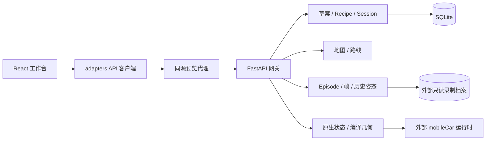

# 当前整体代码导览

更新：2026-10-27（America/Los_Angeles）。本文说明已恢复的平台源码、调用关系和外部依赖，不替代 Specification 或产品验收。

## 源码基线

此前本地仓库仅保存早期 FastAPI 网关和静态接入/草案页面。服务器交付版本的 React 工作台及后续网关逻辑没有同步到本地，因此前一次 push 未包含这部分源码。

本次从服务器只读恢复以下配套版本：

| 部分 | 发布标识 | 恢复范围 |
|---|---|---|
| 前端 | `m1-front-geometry-20261026T092830Z-2d2c53330b76` | `frontend/`，99 个文件，其中 `src/` 34 个文件；包含依赖锁、测试、工具及冻结模型样本 |
| 网关 | `m1x-20261026T065320Z-platform` | `backend/`，68 个源码、测试、工具和公共配置文件 |
| 配套规范 | 网关发布内的 `docs/specs/` | 同步 22 个有变化的文件，补回 S18～S22 五个来源文件 |

恢复时，服务器预览台账中的 `m19d-deliver` 指向上述前端，预览上游为配套运行网关。该观察用于确认源码来源，不保证服务将来始终运行，也不构成执行资格。

99 个前端文件逐项匹配原发布清单的 SHA-256 和大小；原清单另含 10 个 Python 字节码缓存，本次有意排除。网关恢复文件单独记录摘要。见 [原前端发布清单](evidence/source-recovery/2026-10-27/frontend-release-manifest.json) 和 [恢复源码清单](evidence/source-recovery/2026-10-27/restored-source-manifest.json)。前端 README 和 `docs/backend-gaps.md` 保留原发布内容，其中旧端口、旧候选和开发阶段说明是历史记录，不可直接作为当前部署状态。

## 前端入口与功能

| 文件或目录 | 职责 |
|---|---|
| [`frontend/src/main.tsx`](../frontend/src/main.tsx) | React 挂载入口与全局样式 |
| [`frontend/src/app/App.tsx`](../frontend/src/app/App.tsx) | 组装工作台、场景设置、历史视图及服务 |
| [`frontend/src/app/`](../frontend/src/app/) | 上下文、界面状态和应用状态 |
| [`frontend/src/workbench/`](../frontend/src/workbench/) | Dockview 布局、对象/属性面板、Session 抽屉、历史浏览和帧关联 |
| [`frontend/src/viewport/`](../frontend/src/viewport/) | Three.js SceneView、模型装配、相机、Joint/TCP 本地目标、运动学和历史参考模型 |
| [`frontend/src/map/`](../frontend/src/map/) | 地图读取、Waypoint 编辑与路线工作区 |
| [`frontend/src/adapters/`](../frontend/src/adapters/) | 实时/冻结来源、配置、地图路线、历史 Episode、帧与历史姿态 API 客户端 |
| [`frontend/public/sample/`](../frontend/public/sample/) | 显式冻结来源的 JSON、23 个 STL 和离线地图样本 |
| [`frontend/tools/`](../frontend/tools/) / [`frontend/tests/`](../frontend/tests/) | 源码打包、同源预览代理、预览台账和单元/浏览器验证 |

这是独立的 React 19 / TypeScript / Three.js / Dockview 应用，由 Vite 构建。`backend/src/unirobot/static/` 仍保留早期任务目录与接入核对工具页；它不是完整工作台的入口。

## 后端入口与功能

| 文件或目录 | 职责 |
|---|---|
| [`backend/src/unirobot/__main__.py`](../backend/src/unirobot/__main__.py) | 启动 FastAPI 网关 |
| [`api.py`](../backend/src/unirobot/api.py) | 组装服务与暴露 HTTP / WebSocket 接口 |
| [`catalog.py`](../backend/src/unirobot/catalog.py)、[`contracts.py`](../backend/src/unirobot/contracts.py) | 任务目录、机器人描述和公共请求/响应模型 |
| [`runtime.py`](../backend/src/unirobot/runtime.py)、[`adapters.py`](../backend/src/unirobot/adapters.py) | 早期运行登记、探活和受门控的原生进程适配 |
| [`mobilecar.py`](../backend/src/unirobot/mobilecar.py)、[`mobilecar_read.py`](../backend/src/unirobot/mobilecar_read.py)、[`mobilecar_geometry.py`](../backend/src/unirobot/mobilecar_geometry.py) | 接入核对、只读状态和编译几何资源读取 |
| [`drafts.py`](../backend/src/unirobot/drafts.py)、[`recipe.py`](../backend/src/unirobot/recipe.py)、[`prepare.py`](../backend/src/unirobot/prepare.py) | 持久草案、固定执行依赖、验证快照、Session 准备及生命周期协议 |
| [`maps.py`](../backend/src/unirobot/maps.py)、[`routes.py`](../backend/src/unirobot/routes.py) | 地图版本、路线草案与发布 |
| [`episodes.py`](../backend/src/unirobot/episodes.py)、[`frames.py`](../backend/src/unirobot/frames.py) | 历史 Episode、流分页、资产与帧关联 |
| [`history_pose.py`](../backend/src/unirobot/history_pose.py)、[`history_fk.py`](../backend/src/unirobot/history_fk.py) | 历史状态身份核验、模型参考和可验证关节的 FK |
| [`backend/config/`](../backend/config/)、[`backend/tools/`](../backend/tools/)、[`backend/tests/`](../backend/tests/) | 公共版本配置、候选启动/检查工具和测试 |

代理允许的请求以 `frontend/tools/serve-readonly.py` 白名单为准；代码中存在协议处理，不表示当前 native 已满足其身份、权限或执行前置条件。

## 运行与验证边界

按已有执行政策，依赖安装、构建、测试和浏览器验证在授权服务器执行；本地用于源码编辑、清单核对和传输。前端命令见 [`frontend/package.json`](../frontend/package.json) 和 [`frontend/README.md`](../frontend/README.md)。完整候选网关所需参数见 [`backend/tools/launch_unified_gateway.py`](../backend/tools/launch_unified_gateway.py)。

本次在服务器新建隔离副本验证，未修改交付预览目录、未启动 native 服务或执行浏览器操作。前端构建（含 TypeScript 检查）通过，11 个测试文件共 142 项单元测试通过。后端 179 项通过，3 项因隔离目录不包含相邻原生工程、原生报告和迁移来源文件而失败，未修改测试或伪造依赖使其通过。所有 167 个恢复的前后端文件均与受测副本逐项匹配，详见 [服务器验证摘要](evidence/source-recovery/2026-10-27/server-verification.json)。

实时部署还需要匹配的 native 服务、编译几何 bundle、地图包和历史录制目录。它们通过参数或环境变量提供；源码中的地图目录声明、历史来源声明不包含实际地图包或录制数据。没有复制服务器虚拟环境、`node_modules`、构建输出、数据库、原始 Episode 或私人连接配置。冻结前端样本随源码保留，但其旧坐标模型只用于显式样本展示，不冒充实时正确装配。

`mobileCar`、`bimanual_proj`、`mujoco_learning` 仍为独立工程；本仓库恢复的是平台前后端整体逻辑，并未把原生控制器或 MuJoCo 仿真工程合并进来。真实运动、录制、同步回放以及正式 M1 闭环是否满足要求，仍需相应阶段的验证。
