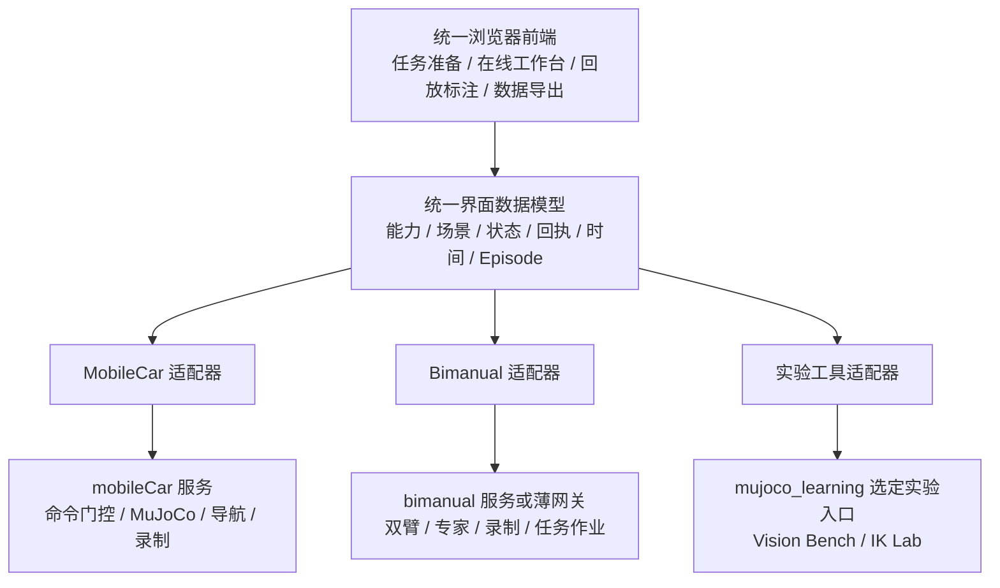

# 统一机器人科研工作台：现有能力与前端需求分析 V0.2

日期：2026-10-20。状态：**需求分析与设计建议，尚未冻结为实现规格。**

本轮静态阅读三个本地项目、已有需求和用户附件，并核对相关项目的官方仓库与文档。没有连接运行服务、运行测试、仿真、训练或部署；文中历史验收结果来自项目报告，不代表本轮复验。README、早期接口文档与后续源码有差异时，分别描述对应版本，不把多个版本的能力自动合并为一个已部署产品。

用户已确认：**允许浏览器使用本机资源绘制三维视图；仿真、感知和规划继续在服务器执行。**

## 1. 直接结论

当前适合先规划统一前端并制作可操作原型。其目标应是一个由任务配置驱动的科研操作工作台，而不是把三个项目的按钮集中到一个页面。

现有开发应通过适配层接入：`mobileCar` 优先提供移动机器人运行、命令、观测和录制能力；`bimanual_proj` 提供双臂仿真、专家、回放与数据能力；`mujoco_learning` 提供视觉测试和 IK 实验工具、算法参考及必要的独立实验入口。暂不搬迁整个目录、统一 Python 环境或改写全部后端。

“前端先行”意味着先完成用户流程、布局、交互状态、能力展示和数据契约草案。可用明确标记的模拟数据与历史记录验证交互，再接一个真实最小闭环；不能把前端原型验收等同于机器人任务验收。

## 2. 三个项目实际能提供什么

### 2.1 能力与限制

| 项目 | 本轮找到的能力与证据 | 对统一前端的支撑 | 不应推断为已完成的能力 |
|---|---|---|---|
| mobileCar | 浏览器 Three.js 整车视图、TCP 目标拖动与 Ghost 预览、键盘驾驶、关节/夹爪、命令回执、控制租约、原生多频 Episode、只读回放；G3B 有限场景 SLAM/Nav2 验收；G4A-1 固定底盘近场接口；G4A-2 真人采集工具与界面修复 | 首个在线控制接入对象；命令、权限、录制和数据质量语义的主要参考 | Nav2 到点不等于语言导航；固定底盘抓取不等于连续导航抓取已交接验收；真人工具就绪不等于真人示范已采完；开发出口不等于训练资格成立 |
| bimanual_proj | 双 SO101 动态仿真、12 维动作、真实接触抓放、分类与台面中转、阶段/共享区 lease/事件、专家与物理回放、LeRobot 通路；后续有三相机配置、ACT 接入、WebGL 多视角回放、数据与模型工作台代码 | 双臂 Profile、专家状态、事件时间轴、回放曲线、数据集与任务作业展示 | 台面中转不等于空中手递手；未找到可核验的实体双主臂接入闭环；ACT 接入与训练完成不等于完整任务成功；WB-5 软件交付准备不等于 WB-6 实际部署与真实任务验证 |
| mujoco_learning | LanderPi 估计/建图/导航/视觉抓取实验；vision_bench 的 far/large3d/near/follow、RGB-D 与估计/真值诊断、关节实时目标；ik_lab 有 Viser 目标手柄、求解与目标流代码 | 单功能实验入口、TCP 交互经验、传感器与坐标语义、算法结果与异常样例 | 历史 P12/P13D 尚有未验收检查点；vision_bench 各测试不构成完整移动任务链；图像预览与客户端 WebGL 是不同显示路径；不能把所有实验分支视为一个统一服务 |

### 2.2 本地证据入口

移动机器人：

- [项目现状](C:/Users/Administrator/Desktop/embodied_intelligence_proj/mobileCar/README.md)
- [运行时 API](C:/Users/Administrator/Desktop/embodied_intelligence_proj/mobileCar/docs/runtime_api_v1.md)
- [命令、控制权、数据与时钟契约](C:/Users/Administrator/Desktop/embodied_intelligence_proj/mobileCar/docs/interface_contract_v1.md)
- [Three.js 视图与目标拖动](C:/Users/Administrator/Desktop/embodied_intelligence_proj/mobileCar/src/mobilecar/ui/web/scene-view.js)
- [近场观测和动作合同](C:/Users/Administrator/Desktop/embodied_intelligence_proj/mobileCar/docs/g4a1_interface_v1.md)
- [真人采集合同](C:/Users/Administrator/Desktop/embodied_intelligence_proj/mobileCar/docs/g4a2_interface_v1.md)
- [操作者控制台 v2 分析](C:/Users/Administrator/Desktop/embodied_intelligence_proj/mobileCar/docs/goals/G4A2_operator_console_v2_ui_validation_20261018.md)
- [驾驶链路故障与修复](C:/Users/Administrator/Desktop/embodied_intelligence_proj/mobileCar/docs/drive_path_diagnosis.md)
- [2026-10-19 页面部署与访问历史证据](C:/Users/Administrator/Desktop/embodied_intelligence_proj/mobileCar/docs/evidence/g4a2_live_deploy_acceptance_20261019.json)

双臂：

- [项目现状](C:/Users/Administrator/Desktop/embodied_intelligence_proj/bimanual_proj/README.md)
- [接口约定：含早期状态及后续 P3 扩展](C:/Users/Administrator/Desktop/embodied_intelligence_proj/bimanual_proj/docs/interfaces.md)
- [三相机 50Hz 独立配置](C:/Users/Administrator/Desktop/embodied_intelligence_proj/bimanual_proj/configs/profiles/collection_50hz_three_camera.yaml)
- [多视图、曲线与三维回放使用记录](C:/Users/Administrator/Desktop/embodied_intelligence_proj/bimanual_proj/docs/interactive_act_playground_usage.md)
- [数据/模型工作台页面](C:/Users/Administrator/Desktop/embodied_intelligence_proj/bimanual_proj/src/bimanual/ui/console/assets/index.html)
- [WB-5 审阅与 WB-6 后继计划](C:/Users/Administrator/Desktop/embodied_intelligence_proj/bimanual_proj/docs/experiment_workbench_v1/wb5_review_and_wb6_r0_plan_20261018.md)
- [唯一物理步进环境](C:/Users/Administrator/Desktop/embodied_intelligence_proj/bimanual_proj/src/bimanual/sim/environment.py)
- [已有阶段和轨迹录制](C:/Users/Administrator/Desktop/embodied_intelligence_proj/bimanual_proj/src/bimanual/recording/episode.py)

实验工具：

- [视觉工作台 UI 重构](C:/Users/Administrator/Desktop/embodied_intelligence_proj/mujoco_learning/docs/landerpi_vision_bench_ui_redesign.md)
- [单场景三维方案分析](C:/Users/Administrator/Desktop/embodied_intelligence_proj/mujoco_learning/docs/landerpi_vision_bench_single_scene_3d_analysis_20261019.md)
- [视觉工作台已知问题](C:/Users/Administrator/Desktop/embodied_intelligence_proj/mujoco_learning/docs/vision_bench_20261019_problem_summary.md)
- [已有 Bench Profile](C:/Users/Administrator/Desktop/embodied_intelligence_proj/mujoco_learning/robots/landerpi/vision_bench/profiles.py)
- [IK Lab 三维界面](C:/Users/Administrator/Desktop/embodied_intelligence_proj/mujoco_learning/robots/landerpi/ik_lab/ui.py)
- [IK Lab 运行与目标流](C:/Users/Administrator/Desktop/embodied_intelligence_proj/mujoco_learning/robots/landerpi/ik_lab/runner.py)
- [历史估计导航与移动抓取状态](C:/Users/Administrator/Desktop/embodied_intelligence_proj/mujoco_learning/docs/project_status_2026-10-02.md)

重要版本区别：双臂早期默认是中央相机、20Hz，另有三相机、50Hz 配置。移动机器人近场示教为特定 5Hz 协议。统一前端必须显示当前实际 Profile，不能以相机最多、频率最高的配置替代所有历史记录。

## 3. 对新增需求的修正

Task Profile、Control Ownership、Task Phase、Annotation 四个对象都应保留。但 Profile 不宜成为无所不包的大配置，建议组合六类描述：

| 描述 | 决定什么 | 权威来源 |
|---|---|---|
| Robot Capabilities | 关节、限位、TCP、传感器、可控制部件和已支持操作 | 后端实际模型与能力发布 |
| Task Profile | 任务目标、可用控制器、语义阶段、任务结果判据引用 | 任务定义及其版本 |
| Observation / Action Profile | 操作者可见信息、策略输入、动作维度/单位/频率和参考系 | 采集/控制协议 |
| Workspace Preset | 默认打开什么面板、大小、布局和工具 | 前端预设 |
| Annotation Schema | 全局/局部阶段、事件、结果、来源与修订规则 | 版本化标注定义 |
| Export Profile | 哪些观测、动作、片段与标签可转成哪种训练数据 | 导出与资格验证服务 |

配置关系应是“LanderPi + 导航子任务 + 导航观测/动作 + 导航布局”，而不只是一个 `robot_type=landerpi` 分支。固定底盘抓取、感知诊断和将来的联合任务应有不同任务配置。SO101 分类、台面中转、主臂示教和策略评估同理。

面板隐藏不等于不采集；面板打开也不等于该信息允许进入训练。布局配置不能修改采样、控制权、物理状态或数据资格。

### 3.1 用户自由调整布局的边界

调试模式下允许在能力范围内添加、隐藏、移动和保存面板。正式采集只能在协议允许的面板集合内调整。

现有 G4A-2 受限视图排除第三人称场景、物体真值和 Oracle 接触。统一前端不能先下载完整真值再用 CSS 隐藏。服务端应提供过滤后的视图载荷。若用户需要第三人称辅助示教，应建立新的观测协议，记录操作者实际看到的信息；策略将来可以只用其中部分输入，但这种示教不能继续冒充旧受限协议。

用户调整完布局后，阶段变化只提示推荐布局，默认不强制重排。自动切换应可关闭；拖动、输入、驾驶期间不移动控制面板。保存“个人布局”与“任务默认布局”两个层次，并提供恢复默认。

### 3.2 控制源、设备与示教角色

分开记录以下事实：

- 控制者类别：Human / Classical Controller / Learned Policy，并保留现有 agent_ui、test_injection 等真实来源。
- 输入设备：键盘、鼠标、主臂。
- 会话用途：从头人工演示、算法运行中的人工干预、纯专家运行、策略评估。
- 辅助生成器：人直接输入，或人工意图经 IK/规划辅助展开。
- 是否使用特权信息：例如已知场景物体坐标、仿真接触或任务真值。

“人点了一次目标”不能使后续所有算法生成帧自动成为无辅助的人类直接动作。演示与干预也不能只靠“当前 source=human”区分，必须保留接管前后上下文与用途。

## 4. 已有开发怎样结合

建议先建立产品和接口层的统一，保留各项目的独立执行环境与原始数据。



这里的“适配器”可以先是前端独立模块；双臂在线控制或某些实验接口不足时，再补窄范围服务网关。该图不是新增三个执行服务的实现要求，也不要求先建设通用插件平台。

### 4.1 适配职责

| 统一前端需要 | 优先复用 | 仍需补充 |
|---|---|---|
| 读取能力、场景、模型身份 | mobileCar 的 capabilities / scene / assets | 双臂与实验工具的等价映射，区分只读/可执行能力 |
| 在线状态与传感器 | mobileCar snapshot、RGB-D；双臂 observation；Bench 快照 | 流身份、新鲜度、参考系、无数据/失效状态的统一表达 |
| 控制请求与结果 | mobileCar commands / lease / receipt | 双臂受控在线命令边界；不能从浏览器直接调用 env.step |
| 三维视图 | mobileCar Three.js SceneManifest；双臂导出几何与真实位姿；IK Lab 显示经验 | 一套选择、工具、目标/实际/预览与坐标转换接口 |
| 专家/策略作业 | 双臂任务、专家和工作台作业服务；小车导航 supervisor | 各控制器状态、取消、权限与结果的 UI 映射 |
| 回放 | mobileCar 只读数据；双臂四视图、曲线和位姿回放 | 统一播放器接口和多频时间选择，保留原始时间 |
| 导出 | 两项目已有官方 LeRobot 适配通路 | 版本、采样、单位、标签和资格的显式转换说明 |

不要把“双臂台面共享区 lease”和“操作者对机械臂的控制 lease”混成同一个权限。前者管理空间资源，后者管理执行器。前端可以同时展示，后端分别判断。

### 4.2 数据与动作不能直接拼接

mobileCar 的近场动作是五个 rad 关节目标加米制夹爪开口；双臂公开动作是左六维再右六维，每臂五个 degree 关节目标加百分比夹爪。二者不能用一个没有单位信息的 `joint_values` 数组直接互换。

三维内部可采用统一米制坐标、明确旋转约定；用户界面可显示度和毫米。适配层负责有来源的单位/参考系转换，保存原始量及映射版本。百分比夹爪到米制开口还依赖机器人标定，不能全平台套一个线性比例。

模型、关节顺序、相机安装和标定都绑定版本。尤其 mobileCar 当前相机位于 link4，joint5 改变夹爪姿态；实验分支的安装候选不能覆盖该事实。三维显示应来自当前编译模型或经过校验的导出物，不另用一份未经核对的旧 URDF。

每个活动仿真会话只有一个物理推进者。前端换 Profile 只改变视图时不新建实例；换机器人/场景需要明确释放旧控制和处理当前录制。首版建议只连接一个活动控制会话，多视角不启动多个 MuJoCo 世界。

## 5. 前端应如何组织

建议四个主工作区，共用一套外壳，避免为每个算法建立独立页面。

| 工作区 | 用户目的 | 主要内容 |
|---|---|---|
| 任务准备 | 决定做哪个实验，确认可以开始 | 机器人、场景、子任务、输入来源、观测/动作协议、准备检查 |
| 在线工作台 | 观察、操作、接管和录制 | 三维/地图/相机、对象树、工具、控制权、阶段、录制、关键事件 |
| 回放与标注 | 检查一条 Episode，修订语义 | 同步回放、阶段与来源轨道、事件、曲线、片段选择、标注修订 |
| 数据与导出 | 搜索、筛选和产出训练视图 | Episode 列表、完整性/结果/资格、导出配置、字段预览、作业结果 |

训练、模型注册和批量实验作为后续工作区接入；第一版可保留已有双臂模型工具链接，不为完整训练控制台延迟核心交互验证。

### 5.1 在线工作台布局

```text
┌──────────────────────────────────────────────────────────────────────────┐
│ 机器人 / 任务 / 场景   在线或回放   控制权摘要   录制状态   停止运动          │
├──────────────┬───────────────────────────────────┬───────────────────────┤
│ 任务与对象    │ 主视口：3D / 地图                  │ 操作与属性             │
│ 当前任务阶段  │ 观察 / 选中 / 关节 / TCP 工具       │ 选中对象、坐标系、限位  │
│ 机器人部件    │ 实际机器人、目标、Ghost、路径       │ 目标 / 受理 / 实际     │
│ 传感器与图层  ├───────────────────────────────────┤ 输入来源、控制权限      │
│ 可折叠        │ RGB / Depth / 左右腕相机等观测      │ 当前不可操作原因        │
├──────────────┴───────────────────────────────────┴───────────────────────┤
│ 时间与事件：全局阶段 / 部件阶段 / 控制来源 / 接管 / 接触 / 录制边界           │
└──────────────────────────────────────────────────────────────────────────┘
```

这只是信息层级草图，不是已确认像素布局。首版默认布局应能直接使用，允许调整分栏、隐藏辅助面板、放大当前相机；自由拖放是增强项。小高度屏幕保持主视口和停止入口可见，右栏内部滚动，不把关键控制放在整页底部。

顶部常驻连接、数据新鲜度摘要、当前机器人/任务/观测协议、控制权、录制和停止。技术身份、完整日志和原始 JSON 放详情抽屉；中文说明优先，单位明确，字号可调，状态不只用颜色表达。

### 5.2 三套任务布局预设

| 预设 | 主视图 | 辅助观测 | 控制与算法 |
|---|---|---|---|
| LanderPi 导航 | 地图与路线，可切三维 | RGB、LiDAR、定位/里程计健康 | 键盘底盘、地图设点、导航状态、底盘/臂权限摘要 |
| LanderPi 近场 | 调试时三维与 RGB-D；受限采集时仅允许观测 | Depth、有效掩码、可用时点云、TCP/关节 | 关节/TCP/夹爪、位置与姿态残差、规划/执行检查、底盘停止门 |
| SO101 操作 | 双臂三维与中央相机 | 左腕/右腕可放大；按实际配置显示缺失相机 | 活动臂、两臂状态、夹爪、主臂连接占位、专家阶段、共享区状态 |

点云、目标识别、可达性、碰撞与接触分别显示数据来源和有效状态。不把“有 Depth”当作已有通用融合点云，也不把“IK 找到解”当作整条路径安全或抓取成功。

### 5.3 必须先设计的交互

1. **观察相机**：旋转、平移、缩放只改变观察视角，不移动机器人或机器人相机。
2. **选择关节**：点击连杆识别关节后显示旋转轴与限位；滑条、数值框和三维旋转工具联动。首个闭环可先用 TCP 与滑条，直接关节旋转随后验证。
3. **拖 TCP**：显示目标参考系、位置/姿态残差和 Ghost。位置优先与严格姿态是不同求解要求；五关节机构不承诺任意 6D 目标。
4. **执行模式**：预览确认模式下拖动不下发执行，Esc 取消预览；显式启用实时控制后按批准频率发送目标。实时模式的 Esc/取消停止后续目标流并执行后端保持，不能撤销已经发生的物理运动。
5. **输入冲突**：拖手柄时关闭观察旋转；输入数值时驾驶快捷键不生效；W/S 前后、A/D 平移、Q/E 转向仅在驾驶已启用且对应区域持有输入焦点时生效。
6. **失焦/断连**：驾驶立即停止新速度请求，目标流按协议取消或保持，由服务器 watchdog 兜底；重连只恢复显示，不自动续用旧控制权或旧轨迹。
7. **控制移交**：明确选择接管哪个部件；后端确认旧动作取消/保持及新权限后才显示“已接管”。双臂每臂关节与夹爪首版宜作为一个控制组；同时控制两臂要显式取得对应权限。
8. **停止与保存**：“停止运动/保持”“结束并保存 Episode”“取消轨迹”“暂停仿真”“Reset”分别定义，不能都调用同一个 Stop。保存确认来自 Recorder，不以按钮点击代表完成。

实时滑条正常松手提交最终合法目标，按当前有效权限允许到位；失焦、显式取消和模式退出另行处理。底盘松键为零速度。这两类松手语义不能简单统一。

底盘与机械臂在数据模型中可以分别拥有控制权，但首版不因此开放任意并行运动。沿用已有近场门控：导航授权活动时不授予互斥近场权限，近场权限活动时拒绝非零底盘命令；只有已验证的动作包络和互锁协议才开放并行。

### 5.4 前端需要六个独立状态维度

| 状态维度 | 示例 | 禁止混淆 |
|---|---|---|
| Session | 连接中、就绪、失联 | 连接成功不等于可以运动 |
| Simulation | 运行、暂停、重置 | 暂停不等于已经停稳 |
| Task | 准备、执行、完成、失败 | 任务阶段不是生命周期 |
| Ownership | 空闲、申请、已持有、撤销 | 点击接管不等于拥有权限 |
| Recording | 启动、录制、收尾、完成、失败 | 停止运动不等于结束录制 |
| Workspace | 调试、正式采集、回放 | 回放中的播放不能驱动真实机器人 |

另外，按钮旁显示它的执行条件和拒绝原因，例如“未录制”“停止已锁存”“近场权限占用”“图像已过期”。已有驾驶故障说明，短暂通知不能替代持续可见的原因。

## 6. 数据和标注如何约束前端

本阶段不冻结具体阶段标签，但应冻结相互独立的维度和身份引用。

| 层次 | 建议最小内容 |
|---|---|
| Episode | 机器人/任务/Profile/模型/标定版本、指令、初态引用、采集目的、开始结束、原始数据引用 |
| Semantic Segment | 起止时刻、scope=global/base/left_arm/right_arm、阶段、标签定义版本、证据、标注者、候选/确认状态与修订号 |
| Step / Event | 观测采样与实际呈现引用、请求/批准/下发/反馈、来源、控制部件、权限、接管/接触/拒绝等事件 |
| Assessment | 记录完整性、物理任务结果、人工结果、各 Export Profile 的资格与原因 |

阶段轨道与控制来源轨道分开。例如同一个“接近”阶段可以从专家转为人工再转回专家；接管本身不用强制切出一个新语义阶段。双臂可同时处于不同局部阶段，与全局任务阶段并存。

这里的语义 Segment 不等于 mobileCar 已有 `recording_segment_id`。前者是标注区间，后者表示连续录制边界；同一录制片段可包含多个语义区间。建议在字段命名中明确 `annotation_segment_id`。

回放编辑采取候选边界、人工调整、确认保存和修订历史。原始观测、动作和事件不改写；标注另存版本。相同 scope/标签层内可用半开区间 `[start,end)`，跨 scope 允许重叠；未知和间断显式保留，不强行补齐一套看似完整的阶段。

“完整原始数据”应指当前协议约定的原生采样流、动作链和必要元信息，包含丢失/失效记录；不是无上限记录模拟器所有内部量。真值/Oracle 走独立诊断或评分路径，不因记录完整就进入策略观测。

### 6.1 VLN 与 VLA 的任务边界

首版把导航子任务与固定底盘操作子任务分别采集、展示和验证。将来用一次 Task Run 或父任务身份关联二者，并保存停车、地图/定位身份、控制权交接、相机/本体观测就绪和恢复事件。

连续运行时可在同一原始记录中切语义片段；如果中间停止/重开录制或 Reset，就保留新的片段/Episode 身份与关联，不能在前端拼成无间断轨迹。跨边界的联合导出应单独验证。

地图点击目标或 Nav2 到点轨迹，不自动成为 VLN 数据；语言导航还需要指令、语义目标/决策与评估定义。类似地，视觉抓取轨迹并不自动证明已具备 VLA 训练所需的语言监督和泛化覆盖。

### 6.2 时间轴与导出

界面有统一回放游标，但保留传感器各自的采样时间、到达时间、clock_id 和有效性。查询某个时刻时按明确规则选择样本；不把浏览器插值动画变成新观测，不用未来图像填补动作决策所见内容。

原始数据、操作者可见数据、模型观测和训练导出视图是四个相关但不同的集合。模型观测应与目标部署接口一致，不能因为研究者看得见某项诊断就进入训练。

导出前展示：目标版本与格式、Episode/片段选择、相机键、动作顺序/单位、频率、对齐策略、标签修订版本、划分策略和资格报告。历史双臂与小车锁定的 LeRobot 包版本不同，不能仅因都叫 LeRobot 就直接合并；官方当前数据格式说明也不能替代已安装版本验证。[官方数据格式说明](https://huggingface.co/docs/lerobot/lerobot-dataset-v3)

界面分别展示“数据完整”“任务成功/失败/未知”“对某训练用途合格/不合格/未评估”。失败轨迹可以完整保存，也可能对某些用途有价值；筛选规则由 Export Profile 决定。

## 7. 可以借鉴哪些 GitHub 项目

附件明确提到 URDF Viewer、RViz、Rerun、Blender/Unity 体验，但没有完整逐项 GitHub 清单。以下结合本地已有引用与本轮官方核对给出候选，不声称它们全部是用户此前选定的项目。

| 项目 | 已核对的相关能力 | 本平台建议用法 | 边界 |
|---|---|---|---|
| [gkjohnson/urdf-loaders](https://github.com/gkjohnson/urdf-loaders) | Three.js URDF 加载、Web Component 示例、关节值更新 | 借鉴机器人层级、关节选择和加载体验；必要时用于经过模型校验的资源加载 | 加载与显示关节不提供完整 IK、路径检查和真实物理执行；已能从 MuJoCo 导出场景时不强制再走 URDF |
| [viser-project/viser](https://github.com/viser-project/viser) | Python 驱动的浏览器三维、选择、Transform Gizmo、GUI；客户端使用 React/Three.js | 独立实验快速原型；参考现有 IK Lab 的交互 | 现有 LabUI 耦合控制/键盘桥，不能整体搬作统一控制器；嵌入后焦点、权限和生命周期仍需接线 |
| [rerun-io/rerun](https://github.com/rerun-io/rerun) | 多模态时间数据、可配置 Blueprint、图像/三维/曲线与时间导航 | 借鉴同步回放、事件轨道和任务布局；可做外部只读分析出口 | 不替代本平台控制权与命令执行层；是否嵌入后续单独验证。[Blueprint 文档](https://rerun.io/docs/concepts/visualization/blueprints) |
| [ros2/rviz](https://github.com/ros2/rviz) | ROS 三维可视化工具 | 借鉴 TF、地图、点云、图层和目标工具；保留已有 ROS 调试入口 | 桌面工具，不能把完整 UI 直接作为网页组件；浏览器设点接入现有导航需补服务接口 |
| [dockview/dockview](https://github.com/dockview/dockview) | 可停靠标签/分栏、布局序列化、多框架绑定 | 新增的优先前端组件候选，服务任务预设与个人布局 | 默认布局先可用；仓库基础包为 MIT，enterprise 包商业授权，不把付费扩展混入默认方案 |
| [huggingface/leLab](https://github.com/huggingface/leLab) | 官方 LeRobot 图形界面：遥操作、Episode 录制、相机逐帧浏览与关节曲线、训练/推理入口 | 新增的重点产品参考，借鉴准备→示教→检查数据的流程和主从臂配置 | 官方指南当前限定 SO-ARM101；不据此推断支持本项目 MuJoCo 双臂或移动任务。[官方指南](https://huggingface.co/docs/lerobot/lelab) |
| [kevinzakka/mink](https://github.com/kevinzakka/mink) | MuJoCo 微分 IK、任务与限位/速度/碰撞约束、双臂和移动操作示例 | 借鉴 TCP 约束、误差与求解状态展示；作为后端算法候选 | 算法库，不是统一前端框架；本轮不升级现有 MuJoCo 环境 |
| [zalo/mujoco_wasm](https://github.com/zalo/mujoco_wasm) | 当前说明使用官方 MuJoCo WASM 绑定在浏览器运行模型，项目已转为示例集合 | 参考模型展示和独立 Demo | 当前产品继续使用服务器权威物理，不据此在正式前端另跑一套仿真 |
| [foxglove/studio](https://github.com/foxglove/studio) | 仓库定位为机器人可视化与调试；该仓库已于 2024-07-18 归档 | 多面板、图层与状态反馈的交互参考 | 不把归档仓库或当前商业产品当成持续维护的通用开源底座 |

Three.js 的 [TransformControls 官方文档](https://threejs.org/docs/pages/TransformControls.html)明确提供类似 Blender 的对象变换交互、平移/旋转和 world/local 参考系。它适合操作“目标标记”；如何把目标转为安全的机器人控制仍由本平台和后端负责。

优先阅读：已有 mobileCar 视图与双臂回放 → Dockview 布局 → URDF Loader/Three.js 交互 → Rerun 时间语义 → LeLab 采集流程。Viser 与 Mink 用于具体实验验证，无需同时将所有库装入主前端。

## 8. 推荐前端技术方向

建议新平台采用 React + TypeScript 组织外壳、面板与状态，Three.js 负责主三维视口，Dockview 作为可停靠布局候选。React Three Fiber 可在原型后评估，不要求为使用它先重写现有 Three.js 场景。

这是针对长期统一产品的工程建议，不是机器人功能已验证的结论。已有 mobileCar 使用原生 JavaScript + Three.js；复用场景资产、协议、计算与交互经验，在组件生命周期外围做封装，避免整页脚本携带全局状态直接导入。双臂 WebGL 回放优先复用几何、真实位姿与回放语义，而不是同时维护两套长期主渲染器。

建议分成：工作台外壳、面板注册、任务配置、三维渲染、命令客户端、时间与回放、数据检查、项目适配八类模块。第一版只做有需要的注册表和类型定义，不实现通用脚本插件系统、任意算法编排画布或大型低代码框架。

HTTP 可继续用于能力、场景、命令和数据索引；现有轮询也可先保留。是否增加 WebSocket/SSE 根据实际状态频率和带宽测量决定，不能仅为技术统一而重做传输。图像/点云按需订阅、缓存和降采样显示；录制频率独立于面板刷新。

前端三维刷新可以比服务器状态发布更快，但平滑动画要与真实测量区分。相机图像由服务器的传感器管线生成，不用浏览器第三人称渲染冒充训练图像。

## 9. 首版前端范围与验收草案

| ID | 优先级 | 需求 | 如何验收 |
|---|---|---|---|
| FE-01 | P0 | 统一外壳与任务选择 | 两类机器人、导航/近场/双臂预设共用外壳；切换后无残留控制目标 |
| FE-02 | P0 | 能力驱动面板 | 缺少相机、点云、主臂或算法时显示未提供与原因，不显示虚构结果 |
| FE-03 | P0 | 三维观察与选择 | 自由观察、标准视角、部件选择；观察相机移动不发送运动命令 |
| FE-04 | P0 | TCP 预览与数值联动 | 手柄、输入框、Ghost 对应同一目标；预览取消不改变实际状态 |
| FE-05 | P0 | 关节/夹爪/底盘操作 | 显示真实限位和单位；目标、批准/下发、实测分开；驾驶输入焦点正确 |
| FE-06 | P0 | 控制权与拒绝反馈 | 每个控制组显示来源；申请/撤销有回执；不可用原因持久可见 |
| FE-07 | P0 | 录制生命周期 | 启动确认、录制、收尾、保存失败可区分；停止运动不隐式结束 Episode |
| FE-08 | P0 | 同步只读回放 | 相机、关节、三维、事件共享游标；播放不调用执行/Reset/物理步进 |
| FE-09 | P0 | 多维时间轨道 | 全局阶段、部件阶段、动作来源、接管事件各自可读，不合并成一个标签 |
| FE-10 | P0 | 调试/采集/回放边界 | 受限采集不获得禁止真值载荷；模拟原型和历史数据明确标识 |
| FE-11 | P1 | 实时 TCP 流和三维关节旋转 | 显式启用；与观察工具互斥；取消、失焦、旧目标和拒绝反馈可验证 |
| FE-12 | P1 | 标注编辑与修订 | 调整片段边界、确认候选、保存新修订，原始记录不变 |
| FE-13 | P1 | 自定义布局持久化 | 可调整、保存、恢复；阶段变化不覆盖用户正在使用的布局 |
| FE-14 | P1 | 数据列表与导出预览 | 完整性、任务结果、指定训练资格分开，显示字段/频率/映射与后端作业状态 |
| FE-15 | P1/接口预留 | 实体主臂 | 前端可表达左右设备、标定/连接、跟随误差；真实硬件桥接另行接入验收 |

P0 可先用模拟服务与真实历史记录验证交互。每个控件有“数据源：模拟/历史/实时”和能力状态；缺失真实后端的动作不能伪装已执行。模拟测试、真实集成和用户任务体验分别记录。

首版不要求：完整 VLN/VLA、通用 Frontier 探索、任意物体识别/抓取、拧螺丝、空中双臂交接、完整训练平台、通用场景建模或全身任意并行控制。可留入口与扩展接口，不以空按钮计入完成。

### 9.1 四条原型验证流程

1. **LanderPi 导航操作**：选导航配置→确认键盘焦点→底盘运动→松键停止→看到目标/回执/实测；插入录制未就绪或停止锁存时能明确定位原因。
2. **LanderPi TCP**：选机械臂→拖目标→看到预览与残差→取消→实际机器人不动；重新预览并明确执行后才运动。
3. **SO101 专家与接管**：选择双臂任务→查看各臂/全局阶段和共享区状态→请求接管活动臂→后端确认→事件留痕；首版可用模拟服务验证状态交互，真实接管另验。
4. **Episode 检查**：打开历史轨迹→同步拖动相机/三维/曲线时间轴→查看接管→修订局部阶段→检查三类结果→预览一个导出用途，原始文件不变。

性能指标先测目标机器、远端链路和典型模型，再确定帧率、拖动反馈与图像年龄门槛。正式采集沿用当前协议已有的新鲜度限制，不用新 UI 的主观“流畅”覆盖后端门控。

## 10. 推进顺序和待收敛事项

建议按可评估的产物推进：

1. **需求收敛**：确认四工作区、三套预设、调试/采集/回放边界及两条最小任务；保留 V0.1 作为原稿。
2. **交互原型**：实现统一外壳、可旋转三维、TCP/关节、控制权与录制状态、历史回放；先验证最关键四条流程。
3. **最小合同**：冻结能力、场景、状态、命令/回执、录制、回放、标注修订的字段和错误样例；不提前冻结全部标签词表。
4. **首个真实接入**：先接 mobileCar 固定场景与 TCP/录制闭环，保持原有后端门控和数据协议。
5. **第二类机器人接入**：先接双臂真实历史回放和专家状态，确认共用模型可表达；再补在线控制网关和受控接管。
6. **数据扩展**：加入离线标注修订与明确版本的导出，然后按真实需要接入主臂、模型作业和导航到操作的交接。

每阶段围绕用户操作验收，不以“又写了一份准备文档”替代可操作原型或真实接入。本轮不启动上述实现阶段。

仍需通过原型讨论的决定：默认面板比例；哪些任务允许实时 TCP；首批正式示教是否允许第三人称辅助；SO101 第一条统一任务是直接分类还是台面中转；主臂输入桥运行在哪台机器；首个 Export Profile 的用途与单位。它们不妨碍先规划公共外壳和制作明确标记的原型。

当前已经可以确定的设计主线是：**一套任务配置驱动的工作台，前端统一交互与信息语义，已有项目保留执行职责，通过小范围适配逐条接入。**
