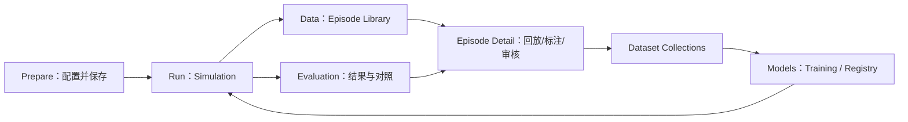

# 全局信息架构与工作区

规范 ID：`FE-SHELL-NAV` · 责任层：前端 · 文档成熟度：基础草案（保留原文逐项状态）

[来源总册 doc-010](../../../设计过程与Specification总册_20261021.md#doc-010) · [上级功能包](README.md) · [总索引](../../README.md)

> 本文件已按主题迁入当前目录；需求确认程度以原文标记为准。文档迁移不表示已实现、已验收或技术栈已冻结。后续在此维护主题正文，总册保留历史。

版本：V0.6（2026-10-22）｜更新日期：2026-10-22（America/Los_Angeles）；原始内容来源保留。

状态：分类与切换语义为方案；业务拆分原则已确认

来源：S04、S05（详见[来源档案](../../90-governance/06-sources.md)）

关联需求：[REQ-PRD-003](../../indexes/05-requirements.md#req-prd-003), [REQ-PRD-004](../../indexes/05-requirements.md#req-prd-004), [REQ-STATE-003](../../indexes/05-requirements.md#req-state-003)

## 组织方案（由下方 V0.2 导航分组细化）

用户已确定按业务阶段分别设计；以下六工作区是助手给出的架构建议，作为本目录的分类方式，不声称用户已逐项确认。

| 工作区 | 主要对象 | 主要动作 | 复用能力 |
|---|---|---|---|
| Scene Setup | Scene Preset、Experiment Config | 加载、布置、检查、保存初态 | 3D、Hierarchy、Gizmo、Inspector |
| Simulation | Runtime Session、Episode | 运行、观察、控制、接管、录制 | 3D、传感器、控制权、事件 |
| Replay & Annotation | Episode、Annotation Revision | 同步回放、分析、标注 | 3D、曲线、时间轴 |
| Dataset Management | Dataset Version | 查询、筛选、检查、导出 | Episode 摘要、回放入口 |
| Model Training | Training Job、Checkpoint | 配置、提交、监控 | 数据版本、日志、资源 |
| Evaluation | Evaluation Run、Result | 复用配置评估、对比结果 | Simulation、Replay、指标 |

## HostApp 内上下文与跨宿主运行边界

V0.6：这里的导航/上下文属于当前 HostApp，视觉/IK 可另用轻量宿主；六工作区是业务职责，四导航组是完整平台的菜单组织，Page/View 是具体呈现。Workspace 不再与导航组或后端状态混用。组件 store 按宿主和 draft 注入；同一草案并发保存、同一运行实体的控制权和物理推进仍由后端统一裁决。当前阶段为 mobileCar 场景→运行→录制→回放，再 bimanual 复用，训练后续。来源：[S16](../../90-governance/sources/S16-mobile-first-spec-repair.md)。

持续显示 Project、Robot、Scene、当前运行 Session、仿真状态、控制来源、录制状态、连接状态。Replay 页还需明确“正在查看的历史 Episode”和“后台在线 Session”不是同一对象。

## 页面切换建议

切换页面不自动停止后端 Session、不结束录制、不转移控制权。离开键盘驾驶入口则立即撤销依赖持续按键的速度命令，后端还应处理命令过期。是否允许录制中进入 Scene Setup 编辑草案、是否在全局显示运行告警待交互设计。

Scene Setup 的草案修改通过显式创建 / 应用配置进入后续运行，不能因为切页就覆盖在线状态。多 Session 支持与并发上限尚未确定，不因本架构使用 Session 对象就默认实现并发实验。

## 关联文档

- [独立状态域与运行模型](../../00-overview/04-runtime-state-domains.md)
- [Scene Setup｜场景布置](../02-scene-setup/01-workflow-initial-state.md)
- [Simulation｜在线仿真工作台](../03-simulation/01-workflow-task-panels.md)
- [Replay & Annotation｜同步回放与标注](../04-replay-annotation/01-synchronized-playback.md)
- [控制权与受控人工接管](../../30-contracts/06-control-authority.md)

[需求追踪矩阵](../../indexes/05-requirements.md) · [Wiki 首页](../../indexes/01-reading-guide.md) · [目录入口](../../README.md)

## V0.2：四组导航与六个逻辑工作区

来源：[S08](../../90-governance/sources/S08-frontend-ia-analysis.md)、[S09](../../90-governance/sources/S09-unified-development-reuse-analysis.md)。以下是当前设计草案，不等于六个同等大小的顶级按钮或已冻结路由。

| 导航组 | 逻辑工作区 / 入口 | 主要流向 |
|---|---|---|
| Prepare | Scene Setup | 模板→场景/初态→检查/保存→Run |
| Run | Simulation | 执行配置、观察、控制、接管、录制→Data |
| Data | Episode Library、Episode Detail、Dataset Collections | 列表→同步回放/标注/审核→集合/划分/版本/导出 |
| Models & Experiments | Training、Model Registry、Evaluation | 数据→训练/权重→Run 推理→结果/回放 |

Data 共享导航与上下文，单 Episode 分析和多 Episode 管理仍有各自主责规范；返回列表保留筛选，历史 Episode 与后台 Session 分开。保存记录后提供“查看本条 Episode”的明确入口，不在跳转时重置运行。

Checkpoint→Simulation 跳转只携带模型/推理/任务引用，经兼容检查和用户显式启动后才执行。训练中的验证视频可预览或链接独立运行，不把在线 3D 控制器嵌入训练页。

页面切换不隐式停止任务/录制或更改控制权；持续驾驶与外力等输入按焦点规则清理。精确 URL、布局与导航词汇由原型收敛。

## V0.3 页面与资源入口收敛

[页面总览](../page-designs/README.md) 将六逻辑工作区展开为页面/详情/标签视图，保持业务职责；Home 为快捷入口，Task Presets/Robot Platform/Scenes 为辅助资源区，Model Zoo 在 Models 下保留唯一主入口。四业务组与辅助入口是本轮统一化建议，尚未冻结菜单或 URL。

[统一规则](04-visual-design-rules.md) 规定不同页面的对象和时钟：完整平台宿主内在线控制在 Simulation，轻宿主可有对应运行视图；评估页对同一 Session 只读监控，所有宿主服从后端控制权；Data 列表/资源/报告不复制全局播放控件。每个页面有原图、采用范围和修正，不把图片所有细节都当成新需求。

## 页面图与设计归属（V0.3）

[PAGE-01 页面设计与修正](../page-designs/01-home.md) · [全部页面图](../page-designs/README.md)。本图仅为功能所在页面的参考，实际可用工具、传感器和写入权限仍按本节点及共享契约。
