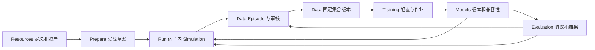

# 页面统一规则与视觉基线

规范 ID：`FE-SHELL-VISUAL` · 责任层：前端共享交互 · 版本：V0.6（2026-10-22）

状态：统一化设计建议。用户已要求每个前端页面必须有图片参考；具体导航、尺寸、配色和路由未因此冻结。

[页面与参考图索引](../page-designs/README.md) · [冲突分析](../../90-governance/08-visual-design-conflicts.md) · [全局 IA](01-navigation-context.md)

## 导航的统一建议

| 层级 | 入口 | 主要对象与边界 |
|---|---|---|
| 快捷入口 | Home | 最近配置、运行、Episode；不承担另一套运行器 |
| 业务组 Prepare | Scene Setup | 当前实验草案、检查与保存 |
| 业务组 Run | Simulation | 完整平台宿主内的在线运动/接管工作台；轻宿主可有对应视图，同一运行实体的权限仍后端裁决 |
| 业务组 Data | Episodes、Dataset Collections | 单条回放/标注与集合/版本/导出分别负责 |
| 业务组 Models & Experiments | Training、Models、Evaluation | 作业、模型版本、协议与结果 |
| 辅助资源区 | Task Presets、Robot Platform、Scenes | 可复用定义和资产；不是新增三个任务执行阶段 |

Training Setup/Training Runs 是同一训练能力的配置与监控视图；Models 的 Catalog/My Models/Registry & Compare 是同一模型域的标签视图；Evaluation 的 Setup/Running/Results/Comparison 是同一评估流程的不同状态。精确 URL 未冻结，可以用嵌套路由或局部视图，但对象身份必须稳定。

## 不同页面的顶部上下文

| 上下文 | 顶部必须识别 | 允许的页面操作 |
|---|---|---|
| 当前 HostApp | Project、连接摘要、所绑定后台运行告警 | 宿主内导航，不隐式启动/停止或转移其他宿主的控制权 |
| Prepare | 草案与引用修订、未保存状态 | 编辑/校验/保存；显式创建或应用 |
| Live | Session、任务、运行/Owner/录制摘要 | 仅本页授权范围内执行；按钮等待回执 |
| Replay | Episode、历史时间、标注修订 | 回放与标签修订，不改变在线状态 |
| Data List/Version | 筛选/集合或固定版本 | 查询、版本与导出，不显示全局播放控件 |
| Job/Report | Job/Run ID、配置快照、实际状态 | 适配器允许的作业操作或只读报告 |

Project、Robot、Task 不用同一个 LanderPi/SO101 名称相互代替。跨页携带稳定引用而非按钮文本或截图数值。后台 Session 摘要可以保留在其他页，但必须与本页对象分开。

## 共享视觉语言

- 采用现有素材的深色工作台方向作为候选，保留一致的导航、间距、表格、Inspector 与图表风格。Logo、品牌名和准确色值未冻结。
- 运行中重点让出给视口、控制权和状态；欢迎横幅、模型宣传图与帮助文字只在首页/资源页按需展示。
- 蓝色用于选择/主要操作、绿色用于已确认成功、橙色用于警告、红色用于故障或停止，是候选语义；必须同时给文字/图标，不能仅依赖颜色。
- Planned、Predicted、Target、Actual 用线型、图例和文字区分，不能只换 Ghost 颜色；无历史记录的数据不事后补造为实际证据。
- 正文/字段保证可读，窄屏将次要区域折为抽屉。先以常见桌面尺寸验证，再定最小宽度、字号及可拖拽面板策略，不把高分辨率概念图全部按比例缩小。
- Loading、Empty、No Results、Disconnected、Stale、Unsupported、Error、Permission Pending 与 Unsaved 是需要设计的状态；未知数值使用未知/未上报，不写 0 或假绿色。

## 工具随上下文启用

| 工具 | Prepare | Live | Replay / 资源预览 |
|---|---|---|---|
| Select / Orbit | 能力范围内可用 | 选择不改变 Owner | 观察及分析选择 |
| Move / Rotate | 允许编辑对象的初态草案 | 授权后的 Joint/TCP/测试工具，含具体语义 | 历史状态只读 |
| Scale / Duplicate / Delete | 仅白名单对象与属性 | 不作为通用物体编辑工具 | 不改原始对象/数据 |
| 播放条 | 初态预览才使用 | 不提供物理倒退；暂停须说明对象 | 只控制本条历史/预览时间 |
| 配置 Edit | 修改新草案 | 活动快照不可原地改写 | 历史报告复制为新草案 |

传感器视图来自 Capability 和 Operator View Profile。SO101 当前为中央/左右腕三路 RGB 与本体；图片中的 Head Depth、点云或主臂画面不构成默认能力。LanderPi 的实际相机/点云/SLAM 也按项目已接入状态提供。

## 页面图的维护规则

每个页面必须有 PAGE ID、主图、覆盖程度、图中不采纳项、功能与后端链接。图片作为设计证据，用户明确规则和主责契约优先；新增/变更页面先更新页面清单与图片映射。当前图片均为带修正的参考，未宣称任何一张已经整体冻结。

需求：[REQ-VIS-001](../../indexes/05-requirements.md#req-vis-001)、[REQ-IA-004](../../indexes/05-requirements.md#req-ia-004)。校验入口：[页面一致性验收](../../40-verification/05-visual-page-consistency.md)。
