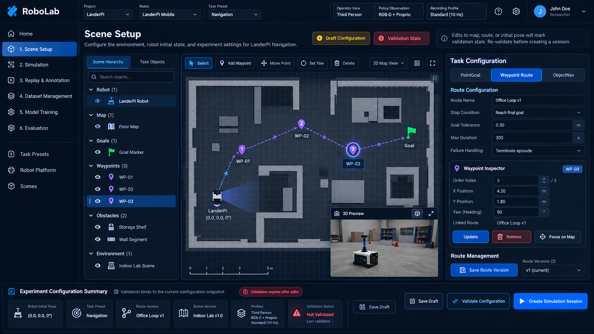
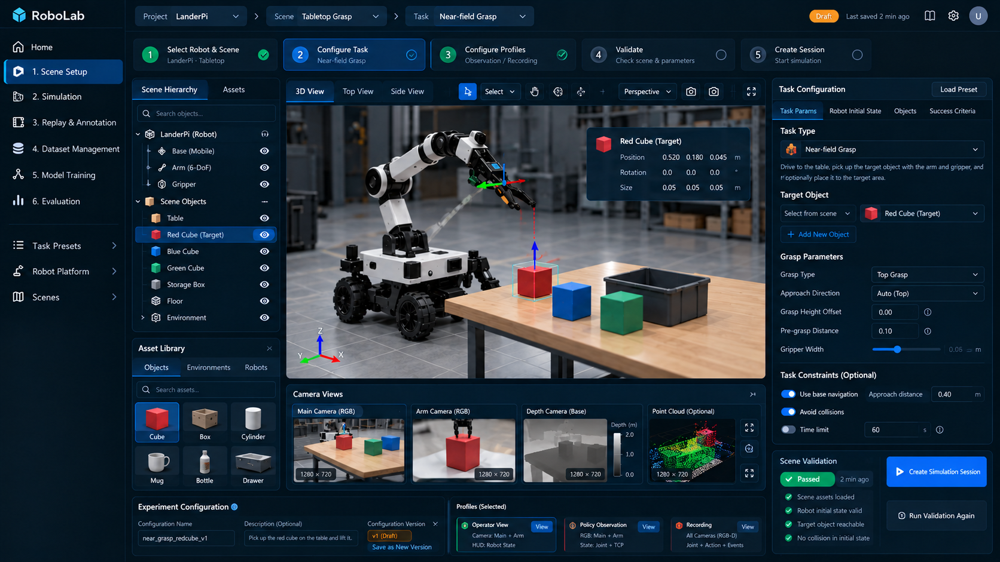
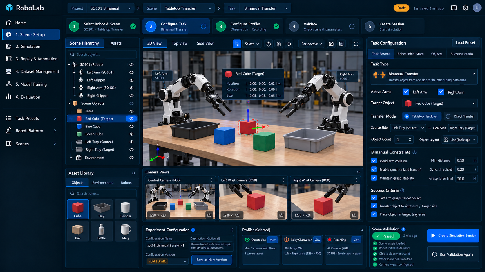

# Scene Setup｜实验配置与场景布置

规范 ID：`PAGE-02` · 责任层：前端页面设计 · 版本：V0.6（2026-10-22）

状态：三图共用页面的详细草案。来源：[S15](../../90-governance/sources/S15-scene-setup-first-loop.md)。图片为 UI Reference，字段与交互由 Specification 主责，不证明现有可运行能力或图中 Passed。

[页面总览](README.md) · [统一页面规则](../01-shell/04-visual-design-rules.md) · [冲突分析](../../90-governance/08-visual-design-conflicts.md)

## 定位与范围

把任务、场景初态和执行/采集规则组合成可校验、可保存的实验配置。

- 页面 ID：`PAGE-02`；导航归属：Prepare。
- 主要对象：SceneVersion、Task Template/Robot 固定版本、ExperimentDraft/ValidatedSnapshot；资源编辑另用 SceneDraft。
- 当前路线：[M1 mobileCar 四步闭环 → M2 bimanual 组件复用](../../00-overview/10-first-task-closed-loop.md)。同宿主内三图复用组件；轻工具可独立宿主，store 按草案注入，训练后续。

## 当前三图 UI Reference

### 导航 / Waypoint（IMG-023）

采用地图主视图、层级/任务对象、Waypoint 选中检查器、独立路线版本与过期提示。PointGoal / Route / ObjectNav 选择驱动字段变化；图中重复 Save Draft 合为一个，Goal Marker 与最后一个 waypoint 的关系由路线契约明确。

### 近场抓取（IMG-024）

采用步骤条、3D/Top/Side 入口、目标对象、抓取字段、Camera Strip 和三 Profile 摘要。移动底盘接近为可选扩展，固定底盘抓取默认不启用导航；6-DoF、点云和图中 Passed 不作为工程事实。

### 双臂台面转运（IMG-025）

采用双臂层级、source/staging/goal 角色、任务模式、三相机列表与双臂检查项。Tabletop 模式表示先放公共区再由另一臂拾取；Direct Transfer 的具体物理语义在图中不明确，暂列后续，不将其自动映射为现有 direct 分类任务。同步阈值、力限制只在适配器支持时开放。

三图共享同一逻辑页面和状态，不创建三个独立工作区。主图已归档为 IMG-023/024/025，均未写入旧 PPT；参考图不要求逐像素照搬，优先实现 [任务字段](../02-scene-setup/02-task-template-configuration.md)、[共享组件](../02-scene-setup/05-shared-scene-components.md) 和 [公共契约](../../30-contracts/07-task-scene-experiment-config.md)。

### 历史参考

历史主参考：`IMG-002`，PPT 第 2 页。旧图保留，不再作为当前三任务字段和布局的唯一依据。

## 区域与功能

| 区域 | 功能与反馈 |
|---|---|
| 顶部上下文/步骤 | Project / Robot / Scene / Task、草案保存状态、五步事实；步骤完成由实际配置/检查派生。 |
| 中央 | 共享 3D 编辑器；双臂可切俯视摆放；导航可切地图/Waypoint。 |
| 右侧 | schema 驱动 Task Params / Robot Initial State / Objects / Success Criteria；对象 Inspector 只开放允许字段。 |
| 底部/抽屉 | 三 Profile 固定版本只读摘要、实验元数据、检查/过期/错误与唯一保存/验证/创建入口。 |

## 关键操作与跳转

- 从模板/场景资源页进入时创建引用版本明确的新草案。
- 通过受限移动/旋转或数值编辑调整初态；保存允许不完整草案，验证必须完整且依赖可用。
- V1 支持创建、编辑和保存 Waypoint，运行页显示路线执行进度。
- “Create Simulation Session”仅提交已验证快照，后端原子核对并返回 `prepared` Session 后进入 Simulation；Start 和录制为后续独立操作。

## 状态、失败与恢复

- dirty/saved 与 unvalidated/validating/passed/failed/stale 分别显示；通过只针对当前执行修订。检查中编辑不被迟到结果覆盖；纯相机视角/元数据不使验证失效。
- 对象非法、地图版本不匹配或能力不足时定位问题并阻止应用，草案可保留。
- 已运行时打开编辑器修改的是新草案，不覆盖活动配置。

## 相对原图的取舍

- Scale/Duplicate/Delete 按对象白名单和上下文启用；机器人本体不提供任意缩放。
- 校验勾选不能恒绿，保存成功也不能替代后端校验。
- 单页底部密集的路线/随机化/校验/启动区改为任务相关工具和抽屉。

关联冲突：[VIS-C03](../../90-governance/08-visual-design-conflicts.md#vis-c03)、[VIS-C04](../../90-governance/08-visual-design-conflicts.md#vis-c04)、[VIS-C06](../../90-governance/08-visual-design-conflicts.md#vis-c06)、[VIS-C10](../../90-governance/08-visual-design-conflicts.md#vis-c10)、[VIS-C22](../../90-governance/08-visual-design-conflicts.md#vis-c22)。

## 主责功能与后端支撑

- [任务模板选择与实验配置流程](../02-scene-setup/02-task-template-configuration.md)
- [SO101 桌面对象的 2D/3D 布置](../02-scene-setup/03-so101-tabletop-layout.md)
- [2D 地图与 Waypoint 路线编辑](../02-scene-setup/04-map-waypoint-editor.md)

后端/契约：[03-scene-builder-assets](../../20-backend/01-session-scene/03-scene-builder-assets.md)、[07-task-scene-experiment-config](../../30-contracts/07-task-scene-experiment-config.md)。

## 常用页面跳转

| 触发操作 | 目标页面 | 携带的对象与限制 |
|---|---|---|
| 选择任务模板 | [PAGE-18](18-task-presets.md) | 保留当前草案引用 |
| 查看机器人能力 | [PAGE-19](19-robot-platform.md) | Robot Configuration Revision |
| 选择已有场景 | [PAGE-20](20-scenes.md) | Scene Revision |
| 创建 Session 成功 | [PAGE-03](03-simulation.md) | Session ID + ValidatedSnapshot ID；不自行开始执行 |

跳转本身不启动运动、改变控制权或覆写活动配置；提交作业/执行的状态以明确操作和后端确认为准。

## 原型验证关注点

参考图可查看、数据对象可追溯、同一操作只有一个权威入口；不支持的操作有明确原因。涉及运动、标注、导出或作业时，分别按主责功能验收，不能以页面截图代替验证。
