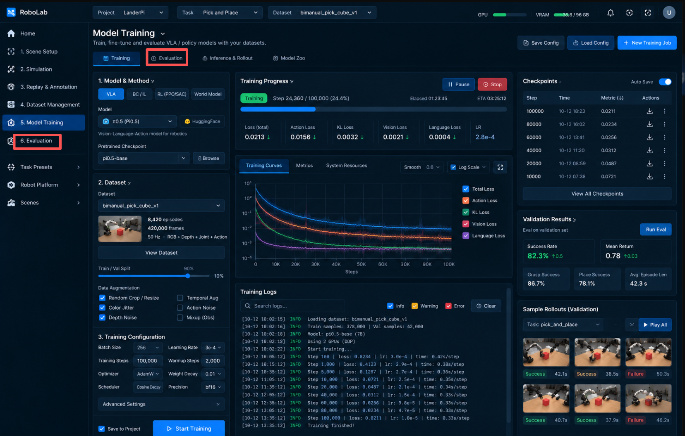

# Training Setup｜训练配置

规范 ID：`PAGE-08` · 责任层：前端页面设计 · 版本：V0.3（2026-10-21）

状态：页面详细草案；“每页必须有图片参考”是本轮用户要求，具体布局与新增能力仍是设计建议。图片是概念稿，不是现有可运行界面的证据。

[页面总览](README.md) · [统一页面规则](../01-shell/04-visual-design-rules.md) · [冲突分析](../../90-governance/08-visual-design-conflicts.md)

## 定位与范围

校验固定数据和模型适配关系，提交可追踪训练作业。

- 页面 ID：`PAGE-08`；导航归属：Models & Experiments。
- 主要对象：Training Config Draft、Dataset Recipe Revision、Model/Checkpoint Reference。
- 增量路线：E：模型训练规划。这是设计顺序，不是排期或启动实施。

## 图片参考

主参考：`IMG-006`，PPT 第 6 页。覆盖程度：局部采用图 6 左侧配置；完整图混有运行监控。下面的修正优先于图中按钮、数值和字段。

补充参考：`IMG-021`，历史冲突截图，不作为当前基线。

## 区域与功能

| 区域 | 功能与反馈 |
|---|---|
| 配置主体 | 模型/方法、数据版本及混合配方、超参数、资源请求。 |
| 检查摘要 | 观测/动作匹配、归一化、划分、后端能力及缺失项。 |
| 操作区 | 保存草案、校验、提交作业。 |

## 关键操作与跳转

- 从固定 Dataset Version 或模型版本进入，显示继承引用。
- 混合数据前检查动作语义、机器人映射、单位和相机；权重和为有效配方只是其中一项检查。
- 参数由训练适配器声明，提交形成不可变 Job Config，跳转 P09。

## 状态、失败与恢复

- 不支持的方法/模型显示原因，不提供假可用选项。
- 作业运行后修改配置只影响新草案；不改变当前作业。
- 后端不支持 Pause 或某指标时不提供虚构控制/曲线。

## 相对原图的取舍

- 运行进度、日志和 Checkpoint 管理从本页主体移至 Training Runs。
- 图 21 的 Evaluation 标签与主评估入口重复，改为 Training Validation 摘要链接。
- RL/World Model/所有 VLA、固定 KL/Vision/Language Loss 均为示例，不承诺首版支持。

关联冲突：[VIS-C02](../../90-governance/08-visual-design-conflicts.md#vis-c02)、[VIS-C13](../../90-governance/08-visual-design-conflicts.md#vis-c13)、[VIS-C14](../../90-governance/08-visual-design-conflicts.md#vis-c14)、[VIS-C17](../../90-governance/08-visual-design-conflicts.md#vis-c17)。

## 主责功能与后端支撑

- [Model Training｜训练管理概念](../06-training-evaluation/01-training-workspace.md)

后端/契约：[01-jobs-models-results](../../20-backend/06-training-evaluation/01-jobs-models-results.md)、[05-dataset-model-lineage](../../30-contracts/05-dataset-model-lineage.md)。

## 常用页面跳转

| 触发操作 | 目标页面 | 携带的对象与限制 |
|---|---|---|
| 查看数据版本 | [PAGE-07](07-dataset-version.md) | 固定数据版本引用 |
| 提交成功后监控 | [PAGE-09](09-training-runs.md) | 已接受 Job ID |

跳转本身不启动运动、改变控制权或覆写活动配置；提交作业/执行的状态以明确操作和后端确认为准。

## 原型验证关注点

参考图可查看、数据对象可追溯、同一操作只有一个权威入口；不支持的操作有明确原因。涉及运动、标注、导出或作业时，分别按主责功能验收，不能以页面截图代替验证。
