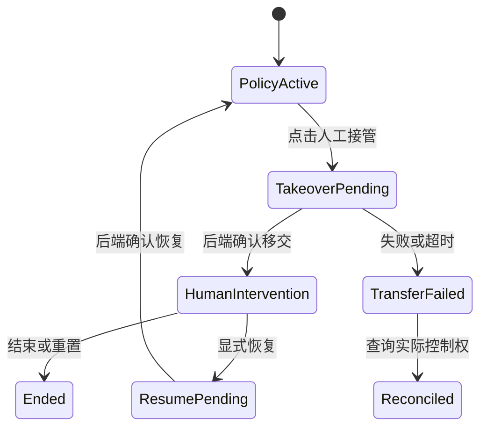

# 控制权与受控人工接管

规范 ID：`CT-AUTHORITY` · 责任层：共享契约 · 文档成熟度：基础草案（保留原文逐项状态）

[来源总册 doc-013](../../设计过程与Specification总册_20261021.md#doc-013) · [上级功能包](README.md) · [总索引](../README.md)

> 本文件已按主题迁入当前目录；需求确认程度以原文标记为准。文档迁移不表示已实现、已验收或技术栈已冻结。后续在此维护主题正文，总册保留历史。

版本：V0.4｜更新日期：2026-10-22（America/Los_Angeles）；原始内容来源保留。

状态：显式接管已确认；转移协议与粒度为草案

来源：S03、S04、S05（详见[来源档案](../90-governance/06-sources.md)）

关联需求：[REQ-SEL-006](../indexes/05-requirements.md#req-sel-006), [REQ-AUTH-001](../indexes/05-requirements.md#req-auth-001), [REQ-AUTH-002](../indexes/05-requirements.md#req-auth-002), [REQ-AUTH-003](../indexes/05-requirements.md#req-auth-003), [REQ-AUTH-004](../indexes/05-requirements.md#req-auth-004)

## 用户已决定的行为

支持人工控制、策略控制和受控接管。VLA 正在控制时，用户点击“人工接管”按钮，使系统停止 VLA 操控并进入人工干预阶段。拖动 TCP 本身不构成隐式接管。

## 平台统一语义草案

Selected Arms 是观察选择集合；Active Arm 是当前工具操作目标；Control Owner 是后端认可的控制源。这三者应分别记录。多选不会自动改变任何一侧控制权。

建议按照 Base / Arm / Gripper 或执行器组确定授权范围；具体粒度尚未决定。Human、Expert、Policy 是来源；“受控接管”是转换机制，不能简单当作与 Human 并列的第四种持续控制源。

状态图是助手方案的细化草案；TransferFailed 不代表策略一定仍在控制，界面应按后端实际状态显示。

## 建议交接顺序

1. 请求指定范围接管，显示 Pending，暂不接受人工运动提交。
2. 后端停止该范围策略输出，并处理旧动作、队列或 action chunk，避免移交后残留动作继续生效。
3. 由控制器执行定义好的保持或停止方式，再确认控制权移交。
4. 前端收到确认后启用人工控制；记录移交时间与来源。
5. 人工完成后显式恢复策略、结束或重置；恢复前状态同步方式待后端设计。

不要求因接管而暂停物理仿真。旧命令如何失效、失败保持方式、接管超时、恢复时策略重初始化均为 OQ，不能以“安全停止”一句话替代具体定义。

## 与外力的关系

向刚体施加外力属于环境 / 物理干预，可在实验允许时与 Policy 同时发生；它不自动把动作控制权改为 Human。是否允许并行、作用范围和记录条件需在实验配置里显式定义。

## STOP 与控制权（M1.4 候选）

身份绑定的安全 STOP 不属于接管/交还流程：它不申请、不获取也不转移 owner，不作为 `motion_ready`/`recording_ready`/lease 的下游条件，因此不得被新增权限门槛挡住既有紧急停止。回执单独报告事实：`owner_cleared_after_stop`（native 是否顺带清了 owner）、`safety_latched`（STOP 后是否仍安全锁定）、`motion_restored=false`（绝不声称恢复运动）。恢复运动、解除安全锁与重新交接控制权仍是未实现的独立动作，需要各自的授权判定。见 [Session 生命周期](../20-backend/01-session-scene/01-session-lifecycle.md#stop-与录制结束协议m1-stop-1--m1-end-1)。

## 关联文档

- [独立状态域与运行模型](../00-overview/04-runtime-state-domains.md)
- [选择、相机与整臂框选](../10-frontend/07-viewport-tools/02-selection-camera.md)
- [控制与干预命令契约草案](02-control-intervention-commands.md)
- [物理受力与临时工具](../10-frontend/07-viewport-tools/05-physical-force-tool.md)
- [实体主臂与仿真从臂](../10-frontend/03-simulation/03-leader-follower-panel.md)

[需求追踪矩阵](../indexes/05-requirements.md) · [Wiki 首页](../indexes/01-reading-guide.md) · [目录入口](../README.md)

## V0.2 Action Chunk 与连续 Episode

S08 补充：交接时处理对应范围的旧 Action Chunk；恢复不能盲目重放剩余动作。按部件声明控制源不自动开放未经验证的底盘/臂并行。只有录制连续且无 Reset/终止等边界时，接管在同一 Episode 内记来源切换；物理受力仍是独立干预。精确失效/恢复协议继续由 OQ-018 收敛。

## V0.4 新图的部件表

Base/Arm/Gripper 是当前可视分组，Coupled 表示夹爪授权继承 Arm 的候选语义，不自动把夹爪命令与 TCP 位姿绑定；独立授权粒度仍需核对适配器。自动 Owner 提供申请接管，人工 Owner 且有可恢复来源才提供明确目标的交还；Pending/拒绝/超时按实际状态反馈。

Execution Profile 记录任务执行意图，当前 Owner、人工输入设备和干预事件独立。单一来源色带不足以表示同时不同部件 Owner；事件/记录按范围追踪。[新图评审](../10-frontend/03-simulation/06-simulation-v2-review.md) 保留待收敛例子。
