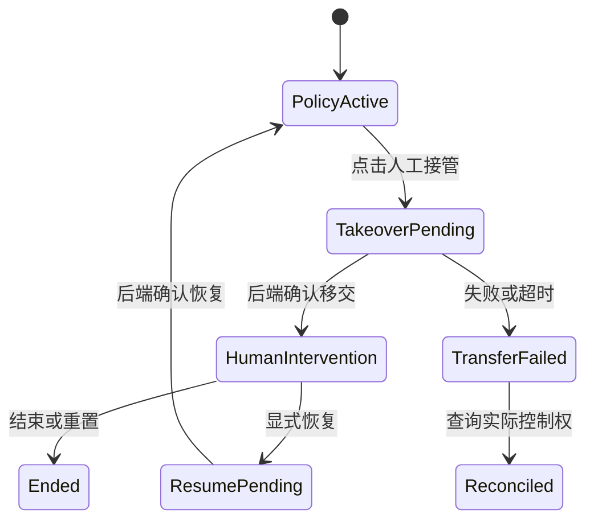

<a id="book-start"></a>
# Embodied 3D Workbench｜设计过程与 Specification 总册

V0.1｜2026-10-21（America/Los_Angeles）

**阅读范围：** 本册保存当前可获取的相关讨论、文件文本和整理结果。最新完整可见的一轮用户/助手原文及 V0.4 片段在附录中；更早完整聊天逐字原文未全部取得，历史摘要已标明。

包含 36 篇分类规范、56 项需求、26 项决策/演变记录、29 项未决问题、Wiki 索引、来源档案与模板。功能验收均未执行。

可以整本阅读，也可使用目录包中的独立文件继续维护。六工作区和分期属于助手建议；用户明确决定与建议分别标记。

## 总目录

- [Embodied 3D Workbench｜设计过程、Spec 与 Wiki](#doc-001)
- [Embodied 3D Workbench Wiki](#doc-002)
- [按工作区索引](#doc-003)
- [按交互与基础主题索引](#doc-004)
- [需求追踪矩阵](#doc-005)
- [术语与边界](#doc-006)
- [产品目标与边界](#doc-007)
- [范围与建议分期](#doc-008)
- [任务、观测与数据配置](#doc-009)
- [全局信息架构与工作区](#doc-010)
- [独立状态域与运行模型](#doc-011)
- [机器人能力与适配边界](#doc-012)
- [控制权与受控人工接管](#doc-013)
- [时间、坐标系与命令生命周期](#doc-014)
- [Scene Setup｜场景布置](#doc-015)
- [Simulation｜在线仿真工作台](#doc-016)
- [Replay & Annotation｜同步回放与标注](#doc-017)
- [Dataset Management｜数据管理](#doc-018)
- [Model Training｜训练管理概念](#doc-019)
- [Evaluation｜评估概念](#doc-020)
- [选择、相机与整臂框选](#doc-021)
- [关节操控与监控](#doc-022)
- [TCP 操控与虚线运动轨迹](#doc-023)
- [物理受力与临时工具](#doc-024)
- [实体主臂与仿真从臂](#doc-025)
- [共用 3D Viewport](#doc-026)
- [Inspector 与层级联动](#doc-027)
- [面板布局与输入焦点](#doc-028)
- [传感器与算法观测面板](#doc-029)
- [统一时间轴与事件轨](#doc-030)
- [Robot / World State 契约草案](#doc-031)
- [控制与干预命令契约草案](#doc-032)
- [Episode、采集、事件与标注契约](#doc-033)
- [Dataset、Training、Checkpoint 与 Evaluation 关系](#doc-034)
- [交互验收清单](#doc-035)
- [工作区、运行与记录验收](#doc-036)
- [回放、标注与数据管理验收](#doc-037)
- [决策与方案演变记录](#doc-038)
- [未决问题登记](#doc-039)
- [冲突、澄清与取代关系](#doc-040)
- [讨论过程与设计形成路径](#doc-041)
- [工作目录使用与维护规则](#doc-042)
- [来源目录与完整性声明](#doc-043)
- [S01｜foreEndDes.pdf 文本提取](#doc-044)
- [S02｜较早对话检索摘要与可见用户原话](#doc-045)
- [S03｜先前助手可见片段：交互 V0.4](#doc-046)
- [S04 / S05｜最新完整可见的一轮讨论](#doc-047)
- [S06｜本轮整理要求](#doc-048)
- [S07｜coreIntent.md 当前文本](#doc-049)
- [<规范标题>](#doc-050)
- [ADR-<编号>｜<决定>](#doc-051)

---

<a id="doc-001"></a>

## Embodied 3D Workbench｜设计过程、Spec 与 Wiki

版本：V0.1｜2026-10-21（America/Los_Angeles）

这是一套可放入项目工作目录继续维护的设计基线，包含讨论过程、可见原文、用户决定、助手方案、未决事项、分类 Spec、交叉索引和待执行验收。没有把文档草案标作已实现功能。

**完整性说明：** 本轮可获取的最新用户/助手一轮已转存，V0.4 的可见片段、早期用户片段及历史检索摘要分别保存；更早完整会话逐字原文未全部取得。本文不会以摘要补造缺失对话。

### 从哪里开始

- [整本阅读：设计过程与Specification总册](#book-start)
- [Wiki 首页与全部分类](#doc-002)
- [按工作区索引](#doc-003)
- [按交互和问题索引](#doc-004)
- [需求追踪矩阵](#doc-005)
- [讨论过程](#doc-041)
- [决策记录](#doc-038) / [冲突与取代关系](#doc-040) / [未决问题](#doc-039)
- [对话和文件来源档案](#doc-043)

### 目录分工

| 路径 | 内容 | 使用方法 |
|---|---|---|
| docs/specs/00-product | 产品目标、范围、Task Profile | 定义“做什么”与明确边界 |
| docs/specs/01-foundation | 工作区、状态域、能力、控制权、时间 | 所有页面共享的规则 |
| docs/specs/02-workspaces | 场景、仿真、回放、数据、训练、评估 | 各工作区完整流程 |
| docs/specs/03-interactions | Selection、Joint、TCP、Force、Leader | 输入到意图的主责规则 |
| docs/specs/04-components | Viewport、Inspector、布局、传感器、时间轴 | 可复用组件的职责 |
| docs/specs/05-contracts | State、Command、Episode、Training 关系 | 当前为契约草案，需核对后端 |
| docs/specs/06-verification | 交互、运行、回放的验收条目 | 均未执行；后续补真实证据 |
| docs/specs/07-decisions | DEC、OQ、冲突与修订 | 避免把建议变成决定 |
| docs/specs/08-process | 讨论过程、维护流程 | 保存推理演变与变更方法 |
| sources | 原文片段、最新完整轮、历史摘要、文件文本 | 保留证据，不随新决定改写 |
| wiki | 总导航、工作区/主题索引、需求矩阵、术语 | 只做分类与索引，引用主责 Spec |
| templates | Spec 与 ADR 模板 | 新规范沿用来源/状态/验收结构 |
| traceability.json | 需求、来源、主责文档、验收及关联关系 | 供后续脚本或索引器读取 |

### 使用提醒

六工作区是助手建议的分类结构，业务拆分原则来自用户；P0/P1/P2 是建议分期。TCP 虚线的具体对象、Alt 临时工具、控制权粒度和标签字典仍有未决项。先按明确需求推进，不把草案字段直接当既有 API。

本目录使用标准 Markdown 相对链接，无需特定 Wiki 插件。复制到现有项目后保留层级即可导航；迁移到特定 Wiki 平台时再按该平台规则调整路径。本次没有建立线上 Wiki 服务或修改现有代码仓库。

---

<a id="doc-002"></a>

## Embodied 3D Workbench Wiki

版本：V0.1｜2026-10-21（America/Los_Angeles）

用于继续构建项目 specification。已有用户决定、历史基线、助手建议和未决问题分别标明；尚未执行真实系统验收。当前可见对话已归档，更早完整逐字原文未全部取得。

### 快速入口

- [按讨论过程阅读](#doc-041)
- [按工作区查找](#doc-003)
- [按交互问题查找](#doc-004)
- [需求 → 来源 → Spec → 验收追踪矩阵](#doc-005)
- [决定与建议](#doc-038)
- [未决问题](#doc-039)
- [原始材料与完整性](#doc-043)
- [术语表](#doc-006)
- [工作目录维护方法](#doc-042)

### 分类目录

#### 产品与范围

- [产品目标与边界](#doc-007)
- [范围与建议分期](#doc-008)
- [任务、观测与数据配置](#doc-009)

#### 共用基础与控制权

- [全局信息架构与工作区](#doc-010)
- [独立状态域与运行模型](#doc-011)
- [机器人能力与适配边界](#doc-012)
- [控制权与受控人工接管](#doc-013)
- [时间、坐标系与命令生命周期](#doc-014)

#### 业务工作区

- [Scene Setup｜场景布置](#doc-015)
- [Simulation｜在线仿真工作台](#doc-016)
- [Replay & Annotation｜同步回放与标注](#doc-017)
- [Dataset Management｜数据管理](#doc-018)
- [Model Training｜训练管理概念](#doc-019)
- [Evaluation｜评估概念](#doc-020)

#### 3D 与输入交互

- [选择、相机与整臂框选](#doc-021)
- [关节操控与监控](#doc-022)
- [TCP 操控与虚线运动轨迹](#doc-023)
- [物理受力与临时工具](#doc-024)
- [实体主臂与仿真从臂](#doc-025)

#### 共用组件

- [共用 3D Viewport](#doc-026)
- [Inspector 与层级联动](#doc-027)
- [面板布局与输入焦点](#doc-028)
- [传感器与算法观测面板](#doc-029)
- [统一时间轴与事件轨](#doc-030)

#### 数据与命令契约

- [Robot / World State 契约草案](#doc-031)
- [控制与干预命令契约草案](#doc-032)
- [Episode、采集、事件与标注契约](#doc-033)
- [Dataset、Training、Checkpoint 与 Evaluation 关系](#doc-034)

#### 验收清单

- [交互验收清单](#doc-035)
- [工作区、运行与记录验收](#doc-036)
- [回放、标注与数据管理验收](#doc-037)

#### 决策、未决与冲突

- [决策与方案演变记录](#doc-038)
- [未决问题登记](#doc-039)
- [冲突、澄清与取代关系](#doc-040)

#### 讨论过程与维护流程

- [讨论过程与设计形成路径](#doc-041)
- [工作目录使用与维护规则](#doc-042)

### 文档模板

- [Specification 模板](#doc-050)
- [ADR 模板](#doc-051)

---

<a id="doc-003"></a>

## 按工作区索引

六工作区作为当前文件分类方案；具体导航待冻结。

| 工作区 | 主责规范 | 重点关联 |
|---|---|---|
| Scene Setup｜场景布置 | [打开规范](#doc-015) | [独立状态域与运行模型](#doc-011)、[选择、相机与整臂框选](#doc-021)、[共用 3D Viewport](#doc-026)、[任务、观测与数据配置](#doc-009) |
| Simulation｜在线仿真工作台 | [打开规范](#doc-016) | [控制权与受控人工接管](#doc-013)、[任务、观测与数据配置](#doc-009)、[关节操控与监控](#doc-022)、[TCP 操控与虚线运动轨迹](#doc-023)、[物理受力与临时工具](#doc-024)、[实体主臂与仿真从臂](#doc-025) |
| Replay & Annotation｜同步回放与标注 | [打开规范](#doc-017) | [统一时间轴与事件轨](#doc-030)、[Episode、采集、事件与标注契约](#doc-033)、[Dataset Management｜数据管理](#doc-018) |
| Dataset Management｜数据管理 | [打开规范](#doc-018) | [Replay & Annotation｜同步回放与标注](#doc-017)、[Episode、采集、事件与标注契约](#doc-033)、[Dataset、Training、Checkpoint 与 Evaluation 关系](#doc-034) |
| Model Training｜训练管理概念 | [打开规范](#doc-019) | [Dataset、Training、Checkpoint 与 Evaluation 关系](#doc-034)、[Dataset Management｜数据管理](#doc-018) |
| Evaluation｜评估概念 | [打开规范](#doc-020) | [Dataset、Training、Checkpoint 与 Evaluation 关系](#doc-034)、[Simulation｜在线仿真工作台](#doc-016)、[Replay & Annotation｜同步回放与标注](#doc-017) |

### 所有工作区共用

[全局信息架构与工作区](#doc-010)、[独立状态域与运行模型](#doc-011)、[机器人能力与适配边界](#doc-012)、[控制权与受控人工接管](#doc-013)、[时间、坐标系与命令生命周期](#doc-014)、[任务、观测与数据配置](#doc-009)、[Episode、采集、事件与标注契约](#doc-033)

[Wiki 首页](#doc-002) · [目录入口](#doc-001)

---

<a id="doc-004"></a>

## 按交互与基础主题索引

| 从问题找文档 | 主责规范 | 后续关联 |
|---|---|---|
| 怎么选 Link / Joint / Arm，如何框选？ | [选择、相机与整臂框选](#doc-021) | [Inspector 与层级联动](#doc-027)、[控制权与受控人工接管](#doc-013)、[交互验收清单](#doc-035) |
| 关节怎么拖动，为什么滑条主要监控？ | [关节操控与监控](#doc-022) | [控制与干预命令契约草案](#doc-032)、[Inspector 与层级联动](#doc-027) |
| TCP 怎么控制，虚线代表什么？ | [TCP 操控与虚线运动轨迹](#doc-023) | [控制与干预命令契约草案](#doc-032)、[共用 3D Viewport](#doc-026)、[时间、坐标系与命令生命周期](#doc-014) |
| 怎么给机器人或物体施力？ | [物理受力与临时工具](#doc-024) | [控制权与受控人工接管](#doc-013)、[Episode、采集、事件与标注契约](#doc-033) |
| VLA 运行时怎么人工接管？ | [控制权与受控人工接管](#doc-013) | [Simulation｜在线仿真工作台](#doc-016)、[控制与干预命令契约草案](#doc-032)、[Episode、采集、事件与标注契约](#doc-033) |
| 实体主臂如何连接和跟随？ | [实体主臂与仿真从臂](#doc-025) | [机器人能力与适配边界](#doc-012)、[控制权与受控人工接管](#doc-013) |
| 切页、暂停、录制、任务状态有何关系？ | [独立状态域与运行模型](#doc-011) | [全局信息架构与工作区](#doc-010)、[Episode、采集、事件与标注契约](#doc-033) |
| 小车和双臂需要哪些面板/观测？ | [任务、观测与数据配置](#doc-009) | [传感器与算法观测面板](#doc-029)、[面板布局与输入焦点](#doc-028)、[Simulation｜在线仿真工作台](#doc-016) |
| 数据时间、坐标系与动作单位在哪里定义？ | [时间、坐标系与命令生命周期](#doc-014) | [Robot / World State 契约草案](#doc-031)、[控制与干预命令契约草案](#doc-032)、[Episode、采集、事件与标注契约](#doc-033) |
| 回放和标签在哪里设计？ | [Replay & Annotation｜同步回放与标注](#doc-017) | [统一时间轴与事件轨](#doc-030)、[Episode、采集、事件与标注契约](#doc-033)、[Dataset Management｜数据管理](#doc-018) |
| 哪些已确定，哪些只是建议？ | [决策与方案演变记录](#doc-038) | [未决问题登记](#doc-039)、[冲突、澄清与取代关系](#doc-040)、[讨论过程与设计形成路径](#doc-041) |
| 下一轮如何维护 specification？ | [工作目录使用与维护规则](#doc-042) | [决策与方案演变记录](#doc-038)、[未决问题登记](#doc-039) |

[Wiki 首页](#doc-002) · [目录入口](#doc-001)

---

<a id="doc-005"></a>

## 需求追踪矩阵

共 56 项。状态不代表实现进度；所有产品功能验收尚未执行。完整规则见各主责 Spec。

| 需求 ID | 状态 | 内容 | 来源 | 主责 Spec | 待执行验收 |
|---|---|---|---|---|---|
| REQ-PRD-001 | 用户明确 | MuJoCo 实时操控、算法观察、干预及 VLN/VLA 数据录制 | [S02](#doc-045)、[S07](#doc-049) | [产品目标与边界](#doc-007) | [TEST-REC-001](#doc-036) |
| REQ-PRD-002 | 用户明确 | 三维编辑器操作手感 + 多面板与时间轴 | [S02](#doc-045) | [产品目标与边界](#doc-007) | 待详细设计 |
| REQ-PRD-003 | 用户明确 | 前端按场景布置/仿真/回放/训练等业务分别设计 | [S04](#doc-047) | [全局信息架构与工作区](#doc-010) | 待详细设计 |
| REQ-PRD-004 | 助手建议 | 六业务工作区 + 共用基础设施 | [S05](#doc-047) | [全局信息架构与工作区](#doc-010) | [TEST-NAV-002](#doc-036) |
| REQ-PRD-005 | 助手建议 | P0/P1/P2 分期与基础/完整能力拆分 | [S05](#doc-047) | [范围与建议分期](#doc-008) | 待详细设计 |
| REQ-OBS-001 | 用户明确 | 小车提供 3D、本体、SLAM、RGB-D 相关观测 | [S02](#doc-045) | [任务、观测与数据配置](#doc-009) | [TEST-PROFILE-001](#doc-036) |
| REQ-OBS-002 | 用户明确 | 双臂提供 3D、三相机和本体观测 | [S02](#doc-045) | [任务、观测与数据配置](#doc-009) | [TEST-PROFILE-001](#doc-036) |
| REQ-OBS-003 | 用户明确 | 小车键盘+鼠标；双臂鼠标+实体主臂 | [S02](#doc-045)、[S07](#doc-049) | [任务、观测与数据配置](#doc-009) | [TEST-PROFILE-001](#doc-036) |
| REQ-OBS-004 | 用户明确 | 小车专家 SLAM/导航+视觉伺服；双臂 IK/动作规划 | [S02](#doc-045)、[S07](#doc-049) | [任务、观测与数据配置](#doc-009) | 待详细设计 |
| REQ-OBS-005 | 整理方案 | UI、Algorithm Observation、Recording Profile 分开 | [S02](#doc-045)、[S05](#doc-047) | [任务、观测与数据配置](#doc-009) | [TEST-REC-003](#doc-036) |
| REQ-STATE-001 | 用户明确 | 任务前 Observe/Edit 可配置 | [S02](#doc-045) | [独立状态域与运行模型](#doc-011) | [TEST-SCENE-001](#doc-036) |
| REQ-STATE-002 | 用户明确 | 任务中支持实时和预览确认两种执行策略 | [S02](#doc-045) | [独立状态域与运行模型](#doc-011) | [TEST-TCP-001](#doc-035) |
| REQ-STATE-003 | 助手建议 | 页面切换不隐式结束 Session/录制或转移控制权 | [S05](#doc-047) | [全局信息架构与工作区](#doc-010) | [TEST-NAV-002](#doc-036) |
| REQ-STATE-004 | 助手建议 | 离开驾驶/失焦撤销连续速度，后端超时兜底 | [S03](#doc-046)、[S05](#doc-047) | [面板布局与输入焦点](#doc-028) | [TEST-INPUT-003](#doc-036) |
| REQ-SCENE-001 | 助手建议 | 初态编辑与在线物理状态分离 | [S02](#doc-045)、[S05](#doc-047) | [Scene Setup｜场景布置](#doc-015) | [TEST-SCENE-002](#doc-036) |
| REQ-SCENE-002 | 助手建议 | 场景检查、保存配置版本并可关联复现 | [S05](#doc-047) | [Scene Setup｜场景布置](#doc-015) | [TEST-SCENE-003](#doc-036) |
| REQ-SEL-001 | 历史基线 | Hover 高亮、Click Link/Joint、Double Click Arm | [S01](#doc-044)、[S03](#doc-046) | [选择、相机与整臂框选](#doc-021) | [TEST-SEL-001](#doc-035) |
| REQ-SEL-002 | 历史确认 | 框选同一 Arm 至少两个不同 Link，自动提升整臂 | [S02](#doc-045)、[S03](#doc-046) | [选择、相机与整臂框选](#doc-021) | [TEST-SEL-002](#doc-035) |
| REQ-SEL-003 | 历史基线 | 默认互斥，Ctrl 双击切换 Arm 多选 | [S02](#doc-045)、[S03](#doc-046) | [选择、相机与整臂框选](#doc-021) | [TEST-SEL-003](#doc-035) |
| REQ-SEL-004 | 助手建议 | 无 Ctrl 的跨臂框选不自动提交多臂集合 | [S03](#doc-046) | [选择、相机与整臂框选](#doc-021) | [TEST-SEL-005](#doc-035) |
| REQ-SEL-005 | 历史基线 | 整臂高亮并联动 Hierarchy / Inspector | [S03](#doc-046) | [Inspector 与层级联动](#doc-027) | [TEST-SEL-004](#doc-035) |
| REQ-SEL-006 | 助手建议 | 选择、Active Arm、控制权分离；选择不发运动 | [S03](#doc-046) | [控制权与受控人工接管](#doc-013) | [TEST-SEL-006](#doc-035) |
| REQ-SEL-007 | 助手建议 | 多臂选择默认只作摘要，不自动联合 IK/运动 | [S03](#doc-046) | [选择、相机与整臂框选](#doc-021) | [TEST-SEL-006](#doc-035) |
| REQ-VIEW-001 | 用户明确 | 坐标系显示与大小调整 | [S01](#doc-044) | [共用 3D Viewport](#doc-026) | 待详细设计 |
| REQ-VIEW-002 | 历史基线 | 空白拖动 Orbit、滚轮 Zoom；中键/F 为补充建议 | [S01](#doc-044)、[S03](#doc-046) | [选择、相机与整臂框选](#doc-021) | 待详细设计 |
| REQ-JOINT-001 | 用户明确 | 关节滑条主要监控；默认只读为建议细化 | [S04](#doc-047)、[S05](#doc-047) | [关节操控与监控](#doc-022) | [TEST-JOINT-002](#doc-035) |
| REQ-JOINT-002 | 助手建议 | Joint Ring 控制；明确选 Joint 后支持对应 Link 拖动 | [S03](#doc-046) | [关节操控与监控](#doc-022) | [TEST-JOINT-001](#doc-035) |
| REQ-TCP-001 | 历史基线 | Arm 的 TCP Tool 产生目标位姿，经后端检查 | [S03](#doc-046) | [TCP 操控与虚线运动轨迹](#doc-023) | [TEST-TCP-001](#doc-035) |
| REQ-TCP-002 | 用户明确 | TCP 朝目标移动时虚线呈现关节运动轨迹 | [S04](#doc-047) | [TCP 操控与虚线运动轨迹](#doc-023) | [TEST-TCP-003](#doc-035) |
| REQ-TCP-003 | 助手建议 | 候选路径、q(t)、关节中心与实际 Trail 区分 | [S05](#doc-047) | [TCP 操控与虚线运动轨迹](#doc-023) | [TEST-TCP-002](#doc-035)<br>[TEST-TCP-003](#doc-035) |
| REQ-TCP-004 | 未决 | 虚线默认对象、姿态约束与具体规划能力 | [S04](#doc-047)、[S05](#doc-047) | [TCP 操控与虚线运动轨迹](#doc-023) | 待详细设计 |
| REQ-AUTH-001 | 用户明确 | 支持人工控制、策略控制及受控接管 | [S04](#doc-047) | [控制权与受控人工接管](#doc-013) | [TEST-AUTH-001](#doc-035)<br>[TEST-AUTH-002](#doc-035) |
| REQ-AUTH-002 | 用户明确 | 按钮停止 VLA 操控，进入人工干预，不隐式鼠标抢占 | [S04](#doc-047) | [控制权与受控人工接管](#doc-013) | [TEST-AUTH-002](#doc-035) |
| REQ-AUTH-003 | 助手建议 | Pending→后端确认→Human；处理旧动作后交接 | [S05](#doc-047) | [控制权与受控人工接管](#doc-013) | [TEST-AUTH-003](#doc-035) |
| REQ-AUTH-004 | 助手建议 | 显式恢复策略；接管不等于暂停仿真时钟 | [S05](#doc-047) | [控制权与受控人工接管](#doc-013) | [TEST-REC-001](#doc-036) |
| REQ-FORCE-001 | 候选方案 | Alt 拖动作为临时外力工具；独立模式由早期方案演进 | [S01](#doc-044)、[S03](#doc-046) | [物理受力与临时工具](#doc-024) | [TEST-FORCE-001](#doc-035) |
| REQ-FORCE-002 | 助手建议 | 释放/取消/失焦/断连/超时撤销持续力 | [S03](#doc-046) | [物理受力与临时工具](#doc-024) | [TEST-FORCE-002](#doc-035) |
| REQ-FORCE-003 | 助手建议 | 外力与 Joint Target/Teleport 不同，Replay 禁用施力 | [S03](#doc-046) | [物理受力与临时工具](#doc-024) | [TEST-REPLAY-002](#doc-037) |
| REQ-FORCE-004 | 助手建议 | 记录 Body/作用点/向量/时间与并行 Policy | [S03](#doc-046) | [Episode、采集、事件与标注契约](#doc-033) | [TEST-REC-002](#doc-036) |
| REQ-LEADER-001 | 用户明确 | 双实体主臂映射 MuJoCo 从臂并录制 | [S02](#doc-045)、[S07](#doc-049) | [实体主臂与仿真从臂](#doc-025) | [TEST-LEADER-001](#doc-036) |
| REQ-LEADER-002 | 历史澄清 | 主臂无独立摄像头，提供状态与映射监控 | [S03](#doc-046) | [实体主臂与仿真从臂](#doc-025) | 待详细设计 |
| REQ-LEADER-003 | 未决 | 主臂断连策略、超时参数、重连对齐和来源切换 | [S03](#doc-046) | [实体主臂与仿真从臂](#doc-025) | [TEST-LEADER-002](#doc-036) |
| REQ-NAV-001 | 当前排除 | 当前前端不做导航目标点击/Waypoint 编辑 | [S04](#doc-047) | [范围与建议分期](#doc-008) | [TEST-NAV-001](#doc-036) |
| REQ-NAV-002 | 用户明确 | 后端导航仍可存在并产生专家数据 | [S04](#doc-047)、[S07](#doc-049) | [任务、观测与数据配置](#doc-009) | [TEST-NAV-001](#doc-036) |
| REQ-REPLAY-001 | 用户明确 | 独立选择录制数据，传感器/本体/轨迹回放与倍速 | [S01](#doc-044) | [Replay & Annotation｜同步回放与标注](#doc-017) | [TEST-REPLAY-001](#doc-037) |
| REQ-REPLAY-002 | 助手建议 | 历史状态只读并与在线仿真隔离；标签独立写入 | [S05](#doc-047) | [Replay & Annotation｜同步回放与标注](#doc-017) | [TEST-REPLAY-002](#doc-037)<br>[TEST-ANN-001](#doc-037) |
| REQ-ANN-001 | 用户明确 | 人类数据与专家数据的阶段标签继续讨论 | [S02](#doc-045) | [Replay & Annotation｜同步回放与标注](#doc-017) | [TEST-ANN-001](#doc-037) |
| REQ-DATA-001 | 助手建议 | 记录完整性、任务成功、训练用途资格分开 | [S05](#doc-047) | [Dataset Management｜数据管理](#doc-018) | [TEST-DATA-001](#doc-037)<br>[TEST-DATA-002](#doc-037) |
| REQ-DATA-002 | 助手建议 | LeRobot 导出检查观测键、动作/单位/频率/对齐 | [S05](#doc-047) | [Dataset Management｜数据管理](#doc-018) | [TEST-EXPORT-001](#doc-037) |
| REQ-TRAIN-001 | 用户明确 | 模型训练作为单独部分设计 | [S04](#doc-047) | [Model Training｜训练管理概念](#doc-019) | 待详细设计 |
| REQ-TRAIN-002 | 助手建议 | 训练前端调独立后端，维护 Job/Checkpoint/版本 | [S05](#doc-047) | [Dataset、Training、Checkpoint 与 Evaluation 关系](#doc-034) | [TEST-TRACE-001](#doc-037) |
| REQ-EVAL-001 | 助手建议 | 独立评估管理/批量测试并追踪数据与模型 | [S05](#doc-047) | [Evaluation｜评估概念](#doc-020) | [TEST-TRACE-001](#doc-037) |
| REQ-CONTRACT-001 | 助手建议 | Actual/Target/Preview 与命令受理/执行分开 | [S03](#doc-046)、[S05](#doc-047) | [Robot / World State 契约草案](#doc-031) | [TEST-TCP-001](#doc-035) |
| REQ-CONTRACT-002 | 助手建议 | 统一时间、Frame、单位和版本关系 | [S05](#doc-047) | [时间、坐标系与命令生命周期](#doc-014) | [TEST-REPLAY-001](#doc-037) |
| REQ-REC-001 | 助手建议 | 来源、采集意图、阶段和标注分开；原始数据可追溯 | [S02](#doc-045)、[S05](#doc-047) | [Episode、采集、事件与标注契约](#doc-033) | [TEST-REC-001](#doc-036)<br>[TEST-ANN-001](#doc-037) |
| REQ-DOC-001 | 用户明确 | 包含可获取讨论过程，按 Spec 分类建立 Wiki 和索引 | [S06](#doc-048) | [工作目录使用与维护规则](#doc-042) | 待详细设计 |

### 旧编号兼容

| 新需求 ID | 已有交互规范 ID |
|---|---|
| REQ-SEL-002 | INT-SEL-002 |
| REQ-SEL-003 | INT-SEL-001, INT-SEL-003 |
| REQ-TCP-002 | INT-TCP-TRAJECTORY-001 |
| REQ-FORCE-001 | INT-FORCE-001 |

旧 TEST 编号保留。REQ 为本次建立的追踪编号，不应声称原对话已使用这些 REQ ID。

[Wiki 首页](#doc-002) · [目录入口](#doc-001)

---

<a id="doc-006"></a>

## 术语与边界

| 术语 | 本文含义 |
|---|---|
| Workspace | 按业务流程组织的前端入口，不等于后端运行状态 |
| Session | 一次后端运行上下文；是否支持多 Session 并发未定 |
| Episode | 一条录制数据的单位；与 Session 的边界映射待定 |
| Arm / Link / Joint / Body | 机械臂、运动学连杆、关节、物理刚体；不可只凭名称混用 |
| Selected Arms | 当前选中观察的 Arm 集合 |
| Active Arm | 当前工具准备操作的 Arm；不自动拥有控制权 |
| Control Owner | 后端认可的控制来源与范围 |
| Human / Expert / Policy | 人工、专家算法、学习策略等来源维度 |
| Human Demonstration | 以人工示教为目的的数据上下文 |
| Human Intervention | 策略或任务过程中经流程切入的人工干预 |
| Takeover | 控制权转换机制，完成后来源通常为 Human |
| Physics Intervention | 对物理世界施加扰动；与策略动作可并行但需实验允许 |
| Live | 目标经检查实时提交，不表示绕过后端 |
| Preview-Confirm | 先预览目标/候选，显式确认后提交 |
| Actual / Target / Preview | 实际状态、控制目标、未执行预览 |
| TCP | Tool Center Point；控制目标需 Frame 与可实现自由度 |
| IK / FK | 逆运动学 / 正运动学；终点 IK 不等于完整轨迹 |
| q(t) | 随时间的关节配置序列 |
| Ghost Robot | 半透明候选或目标姿态，仅作预览 |
| Candidate Path | 来自指定候选的空间路径，需标检查状态 |
| Actual Trail | 实际历史状态计算出的运动轨迹 |
| Task Profile | 任务差异的配置承载方案 |
| Observation Profile | 观测配置；算法输入与 UI 显示应分别定义 |
| Recording Profile | 记录流、动作语义、频率和时间约定 |
| Task Phase / Annotation | 在线任务阶段/事件与离线标注层，不应混为不可修改真值 |
| Dataset Version | 具有来源、筛选、变换和标签版本关系的数据集快照 |
| Specification | 目标行为与约束的主责文档；不意味着已经实现 |
| Wiki | 导航、分类与交叉索引；不应复制全部主责规范 |
| ADR / DEC / OQ | 架构决策记录 / 决策条目 / 未决问题 |

[Wiki 首页](#doc-002) · [目录入口](#doc-001)

---

<a id="doc-007"></a>

## 产品目标与边界

版本：V0.1｜整理日期：2026-10-21（America/Los_Angeles）

状态：用户目标与边界已明确；详细产品方案为草案

来源：S02、S04、S07（详见[来源档案](#doc-043)）

关联需求：REQ-PRD-001, REQ-PRD-002

### 产品目标

搭建面向 MuJoCo 实时仿真的具身机器人科研工作台，让用户能够操控机器人、观察算法、按实验规则进行人工干预，并录制 VLN / VLA 相关仿真数据。面向 LanderPi 移动操作和 SO101 双臂；共同操作方向为三维编辑器的直接操控体验，加上机器人工作台的多面板与统一时间轴。

### 已有用户决定

| 需求 | 当前基线 | 来源 |
|---|---|---|
| 产品组织 | 按场景布置、系统仿真、数据回放、模型训练等业务部分分别设计 | S04 |
| 交互位置 | 已讨论的鼠标、关节、TCP、受力属于在线仿真交互的一部分 | S04 |
| 任务差异 | 小车与双臂分别配置观测、人工输入、专家数据 | S02 |
| 任务前状态 | 场景加载后支持可配置的观察或编辑模式 | S02 用户原话 |
| 任务中控制 | 支持实时控制及预览确认 | S02 用户原话 |
| VLA 接管 | 点击按钮停止 VLA 操控后进入人工干预阶段 | S04 |
| 控制机制 | 人工控制、策略控制、受控接管 | S04 |
| 关节滑条 | 主要用来监控数据，不能继续沿用默认滑动就控制的假设 | S04 |
| TCP 轨迹 | 末端操控状态向目标移动时，用虚线展现运动轨迹 | S04；具体显示对象未决 |
| 导航交互边界 | 当前不做鼠标点击导航目标、Waypoint 编辑；后端可作为专家数据来源 | S04 |

### 场景与任务

小车：VLN 导航与近距离 VLA 操作。用户操作底盘和机械臂，键盘与鼠标为当前明确输入；观测包括 3D、本体、SLAM、RGB 和深度。专家来源为 SLAM 导航及近场视觉伺服抓取。

双臂：机械臂协作任务，现有意图包括方块传递；鼠标与实体双主臂控制 MuJoCo 从臂；观测包括 3D、三路相机与本体。专家来源为 IK / 动作规划；还需人类遥操作数据。“拧螺丝”见 S07 的括号任务意图，不能据此认定已具备该任务或把它列为 V1 已承诺交付。

### 助手方案，尚未逐项冻结

六工作区的具体拆分、P0/P1/P2、默认布局、控制权状态名、接口字段，以及训练和评估的上线时间均为建议。前端使用 React / Three.js / R3F / Zustand 的路线也仅是参考，不能写成已确定技术栈。

### 当前不应被推导出的能力

多臂选中不代表联合控制；IK 最终解不代表完整无碰轨迹；回放不代表可覆盖在线仿真；界面展示的观测不代表算法必须消费或录制的全部观测。上述区分是整理后的设计约束草案，实际接口需后续核对。

参见：范围分期、Task Profile、决策记录、需求追踪矩阵。

### 关联文档

- [范围与建议分期](#doc-008)
- [任务、观测与数据配置](#doc-009)
- [全局信息架构与工作区](#doc-010)
- [决策与方案演变记录](#doc-038)

[需求追踪矩阵](#doc-005) · [Wiki 首页](#doc-002) · [目录入口](#doc-001)

---

<a id="doc-008"></a>

## 范围与建议分期

版本：V0.1｜整理日期：2026-10-21（America/Los_Angeles）

状态：分期为助手建议；导航编辑排除为用户明确边界

来源：S03、S04、S05（详见[来源档案](#doc-043)）

关联需求：REQ-PRD-005, REQ-NAV-001

### 已明确的范围边界

当前开发不包含地图鼠标设点、Waypoint 拖动编辑。后端导航、路径显示和专家数据仍可存在。主要交互是 3D 关节 / TCP、键盘底盘、主从臂、受控接管及实验录制。

### 从上一轮保留的分期建议

| 阶段 | 建议内容 | 不能误读为 |
|---|---|---|
| P0 | Scene Setup、Simulation、Replay、基础 Dataset；基础交互与数据链路 | 用户已批准的工期或完整 V1 冻结清单 |
| P1 | 数据检查、人工干预实验、基础评估管理 | 已完整训练平台 |
| P2 | 训练管理、模型版本、批量评估 | 浏览器内训练框架 |

原回复的优先级存在粗细粒度差异：总体“基础 Dataset”为 P0，而专题表的“Dataset Management”为 P1；Evaluation 既有 P1 管理又有 P2 批量能力。整理时采用“基础/完整”“基础/批量”的解释消除表面冲突，但仍需正式排期时确认。

Push / Grab、联合双臂 IK、精确关节直接拖动映射、完整训练框架暂不作为已冻结核心能力。该描述保留了助手建议，不替用户新增永久排除项。

### 进入实现前的最小收敛

先冻结页面与 Session 关系、Scene Setup 与运行态边界、接管流程、TCP 虚线语义和原始记录契约；再细化布局和原型。阶段标签字典不应在未经讨论时冻结为训练真值。

### 关联文档

- [产品目标与边界](#doc-007)
- [Dataset Management｜数据管理](#doc-018)
- [Model Training｜训练管理概念](#doc-019)
- [Evaluation｜评估概念](#doc-020)

[需求追踪矩阵](#doc-005) · [Wiki 首页](#doc-002) · [目录入口](#doc-001)

---

<a id="doc-009"></a>

## 任务、观测与数据配置

版本：V0.1｜整理日期：2026-10-21（America/Los_Angeles）

状态：任务差异已确认；Task Profile 与三份配置为整理方案

来源：S02、S05、S07（详见[来源档案](#doc-043)）

关联需求：REQ-OBS-001, REQ-OBS-002, REQ-OBS-003, REQ-OBS-004, REQ-OBS-005, REQ-NAV-002

### 为什么需要配置差异

用户明确指出不同任务的算法观测、人工干预形式和专家数据不同。Task Profile 是助手提出的统一承载方式，并非要求复制多套前端。

| 维度 | LanderPi 导航 | LanderPi 近场操作 | SO101 双臂 |
|---|---|---|---|
| 3D | 场景、机器人 | 机械臂、目标物 | 左右机械臂、物体 |
| 观测基线 | 本体、SLAM、RGB、Depth；LiDAR 视图为建议 | 本体、RGB-D；点云为建议 | 本体、中央/左腕/右腕相机 |
| 人工输入 | 键盘底盘、鼠标观察 | 鼠标 Joint / TCP，键盘底盘按阶段约束 | 鼠标、实体双主臂 |
| 专家来源 | SLAM / 导航专家 | 近场视觉伺服抓取 | IK / 动作规划 |
| 数据用途 | VLN | 近场 VLA | 双臂学习 / 模仿学习 |
| 标签 | 导航阶段字典待讨论 | 操作阶段字典待讨论 | 协作阶段字典待讨论 |

### 必须分开的三份配置（整理建议）

1. UI Observation：面板显示内容、刷新方式、布局。
2. Algorithm Observation：算法实际输入的相机、本体、地图等及其预处理。
3. Recording Profile：保存哪些流、频率、动作语义和时间关联。

把某个相机面板隐藏不应隐式停止其采集。用户说的“算法观测不同”不能被缩减为只有 UI 面板不同；三份配置之间的关联需通过版本化 Profile 明确。

任务类型、阶段、控制来源、采集目的分别记录。Human Demonstration 与 Policy 运行中的 Human Intervention 可使用同一控制设备，但数据来源语义不同；专家算法不是人类示教。

### 关联文档

- [机器人能力与适配边界](#doc-012)
- [Simulation｜在线仿真工作台](#doc-016)
- [传感器与算法观测面板](#doc-029)
- [Episode、采集、事件与标注契约](#doc-033)

[需求追踪矩阵](#doc-005) · [Wiki 首页](#doc-002) · [目录入口](#doc-001)

---

<a id="doc-010"></a>

## 全局信息架构与工作区

版本：V0.1｜整理日期：2026-10-21（America/Los_Angeles）

状态：分类与切换语义为方案；业务拆分原则已确认

来源：S04、S05（详见[来源档案](#doc-043)）

关联需求：REQ-PRD-003, REQ-PRD-004, REQ-STATE-003

### 组织方案

用户已确定按业务阶段分别设计；以下六工作区是助手给出的架构建议，作为本目录的分类方式，不声称用户已逐项确认。

| 工作区 | 主要对象 | 主要动作 | 复用能力 |
|---|---|---|---|
| Scene Setup | Scene Preset、Experiment Config | 加载、布置、检查、保存初态 | 3D、Hierarchy、Gizmo、Inspector |
| Simulation | Runtime Session、Episode | 运行、观察、控制、接管、录制 | 3D、传感器、控制权、事件 |
| Replay & Annotation | Episode、Annotation Revision | 同步回放、分析、标注 | 3D、曲线、时间轴 |
| Dataset Management | Dataset Version | 查询、筛选、检查、导出 | Episode 摘要、回放入口 |
| Model Training | Training Job、Checkpoint | 配置、提交、监控 | 数据版本、日志、资源 |
| Evaluation | Evaluation Run、Result | 复用配置评估、对比结果 | Simulation、Replay、指标 |

### 全局上下文草案

持续显示 Project、Robot、Scene、当前运行 Session、仿真状态、控制来源、录制状态、连接状态。Replay 页还需明确“正在查看的历史 Episode”和“后台在线 Session”不是同一对象。

### 页面切换建议

切换页面不自动停止后端 Session、不结束录制、不转移控制权。离开键盘驾驶入口则立即撤销依赖持续按键的速度命令，后端还应处理命令过期。是否允许录制中进入 Scene Setup 编辑草案、是否在全局显示运行告警待交互设计。

Scene Setup 的草案修改通过显式创建 / 应用配置进入后续运行，不能因为切页就覆盖在线状态。多 Session 支持与并发上限尚未确定，不因本架构使用 Session 对象就默认实现并发实验。

### 关联文档

- [独立状态域与运行模型](#doc-011)
- [Scene Setup｜场景布置](#doc-015)
- [Simulation｜在线仿真工作台](#doc-016)
- [Replay & Annotation｜同步回放与标注](#doc-017)
- [控制权与受控人工接管](#doc-013)

[需求追踪矩阵](#doc-005) · [Wiki 首页](#doc-002) · [目录入口](#doc-001)

---

<a id="doc-011"></a>

## 独立状态域与运行模型

版本：V0.1｜整理日期：2026-10-21（America/Los_Angeles）

状态：用户选择与状态方案混合；状态表未冻结

来源：S02、S03、S05（详见[来源档案](#doc-043)）

关联需求：REQ-STATE-001, REQ-STATE-002

### 状态域草案

| 状态域 | 示例值，仅为命名草案 | 管理职责 |
|---|---|---|
| Workspace | Scene Setup / Simulation / Replay 等 | 当前页面与操作入口 |
| Scene Document | Unloaded / Loaded / Edited / Validated | 场景配置与初态 |
| Simulation | Ready / Running / Paused / Stopped / Error | 物理仿真生命周期 |
| Task | Idle / Active / Completed / Failed | 任务语义与结果 |
| Recording | Idle / Recording / Finalizing / Error | 数据记录生命周期 |
| Control Authority | Human / Expert / Policy / Pending | 指定执行器范围的命令归属 |
| Interaction | Observe / Edit、Joint / TCP / Force | 当前工具及可用行为 |
| Execution Policy | Live / Preview-Confirm | 目标如何被提交 |

这些维度不应压成一个大枚举。仿真 Running + Policy Active + Recording 可以同时成立；切到 Replay 观察历史也不意味着后台仿真变成 Replay 状态。

### 已确认与未确认

任务前可配置 Observe / Edit，以及任务中支持实时 / 预览确认来自用户。其余状态名、组合矩阵和状态所有权来自助手方案，需要结合现有后端核对。

### 建议约束

- 运行中常规 Scene Edit 不直接修改在线仿真实体；若以后支持 Debug 修改，应另列权限、重置及记录规则。
- Live 也需权限检查和执行反馈，Preview 也不能覆盖 Actual State。
- Preview 的草案取消与已受理命令的停止是不同操作；Esc 不能承诺回滚已发生的物理运动。
- Replay 使用独立历史数据上下文；录制状态不得由页面是否可见推断。

暂停时是否允许施力、单步、关节提交，以及 Reset 对 Episode 的关闭规则均待定义。

### 关联文档

- [全局信息架构与工作区](#doc-010)
- [控制权与受控人工接管](#doc-013)
- [Scene Setup｜场景布置](#doc-015)
- [Episode、采集、事件与标注契约](#doc-033)

[需求追踪矩阵](#doc-005) · [Wiki 首页](#doc-002) · [目录入口](#doc-001)

---

<a id="doc-012"></a>

## 机器人能力与适配边界

版本：V0.1｜整理日期：2026-10-21（America/Los_Angeles）

状态：能力适配为草案；机器人任务差异已有来源

来源：S01、S02、S05（详见[来源档案](#doc-043)）

关联需求：见需求追踪矩阵中的引用与相关主责规范

### 能力驱动的共用工作台

Robot Capability 描述机器人有哪些 Arm、Joint、Link、TCP、Gripper、Base、Sensor，以及支持哪些命令。前端据此显示工具，避免把 SO101 面板强行用于 LanderPi。

| 能力 | LanderPi | SO101 双臂 |
|---|---|---|
| 底盘 | 键盘控制需求 | 无导航底盘需求 |
| Arm | 单臂近场操作 | 左右独立 Arm |
| TCP 控制 | 根据实际自由度支持可达位置 / 姿态 | 根据实际模型与控制器适配 |
| 相机 | RGB-D 为当前需求 | 三路 RGB 视图 |
| Leader | 当前首要键盘与鼠标；不自动引入实体主臂要求 | 双实体主臂映射从臂 |
| 专家 | SLAM / 导航、视觉伺服 | IK / 动作规划 |

能力字段建议包含稳定 ID、关节类型/限位/单位、运动学链、参考坐标系、可编辑对象、可施力 Body、控制源及可用控制模式。精确字段属于接口草案。

不得用“TCP 6D 目标”推断实际机械臂可任意实现六维位姿。未满足自由度或约束时，应说明不可达维度；不能把后端无法实现的姿态显示为已执行成功。

URDF / MJCF 的分工、前后端模型一致性及 Frame / Link / Body ID 映射需要单独核对；参考项目里出现 URDF 不等于已决定从 MuJoCo 改用另一套仿真。

### 关联文档

- [任务、观测与数据配置](#doc-009)
- [Robot / World State 契约草案](#doc-031)
- [关节操控与监控](#doc-022)
- [TCP 操控与虚线运动轨迹](#doc-023)
- [实体主臂与仿真从臂](#doc-025)

[需求追踪矩阵](#doc-005) · [Wiki 首页](#doc-002) · [目录入口](#doc-001)

---

<a id="doc-013"></a>

## 控制权与受控人工接管

版本：V0.1｜整理日期：2026-10-21（America/Los_Angeles）

状态：显式接管已确认；转移协议与粒度为草案

来源：S03、S04、S05（详见[来源档案](#doc-043)）

关联需求：REQ-SEL-006, REQ-AUTH-001, REQ-AUTH-002, REQ-AUTH-003, REQ-AUTH-004

### 用户已决定的行为

支持人工控制、策略控制和受控接管。VLA 正在控制时，用户点击“人工接管”按钮，使系统停止 VLA 操控并进入人工干预阶段。拖动 TCP 本身不构成隐式接管。

### 平台统一语义草案

Selected Arms 是观察选择集合；Active Arm 是当前工具操作目标；Control Owner 是后端认可的控制源。这三者应分别记录。多选不会自动改变任何一侧控制权。

建议按照 Base / Arm / Gripper 或执行器组确定授权范围；具体粒度尚未决定。Human、Expert、Policy 是来源；“受控接管”是转换机制，不能简单当作与 Human 并列的第四种持续控制源。



状态图是助手方案的细化草案；TransferFailed 不代表策略一定仍在控制，界面应按后端实际状态显示。

### 建议交接顺序

1. 请求指定范围接管，显示 Pending，暂不接受人工运动提交。
2. 后端停止该范围策略输出，并处理旧动作、队列或 action chunk，避免移交后残留动作继续生效。
3. 由控制器执行定义好的保持或停止方式，再确认控制权移交。
4. 前端收到确认后启用人工控制；记录移交时间与来源。
5. 人工完成后显式恢复策略、结束或重置；恢复前状态同步方式待后端设计。

不要求因接管而暂停物理仿真。旧命令如何失效、失败保持方式、接管超时、恢复时策略重初始化均为 OQ，不能以“安全停止”一句话替代具体定义。

### 与外力的关系

向刚体施加外力属于环境 / 物理干预，可在实验允许时与 Policy 同时发生；它不自动把动作控制权改为 Human。是否允许并行、作用范围和记录条件需在实验配置里显式定义。

### 关联文档

- [独立状态域与运行模型](#doc-011)
- [选择、相机与整臂框选](#doc-021)
- [控制与干预命令契约草案](#doc-032)
- [物理受力与临时工具](#doc-024)
- [实体主臂与仿真从臂](#doc-025)

[需求追踪矩阵](#doc-005) · [Wiki 首页](#doc-002) · [目录入口](#doc-001)

---

<a id="doc-014"></a>

## 时间、坐标系与命令生命周期

版本：V0.1｜整理日期：2026-10-21（America/Los_Angeles）

状态：跨工作区接口设计草案

来源：S02、S03、S05（详见[来源档案](#doc-043)）

关联需求：REQ-CONTRACT-002

### 建议区分的时间

| 时间 | 用途 |
|---|---|
| Simulation Time | 仿真状态、动作、接触、事件的物理时间 |
| Sensor / Source Time | 各观测产生时间 |
| Host Time | 进程、连接、训练作业诊断 |
| Receive / Render Time | 前端显示与链路延迟分析 |
| Replay Cursor | 历史 Episode 的查看位置 |

时间轴同步应依照记录的时间契约，不能以浏览器收包顺序替代采样时序。暂停、重置、时间回退后的 Session / Episode 标识和单调序列需定义。各源时钟是否同源、采样对齐、插值规则、允许时差均未冻结。

### 坐标系与单位

状态、目标、轨迹和外力必须带 Frame ID 与单位。界面可用 degree 显示，传输单位不得只靠控件猜测。RGB-D 相机随机械臂刚性运动时，需用对应时刻变换处理，不应把相机位姿固定为起始外参在世界中的姿态。

### 命令状态建议

Draft → Submitted → Accepted / Rejected → Executing → Completed / Failed / Cancelled / Expired。

“目标已设置”“后端已接受”“物理状态已到达”分别显示。Accepted 不等于执行成功，IK Success 不等于到达，碰撞检查通过也不等于动力学执行必定成功。

取消未提交草案、撤销尚未执行命令、停止正在执行运动应使用不同反馈。动作维度、绝对 / 增量、关节 / TCP、目标 / 实测的语义在导出时继续保留。

### 关联文档

- [Robot / World State 契约草案](#doc-031)
- [控制与干预命令契约草案](#doc-032)
- [Episode、采集、事件与标注契约](#doc-033)
- [统一时间轴与事件轨](#doc-030)

[需求追踪矩阵](#doc-005) · [Wiki 首页](#doc-002) · [目录入口](#doc-001)

---

<a id="doc-015"></a>

## Scene Setup｜场景布置

版本：V0.1｜整理日期：2026-10-21（America/Los_Angeles）

状态：独立模块已确认；具体流程为方案

来源：S02、S04、S05（详见[来源档案](#doc-043)）

关联需求：REQ-SCENE-001, REQ-SCENE-002

### 职责与入口

负责机器人实验初态和配置，不承担完整三维建模器职责。用户已确定需要单独的场景布置部分；以下控件和流程由助手建议。

进入后选择已有 MuJoCo 场景和机器人，按可配置 Observe / Edit 模式观察或编辑。Scene Hierarchy 选择允许编辑的对象，在 3D 中平移 / 旋转，Inspector 显示位姿和坐标系。

### 建议流程

选择场景 → 选择机器人 / Task Profile → 配置机器人及物体初态 → 配置任务与采集 → 检查 → 保存版本 → 显式启动 / 应用到运行。

| 配置域 | 内容 | 待确定 |
|---|---|---|
| 场景 | 既有场景、可编辑物体 | 资产来源与允许增删范围 |
| 初态 | 机器人关节、物体位姿 | 数值输入、碰撞时提交规则 |
| 任务 | 类型、目标、成功条件 | 不同任务配置 schema |
| 仿真 | 随机种子、必要物理参数 | 哪些参数允许前端编辑 |
| 传感 / 录制 | Profile、必需数据流 | 缺失流是阻塞还是告警 |
| 版本 | 场景预设、实验配置版本 | 保存与覆盖规则 |

### 关键边界

Move Object 修改场景初态；Alt 拖动施力影响在线物理过程。两者可共享 Picking / Gizmo 渲染，但不能共享无区分的修改操作。对在线 Session 的任何配置应用应显式确认目标 Session 和后果；是否必须先停止或新建运行尚未冻结。

### 验收草案

Observe 不写场景；Edit 只写可编辑对象；保存能复现初态与配置；在 Scene Setup 编辑草案时不改变后台运行机器人；无效初态给出对象级原因。场景切换、未保存变更、Reset 的细节待原型确定。

### 关联文档

- [独立状态域与运行模型](#doc-011)
- [共用 3D Viewport](#doc-026)
- [选择、相机与整臂框选](#doc-021)
- [任务、观测与数据配置](#doc-009)

[需求追踪矩阵](#doc-005) · [Wiki 首页](#doc-002) · [目录入口](#doc-001)

---

<a id="doc-016"></a>

## Simulation｜在线仿真工作台

版本：V0.1｜整理日期：2026-10-21（America/Los_Angeles）

状态：功能边界明确；布局与录制流程为草案

来源：S01–S05（详见[来源档案](#doc-043)）

关联需求：见需求追踪矩阵中的引用与相关主责规范

### 核心任务

运行 / 暂停 / 重置 MuJoCo，观察算法、人工控制、受控接管、物理干预、录制 Episode。沿用统一 3D 工作台，按 Task Profile 提供默认面板，具体布局尚未冻结。

### 面板职责建议

| 区域 | 内容 |
|---|---|
| 全局状态 | Project、Robot、Scene、Session、仿真/录制/连接状态 |
| 中央 Viewport | 模型、选择、高亮、坐标系、Joint / TCP 工具、轨迹 |
| Hierarchy / Inspector | 对象树、Arm、关节实测/目标/限位、TCP、控制来源 |
| 任务传感器区 | 小车地图/RGB-D，或双臂中央/左右腕相机 |
| 控制与事件区 | 当前控制源、人工接管、运行反馈、事件、录制入口 |
| 可折叠分析区 | 关节曲线、实时数据、可选历史轨迹 |

面板位置仅为职责分类，不能据此认定左中右布局已由用户确认。用户在操作中，任务阶段变化只建议切换布局，不强制重新排列。

### 操作流程

选定 Session → 检查状态和控制源 → 观察或选择对象 → 按工具生成目标 → Live / Preview-Confirm → 后端反馈 → 观察实际执行 → 录制与事件关联。

VLA Active 下鼠标仍可选中观察，但运动操作需先走受控接管；是否允许未授权时编辑纯预览目标待确定。外力以独立干预权限判定，不视作 TCP 控制。

### 与其他规范的关系

本页负责工作流，不重新定义快捷键、TCP 路径含义或接管协议。具体引用 Selection、Joint、TCP、Physics、Leader-Follower、Control Authority。

### 待细化

录制开始/结束与任务状态关系、暂停录制、重置后 Episode 边界、连接恢复、快捷控制区位置、手动夹爪输入、接管目标范围。

### 关联文档

- [控制权与受控人工接管](#doc-013)
- [任务、观测与数据配置](#doc-009)
- [选择、相机与整臂框选](#doc-021)
- [关节操控与监控](#doc-022)
- [TCP 操控与虚线运动轨迹](#doc-023)
- [物理受力与临时工具](#doc-024)
- [实体主臂与仿真从臂](#doc-025)

[需求追踪矩阵](#doc-005) · [Wiki 首页](#doc-002) · [目录入口](#doc-001)

---

<a id="doc-017"></a>

## Replay & Annotation｜同步回放与标注

版本：V0.1｜整理日期：2026-10-21（America/Los_Angeles）

状态：回放需求已明确；高级交互与标签协议为草案

来源：S01、S02、S05（详见[来源档案](#doc-043)）

关联需求：REQ-REPLAY-001, REQ-REPLAY-002, REQ-ANN-001

### 用户需求与建议扩展

用户需要独立回放入口，选择已录制数据，同步查看任务传感器、本体与轨迹，支持播放、倍速。逐帧、区间循环、标注审核等来自后续助手方案。

### 核心对象与流程

选择 Episode → 检查可用流及版本 → 打开回放 → 同步 3D / 相机 / 曲线 → 定位问题区间 → 添加或修订标注 → 保存 Annotation Revision。

| 回放对象 | 建议显示 |
|---|---|
| 3D / Robot | 记录的历史姿态及 Frame |
| Camera | 对应源时间的图像与缺帧提示 |
| Joint Chart | Actual / Target；速度按记录能力显示 |
| Trajectory | 实际 TCP 与记录过的目标 / 候选轨迹 |
| Task Phase | 在线事件与离线标签分轨 |
| Control Source | Human / Expert / Policy、接管区间 |
| Events | 碰撞、抓取、失败、恢复、连接异常等已记录事件 |

### 回放与标注的写入边界

历史状态浏览默认只读，不驱动在线 MuJoCo；标注操作写入独立标签层，不能修改原始传感器和动作记录。回放时间轴与在线仿真时钟必须使用各自上下文。

阶段标签由用户明确要求继续讨论；不能把助手示例的“接近/闭合/抬升/传递”直接变成冻结字典。应支持未标注 / 不确定的表达方式，最终格式、区间开闭、是否允许重叠、多任务层级、审核机制待定。

### 分析示例

对于 ACT “初次抓起后才失败”，可关联抓取接触、抬升高度、夹爪目标/实际、控制源、chunk 切换事件；这些是诊断视图建议，并非要求当前已录制全部诊断量。

### 验收草案

播放、暂停、倍速、拖动定位可用；缺失数据明确显示；回放操作不提交在线命令；修改标签形成可追踪版本。同步误差阈值和性能指标仍待实测冻结。

### 关联文档

- [统一时间轴与事件轨](#doc-030)
- [Episode、采集、事件与标注契约](#doc-033)
- [Dataset Management｜数据管理](#doc-018)
- [回放、标注与数据管理验收](#doc-037)

[需求追踪矩阵](#doc-005) · [Wiki 首页](#doc-002) · [目录入口](#doc-001)

---

<a id="doc-018"></a>

## Dataset Management｜数据管理

版本：V0.1｜整理日期：2026-10-21（America/Los_Angeles）

状态：多 Episode 管理与导出方案；尚待独立评审

来源：S02、S05、S07（详见[来源档案](#doc-043)）

关联需求：REQ-DATA-001, REQ-DATA-002

### 职责

面向多个 Episode 的组织、查找、筛选、检查、版本和导出；单条 Episode 的行为分析交给 Replay。将其单列工作区是助手建议。

### 列表与详情草案

显示任务、机器人、采集时间、控制源组成、观测 Profile、Episode 时长、任务结果、数据完整性、标注状态和用途资格。支持从某条记录进入 Replay，返回时保留筛选条件。

| 判断 | 示例 | 与其他判断的关系 |
|---|---|---|
| Recording Integrity | 是否缺帧、丢动作、时间异常 | 与任务成功独立 |
| Task Outcome | 成功、失败、未完成、未知 | 与可训练性独立 |
| Training Eligibility | 对指定数据配方是否满足观测/动作/标签要求 | 需要绑定用途和规则版本 |

任务失败但记录完整可用于故障分析；成功但缺相机帧可能不满足某个训练配方。不能用一个绿色“有效”字段代替三项判断。

### 导出草案

选中 Dataset Version / Episode 筛选结果 → 指定导出配方 → 检查相机键、动作维度、单位、频率、时间对齐、标签版本 → 导出并给出报告。

LeRobot 作为明确相关数据生态保留；具体目标版本和 schema 不在本文中假定。导航、视觉伺服和双臂动作的数据语义不同，统一采集底座不意味着可无差别混成同一种 action 向量。

原始数据保存、派生变换、数据划分和人工筛除需保留来源关系。是否支持大规模存储、删除、权限和云上传不属于已讨论的 V1 承诺。

### 关联文档

- [Replay & Annotation｜同步回放与标注](#doc-017)
- [Episode、采集、事件与标注契约](#doc-033)
- [Dataset、Training、Checkpoint 与 Evaluation 关系](#doc-034)
- [回放、标注与数据管理验收](#doc-037)

[需求追踪矩阵](#doc-005) · [Wiki 首页](#doc-002) · [目录入口](#doc-001)

---

<a id="doc-019"></a>

## Model Training｜训练管理概念

版本：V0.1｜整理日期：2026-10-21（America/Los_Angeles）

状态：模块需求存在；当前为概念设计

来源：S04、S05（详见[来源档案](#doc-043)）

关联需求：REQ-TRAIN-001

### 当前成熟度

用户明确要求模型训练作为整体前端的独立部分；具体功能、模型列表、后端接口和 P2 排期来自助手建议，尚未冻结。

### 建议边界

前端管理独立训练后端上的作业，不在浏览器里实现 PyTorch 训练框架。主要流程：选数据版本及划分 → 选模型和配置 → 提交作业 → 监控指标/资源 → 管理 Checkpoint → 进入评估。

| 对象 | 最小关系草案 |
|---|---|
| Training Job | 指向数据版本、配置版本、后端运行与状态 |
| Metrics | 指标名、step、数值、时间与 Job |
| Checkpoint | 生成作业、训练 step、存储引用 |
| Model Version | Checkpoint、配置、数据版本及后续评估 |

BC、ACT、Diffusion Policy 为助手示例，不等于首版必须全部支持；VLA 模型的具体训练能力也不能从产品名称推导。

### 待讨论

本地 / 服务器作业接口、资源调度、停止语义、断点续训、日志持久化、配置校验、模型与动作 schema 适配、训练/验证划分规则。未决前先保留导航入口和对象关系即可，不应建立空页面来假装功能已完成。

### 关联文档

- [Dataset、Training、Checkpoint 与 Evaluation 关系](#doc-034)
- [Dataset Management｜数据管理](#doc-018)
- [Evaluation｜评估概念](#doc-020)

[需求追踪矩阵](#doc-005) · [Wiki 首页](#doc-002) · [目录入口](#doc-001)

---

<a id="doc-020"></a>

## Evaluation｜评估概念

版本：V0.1｜整理日期：2026-10-21（America/Los_Angeles）

状态：助手建议；未逐项确认

来源：S05（详见[来源档案](#doc-043)）

关联需求：REQ-EVAL-001

### 当前成熟度

独立评估工作区、P1/P2 分期、批量评估均为助手提出的扩展方案。其定位是把模型、任务、配置、种子、运行证据与结果关联，便于复现实验。

### 建议流程

选择 Model Version / Checkpoint → 选择任务和场景配置版本 → 指定种子或测试集合 → 启动评估 → 在 Simulation 观察 → 从结果进入 Replay → 聚合比较。

| 指标层 | 可能内容；非冻结标准 |
|---|---|
| 任务 | 导航、停靠、可达性、抓取、保持、传递等阶段结果 |
| 控制与干预 | 接管次数、人工区间、外力扰动 |
| 数据与运行 | 记录完整性、异常、超时 |
| 对比 | 模型、配置、场景/种子及样本数量 |

成功条件必须引用对应任务的正式规范，不能在前端用一个阈值替代整个任务成功判定。导航到达不必然代表移动操作成功；干预后的结果应标明是否含人工控制或物理扰动。

自动汇总、基础运行管理与批量鲁棒性实验可分层开发，具体优先级待定。当前不从过去某个机器人实验的数值直接冻结本平台通用评估标准。

### 关联文档

- [Dataset、Training、Checkpoint 与 Evaluation 关系](#doc-034)
- [Simulation｜在线仿真工作台](#doc-016)
- [Replay & Annotation｜同步回放与标注](#doc-017)
- [Dataset Management｜数据管理](#doc-018)

[需求追踪矩阵](#doc-005) · [Wiki 首页](#doc-002) · [目录入口](#doc-001)

---

<a id="doc-021"></a>

## 选择、相机与整臂框选

版本：V0.1｜整理日期：2026-10-21（America/Los_Angeles）

状态：历史基线与助手草案混合；边缘命中规则未冻结

来源：S01、S02、S03（详见[来源档案](#doc-043)）

关联需求：REQ-SEL-001, REQ-SEL-002, REQ-SEL-003, REQ-SEL-004, REQ-SEL-007, REQ-VIEW-002

### 已有交互基线与来源强度

鼠标悬停高亮、单击选择、双击所属 Arm、同臂多个不同 Link 框选提升等为已讨论基线。同臂提升在历史记录中明确为用户决定；Ctrl 多选和跨臂细节在 S03 助手草案中完整呈现，原始用户逐字记录未全部取回。

| 输入 | 行为 | 备注 |
|---|---|---|
| 空白左键拖动 | Orbit | 应是拖动，不是单击就旋转 |
| 滚轮 | Zoom | 限制范围待定 |
| Hover Link | 局部高亮 | 与持续选中区分 |
| Click Link | 选择 Link / Joint | Link 到 Joint 的精确映射待定义 |
| Double Click Link | 选择所属 Arm，替换旧选择 | 选择不发运动命令 |
| Shift + Drag | 框选 | 遮挡 / 命中规则未决 |
| Ctrl + Double Click | 切换所属 Arm 的选中状态 | 历史方案 |
| Ctrl + Shift + Drag | 追加框选结果 | 不自动联合 IK |
| 中键拖动、F | Orbit、聚焦 | 助手补充建议 |

### 框选规则草案

| 命中 | 无 Ctrl | Ctrl 追加 |
|---|---|---|
| 同一 Arm 至少两个不同 Link | 提升到 Arm，替换旧选择 | 追加该 Arm |
| 只命中一个 Link | 保持 Link 级 | 普通追加规则待细化 |
| 多条 Arm 各有多个 Link | 不自动形成多臂选择，提示 Ctrl | 追加命中的 Arm |
| 混入环境物体 | 旧草案写“保持对象级，不自动提升” | 同样需澄清 |

无 Ctrl 跨 Arm 框选时，是保留旧选择还是只给提示，尚未写清；“不提交多臂”不能自动解释为清空选择。环境混选是否整体禁止提升或仅环境对象不提升，也需澄清。

### 三种不同状态

Selected Arms：所选集合；Active Arm：单个当前操作目标；Control Owner：后端授权。选择反馈可同步 Viewport 高亮、Hierarchy 展开和 Inspector；多臂选择默认展示摘要，不出现可执行联合 Gizmo。

### 输入仲裁

建议拖动开始时锁定工具与修饰键语义。单击/双击不能在等待判定期间先发送运动；框选不触发相机 Orbit；文本输入焦点不响应机器人快捷键。完整优先级需要原型验证。

沿用旧编号：INT-SEL-001/002/003；验收 TEST-SEL-001 至 TEST-SEL-006。

### 关联文档

- [控制权与受控人工接管](#doc-013)
- [共用 3D Viewport](#doc-026)
- [Inspector 与层级联动](#doc-027)
- [关节操控与监控](#doc-022)
- [交互验收清单](#doc-035)

[需求追踪矩阵](#doc-005) · [Wiki 首页](#doc-002) · [目录入口](#doc-001)

---

<a id="doc-022"></a>

## 关节操控与监控

版本：V0.1｜整理日期：2026-10-21（America/Los_Angeles）

状态：滑条定位为用户明确修订；操控细节为草案

来源：S03、S04、S05（详见[来源档案](#doc-043)）

关联需求：REQ-JOINT-001, REQ-JOINT-002

### 用户修订

关节滑条主要用于监控数据；不能把普通 Inspector 上的滑条继续设计为默认控制入口。助手建议将默认关节数值/滑条设为只读，必要时另开显式 Joint Edit 或调试输入。

### 鼠标操控草案

选择 Joint → 显示轴 / Joint Ring → 在权限与模式允许时拖动 → 计算目标 → Live 或 Preview-Confirm 提交 → 显示后端反馈及 Actual / Target 差异。

明确选中 Joint 后，可支持拖动对应 Link 以修改该 Joint 目标。屏幕位移到关节角的映射尚未定义；不能对任意 Link 拖动就默认猜测要控制哪个关节。

### 语义

一次关节直接控制只修改所选关节目标；下游 Link 随运动学链变化，不代表修改了所有下游关节的目标。限位、关节类型、零位、单位由机器人适配描述，前端显示与后端检查均需一致。

Policy Active 下不隐式发送覆盖动作；先走受控接管。Force 工具的 Link 拖动不写 Joint Target。Scene Edit 的初态关节修改也与在线控制区分。

### 反馈与待验证

显示当前值、目标值、限位、控制源、受理/拒绝/执行状态。待验证 Joint Ring 的可拾取宽度、视角接近平行时的退化行为、拖动灵敏度、取消草案与停止运动语义。

沿用 TEST-JOINT-001；增加监控控件不发命令的验收。

### 关联文档

- [选择、相机与整臂框选](#doc-021)
- [控制权与受控人工接管](#doc-013)
- [控制与干预命令契约草案](#doc-032)
- [Inspector 与层级联动](#doc-027)
- [交互验收清单](#doc-035)

[需求追踪矩阵](#doc-005) · [Wiki 首页](#doc-002) · [目录入口](#doc-001)

---

<a id="doc-023"></a>

## TCP 操控与虚线运动轨迹

版本：V0.1｜整理日期：2026-10-21（America/Los_Angeles）

状态：虚线可视化已要求；显示语义与规划能力待定义

来源：S03、S04、S05（详见[来源档案](#doc-043)）

关联需求：REQ-TCP-001, REQ-TCP-002, REQ-TCP-003, REQ-TCP-004

### 用户要求

设置末端操控状态后，TCP 朝目标移动时，需要用虚线展现关节的运动轨迹。该需求不能在整理时悄悄缩减成“只有 TCP 一条线”。默认具体显示哪些轨迹仍需原型确定。

### 需要区分的四种对象

| 对象 | 真实含义 | 助手建议显示 |
|---|---|---|
| Candidate TCP Path | 某一候选 q(t) 经 FK 得到的末端空间轨迹 | 虚线，标记候选 / 检查状态 |
| Joint Trajectory q(t) | 各关节角/位置随时间的序列 | 时间曲线、Ghost Robot |
| Joint Position Trails | 移动关节中心在世界或指定 Frame 中的轨迹 | 可选虚线，便于满足“关节运动轨迹”原意 |
| Actual TCP Trail | 根据实际历史状态计算的末端轨迹 | 实线 |

“默认 TCP，关节中心按需显示”是助手建议，尚未得到用户对显示语义的最终确认。Ghost Robot 是姿态预览，不等于运动轨迹本身。

### 操作流程草案

选择 Arm → 开启 TCP Tool → 选择目标参考系 / 自由度约束 → 拖动 Gizmo 形成目标 → 后端 IK / 必要轨迹生成与检查 → 显示候选 → 按 Live 或 Preview-Confirm 提交 → 对比实际运动。

只有 IK 终点 q_target 时只能证明得到一个候选配置，无法直接给出整条 q(t)。可以显示目标 Ghost 和起终点；如绘制仅作目标连接的辅助线，必须标记为未规划提示，不能称其为已验证可执行路径。

获得 q(t) 后，可通过 FK 得到 TCP 或某个关节中心位置。插值/规划方法、碰撞检查级别、轨迹时长和执行器跟踪约束尚未冻结；不能保证拖动即完成无碰规划。

### 显示契约草案

轨迹绑定 robot/arm、trajectory_id、目标版本、Frame、时间区间、候选来源、检查状态。新目标导致旧候选失效时需明确标记；不能把过期路径继续显示成当前已接受命令。预览不会写 Actual State。

待定：姿态轴拖动、局部/世界轴、受限自由度、Joint Trails 默认开关、轨迹颜色与虚线、Ghost 密度、Live 下是否显示全程候选。沿用 INT-TCP-TRAJECTORY-001、TEST-TCP-001。

### 关联文档

- [控制权与受控人工接管](#doc-013)
- [控制与干预命令契约草案](#doc-032)
- [共用 3D Viewport](#doc-026)
- [时间、坐标系与命令生命周期](#doc-014)
- [交互验收清单](#doc-035)

[需求追踪矩阵](#doc-005) · [Wiki 首页](#doc-002) · [目录入口](#doc-001)

---

<a id="doc-024"></a>

## 物理受力与临时工具

版本：V0.1｜整理日期：2026-10-21（America/Los_Angeles）

状态：能力方向明确；临时工具与参数为候选方案

来源：S01、S02、S03、S05（详见[来源档案](#doc-043)）

关联需求：REQ-FORCE-001, REQ-FORCE-002, REQ-FORCE-003

### 演变与状态

较早讨论采用独立“受力模式”；S03 提议改为 Alt + Drag 临时工具，以区分力与关节运动命令。当前将 Alt 作为候选绑定，独立按钮是否保留及是否可自定义仍待验证，不把助手建议写成用户最终批准。

### 候选操作

按住 Alt → Force Cursor 与可施力 Body 悬停反馈 → 按左键锁定 Body 及作用点 → 拖动计算力并显示向量/大小 → 按实验权限施加受限外力 → 释放、取消、失焦或超时结束。

拖动开始时锁定工具；Gizmo 拖动途中按 Alt 不变成施力。外力不得改 Joint Target、Teleport 或 Scene Preset；Replay 禁用在线施力。

### 前后端职责草案

前端产生指向 Body / 作用点的施力意图并显示反馈；后端检查干预权限、允许状态、幅值与超时，负责持续力清除。释放 Alt、鼠标、Esc、窗口失焦、切页、连接断开和输入超时均需处理；不能只依赖最后一次 mouseup。

### 记录内容

干预 ID、Body、作用点及 Frame、力向量及单位、开始/结束仿真时间、结束原因、同时存在的控制源 / Policy 和关联 Session / Episode。若采用随时间变化的力，需记录序列或可重建参数，不能只存一个初始向量。

### 未决项

二维拖动到三维力的约束平面/深度、弹簧拉拽还是直接力、幅值/变化率、力与力矩、暂停时行为、Windows/浏览器 Alt 兼容性。初版优先 Pull、以后再讨论 Push / Grab 是助手分期建议。

沿用 INT-FORCE-001、TEST-FORCE-001/002。允许 Policy 并行受力不等于允许 Human 与 Policy 同时向同一执行器写动作。

### 关联文档

- [控制权与受控人工接管](#doc-013)
- [控制与干预命令契约草案](#doc-032)
- [Episode、采集、事件与标注契约](#doc-033)
- [交互验收清单](#doc-035)

[需求追踪矩阵](#doc-005) · [Wiki 首页](#doc-002) · [目录入口](#doc-001)

---

<a id="doc-025"></a>

## 实体主臂与仿真从臂

版本：V0.1｜整理日期：2026-10-21（America/Los_Angeles）

状态：遥操作与无主臂摄像头为历史基线；设备协议待定义

来源：S01、S02、S03、S05、S07（详见[来源档案](#doc-043)）

关联需求：REQ-LEADER-001, REQ-LEADER-002, REQ-LEADER-003

### 已讨论需求

左右实体主臂分别映射到 SO101 MuJoCo 从臂，支持双臂遥操作录制。后续已澄清实体主臂无独立摄像头，只需状态监控与控制；S01 中早期“捕捉画面”不能继续作为必需相机视图。

### 前端建议展示

设备连接、左右映射、标定状态、输入关节、从臂实测与目标、跟踪误差、当前控制权及断连原因。三路场景/腕相机属于任务观测，不能与实体主臂摄像头混为一谈。

### 进入控制草案

连接 → 识别设备 → 标定 / 校验映射 → 请求对应 Arm 控制权 → 对齐与启用 → 实时跟随 → 录制并标明来源。鼠标选择另一条 Arm 不自动切换主臂映射、解除授权或抢占控制。

关节映射的顺序、方向、比例、零偏、限位、夹爪单位和控制频率需适配；不能只按相同数组下标假定兼容。超时/断连后如何保持或停止、重连如何重新对齐由后端协议定义，目前没有冻结参数。

鼠标与主臂在同一 Arm 的切换需要明确来源与权限；一臂 Human、一臂 Policy 的混合控制是架构允许讨论的情形，不等于已承诺实现联合协作策略。

### 关联文档

- [控制权与受控人工接管](#doc-013)
- [机器人能力与适配边界](#doc-012)
- [Episode、采集、事件与标注契约](#doc-033)
- [工作区、运行与记录验收](#doc-036)

[需求追踪矩阵](#doc-005) · [Wiki 首页](#doc-002) · [目录入口](#doc-001)

---

<a id="doc-026"></a>

## 共用 3D Viewport

版本：V0.1｜整理日期：2026-10-21（America/Los_Angeles）

状态：组件草案

来源：S01、S03、S05（详见[来源档案](#doc-043)）

关联需求：REQ-VIEW-001

### 组件职责草案

渲染机器人/场景、对象拾取、Hover/Selection、坐标系、Gizmo、Ghost、轨迹和外力反馈。Scene Setup、Simulation、Replay 共用呈现能力，使用不同数据上下文和可用操作。

| 使用方 | 数据来源 | 可写入对象 |
|---|---|---|
| Scene Setup | Scene Draft / Initial State | 允许编辑的配置草案 |
| Simulation | 在线 Robot / World State | 通过网关提交控制或干预意图 |
| Replay | Episode Historical State | 标注层；不写在线状态 |

坐标系需支持显示、隐藏与大小调节，这是 S01 的直接需求。相机 Orbit / Zoom / Focus 与控制 Gizmo 的拾取区域、优先级需统一。渲染选择高亮不能修改物理材质或碰撞属性。

前端机器人姿态来自后端 Actual State；预览机器人作为独立 Ghost。对象稳定 ID 要能定位到 Arm / Joint / Link / Body，不以屏幕像素或显示名称作为唯一后端标识。

渲染帧率、状态订阅频率、传感器帧率、控制频率和录制频率分别定义；当前不填入未经测量的性能承诺。

### 关联文档

- [选择、相机与整臂框选](#doc-021)
- [TCP 操控与虚线运动轨迹](#doc-023)
- [物理受力与临时工具](#doc-024)
- [Scene Setup｜场景布置](#doc-015)
- [Replay & Annotation｜同步回放与标注](#doc-017)

[需求追踪矩阵](#doc-005) · [Wiki 首页](#doc-002) · [目录入口](#doc-001)

---

<a id="doc-027"></a>

## Inspector 与层级联动

版本：V0.1｜整理日期：2026-10-21（America/Los_Angeles）

状态：选择联动为历史草案；监控定位已确认

来源：S03、S04、S05（详见[来源档案](#doc-043)）

关联需求：REQ-SEL-005

### 内容草案

| 选择 | Inspector |
|---|---|
| Link | 名称、所属 Arm、关联 Joint / Body、可用操作 |
| Joint | Actual / Target、限位、单位、控制来源、状态反馈 |
| Arm | 关节列表、Actual/Target TCP、Gripper、Authority、错误 |
| 多 Arm | 分组摘要；可显式指定 Active Arm |
| 环境对象 | 位姿与可编辑/可施力属性，按工作区约束 |

单臂选中：Viewport 全链高亮、Hierarchy 定位展开、Inspector 展示所属内容。多臂选中：保留各臂状态，不自动产生联合 TCP Gizmo。

关节滑条/数值默认以监控为主；默认只读为助手建议。若另有编辑入口，必须有明确工具状态和权限提示。Actual / Target 不应仅以颜色区分，应有文本标签与单位。

显示“当前选择”与“谁拥有控制权”两个区域。若控件不可用，应提供具体原因，如尚未接管、Replay、无此能力、不可达、数据过期；不要将所有情况笼统写为错误。

### 关联文档

- [选择、相机与整臂框选](#doc-021)
- [关节操控与监控](#doc-022)
- [控制权与受控人工接管](#doc-013)

[需求追踪矩阵](#doc-005) · [Wiki 首页](#doc-002) · [目录入口](#doc-001)

---

<a id="doc-028"></a>

## 面板布局与输入焦点

版本：V0.1｜整理日期：2026-10-21（America/Los_Angeles）

状态：可折叠数据区有来源；布局交互为草案

来源：S01、S03、S05（详见[来源档案](#doc-043)）

关联需求：REQ-STATE-004

### 建议行为

Task Profile 提供默认面板组合，支持折叠、调整、保存与重置。用户希望实时画面能隐藏/展开关节数据或画面，并专门约束排版；拖拽 Docking 的具体机制仍是建议。

不能在拖动 Joint / TCP 或按键驾驶时因任务阶段变化强制换布局。布局状态可按任务保存，控制权与运行状态不能跟随布局预设改变。

### 输入焦点

快捷键仅在 Viewport 有效输入上下文生效；输入框编辑时优先输入文本。开始拖动时锁定操作类型，结束或失焦清理持续输入。离开驾驶视图、失焦或连接断开需撤销连续速度或受力，后端以超时兜底。

全局状态、接管和必要停止入口如何在窄屏/面板折叠时保持可达，需要布局原型确定。当前以桌面浏览器为主要验证环境，具体分辨率与多显示器行为未冻结。

### 关联文档

- [全局信息架构与工作区](#doc-010)
- [任务、观测与数据配置](#doc-009)
- [工作区、运行与记录验收](#doc-036)

[需求追踪矩阵](#doc-005) · [Wiki 首页](#doc-002) · [目录入口](#doc-001)

---

<a id="doc-029"></a>

## 传感器与算法观测面板

版本：V0.1｜整理日期：2026-10-21（America/Los_Angeles）

状态：观测差异已确认；组件显示契约为草案

来源：S01、S02、S04、S05（详见[来源档案](#doc-043)）

关联需求：见需求追踪矩阵中的引用与相关主责规范

### 职责

根据 UI Profile 显示 RGB、Depth、相机视角、地图、LiDAR、点云、本体曲线等可用数据。小车与双臂的必需观测不同；不能固定为一套相机九宫格。

每个面板建议显示源名称、Frame、源时间/仿真时间、连接与缺帧/过期状态。RGB、深度与 3D 点云的显示变换要与时刻匹配；未知流不得悄悄用旧画面冒充实时。

面板隐藏只影响呈现，不应隐式改变算法输入或记录 Profile。若要停止某个传感器源，应是独立配置操作，并体现对算法及记录的影响。

双臂中央/左腕/右腕视图属于任务相机；实体主臂无独立相机需求。地图只读显示可与后端专家路径共存，当前不提供点击导航目标和 Waypoint 编辑。

### 关联文档

- [任务、观测与数据配置](#doc-009)
- [时间、坐标系与命令生命周期](#doc-014)
- [Episode、采集、事件与标注契约](#doc-033)

[需求追踪矩阵](#doc-005) · [Wiki 首页](#doc-002) · [目录入口](#doc-001)

---

<a id="doc-030"></a>

## 统一时间轴与事件轨

版本：V0.1｜整理日期：2026-10-21（America/Los_Angeles）

状态：回放时间轴需求明确；多轨实现为草案

来源：S01、S02、S03、S05（详见[来源档案](#doc-043)）

关联需求：见需求追踪矩阵中的引用与相关主责规范

### 建议轨道

Simulation / Episode 主时间、相机帧、关节曲线、TCP 轨迹、任务阶段、控制源区间、接管事件、物理扰动与离线标注。轨道来源与版本需可辨识。

### 在线与回放

在线时间轴关注最新状态和事件，可查看历史缓存但不因此回退物理世界。Replay 游标驱动历史显示，支持用户需要的播放、倍速；暂停、逐帧、定位、区间循环为建议。

不同流采样率不必相同；对齐与插值应遵守数据契约。缺帧区域、未知标签、时钟异常不能被一条连续曲线掩盖。区间端点语义和帧索引映射待定义。

离线标注与在线检测事件独立；修改标注不覆盖原始事件，也不修改动作。控制来源时间段可辅助区分纯 Policy、人工接管、纯人工示教和专家算法轨迹。

### 关联文档

- [时间、坐标系与命令生命周期](#doc-014)
- [Replay & Annotation｜同步回放与标注](#doc-017)
- [Episode、采集、事件与标注契约](#doc-033)

[需求追踪矩阵](#doc-005) · [Wiki 首页](#doc-002) · [目录入口](#doc-001)

---

<a id="doc-031"></a>

## Robot / World State 契约草案

版本：V0.1｜整理日期：2026-10-21（America/Los_Angeles）

状态：接口概念草案，不是已实现 API

来源：S02、S03、S05（详见[来源档案](#doc-043)）

关联需求：REQ-CONTRACT-001

### 目的

使在线 3D、Inspector、传感器、录制和回放能引用同一机器人身份与时间，而不是各面板自行解释数组。

| 字段组 | 建议内容 |
|---|---|
| 身份 | schema_version、session_id、robot_id、arm_id、稳定 joint/link/body ID |
| 时间 | sim_time、source_time、sequence、状态有效性 |
| 本体 | joint actual position/velocity；其他状态按实际能力 |
| 目标 | 单独的 joint target / TCP target 与关联 command_id |
| 变换 | Frame ID、世界/机器人/相机变换、单位与约定 |
| 控制 | 每个控制范围的 owner、模式、接管状态 |
| 物体 | 可供 3D 与回放使用的世界实体位姿 |

Actual、Target、Preview 分开；是否记录接触、力矩和加速度由任务/记录配置决定。缺失或过期字段应有明确状态，而不是以零填补。

当前未选择 WebSocket/HTTP、序列化形式、字段拼写、压缩、广播频率，也未声明上表是可直接调用的 API。字段草案只有在与既有后端核对后才能冻结。

### 关联文档

- [机器人能力与适配边界](#doc-012)
- [时间、坐标系与命令生命周期](#doc-014)
- [控制与干预命令契约草案](#doc-032)
- [Episode、采集、事件与标注契约](#doc-033)

[需求追踪矩阵](#doc-005) · [Wiki 首页](#doc-002) · [目录入口](#doc-001)

---

<a id="doc-032"></a>

## 控制与干预命令契约草案

版本：V0.1｜整理日期：2026-10-21（America/Los_Angeles）

状态：接口概念草案，不是已实现 API

来源：S03、S04、S05（详见[来源档案](#doc-043)）

关联需求：见需求追踪矩阵中的引用与相关主责规范

### 共用信封建议

command_id、session_id、robot/control_scope、source、authority 引用、issued_time/sequence、目标/坐标系/单位、有效期及请求类型。

| 意图 | 主要载荷草案 | 接收后语义 |
|---|---|---|
| Joint Target | 关节 ID 与目标、Live/Preview | 只控制对应目标变量 |
| TCP Target | Frame、目标位姿、约束、目标版本 | IK / 必要轨迹检查；反馈受理与实际执行 |
| Base Velocity | 底盘速度、有效期 | 持续输入需超时失效 |
| Gripper | 机器人定义的开度/目标 | 语义与单位需能力描述 |
| Takeover / Resume | 指定控制范围、请求 ID | 后端确认后移交 |
| External Force | Body、作用点/Frame、力向量、有效期 | 干预权限；不改变关节目标 |

客户端不能通过写一个 owner 字段自授控制权。旧动作过期与拒绝、重复请求、断连清理需要后端协议，具体机制尚未选择。

响应建议含 command_id、Accepted/Rejected、原因、执行阶段与完成/失败信息。TCP 规划结果和最终执行结果分开；Replay 不调用在线命令入口。

### 关联文档

- [控制权与受控人工接管](#doc-013)
- [关节操控与监控](#doc-022)
- [TCP 操控与虚线运动轨迹](#doc-023)
- [物理受力与临时工具](#doc-024)
- [时间、坐标系与命令生命周期](#doc-014)

[需求追踪矩阵](#doc-005) · [Wiki 首页](#doc-002) · [目录入口](#doc-001)

---

<a id="doc-033"></a>

## Episode、采集、事件与标注契约

版本：V0.1｜整理日期：2026-10-21（America/Los_Angeles）

状态：记录语义草案；具体采集与标签协议待讨论

来源：S02、S03、S04、S05、S07（详见[来源档案](#doc-043)）

关联需求：REQ-FORCE-004, REQ-REC-001

### 最小关系草案

Episode 引用 Experiment Config、Scene / Robot Version、Task Profile、Algorithm Observation、Recording Profile、随机种子与运行 Session。记录 Robot State、Action、Observation、Transform、Task、Events 和必要元数据。

### 需要分别记录的层

| 层 | 内容 |
|---|---|
| 原始记录 | 传感器、本体、实际发出的动作与时间 |
| 在线事件 | 控制源变更、接管、干预、任务阶段、碰撞/失败等 |
| 派生数据 | FK 轨迹、重采样、诊断量及生成配置 |
| 离线标注 | 标签区间、作者/修订、字典版本、审核状态 |
| 训练视图 | 筛选规则、动作/观测适配、数据划分、导出报告 |

Human / Expert / Policy 表示来源；Human Demonstration / Human Intervention 表示采集意图或上下文，不宜压在同一个互斥枚举中。阶段标签字典待讨论，保留原始流和事件后可以再标注。

动作需说明关节/末端/底盘、绝对/增量、目标/实测、单位、频率和左右臂顺序，不能仅保存匿名数值向量。命令被拒绝与实际执行动作不能混写成同一条专家 action。

### 事件草案

event_id、episode/session、sim_time 或区间、type、source、robot/scope、关联 command/intervention ID、载荷与版本。外力需要 Body/作用点/向量与全过程时间，接管需要请求与确认点。

录制开始/停止/Finalize、失败数据保留、丢帧策略、重置边界和原始文件格式尚未冻结。

### 关联文档

- [任务、观测与数据配置](#doc-009)
- [时间、坐标系与命令生命周期](#doc-014)
- [Replay & Annotation｜同步回放与标注](#doc-017)
- [Dataset Management｜数据管理](#doc-018)
- [实体主臂与仿真从臂](#doc-025)

[需求追踪矩阵](#doc-005) · [Wiki 首页](#doc-002) · [目录入口](#doc-001)

---

<a id="doc-034"></a>

## Dataset、Training、Checkpoint 与 Evaluation 关系

版本：V0.1｜整理日期：2026-10-21（America/Los_Angeles）

状态：未来对象与追踪概念

来源：S05（详见[来源档案](#doc-043)）

关联需求：REQ-TRAIN-002

### 对象关系草案

| 对象 | 关联 |
|---|---|
| Dataset Version | Episode 集合、筛选与变换、标注版本、动作/观测 schema |
| Training Job | Dataset Version、划分、模型/配置版本、运行状态 |
| Checkpoint | Training Job、step、存储位置、元数据 |
| Model Version | Checkpoint、推理配置、动作解码 / 控制接口 |
| Evaluation Run | Model Version、任务/场景版本、种子、Episode、结果 |

这些关系用于未来追溯“模型来自哪份数据、在哪种场景验证”，不代表已实现训练服务。精确 ID、版本策略、后端生命周期和存储位置待定。

数据划分原则、模型和机器人 action schema 兼容性必须进入正式训练规范；前端不能凭文件名相同就视为兼容。训练与评估的运行状态需来自服务，不由页面是否打开推断。

### 关联文档

- [Model Training｜训练管理概念](#doc-019)
- [Evaluation｜评估概念](#doc-020)
- [Dataset Management｜数据管理](#doc-018)

[需求追踪矩阵](#doc-005) · [Wiki 首页](#doc-002) · [目录入口](#doc-001)

---

<a id="doc-035"></a>

## 交互验收清单

版本：V0.1｜整理日期：2026-10-21（America/Los_Angeles）

状态：待执行；部分预期依赖未冻结方案

来源：S03、S04、S05（详见[来源档案](#doc-043)）

关联需求：见需求追踪矩阵中的引用与相关主责规范

以下是待执行验收，未运行真实前端或 MuJoCo 测试，所有结果状态均为“未执行”。TEST-SEL、TEST-JOINT、TEST-TCP、TEST-FORCE、TEST-AUTH 编号沿用 V0.4。

| ID | 操作与预期 | 所验证规范 |
|---|---|---|
| TEST-SEL-001 | 普通选择另一条 Arm，替换旧 Arm Selection | Selection |
| TEST-SEL-002 | 框选同臂两个不同 Link，提升为 Arm | Selection |
| TEST-SEL-003 | Ctrl 可选择左右臂；松开后普通选择互斥 | Selection |
| TEST-SEL-004 | 全链高亮、Hierarchy/Inspector 正确联动 | Inspector |
| TEST-SEL-005 | 无 Ctrl 跨双臂框选不自动形成多臂集合 | Selection；保留旧选择细节待定 |
| TEST-SEL-006 | 任何 Selection 均不产生机器人运动命令 | Selection / Authority |
| TEST-JOINT-001 | 拖动选中 Joint 只改变该 Joint Target | Joint |
| TEST-JOINT-002 | 查看/操作默认监控控件不发运动命令 | Joint / Inspector |
| TEST-TCP-001 | TCP Preview 不覆盖在线 Actual State | TCP |
| TEST-TCP-002 | 仅 IK 终点时不伪称已有规划路径 | TCP |
| TEST-TCP-003 | 候选、实际、关节中心轨迹可辨；切目标使旧候选失效 | TCP；显示方案待冻结 |
| TEST-FORCE-001 | 候选 Alt 拖动命中正确 Body 并受限施力 | Physics |
| TEST-FORCE-002 | Alt/鼠标释放、失焦、取消、连接断开/超时均撤销持续力 | Physics |
| TEST-INPUT-001 | 正在 Gizmo 拖动时按 Alt，不改变操作语义 | Input / Physics |
| TEST-INPUT-002 | 文本输入焦点下不响应机器人快捷键 | Input |
| TEST-AUTH-001 | 无权限不能驱动对应机器人范围 | Authority |
| TEST-AUTH-002 | Policy Active 拖动不隐式覆盖；接管 Pending 不开放控制 | Authority |
| TEST-AUTH-003 | 接管确认后旧策略动作/队列不再影响已移交范围 | Authority / Command |

遮挡拾取、单击/双击延迟、Alt 兼容性、直接拖动映射、轨迹默认显示应先用原型验证，再固化可量化验收阈值。此清单不等于自动化测试实现。

### 关联文档

- [选择、相机与整臂框选](#doc-021)
- [关节操控与监控](#doc-022)
- [TCP 操控与虚线运动轨迹](#doc-023)
- [物理受力与临时工具](#doc-024)
- [控制权与受控人工接管](#doc-013)

[需求追踪矩阵](#doc-005) · [Wiki 首页](#doc-002) · [目录入口](#doc-001)

---

<a id="doc-036"></a>

## 工作区、运行与记录验收

版本：V0.1｜整理日期：2026-10-21（America/Los_Angeles）

状态：待执行；运行策略含助手建议

来源：S02–S05（详见[来源档案](#doc-043)）

关联需求：见需求追踪矩阵中的引用与相关主责规范

所有测试均为未执行的规格草案。

| ID | 场景 | 预期 |
|---|---|---|
| TEST-SCENE-001 | Observe 模式尝试编辑 | 不写 Scene Draft |
| TEST-SCENE-002 | 编辑 Scene Draft，后台 Session 运行 | 不覆盖运行状态 |
| TEST-SCENE-003 | 保存配置并重新加载 | 初态和配置可关联复现 |
| TEST-NAV-001 | 查看导航地图 | 可展示后端目标/路径；无当前排除的鼠标设点工具 |
| TEST-NAV-002 | Simulation 切到其他页 | 后台运行/录制/Authority 按 Session 持续 |
| TEST-INPUT-003 | 键盘驾驶时离开视图或失焦 | 持续速度撤销；后端超时也生效 |
| TEST-PROFILE-001 | 切换小车/双臂 Profile | 对应观测、能力和输入正确；不误改算法/记录配置 |
| TEST-LEADER-001 | 选择另一 Arm | 不自行改变主臂映射与控制权 |
| TEST-LEADER-002 | 主臂断连 | 按已定义后端策略反馈；未定义前不可宣称通过 |
| TEST-REC-001 | Policy → 人工接管 → 恢复 | 控制源时间段、动作和事件可关联 |
| TEST-REC-002 | Policy 同时受物理扰动 | 动作源与外力干预分别记录 |
| TEST-REC-003 | 隐藏传感器面板 | 不隐式停止对应原始采集 |
| TEST-REC-004 | 停止/重置期间录制 | Episode 边界与 Finalize 按正式规则执行；规则待定 |

交互延迟、帧率、同步误差、丢帧率和超时数值尚未冻结；先测量真实场景负载，再确定阈值。没有实测结果时不写“已通过”。

### 关联文档

- [Scene Setup｜场景布置](#doc-015)
- [全局信息架构与工作区](#doc-010)
- [Simulation｜在线仿真工作台](#doc-016)
- [Episode、采集、事件与标注契约](#doc-033)

[需求追踪矩阵](#doc-005) · [Wiki 首页](#doc-002) · [目录入口](#doc-001)

---

<a id="doc-037"></a>

## 回放、标注与数据管理验收

版本：V0.1｜整理日期：2026-10-21（America/Los_Angeles）

状态：待执行；功能细节为方案

来源：S01、S02、S05（详见[来源档案](#doc-043)）

关联需求：见需求追踪矩阵中的引用与相关主责规范

所有测试均为未执行的规格草案。

| ID | 操作 | 预期 |
|---|---|---|
| TEST-REPLAY-001 | 选择 Episode，播放/暂停/倍速/定位 | 3D、相机、曲线按约定时间同步 |
| TEST-REPLAY-002 | 回放时拖动时间轴或 3D | 不修改后台在线仿真；不产生在线运动命令 |
| TEST-REPLAY-003 | 某个数据流缺帧或过期 | 明确缺失，不伪装同步连续 |
| TEST-ANN-001 | 添加/修订阶段标签 | 独立版本，不覆盖原始状态、动作与事件 |
| TEST-DATA-001 | 任务失败但记录完整 | 成功与完整性字段独立 |
| TEST-DATA-002 | 任务成功但缺相机帧 | 可按用途判定不满足训练资格，保留原因 |
| TEST-EXPORT-001 | 导出 LeRobot 训练数据 | 相机键、动作语义、维度/单位、频率/对齐有检查报告 |
| TEST-TRACE-001 | 从模型/评估查看来源 | 追到数据版本、配置和 Episode；该功能后续分期 |

逐帧、循环、标注区间边界和对齐误差的具体阈值应在回放详细设计后补充；此目录尚未执行实际采集/回放验收。

### 关联文档

- [Replay & Annotation｜同步回放与标注](#doc-017)
- [Dataset Management｜数据管理](#doc-018)
- [Episode、采集、事件与标注契约](#doc-033)

[需求追踪矩阵](#doc-005) · [Wiki 首页](#doc-002) · [目录入口](#doc-001)

---

<a id="doc-038"></a>

## 决策与方案演变记录

版本：V0.1｜整理日期：2026-10-21（America/Los_Angeles）

状态：混合决策记录；各条状态逐项标明

来源：S01–S07（详见[来源档案](#doc-043)）

关联需求：见需求追踪矩阵中的引用与相关主责规范

“已确认”仅表示有明确用户原话或历史明确决定；不代表实现、验收或工期承诺。历史确认项的连续原文缺失时保留证据限制。

| ID | 决定 / 方案 | 状态与依据 | 影响 |
|---|---|---|---|
| DEC-001 | 三维编辑器操作手感 + 机器人工作台多面板/时间轴 | 已确认；S02 用户原话 | 全局产品方向 |
| DEC-002 | 场景/系统流程与科研任务交互解耦 | 已确认；S02 用户原话 | 状态域、工作区边界 |
| DEC-003 | 任务前默认 Observe / Edit 可配置 | 已确认；S02 用户原话 | Scene Setup |
| DEC-004 | 任务内支持 Live 与 Preview-Confirm | 已确认；S02 用户原话 | Joint / TCP / Command |
| DEC-005 | 小车与双臂的观测/干预/专家数据分别配置 | 已确认；S02 用户原话 | Task / Observation / Recording Profile |
| DEC-006 | 同一 Arm 多个不同 Link 框选提升整臂 | 历史已确认；S02 摘要、S03；缺连续原文 | Selection |
| DEC-007 | 默认互斥、Ctrl 多臂选择 | 历史基线；S03 引述用户决定、S02 摘要 | Selection；边缘规则未冻结 |
| DEC-008 | Selected Arms、Active Arm、Owner 分开 | 助手方案；S03 | Inspector、控制权 |
| DEC-009 | 无 Ctrl 跨臂框选不自动多选 | 助手 V0.4 草案；S03 | 原型与边缘命中测试 |
| DEC-010 | 物理受力从独立模式转为 Alt 临时工具候选 | 较早模式 → 助手新建议；S02/S03 | 不把独立模式当唯一最终交互 |
| DEC-011 | 实体主臂无独立相机，展示状态与映射 | 历史澄清；S03；S01 为早期不同表述 | 不误加主臂视频面板 |
| DEC-012 | 前端按场景布置/仿真/回放/训练等分别设计 | 已确认；S04 | 上层工作区结构 |
| DEC-013 | 六业务工作区 + 共用基础设施 | 助手建议；S05 | 本目录用作分类，非用户逐项冻结 |
| DEC-014 | TCP 移动时显示虚线运动轨迹 | 已确认；S04 | TCP / Trajectory；显示语义待定 |
| DEC-015 | 区分候选TCP、q(t)、Actual Trail、关节中心轨迹 | 助手解释/方案；S05 | 不把单点 IK 当规划路径 |
| DEC-016 | 当前不做导航鼠标设点/Waypoint 编辑 | 已确认排除；S04 | 保留后端专家与只读显示 |
| DEC-017 | 关节滑条以监控为主 | 已确认修订；S04 | Inspector 不默认发送控制 |
| DEC-018 | 默认关节监控只读，编辑另设入口 | 助手实现建议；S05 | 需在详细交互冻结 |
| DEC-019 | 通过按钮停止 VLA，受控进入人工干预 | 已确认；S04 | 平台控制权协议 |
| DEC-020 | 接管 Pending、后端确认、显式恢复 | 助手协议建议；S05 | 防止旧策略动作残留 |
| DEC-021 | 页面切换与 Session 生命周期分开 | 助手建议；S05 | 全局状态与焦点处理 |
| DEC-022 | Replay 与在线仿真上下文隔离 | 助手方案；S05 | 只读历史状态；标注独立 |
| DEC-023 | 完整性、任务结果、训练资格独立 | 助手建议；S05 | Dataset Management |
| DEC-024 | P0/P1/P2 分层推进 | 助手建议；S05 | 未转化为用户承诺排期 |
| DEC-025 | 阶段标签继续讨论，不提前冻结 | 用户要求；S02 | 保留原始记录和事件 |
| DEC-026 | 原文、摘要、规范、索引分别保留 | 本轮整理方法；S06 | 防止来源和推导混淆 |

后续如果某一项改变，新增决策条目，引用被取代项；来源原文保留，不直接改写历史。方案采纳时记录用户确认来源和日期，不能只把状态从“建议”改成“确认”却没有证据。

### 关联文档

- [冲突、澄清与取代关系](#doc-040)
- [未决问题登记](#doc-039)
- [讨论过程与设计形成路径](#doc-041)

[需求追踪矩阵](#doc-005) · [Wiki 首页](#doc-002) · [目录入口](#doc-001)

---

<a id="doc-039"></a>

## 未决问题登记

版本：V0.1｜整理日期：2026-10-21（America/Los_Angeles）

状态：开放问题；无新增用户批准要求

来源：S01–S07（详见[来源档案](#doc-043)）

关联需求：见需求追踪矩阵中的引用与相关主责规范

下表为待讨论，不是阻止当前整理的审批清单。优先级是本轮组织建议。

| ID | 问题 | 影响文档 | 建议顺序 |
|---|---|---|---|
| OQ-001 | 六工作区是否作为正式导航；Dataset / Evaluation 是否独立入口 | Navigation | 先讨论 |
| OQ-002 | 离开 Simulation 的全局状态与危险持续输入如何显示/终止 | Navigation / Input | 先讨论 |
| OQ-003 | Scene Draft 如何应用：停止旧 Session、Reset 或新建运行 | Scene / Runtime | 先讨论 |
| OQ-004 | 运行/暂停/录制/任务的组合规则和 Reset 的 Episode 边界 | Runtime / Recording | 先讨论 |
| OQ-005 | 单击 Link 到 Joint 的映射；原草案“单击恢复互斥”具体作用层级 | Selection | 原型 |
| OQ-006 | 框选是可见表面、投影中心还是穿透选择 | Selection | 原型 |
| OQ-007 | 跨臂无 Ctrl 的结果保持旧选择还是取消；环境混选如何提升 | Selection | 原型 |
| OQ-008 | Ctrl 单击/框选 Link 与 Arm 混合集合的追加/去重 | Selection | 原型 |
| OQ-009 | Joint Link 屏幕拖动到角度的映射、退化视角和灵敏度 | Joint | 原型 |
| OQ-010 | TCP 的姿态约束、局部/世界轴与自由度投影 | TCP | 先讨论 |
| OQ-011 | “虚线关节轨迹”的默认对象：TCP、各关节中心、Ghost 或组合 | TCP | 先讨论 |
| OQ-012 | 后端提供终点 IK、插值还是规划；碰撞/可执行性反馈级别 | TCP / Command | 先核对后端 |
| OQ-013 | Live 下的轨迹预览、目标版本和旧候选失效方式 | TCP | 原型/接口 |
| OQ-014 | Alt 绑定兼容性、独立按钮是否保留、自定义键 | Physics / Input | 原型 |
| OQ-015 | 外力的三维映射、幅值/变化率、力矩、暂停行为 | Physics | 先讨论 |
| OQ-016 | 哪些实验允许与 Policy 并行物理扰动 | Physics / Authority | 先讨论 |
| OQ-017 | 控制权按 Arm / Gripper / Base / 执行器组分到何种粒度 | Authority | 先讨论 |
| OQ-018 | 接管时旧动作/chunk 清空、保持控制、失败和恢复策略 | Authority | 先核对后端 |
| OQ-019 | 鼠标与 Leader 来源切换、断连超时/重连对齐 | Leader / Authority | 先讨论 |
| OQ-020 | Algorithm Observation 与 UI / Recording 配置版本关系 | Profiles / Contracts | 先讨论 |
| OQ-021 | 在线时间、传感器时间、时差阈值与回放插值 | Time / Timeline | 先核对链路 |
| OQ-022 | 原始记录 schema、动作绝对/增量、频率与单位 | Recording | 先核对后端 |
| OQ-023 | 小车导航/近场操作与双臂的阶段标签字典及区间规范 | Annotation | 专题讨论 |
| OQ-024 | Dataset 资格规则、LeRobot 导出版本和校验 | Dataset | P0/P1 冻结时 |
| OQ-025 | 任务默认布局、面板停靠、状态/接管入口位置 | Simulation / Components | 布局原型 |
| OQ-026 | 接口传输、订阅频率、渲染负载及延迟/丢帧指标 | Contracts / Verification | 实测后 |
| OQ-027 | 训练后端、模型支持、资源与作业控制 | Training | 概念后续 |
| OQ-028 | Evaluation 成功条件、干预结果分组与批量测试 | Evaluation | 概念后续 |
| OQ-029 | 更早完整聊天原文尚未取得，如何补入来源档案 | Sources / History | 后续有来源时补齐 |

未决条目收敛时，应更新主责 Spec、相关需求行、决策记录及验收条件，并保留旧问题的关闭依据。

### 关联文档

- [决策与方案演变记录](#doc-038)
- [讨论过程与设计形成路径](#doc-041)
- [工作目录使用与维护规则](#doc-042)

[需求追踪矩阵](#doc-005) · [Wiki 首页](#doc-002) · [目录入口](#doc-001)

---

<a id="doc-040"></a>

## 冲突、澄清与取代关系

版本：V0.1｜整理日期：2026-10-21（America/Los_Angeles）

状态：来源核对与整理结论

来源：S01–S05（详见[来源档案](#doc-043)）

关联需求：见需求追踪矩阵中的引用与相关主责规范

| 早期说法 / 易混处 | 后续材料 / 当前处理 | 仍需明确 |
|---|---|---|
| 把 3D 鼠标规范当完整前端 | S04 明确它只是在线仿真交互；上层按业务拆分 | 正式全局导航 |
| 关节滑条作为控制入口 | S04 改为主要监控；S05 建议默认只读 | 调试编辑入口 |
| 主臂需要“捕捉画面” | S03 已澄清实体主臂无摄像头，只显示状态与映射 | 原始澄清连续记录缺失 |
| 独立受力模式 | S03 提议 Alt 临时工具 | 是否保留按钮、绑定兼容 |
| 框选自动整臂，可能跨双臂自动多选 | 单臂多个不同 Link 提升保持；S03 新草案跨臂需 Ctrl | 命中混合对象与取消行为 |
| 选中 Arm 就进入可执行控制 | 选择、Active Arm 与 Owner 分开 | 控制粒度与工具启用规则 |
| 双击 Arm 就自动进入 TCP 控制 | S03 写“选 Arm 后可切 TCP Tool” | 不把早期设想当最终自动激活规则 |
| 关节“轨迹”都等于 TCP 线 | S04 原意较广，S05 区分多种表示 | 默认显示语义 |
| 有 IK 就有可执行路径 | 终点解、候选轨迹、实际执行分别标明 | 后端真实规划能力 |
| 鼠标拖动覆盖 VLA | S04 明确按钮受控接管 | 停旧命令与恢复协议 |
| 暂停 Policy 等于暂停物理仿真 | S05 指出二者不同 | 各状态组合与例外 |
| 回放“只读”所以不能标注 | 只读指原始历史状态；标签作为独立修订层 | 标注版本与审核 |
| 任务成功就能训练 | S05 拆开成功、记录完整、用途资格 | 具体资格配方 |
| P0 Dataset 与 P1 Dataset 冲突 | 解释为基础 P0 / 完整 P1，保留为建议 | 正式排期 |
| 六工作区被历史摘要标作用户约束 | 当前原话只明确“多个部分”；具体六项来自 S05 | 不虚构用户逐项确认 |

本页记录变化，不删除早期来源。新的整理解释若未经用户确认，仍标为方案，而不是在总册里覆盖成已决定事实。

### 关联文档

- [决策与方案演变记录](#doc-038)
- [选择、相机与整臂框选](#doc-021)
- [TCP 操控与虚线运动轨迹](#doc-023)
- [控制权与受控人工接管](#doc-013)

[需求追踪矩阵](#doc-005) · [Wiki 首页](#doc-002) · [目录入口](#doc-001)

---

<a id="doc-041"></a>

## 讨论过程与设计形成路径

版本：V0.1｜整理日期：2026-10-21（America/Los_Angeles）

状态：过程整理；原文完整性有限

来源：S01–S07（详见[来源档案](#doc-043)）

关联需求：见需求追踪矩阵中的引用与相关主责规范

### 记录边界

本稿覆盖当前可获取的相关材料：六页参考项目笔记、早期主题的检索摘要及可见用户片段、V0.4 助手回复片段、最新完整可见的一轮用户/助手讨论，以及本轮整理要求。更早会话已被截断，未取得完整逐字聊天导出；本稿不称“全部历史逐字实录”。

日期按 America/Los_Angeles 展示到日；旧会话标题日期与 UTC 记录可能跨日。没有可靠时间的轮次不补造精确时间。

### 阶段 A｜从参考项目中提炼想要的操作体验

S01 围绕 URDF 加载、悬停高亮、Orbit / Zoom、坐标系尺寸、鼠标拖关节 / TCP、主从臂、回放、实时隐藏数据面板、多传感器时间轴与物理拖拽提问。它是需求探索和用户观察，不是对各开源项目能力的权威审计。

关键转向：目标不是堆叠参考项目功能，而是找一套统一的 3D 交互与科研工作台架构。S01 中有早期不确定性，例如 URDF 管理含义、主臂捕捉画面；后续澄清应优先于早期猜想。

### 阶段 B｜统一 3D 工作台方向（约 2026-10-19）

用户认为现有前端偏离想法，希望统一交互以测试结构和录制训练数据。助手提出统一世界状态/视图核心、任务观测、控制网关与记录对象。用户明确接受“三维编辑器操作手感作为底层，多面板和时间轴作为上层”。

结果：全平台共享 3D 交互基础，而非每个机器人重新设计鼠标逻辑；前端意图与后端控制解耦仍属架构方案。

### 阶段 C｜系统流程与任务交互解耦（约 2026-10-20）

用户把场景加载、系统状态控制、科研任务交互分开，计划逐项讨论交互，汇总冲突和实现合理性后再进入产品 / UX / 架构评审。用户明确接受任务前可配置 Observe / Edit，任务中同时支持实时和预览确认。

助手提出独立状态域、Picking→工具→命令网关→状态与记录链路，回放上下文独立。这些是后续 Runtime 和 Control Authority 文档的来源，不是已经运行的系统。

### 阶段 D｜机器人与数据边界（约 2026-10-20）

用户目的为操控 MuJoCo 实时仿真、录制 VLN/VLA 数据、观察算法与人为干预。用户强调小车和双臂的算法观测、输入设备、专家来源不同：小车 SLAM/RGB-D/底盘与近场抓取，双臂三相机/主从臂/IK。阶段标签需要继续讨论。

助手由此提出 Task Profile、控制来源、任务阶段、标注分离。当前整理进一步把 UI、算法与记录配置分开，并标成方案。

### 阶段 E｜选择、关节、TCP、受力与主臂交互（V0.4）

用户历史明确决定同臂多个不同 Link 框选提升整臂。当前可见助手片段进一步给出默认互斥/Ctrl 多选、Selected Arms 与 Active Arm、高亮/Hierarchy/Inspector、Joint Ring、TCP、Alt 临时外力、Leader-Follower 和 TEST 编号。

物理受力由早期独立模式发展为临时工具候选；Alt 必须在拖动前按下，释放或超时撤销。跨臂框选、直接关节拖动映射、遮挡拾取、TCP 姿态、外力参数和多臂联合控制均仍未决。

### 阶段 F｜用户纠正完整前端边界（最新完整用户轮）

S04 是关键原话，完整保存在来源文件。用户要求按场景布置、仿真、回放、训练等分别设计；要求 TCP 移动显示虚线；当前排除导航设点/Waypoint UI；关节滑条主要监控；VLA 通过按钮停止并受控进入人工干预；认可人工、策略与受控接管三种机制。

这些修订比旧的通用交互设想更具体，后续详细设计必须保留。

### 阶段 G｜助手给出整体工作区与 Spec 分类方案

S05 提议六业务工作区，共用基础设施；P0 场景/仿真/回放/基础数据管理，P1 数据与评估管理，P2 训练与批量评估；区分轨迹语义和接管状态；列出十个缺口和 docs/specs 分类。

该轮方案尚未被用户逐项冻结，故当前文档将其保存为架构草案。这里的“六工作区”是用来组织文件的工作性分类。

### 阶段 H｜本轮文档化

用户要求包含对话过程，并按 specification 建 Wiki 和索引。本次生成总册、分类 Spec、来源档案、决策/未决记录、需求追踪矩阵和模板。没有据此新建运行平台、部署 Wiki 或调用真实机器人。

### 关联文档

- [决策与方案演变记录](#doc-038)
- [冲突、澄清与取代关系](#doc-040)
- [工作目录使用与维护规则](#doc-042)

[需求追踪矩阵](#doc-005) · [Wiki 首页](#doc-002) · [目录入口](#doc-001)

---

<a id="doc-042"></a>

## 工作目录使用与维护规则

版本：V0.1｜整理日期：2026-10-21（America/Los_Angeles）

状态：本轮整理方法与维护建议

来源：S06；综合 S01–S05（详见[来源档案](#doc-043)）

关联需求：REQ-DOC-001

### 直接使用

解压目录后，从 README 或 wiki/Home.md 进入。docs/specs 保留主责规范，sources 保留来源，wiki 提供导航与追踪，templates 提供新增文档骨架。可整体放入项目根目录，再按已有仓库规范调整位置；本次未接触用户现有代码仓库，也未部署在线 Wiki。

### 单一主责原则

同一规则只在一个主责 Spec 详细定义：Simulation 引用 TCP 文档而不复制其规则；所有工作区引用 Control Authority；所有采集/回放引用 Recording 契约。来源记录不跟随新决定被改写。

### 状态词

| 状态 | 使用条件 |
|---|---|
| 用户明确决定 | 当前或可见历史有用户原话 |
| 历史确认 / 历史基线 | 检索或助手引述支持，但缺少连续原文 |
| 助手建议 / 整理方案 | 尚无逐项用户确认 |
| 未决 | 存在具体选择或接口空白 |
| 当前排除 | 用户明确划出本轮范围 |
| 被取代 | 有新来源覆盖旧方案；保留旧文本 |
| 已实现 / 已验证 | 需代码或运行证据；本文未作此声明 |

### 新增需求步骤

1. 在 sources 追加来源，注明角色、日期、完整性；摘要不能伪装原文。
2. 在需求矩阵追加稳定 REQ ID，绑定主责 Spec、来源与验收项。
3. 需要变更旧决定时，追加 DEC / ADR 并标明取代关系。
4. 只改主责 Spec，更新链接与引用；接口改动同步 Contracts。
5. 界面/输入交互先有布局或可操作原型证据，再冻结参数和验收。
6. 实现完成后挂代码/测试证据，不能只把标题改为 Completed。

新增具体 API 或状态值时，要先核对现有后端资源。本稿的字段名、状态名和表格不是自动生成代码的强制协议；合并进仓库前应明确版本与兼容性。

### 后续讨论建议顺序

Information Architecture / Session 关系 → Scene Setup 边界 → Authority → Simulation Profile / 布局 → TCP 与其他交互原型 → Recording / Replay / 标签 → Dataset → Training / Evaluation。该顺序为整理建议，不是用户已批准排期。

### 关联文档

- [讨论过程与设计形成路径](#doc-041)
- [决策与方案演变记录](#doc-038)
- [未决问题登记](#doc-039)

[需求追踪矩阵](#doc-005) · [Wiki 首页](#doc-002) · [目录入口](#doc-001)

---

<a id="doc-043"></a>

## 来源目录与完整性声明

本目录是需求证据档案。当前取得的并非全部早期会话逐字记录；摘要、原文片段、当前原话和现存文件分别标明。没有用推测补齐失落轮次。

| 来源 | 材料 | 完整性 | 覆盖主题 |
|---|---|---|---|
| [S01](#doc-044) | foreEndDes.pdf 当前六页文本 | 现存文件，非聊天导出；图片未复刻 | URDF/3D/坐标系、主从臂、回放、实时面板和力交互探索 |
| [S02](#doc-045) | 更早主题的检索摘要与上下文用户片段 | 摘要和单条原话混合，逐段标明；缺连续角色历史 | 统一方向、Observe/Edit、Live/Preview、任务差异、产品目标 |
| [S03](#doc-046) | 3D Interaction V0.4 的先前助手回复 | 开头截断的可见片段，内部 V0.4 正文可见 | 快捷键、选择、Joint/TCP/Force、Leader、初步验收 |
| [S04](#doc-047) | 最新用户轮，msg_idx 32 | 本轮上下文完整可见的单条用户消息 | 业务拆分、虚线轨迹、导航边界、关节监控、按钮接管 |
| [S05](#doc-047) | 对 S04 的助手回复，msg_idx 33 | 本轮上下文完整可见；格式空白有规范化 | 六工作区、轨迹区分、接管协议、十个缺口和 Spec 目录 |
| [S06](#doc-048) | 本轮用户整理要求 | 本轮原话完整 | 整理过程、Spec 分类、Wiki 与交叉索引 |
| [S07](#doc-049) | coreIntent.md 当前文本 | 现存两行任务意图，不是聊天历史 | 小车 VLN/VLA 与双臂、专家和遥操作意图 |

### 来源优先级

当前明确用户原话优先于早期建议；后续明确澄清优先于早期探索；现存文件按本次读取内容使用；检索摘要用于补充并标记证据限制。助手回复中的“我建议”不能因进入索引而自动变成用户决定。

### 还未取得的材料

较早“需求讨论流程 / (完整版)需求讨论流程”“3D交互流程解析”“产品边界与核心对象”的完整连续用户/助手导出未取得。更早逐字记录、交互演示的可执行状态、PDF 内截图未收入逐字文本。未来有原始记录时追加 S08 及以后来源并补齐，不覆盖当前档案。

### 参考项目入口（仅记录提及，不作当前能力核验）

| 项目入口 | 对话中的参考意图 |
|---|---|
| [gkjohnson/urdf-loaders](https://github.com/gkjohnson/urdf-loaders) | 加载机器人、关节与拾取基础 |
| [tony1213/urdf-viewer](https://github.com/tony1213/urdf-viewer) | URDF/3D 基础交互参考 |
| [qkrdkwl9090/urdf-viewer](https://github.com/qkrdkwl9090/urdf-viewer) | 机械臂控制与前端组织探索 |
| [rerun-io/rerun](https://github.com/rerun-io/rerun) | 多传感器、曲线、统一时间轴 |
| [vuer-ai/vuer](https://github.com/vuer-ai/vuer) | Python 驱动 3D / 遥操作探索 |
| [ttktjmt/mjswan](https://github.com/ttktjmt/mjswan) | 鼠标物理拖拽体验 |
| [ARISE-Initiative/robosuite](https://github.com/ARISE-Initiative/robosuite) | MuJoCo 控制、IK、OSC 与示教的探索问题 |

以上用途来自需求对话，未在本轮重新访问各仓库，因此不将“项目不支持某能力”等早期用户观察转写为当前事实。

[Wiki 首页](#doc-002) · [目录入口](#doc-001)

---

<a id="doc-044"></a>

## S01｜foreEndDes.pdf 文本提取

记录性质：当前文件的六页解析文本；未复刻页面图片。源文件中的主臂“捕捉画面”表述早于后续“主臂不需要摄像头”澄清，不作为当前相机要求。

<PARSED TEXT FOR PAGE: 1 / 6>
https://github.com/gkjohnson/urdf-loaders


光标停留再某个3D元件上会高亮
鼠标单击空白区域 能3D旋转
鼠标滚轮靠近放大缩小
机器人 URDF 加载与关节管理？这个我不是很明白 应该是前端urdf加载的参考
https://github.com/tony1213/urdf-viewer
<PARSED TEXT FOR PAGE: 2 / 6>
应该还需要坐标系显示
<PARSED TEXT FOR PAGE: 3 / 6>
可以调节坐标系显示大小
机械臂鼠标拖动、关节操作、TCP IK
<PARSED TEXT FOR PAGE: 4 / 6>
还需要这个视角的3D显示画面
如何参考机械臂鼠标拖动、关节操作、TCP IK 操作我也不是特别懂
因为没有在这个项目中找到鼠标拖动关节，或者直接操控末端TCP，我的项目还要预留出实体主臂的捕
捉画面并且主臂能直接控制仿真从臂
https://github.com/qkrdkwl9090/urdf-viewer
<PARSED TEXT FOR PAGE: 5 / 6>
这个项目应该只是前端如何组织的参考我不是很明白前端逻辑组织
React Three Fiber + Zustand 组件设计
需要请教你一些基本的设计逻辑
https://github.com/rerun-io/rerun
这个项目很有意思
3D 可视化、多传感器面板、统一时间轴


我当前的项目应该不用显示这么多信息
应该是有个数据回放功能，将每个任务传感器数据还有一些本体感知数据可以进行轨迹绘制，数据回
放，播放，倍速放，可以在我的前端画面专门开一个数据回放界面选择某个已录制数据进行回放，或者
在实时运行画面可以有一个隐藏框将某个实时关节数据显示或者画面显示，不过排版需要专门进行约束
https://github.com/vuer-ai/vuer


Python 驱动的交互式 3D 场景、机器人遥操作？
基本用户操作倒是跟前面差不多
不过内部实现应该是python相关的3D操作吧我也不太确定


https://github.com/ttktjmt/mjswan


这个仓库可以好好参考
MuJoCo WASM + Three.js，浏览器仿真与交互
有效进行了鼠标拉动产生力的感觉，有三种力交互模式：pull , push grab ,我觉得这种交互挺好的，后续
可以作为一些人为干扰或者挪动物体看视觉测量效果
<PARSED TEXT FOR PAGE: 6 / 6>
https://github.com/ARISE-Initiative/robosuite
这个仓库的话，我前端来看，感觉成功率并不高
并且IK效果也不是很好无视觉伺服
不能3D交互，MuJoCo 控制、IK、OSC、遥操作及示教 这些我在demo中没法看到
你可以详细跟我介绍一下当前这个项目的MuJoCo 控制、IK、OSC、遥操作及示教 功能

---

<a id="doc-045"></a>

## S02｜较早对话检索摘要与可见用户原话

记录性质：检索摘要，不是连续逐字聊天记录。摘要中的“用户约束”仍须与当前可见用户原话核对；六工作区的具体划分来自助手建议，不能仅凭检索标签认定用户已逐项确认。

### 检索返回的历史摘要

[convo search]
- [USER_FACT] [c0] U@2026-10-19T17:13:52Z, -1d15h: accepted direction: Blender/Unity 3D-editor操作感作为底层，RViz/Rerun多面板与时间轴作为上层；目标为 Embodied 3D Workbench
- [USER_CONSTRAINT] [c0] U@2026-10-21T06:55:22Z, -1h46m: 前端分六工作区：场景布置、系统仿真、数据回放/标注、数据管理、模型训练、评估；TCP移动显示关节/末端虚线轨迹；关节滑条主要只读监控；VLA控制时必须点击按钮进入受控人工接管；导航点击/Waypoint UI暂不纳入
- [USER_CONSTRAINT] [c0] U@2026-10-21T06:45:18Z, -1h56m: 物理受力候选Alt拖动；Shift框选；Ctrl追加/多机械臂选择；整臂选中后所有连杆高亮，Inspector显示Arm、关节列表、状态、TCP；框选同一机械臂多个Link自动提升整臂选择彩票娱乐

- [USER_FACT] [c1] U@2026-10-19T16:49:23Z, -1d16h: 具身前端需求大致确定，但3D交互需单独讨论；目标是统一3D前端，用于结构测试与训练数据录制；现有交互效果偏离想法。
- [PRIOR_ASSISTANT_OUTPUT] [c1] A@2026-10-19T16:50:21Z, -1d16h: 提议 Embodied 3D Workbench：统一3D世界状态/视图核心，覆盖 Scene/Simulation、Navigation/SLAM、Manipulation、Perception、Teleoperation/Dataset；React+Three.js/R3F+Python MuJoCo，浏览器仅发意图，控制网关负责IK、控制权与安全约束；记录 Robot State、Action、Observation、Transform、Task、Events、Episode Metadata。
- [USER_PREFERENCE] [c1] U@2026-10-19T17:13:52Z, -1d15h: 接受“以三维编辑器的操作手感为底层，以机器人科研工作台的多面板和时间轴为上层”。
- [PRIOR_ASSISTANT_OUTPUT] [c1] A@2026-10-19T17:14:39Z, -

- [USER_FACT] [c2] U@2026-10-21T02:26:35Z, -6h: 产品初始边界：人操控 MuJoCo 实时仿真机器；小车含导航/观测/鼠标关节与整臂/TCP、键盘底盘、视觉伺服抓取和录制；双臂无导航底盘，鼠标关节/TCP或实体主臂遥操作并录制。
- [USER_CONSTRAINT] [c2] U@2026-10-21T03:00:58Z, -5h: 不同任务观测与干预必须区分：小车含3D、本体、SLAM、RGB-D，键盘+鼠标；双臂含3D、三摄像头、本体，鼠标+实体主臂；专家数据分别为SLAM导航/近场视觉伺服抓取与IK，另需人类遥操作及阶段标签讨论。
- [PRIOR_ASSISTANT_OUTPUT] [c2] A@2026-10-21T03:01:15Z, -5h: 建议统一3D工作台加载Task Profile；区分Human Demonstration/Intervention与专家控制；新增Control Source/Ownership、Task Phase、Annotation；阶段标签暂不冻结，原始数据

- [USER_FACT] [c3] U@2026-10-20T10:35:57Z, -23h: 用户将场景加载/系统状态控制与科研任务中的3D交互分离，拟逐项讨论交互、汇总冲突/可行性后交给产品、UX、架构角色评审。
- [USER_CONSTRAINT] [c3] U@2026-10-20T10:40:23Z, -22h: 已接受：任务前默认支持可配置 Observe/Edit；任务中支持 Live Control 与 Preview & Commit。
- [PRIOR_ASSISTANT_OUTPUT] [c3] A@2026-10-20T10:41:22Z, -22h: 方案确立独立 Scene/Workspace/Interaction/Simulation/Task/Recording/Control 状态域；Live/Preview 是工具执行策略；需控制权仲裁、场景配置与运行时状态分离、传感器/观测与专家数据记录区分；默认禁止运行中改场景，Debug Mode 例外；交互经 Picking→工具→命令网关→状态同步/记录，回放为独立语义。

[files]
Sources:
[f0] foreEndDes.pdf
[f1] coreIntent.md

Evidence:
- [FILE_METADATA] [f0] 文件创建/修改于 2026-10-21；检索到的是六页参考项目笔记片段，不是“完整版”需求讨论原文。
- [FILE_CONTENT] [f0] 可确认的原话包括：“还需要这个视角的3D显示画面”“机械臂鼠标拖动、关节操作、TCP IK”“预留出实体主臂的捕捉画面并且主臂能直接控制仿真从臂”。
- [FILE_CONTENT] [f0] 另有原话涉及数据回放：“每个任务传感器数据还有一些本体感知数据可以进行轨迹绘制，数据回放，播放，倍速放”，以及实时运行画面显示隐藏关节数据/画面。
- [FILE_CONTENT] [f0] 参考方向包括 React Three Fiber + Zustand、3D 可视化、多传感器面板、统一时间轴，以及 MuJoCo WASM + Three.js 的 pull/push/grab 交互；未检索到 3D Interaction V0.4、六工作区、TCP 虚线轨迹、显式接管等完整决策对话。
- [FILE_CONTENT] [f1] 仅检索到项目任务概述：“移动小车VLN导航近距离VLA操作”与“双臂机器人方块传递（拧螺丝）”；未检索到用户/助手连续角色与时间记录、产品边界、观察/编辑模式、阶段标签等指定原文。

### 当前上下文还保留的较早用户原话

以下仅为上下文中完整可见的单条用户消息，不能补成缺失的助手回复。

#### 需求讨论流程

可能你还没明白我要做的东西，你可以读取最近关于具身相关的对话记录
我现在感觉具身大致需求定好了但是3D交互界面其实还需要单独进行讨论和设计现在一些前端有点偏离我的想法，我现在是不是需要制定一套合理的统一的3d互动前端，然后能够让我能很好的进行各种结构的测试，以及训练数据的录制，现在做的前端交互效果都很不好，我可能需要一套相关的3D交互的一套基本架构或者能帮

该条在上下文中结尾截断。

#### 接受总体操作方向

以三维编辑器的操作手感作为底层，以机器人科研工作台的多面板和时间轴作为上层

#### 3D 交互流程解析

我当前自己设计一个场景首先进行场景加载与3D交互无关
进入场景后进行一系列的系统状态控制
然后真正进入科研某个任务状态时则开始真正的3D交互
然后，我每种交互设想然后跟你讨论它是如何进行3D交互的应该如何实现
将这些交互设想形成一个集合然后统一进行冲突判断和实现合理性然后再统一给**3D 前端产品设计师、UX 交互设计师和系统架构顾问 进行后续的讨论，上面逻辑正确么？**
然后我现在也就是需要将前端交互平台的功能设计进行解耦哪些是控制整个系统运转流程，哪些是用于某个任务

#### 接受默认状态与执行方式

针对我的机器人 3D 科研工作台，我确定：场景加载后、科研任务开始前的默认交互为「可配置的观察或编辑模式」；科研任务中的 3D 控制策略为「支持实时控制和预览确认两种模式」。请基于这些选择，继续规划系统状态与交互模式，并说明合理的约束和例外。

#### 产品边界与核心对象

为什么开发？
首先当前平台是为了搭建一个人操控mujoco实时仿真机器，进行VLN和VLA仿真数据录制，更方便观察机器人算法运转以及能在环境运行时人为提供一些干预从而

该条在上下文中结尾截断。

#### 不同任务的观测、人工干预与专家数据

我有几个小问题下面需求上面需求是否已经满足？
首先对于不同的任务**算法观测其实是不同的**
比如小车任务的话
3D 视角、机器人本体状态，SLAM，彩色图像和深度图像
双臂任务
3D 视角 ，3摄像头视角 ，机器人本体状态
人工干预的形式会有不同
小车任务 控制底盘加机械臂（鼠标加键盘）
双臂，控制双臂（鼠标加实体主臂）
**专家数据**  也会有所不同
小车slam导航数据加近场视觉伺服抓取数据，并且阶段打标签还需要一定的讨论
另外还需要人类数据阶段打标签还需要一定的讨论
双臂主要是IK数据，然后后续应该还需要人类遥操作数据

---

<a id="doc-046"></a>

## S03｜先前助手可见片段：交互 V0.4

记录性质：原文片段；开头缺失。此处只统一了部分空白和 Markdown 表格缩进。

[来源说明：以下为本轮上下文中可见的先前助手回复片段。开头已经截断；不能视为整轮原文。]

应 Link / Joint | 否 |
| 双击 Link | 选择该 Link 所属的整条 Arm | 否 |
| `Shift + 左键拖动` | 矩形框选 | 否 |
| `Ctrl + 双击 Link` | 添加/移除整条 Arm 的选择 | 否 |
| `Ctrl + Shift + 左键拖动` | 将框选结果追加到已有选择 | 否 |
| 拖动 Joint Ring | 调节选中关节目标 | 可产生控制命令 |
| 选中 Joint 后拖动对应连杆 | 调节指定关节目标 | 可产生控制命令 |
| 拖动 TCP Gizmo | 更新末端目标 | 根据执行模式决定 |
| `Alt + 左键拖动` 刚体 | 临时施加物理外力 | 是，需授权 |
| `Esc` | 取消当前未提交操作 | 根据操作状态决定 |

还有一个辅助建议：保留中键拖动旋转视角和 `F` 聚焦选中对象。这有利于在 Joint/TCP 工具正在启用时快速调整观察视角。

这套设计形成了一个非常清楚的记忆规则：

**Shift**

范围选择

**Ctrl**

追加选择

**Alt**

临时施加外力

这样不必为了物理交互再增加一个常驻的大模式按钮。

但 Alt 拖动是**默认设计候选**，需要在你的 Windows 浏览器环境里做兼容性测试。部分 Linux 窗口管理器会拦截 Alt + 鼠标拖动，因此应该允许自定义绑定。

### 二、细化机械臂选择逻辑

你确定的“默认互斥、Ctrl 多选”，我建议建立两个概念：

**Selected Arms（被选中的机械臂集合）** 和 **Active Arm（当前可操作的机械臂）**。

这两个状态不是同一个东西。

**整臂选择与 Inspector 示例** (交互演示)

点击机械臂模拟普通整臂选择；打开 Ctrl 多选后，可以追加或移除机械臂。

- [ ] 模拟按住 Ctrl 多选 \(当前所选项不可用。)

Inspector

这是选择行为演示，不涉及真实鼠标框选和 MuJoCo 控制。

#### 选中后的视觉反馈

我建议选中 Arm 后，统一执行以下行为：

**3D Viewport**

整条机械臂的所有 Link 都显示选中高亮；鼠标当前悬停的 Link 可显示更强的局部反馈。TCP 坐标系可见，但只有启用 TCP 工具后才出现可拖动手柄。

**Scene Hierarchy**

自动展开对应机械臂节点，并显示它包含的关节与连杆。SO101 左右臂各自独立。

**Inspector**

显示 Arm 名称、关节列表（当前值、目标值和限位）、实际 TCP、目标 TCP、控制来源、夹爪状态及错误提示。

**多臂选择**

同时高亮多个 Arm，Inspector 改成多臂摘要。此时默认不出现单个 TCP Gizmo，也不自动向两条机械臂发送控制指令；用户可以从 Inspector 明确选择当前操作的 Arm。

#### 框选跨越多条机械臂时怎么办？

这里需要调整 V0.3 中的一条旧规则，以满足你现在确定的 Ctrl 多选约束：

| 框选结果 | 不按 Ctrl | 按住 Ctrl |
|--------|--------|--------|
| 一条 Arm 的多个不同 Link | 直接选中该 Arm，替换旧选择 | 将该 Arm 加入已有选择 |
| 两条 Arm 各有多个 Link 被命中 | 不自动提交多臂选择，提示按 Ctrl | 追加两条 Arm |
| 只命中一个 Link | 保持 Link 级选择 | 按普通多选规则处理 |
| 混入环境物体 | 保持对象级选择，不自动提升 | 同样不自动提升 |

这样不会发生“明明只想选左臂，却因一个框选矩形覆盖了右臂而意外选择两条机械臂”的问题。

---

### 三、物理受力操作不一定需要独立模式按钮

我的建议是：将它设计成**临时工具（Momentary Tool）**。

实际交互如下：

Alt + 鼠标物理受力流程

1. 用户按住 Alt，光标变为 Force Cursor。
2. 鼠标悬停可施力刚体，显示可受力的 Link 或物体。
3. 按下鼠标左键，记录三维作用点。
4. 拖动鼠标，预览力向量与大小；按当前权限向 MuJoCo 施加受限外力。
5. 释放鼠标、Alt 或失去窗口焦点，立即终止持续施力命令。

有四条必须补充的规则：

- **优先级：** 已经开始的 Gizmo 拖动不能在中途变成受力操作；Alt 必须在拖动开始前按下。
- **控制保护：** 仅在授权且允许环境干预的仿真状态下生效；Replay 中完全禁用。
- **物理语义：** Alt 拖动机器人 Link 是施加外力，不是直接修改 Joint Target，也不是传送物体位置。
- **实验追踪：** 记录作用刚体、作用点、力向量、开始与结束仿真时间，以及是否存在同时运行的 Policy。

初版可以优先实现鼠标拉拽力。Push、Grab 等差异更大的行为暂时保留后续扩展，不需要为了追求功能完整而一次做完。

在鼠标失焦或连接中断时，后端也需要通过命令超时自动撤销持续外力，不能仅依赖浏览器发送释放事件。

---

### 四、整理成可放入 Wiki 的 Specification V0.4

:::writing{variant="document" id="68325"}
## 3D Interaction Specification V0.4

**模块：** Selection, Robot Manipulation & Physics Interaction  
**状态：** Design Draft  
**适用对象：** LanderPi、SO101 双臂及后续兼容机器人

### 1. 设计原则

- 鼠标选择与机器人控制权限必须分离。
- 默认采用单机械臂互斥选择。
- Ctrl 用于增加或移除多机械臂选择。
- 框选同一机械臂的多个不同 Link 时自动提升为 Arm 级选择。
- 整臂选择不自动产生机器人控制命令。
- 关节、TCP 与物理受力操作必须有明确区分。
- 鼠标操作不得绕过 MuJoCo 后端控制及权限约束。

### 2. 鼠标交互规范

| 输入 | 行为 |
|---|---|
| 空白左键拖动 | Orbit Camera |
| 滚轮 | Zoom |
| Hover Link | Highlight |
| Click Link | Select Link / Joint |
| Double Click Link | Select Arm |
| Shift + Drag | Box Selection |
| Ctrl + Double Click Link | Toggle Arm Selection |
| Ctrl + Shift + Drag | Add Box Selection |
| Joint Ring Drag | Joint Target Control |
| Selected Joint Link Drag | Direct Joint Control |
| TCP Gizmo Drag | TCP Target Control |
| Alt + Drag Body | Physics Force |
| Esc | Cancel Current Uncommitted Interaction |

所有快捷键只在 3D Viewport 具有有效输入焦点时生效。输入框和系统快捷键优先得到保护。

### 3. Arm Selection

#### INT-SEL-001：单臂选择

- 双击 Link 选择所属 Arm。
- 如果已经选择其他 Arm，则替换选择。
- 整条 Arm 的所有 Link 统一高亮。
- Inspector 显示 Arm 属性和 Joint 列表。

#### INT-SEL-002：框选提升

- 框选命中同一 Arm 的至少两个不同 Link 时，自动选择该 Arm。
- 不要求框选覆盖全部连杆。
- 混合命中多个 Arm 时，未按 Ctrl 不自动提交多臂选择。
- 按住 Ctrl 时可将多个 Arm 加入选择集合。

#### INT-SEL-003：多臂选择

- Ctrl + 双击 Arm Link，切换该 Arm 的选中状态。
- Ctrl + Shift + 框选，追加符合整臂提升条件的 Arm。
- 多臂选择显示多臂 Inspector。
- 多臂选择不自动执行联合 IK 或多臂运动。
- 单击/双击选择其他 Arm 时恢复互斥选择规则。

### 4. Selection Visual Feedback

单臂选择时：

- 所有所属 Link 显示一致的选中高亮。
- Scene Hierarchy 自动定位并展开对应 Arm。
- Inspector 显示 Arm Name、Joint State、Joint Limits、Actual TCP、Target TCP、Control Authority 和 Gripper State。
- TCP 工具启用时显示对应 TCP Gizmo。

多臂选择时：

- 多条 Arm 同时高亮。
- Inspector 展示各 Arm 的分组状态。
- 默认不显示可执行的联合 TCP Gizmo。
- 不自动改变已有控制权。

### 5. Joint Manipulation

- 默认采用 Joint Rotation Gizmo。
- 明确选中 Joint 后支持拖动对应 Link。
- 只更新当前选中 Joint 的目标变量。
- 下游机器人结构按运动学链产生相应变化。
- 实时显示当前角度、目标角度、限位及执行反馈。
- 真实控制命令由后端统一受理。

### 6. TCP Manipulation

- 选中 Arm 后可切换到 TCP Control Tool。
- 在实际 TCP 或目标 TCP 位置显示操作手柄。
- 拖动产生目标 TCP 位姿。
- 后端执行 IK、关节限位及碰撞检查。
- 支持 Preview/Confirm 与 Real-time Teleoperation。
- 目标、命令受理和实际执行状态分别显示。
- 自由度受限时提供部分姿态不可实现等具体反馈。

### 7. Physics Interaction

#### INT-FORCE-001：临时外力工具

触发方式：Alt + 鼠标左键拖动。

- 鼠标命中可受力刚体后锁定目标 Body。
- 根据屏幕拖动计算三维作用力方向与大小。
- 显示 Force Vector、作用点和力值。
- 后端检查受力权限及幅值限制。
- 仿真执行外力作用。
- 释放、取消、失焦或超时后停止持续施力。

#### 约束

- 不能直接写入目标关节角。
- 不等价于 Teleport 或 Scene Edit。
- 不能绕过实验干预权限。
- 不允许在 Replay 中施力。
- 干预事件必须能够与仿真时间及控制来源对应。

### 8. Leader-Follower Teleoperation

- 参考 LeRobot 的 Leader-Follower 关节映射。
- 左右实体主臂分别映射到对应 MuJoCo 从臂。
- 实体主臂不需要摄像头视图。
- 前端提供主臂连接、标定、目标关节、从臂状态与跟踪误差。
- 鼠标选择 Arm 不自动改变实体主臂控制权。
- 主臂输入超时或断开连接时，由后端执行已定义的安全策略。

### 9. 验收要求

- TEST-SEL-001：单臂选择替换旧的 Arm Selection。
- TEST-SEL-002：框选同一条 Arm 的两个不同 Link 自动提升为整臂选择。
- TEST-SEL-003：Ctrl 可选择左右双臂；释放 Ctrl 后普通选择恢复互斥。
- TEST-SEL-004：选中 Arm 后所有所属 Link 高亮，Inspector 显示正确的状态。
- TEST-SEL-005：无 Ctrl 的跨双臂框选不得自动形成多臂选择。
- TEST-SEL-006：任何 Selection 操作都不产生机器人运动命令。
- TEST-JOINT-001：拖动选中 Joint 只修改该关节目标。
- TEST-TCP-001：TCP 预览不能直接覆盖 MuJoCo Actual State。
- TEST-FORCE-001：Alt 拖动向正确的刚体施加受限外力。
- TEST-FORCE-002：Alt 释放、鼠标释放、失焦或超时均能停止持续外力。
- TEST-AUTH-001：未获得控制权的操作不能驱动机器人。

### 10. 未决问题

- Box Selection 的遮挡与命中规则。
- Joint Link 直接拖动的二维鼠标位移到关节角映射。
- TCP 的姿态约束与轴向拖动方式。
- Alt + Drag 对不同操作系统和浏览器的兼容性。
- 物理施力的大小映射、显示和限制。
- 多臂选择后是否在后续版本支持联合控制。
:::

### 五、我建议接下来先验证这四种最基础的用户体验

我认为现阶段**不必继续增加大量快捷键或功能按钮**。先用一套可操作原型验证上述四类操作，再逐步确定 TCP 旋转控制、关节直接拖动和受力大小映射。

尤其要注意：你设计的是科研实验工作台，鼠标操作需要便捷，但也要能明确区分**选择、目标预览、实际执行和外部物理扰动**。把这四种语义分开，是之后统一 LanderPi、SO101、LeRobot 遥操作与 Policy 控制的关键。

---

<a id="doc-047"></a>

## S04 / S05｜最新完整可见的一轮讨论

记录性质：当前上下文可见文本转存；保留角色和先后顺序，统一了列表缩进和目录展示空行。

### S04｜用户（上下文 msg_idx 32）

整体前端需要分成多个部分，上面只是系统运行仿真交互部分，应该分成，场景布置，系统仿真，数据回放，模型训练等几个部分分别来进行设计
并且TCP朝目标移动的时候也就是设置末端操控状态后，我需要用虚线展现关节的运动轨迹
导航目标 鼠标点击位置、设置 Waypoint 这个应该不属于当前的前端开发中但是后端可以有作为专家数据
机器人关节 鼠标拖动、关节滑条 滑条的话应该主要是用来监控数据的
例如当 VLA 正在控制机械臂时，你突然用鼠标移动末端，系统究竟应该覆盖 VLA 命令、暂时接管，还是拒绝操作？应该设置一个按钮，点击后停止VLA操控模式进入人工干预阶段（受控接管）
支持人工控制、策略控制和受控接管三种机制 是的
之前定义的初始边界很正确
V1 建议包含 和暂不纳入核心范围
当前完整的前端设计 还差哪些？

---

### S05｜助手（上下文 msg_idx 33）

我认为你现在做出了一个非常重要的架构调整：

**之前我们讨论的鼠标交互、机械臂 TCP、外力控制等，只是整个系统的「在线仿真交互模块」，而不是完整的前端。**

你的平台应该围绕具身智能科研实验的完整生命周期进行设计：

**场景配置 → 仿真执行 → 数据录制 → 数据回放与标注 → 模型训练 → 模型评估。**

你新提出的 TCP 虚线轨迹、关节滑条以监控为主、VLA 受控接管，以及暂不开发导航目标点击 UI，我都认为合理。不过，其中 TCP 轨迹需要区分规划轨迹和实际轨迹；VLA 接管也必须定义完整的状态切换规则。

## 一、首先重新划分整个前端

我建议采用 **6 个业务工作区 + 一套共用前端基础设施**。

**Embodied Research Platform**

全局项目 · 机器人 · 场景 · 实验与运行状态

**Shared Foundation**

3D Viewport · Robot Adapter · Runtime State · Timeline · Data Contracts · UI Components

六个工作区不代表六套前端。它们可以共用 3D 渲染、机器人模型、状态订阅、时间轴和通用面板，但有各自的任务流程。

### 各工作区究竟负责什么？

| 工作区 | 核心职责 | 是否需要 3D |
|--------|--------|--------|
| **Scene Setup** | 加载场景、布置物体、设置机器人初态、配置任务 | 核心操作区 |
| **Simulation** | 运行 MuJoCo、遥操作、观察算法、人工接管、录制 | 核心操作区 |
| **Replay & Annotation** | 选择 Episode、同步回放、关节曲线、轨迹与事件标注 | 核心分析区 |
| **Dataset Management** | 查找数据、检查完整性、筛选与导出 LeRobot 数据 | 可选预览 |
| **Model Training** | 选择数据集、模型配置、启动训练、监测 Loss 和 Checkpoint | 通常不需要 |
| **Evaluation** | 运行模型、批量实验、成功率与鲁棒性比较 | 复用仿真视图 |

这里还需要做一个阶段性决定：

**V1 不必完整实现 Model Training 和 Evaluation 的全部功能。**

根据你此前确定的产品边界，我建议：

- P0：完成 Scene Setup、Simulation、Replay，以及基础 Dataset Management。
- P1：补充完整的数据检查、干预实验及评估管理。
- P2：增加 Model Training、模型版本管理与批量评估。

但现在可以先规划它们的页面位置、核心对象和数据关系，避免将来重构整个导航体系。

---

## 二、针对你刚提出的四项修改，我的设计建议

### 2.1 TCP 目标移动时显示虚线运动轨迹

这是很有价值的科研可视化需求，我建议作为 P0 交互能力。

但是你说的“关节运动轨迹”其实包含三个不同概念。

#### TCP 与关节运动轨迹示意

```svg
<svg viewBox="0 0 340 190" width="100%" xmlns="http://www.w3.org/2000/svg"><g stroke="#829aaa" stroke-width="13" stroke-linecap="round" stroke-linejoin="round" fill="none"><path d="M52 153L101 113L146 101L181 76" /></g><g fill="#abc1cc" stroke="#627e90" stroke-width="2"><circle cx="52" cy="153" r="10" /><circle cx="101" cy="113" r="9" /><circle cx="146" cy="101" r="9" /><circle cx="181" cy="76" r="7" /></g><g stroke="#b9bdc3" stroke-width="10" stroke-linecap="round" fill="none" opacity=".38" stroke-dasharray="4 5"><path d="M52 153L105 103L155 80L202 53" /><path d="M52 153L110 97L166 61L231 35" /></g><path d="M181 76Q202 64 211 47T253 34" fill="none" stroke="#e7a153" stroke-width="2.8" stroke-dasharray="6 5" /><path d="M181 76Q193 73 202 63T225 59" fill="none" stroke="#4b9bd1" stroke-width="3" /><g stroke-width="2" stroke-linecap="round"><path d="M253 34V12" stroke="#37a876" /><path d="M253 34L276 43" stroke="#d97662" /><path d="M253 34L239 53" stroke="#4a8fdb" /></g><circle cx="253" cy="34" r="6" fill="#e7a153" /><g fill="currentColor" font-size="10"><text x="14" y="177">Robot Current</text><text x="267" y="26">Target</text><text x="231" y="104">Planned TCP</text><text x="231" y="116">Actual TCP</text></g><path d="M206 96L192 60" stroke="#e7a153" stroke-width="2" stroke-dasharray="5 4" /><path d="M206 110L188 82" stroke="#4b9bd1" stroke-width="2" /></svg>
```

概念示意：虚线是候选规划路径，实线为已经执行的末端轨迹，半透明机械臂是中间姿态预览。它们不是同一种数据。

| 轨迹类型 | 表示什么 | 推荐显示 |
|--------|--------|--------|
| TCP Planned Path | 规划器预测的末端路径 | 虚线 |
| Joint Trajectory | 多个关节随时间变化的 \(q(t)\) | 曲线面板、可选 Ghost Robot |
| Actual TCP Trail | 实际末端走过的轨迹 | 实线 |

这里有一个很重要的技术限制：

**只有 IK 目标点，不代表已经生成完整的运动轨迹。**

IK 可能只给出一个最终关节配置 \(q_{\mathrm{target}}\)。只有进一步通过轨迹插值或运动规划得到 \(q(t)\)，才能计算完整的关节运动过程：

\[
q(t)\xrightarrow{FK}T_{\mathrm{TCP}}(t)
\]

因此我建议：

在设置目标 TCP 后，如果后端存在可用的候选轨迹，就沿路径显示虚线，并以若干半透明机器人姿态表示中间状态。

如果当前只有目标 IK 解，则显示目标 Ghost Robot 和起终点，不要将起终点之间的直线伪装成已经验证安全的规划路径。

此外，可以支持可选的 `Joint Position Trails`，展示移动关节中心在 3D 空间中的轨迹。但默认先显示 TCP 轨迹，避免机器人周围出现大量曲线影响观察。

**这部分建议形成独立规范：`INT-TCP-TRAJECTORY-001`。**

### 2.2 导航目标与 Waypoint：暂时不做前端鼠标编辑

我赞同你现在的边界收缩。

LanderPi 的前端应该显示：

- SLAM 地图与机器人定位结果。
- 专家算法生成的导航路径。
- 当前导航目标和机器人运动状态。
- 导航成功、失败、重规划及其事件。

但 V1 **不开发鼠标点击地图设置导航目标、拖动 Waypoint 编辑路径等交互工具**。

后端仍然可以支持规划与导航，并将其作为专家数据的来源。

这样也不会妨碍你完成移动操作主线，只是要求导航目标由实验配置或专家系统提供。

### 2.3 关节滑条：主要承担监控而不是直接控制

这个调整我非常赞同。

之前把关节控制理解成“鼠标拖动 + 滑条拖动”，容易让前端变成一个普通的机器人参数控制面板，而不是你想要的 3D 编辑器。

我建议：

**默认 Inspector 的关节数值为只读监控。**

例如：

**Joint State Monitor** (Read-only)

数值为示例。正式界面需要同时区分目标关节值和实际关节值，并依据机器人真实关节限位绘制。

如果以后确实需要数值修改，可以在显式开启 Joint Edit 或调试工具之后，提供数字输入或可编辑控件，而不是默认滑动即发送控制命令。

这样可以避免用户在查看状态时误触控制。

### 2.4 VLA 控制期间的人为接管：采用显式按钮

你确定的是：

**Policy 正在运行时，用户不能直接靠鼠标拖动覆盖控制命令，必须先点击「人工接管」。**

这个设计方向正确，我建议进一步定义为控制权状态机。

**Policy Active**

VLA 控制机械臂

**请求人工接管**

用户显式点击 Take Control

**Takeover Pending**

停止 Policy 继续下发动作 · 等待确认 · 稳定控制器

**Human Intervention**

人工获得指定机器人部件的控制权

**Resume / End / Reset**

恢复策略、结束任务或重置实验

这里的关键不是按钮本身，而是状态转换：

1. 用户请求接管。
2. 后端停止或暂停 VLA 对对应执行器的动作输出，并确认旧控制命令不再生效。
3. 根据控制器能力让机器人稳定保持当前状态或安全停止。
4. 后端将控制权限移交给 Human Controller。
5. 前端明确显示已经完成接管，才能开始鼠标或主臂遥操作。
6. 录制模块将后续数据标记为 Human Intervention。
7. 只有经过显式恢复流程，策略才重新获得控制权。

如果接管失败，不能假装已经进入人工模式。

还需要区分**停止 Policy 控制**与**暂停 MuJoCo 物理仿真**。人工接管通常不需要停止物理仿真时钟。

这应成为平台级的 `Control Authority Specification`，而不是仅仅写在 VLA 页面里的一个按钮逻辑。

---

## 三、当前完整的前端设计，还缺哪些部分？

目前你已经有较明确的产品需求和部分 3D 交互规则，但离完整的 Frontend Specification 仍有一段距离。

我认为主要还缺下面 **10 个设计专题**。

| 设计专题 | 当前进度 | 优先级 |
|--------|--------|--------|
| 1. 全局信息架构与页面导航 | 刚确定六个工作区 | P0 |
| 2. Scene Setup 场景布置 | 尚未详细设计 | P0 |
| 3. Simulation 在线工作台布局 | 已有交互规则，布局待定 | P0 |
| 4. 统一 3D 工具与轨迹显示 | 基础规则较明确，需原型 | P0 |
| 5. 运行状态与控制权系统 | 原则已明确，转换待细化 | P0 |
| 6. Replay & Annotation | 已有目标，缺详细流程 | P0 |
| 7. Dataset Management | 已有数据需求，缺 UI 流程 | P1 |
| 8. Model Training | 尚未设计 | P2 |
| 9. Evaluation | 尚未设计 | P1–P2 |
| 10. 共用组件、数据接口与验收 | 只有初步架构 | P0 |

我认为现在最应该优先讨论的是前六项。

### 3.1 全局信息架构：所有页面如何连接？

需要先确定页面之间如何跳转，以及哪些状态始终保留。

例如：

**Embodied Workbench**

Project / Robot

当前工作区：Simulation

3D Viewport

Sensor Panels

Simulation Running Controller: Human

全局导航结构概念图。实际界面中，导航栏不必占用这么大的工作空间。

一个重要设计问题是：**用户从 Simulation 切换到 Replay 时，后台正在运行的 MuJoCo 任务是否继续运行？**

我建议页面切换不应自动停止仿真、结束录制或改变控制权。运行状态归后端 Session 管理，页面只是观察和操作入口。

但如果离开了正在使用键盘驾驶的界面，应立即停止持续键盘速度命令，防止无人控制下继续运动。

因此要区分“切换页面”和“切换机器人运行状态”。

### 3.2 Scene Setup：这是目前最大的设计空白之一

Scene Setup 并不是通用建模器，而是**机器人实验场景布置器**。

我建议先设计以下功能：

| 能力 | 具体行为 |
|--------|--------|
| 场景加载 | 选择已有 MuJoCo 场景 |
| 机器人选择 | LanderPi / SO101 |
| 对象编辑 | 选中、移动、旋转指定可编辑物体 |
| 初态配置 | 机器人起始状态、物体初始位姿 |
| 任务配置 | 抓取目标、任务类型、成功条件 |
| 仿真配置 | 随机种子、基础物理参数 |
| 场景检查 | 初始碰撞、有效性、必需传感器 |
| 配置保存 | 场景预设与实验配置版本 |

这里可以复用你已经设计的选择、框选、Gizmo 和坐标系工具。

但 Scene Setup 里的 Move Object 与 Simulation 中的 Alt + Drag 施力，属于完全不同的操作。

Scene Setup 允许修改初始状态；Simulation 中则通过受控物理干预影响运行。

这两个工作区可以共用渲染组件，但不能混淆行为。

### 3.3 Simulation：布局还需要按任务进一步设计

你已经定义了大部分机械臂鼠标操作，但**还没有确定 LanderPi 与 SO101 的具体面板布局**。

建议在共同的 Simulation 页面下使用不同 Task Profile。

| Task Profile | 主视图 | 辅助观察 | 主要控制 |
|--------|--------|--------|--------|
| LanderPi Navigation | 3D 场景及地图 | LiDAR、SLAM、RGB、底盘状态 | 键盘驾驶、算法接管 |
| LanderPi Manipulation | 机械臂 3D / RGB-D | Depth、点云、TCP 与关节状态 | Joint、TCP、夹爪 |
| SO101 Bimanual | 双臂 3D | 中央、左腕、右腕相机 | 鼠标、双实体主臂 |

注意你现在明确不做导航目标鼠标设点，这不会影响 Navigation 工作区作为观测界面存在。

我建议每个 Task Profile 都有自己的默认布局，但同一套面板依然允许调整、折叠和保存。

还需要约定：**任务阶段变化可以建议切换布局，不能在用户正在操作时强行重新排列面板。**

### 3.4 Replay & Annotation：应当单独详细设计

这部分不能简单等同于在 Simulation 页面加一个播放条。

我建议用户进入 Replay 页面后，能够选择已录制 Episode，然后在统一时间轴上同步查看：

| 显示对象 | 回放能力 |
|--------|--------|
| 3D Robot | 按历史状态更新机器人姿态 |
| Camera | 按时间显示对应图像 |
| Joint Chart | 显示关节位置、目标及必要的速度曲线 |
| TCP Trajectory | 显示目标与实际末端运动轨迹 |
| Task Phases | 显示抓取、抬升、传递等阶段 |
| Control Source | 显示 Human、Expert、Policy 及接管区间 |
| Events | 碰撞、抓取、失败、异常和恢复 |
| Annotations | 添加、修改和审核任务阶段标签 |

时间轴支持播放、暂停、倍速、逐帧、拖动定位和指定时间段循环。

在线工作台与回放工作区共享一部分 Viewport 和曲线组件，但**回放必须默认只读**，拖动时间轴不能修改当前正在运行的 MuJoCo 状态。

这部分尤其有助于分析你后续 ACT 策略出现的“初次抓起成功，但执行后段失败”等问题。

### 3.5 Dataset Management：与 Replay 分离

Replay 关注单条 Episode 的详细行为。

Dataset Management 则关注多个 Episode 的管理与训练用途。

我建议这一工作区显示数据集来源、任务类型、采集时间、控制来源、观测配置、Episode 时长、完整性状态及任务结果。

这里要把三种判断严格分开：

**记录是否完整、任务是否成功、数据是否符合特定训练用途。**

例如某条抓取轨迹可以任务失败但记录完整；另一条轨迹虽然任务成功，却可能因为丢失相机帧而不符合训练资格。

LeRobot 导出时，前端还应允许检查相机键、动作维度、单位、频率和时间对齐结果，而不是只显示“导出成功”。

### 3.6 Model Training：先设计管理界面，不开发训练框架

我建议 Training 工作区将来包含：

| 组件 | 用途 |
|--------|--------|
| Dataset Selector | 选择数据集及训练/验证划分 |
| Model Configuration | 选择 BC、ACT、Diffusion Policy 等模型及配置 |
| Training Jobs | 启动、停止、查看训练任务 |
| Metrics | Loss、学习率、训练进度等 |
| Resources | GPU、内存、运行状态 |
| Checkpoints | 查看和选择模型版本 |
| Model Registry | 记录模型与训练数据、配置及实验的关系 |

它主要调用独立的训练后端，而不是在浏览器中完成 PyTorch 训练。

正式开发可以放到 P2，但建议现在先定义 Training Job、Dataset Version、Checkpoint、Model Version 等核心对象，以免后续数据追踪出现断层。

---

## 四、还有几项跨工作区设计不能遗漏

除了各页面本身，你还需要一些完整前端都必须遵守的基础规范。

| 跨工作区规范 | 必须解决的问题 |
|--------|--------|
| Runtime State | 场景编辑、仿真运行、暂停、接管、回放如何隔离 |
| Control Authority | 人类、Expert、Policy 如何拥有和转移控制权 |
| Robot Capability | LanderPi 和 SO101 的关节、传感器和控制能力差异 |
| Observation Profile | 不同任务应该展示、记录哪些观测 |
| Command Lifecycle | 目标已设置、命令已接受、执行中和执行完成如何区分 |
| Time & Transform | 统一仿真时间、数据时间、坐标系和单位 |
| Docking & Layout | 面板拖动、折叠、保存、重置及关键控制区保护 |
| Interaction Feedback | 悬停、选中、等待、拒绝、不可达、错误等状态 |
| Usability & Performance | 操作延迟、渲染性能、误触率、数据完整性等验收 |
| Accessibility & Input | 快捷键冲突、焦点管理、实体主臂断连、键盘驾驶安全 |

特别是控制权限、运行状态、页面导航三者需要分开定义。

例如：SO101 左臂由实体主臂控制、右臂由 VLA 控制，前端仍可以同时选中两条臂观察状态，但用户不能直接通过选择动作抢占任何一侧的控制权。

---

## 五、我建议更新 Specification 的组织结构

你之前提出使用 Wiki 与树状文档结构，我认为现在已经可以开始正式使用。

但目前应只建立主干文档，再逐渐添加详细规范。

```text
docs/
└── specs/
    ├── 00-product/
    │   └── product-requirements-v0.1.md
    ├── 01-foundation/
    │   ├── navigation-and-workspaces.md
    │   ├── runtime-state-model.md
    │   ├── robot-capabilities.md
    │   └── control-authority.md
    ├── 02-workspaces/
    │   ├── scene-setup.md
    │   ├── simulation.md
    │   ├── replay-annotation.md
    │   ├── dataset-management.md
    │   ├── model-training.md
    │   └── evaluation.md
    ├── 03-interactions/
    │   ├── selection-and-camera.md
    │   ├── joint-manipulation.md
    │   ├── tcp-and-trajectory.md
    │   ├── physics-intervention.md
    │   └── leader-follower.md
    ├── 04-components/
    │   ├── 3d-viewport.md
    │   ├── inspector.md
    │   ├── dockable-panels.md
    │   ├── sensor-panel.md
    │   └── timeline.md
    ├── 05-contracts/
    │   ├── robot-state.md
    │   ├── robot-command.md
    │   ├── recording-and-events.md
    │   └── training-jobs.md
    └── 06-verification/
        ├── interaction-tests.md
        ├── simulation-tests.md
        └── replay-tests.md
```

其中 `simulation.md` 只需要引用 `tcp-and-trajectory.md`，不应该重复定义 TCP Gizmo 的行为。`control-authority.md` 则负责所有工作区共享的接管规则。

这样你调整某项交互时，不必逐一手工修改多个页面文档。

---

## 六、我建议你接下来这样继续设计

目前不需要把这十项一次讨论完。

你已经在 3D Interaction 上投入了较多讨论，但缺少一个上层架构来安排这些能力。

因此，我建议下一步先完成：

**1**

**Frontend Information Architecture V0.1**

确定六个工作区的职责、全局导航、运行状态显示、页面切换规则。

---

**2**

**Scene Setup Design V0.1**

确定场景选择、对象布置、机器人初态、任务配置、场景编辑与仿真状态的边界。

---

**3**

**Simulation Workspace Design V0.1**

将已讨论的鼠标操作、TCP 虚线轨迹、关节监控、控制权限、实体主臂以及不同机器人的传感器面板整理成完整布局。

---

**4**

**Replay & Dataset Design V0.1**

确定 Episode 回放、曲线、阶段标签、数据筛选和导出的基础操作流程。

每个工作区经过布局讨论和可操作原型验证后，再编写组件级 Specification。训练和评估工作区先完成概念设计，暂时不进入详细实现。

### 我的总体判断

你当前完成的内容，可以视为：

| 项目阶段 | 状态 |
|--------|--------|
| Product Requirements V0.1 | 初稿基本完整 |
| Frontend Architecture / Information Architecture | 尚未正式完成 |
| 3D Selection & Camera Interaction | 大部分规则已经明确 |
| Joint / TCP / Physics Interaction | 已有详细方案，等待原型验证 |
| Scene Setup | 尚待设计 |
| Simulation Workspace | 功能明确，整体布局尚待设计 |
| Replay / Dataset | 方向明确，详细交互尚待设计 |
| Training / Evaluation | 产品定位已明确，具体界面未设计 |
| Verification Specification | 只有局部测试案例 |

**所以你现在并不缺功能想法，而是需要从“逐个功能讨论”转向“工作区级系统设计”。**

我建议我们下一轮首先集中设计 **Scene Setup 与 Simulation 的边界，以及整个前端的全局导航方式**。

这是当前最上层、也最容易影响后续所有页面的一项设计决定。

你的 3D 鼠标交互规范可以保留为 Simulation 的一部分，并由 Scene Setup 复用其中的选择、坐标系与 Gizmo 能力，但两者不能共用未经区分的执行权限和修改状态。

---

<a id="doc-048"></a>

## S06｜本轮整理要求

角色：用户。

对上面整体内容我需要整理成文档，需要包含我的所有对话过程，方便我后续进行工作目录specification的构建，并按照specification的分类建立wiki和不同内容间的索引

---

<a id="doc-049"></a>

## S07｜coreIntent.md 当前文本

记录性质：读取现存文件的原文；此处方块传递与“拧螺丝”保留为任务意图，不据此扩大当前已冻结范围。

1.移动小车VLN导航近距离VLA操作（遥操作键盘加鼠标，专家数据则是Slam+视觉伺服）
2.双臂机器人方块传递（拧螺丝）（遥操作双主臂，专家数据则是IK+动作规划）

---

<a id="doc-050"></a>

## <规范标题>

版本：V0.1

状态：草案 / 用户确认 / 已实现 / 已验证（按证据填写）

主责范围：<本文件唯一负责的规则>

关联需求：REQ-...

来源：S...；注明用户原话 / 历史摘要 / 助手方案

### 目标与范围

<用户要完成的任务；排除项仅引用明确边界>

### 前置条件与状态

<Workspace、Session、Capability、Authority、Recording 等>

### 对象与输入

<数据和坐标系；鼠标/键盘/设备输入>

### 正常流程与反馈

<逐步操作；目标、受理、执行分别说明>

### 取消、失败与恢复

<区分草案取消、停止命令和已发生物理运动>

### 数据与事件

<引用契约；不在多个工作区复制字段定义>

### 验收与证据

| Test ID | 操作/预期 | 状态 | 实际证据 |
|---|---|---|---|
| TEST-... | ... | 未执行 | 待提供 |

### 未决与关联

OQ-...；关联主责规范与决策。

---

<a id="doc-051"></a>

## ADR-<编号>｜<决定>

日期：<本地日期与时区>

状态：提议 / 已确认 / 被取代

来源：S...；确认来源：<具体用户记录或评审证据>

关联需求 / Spec：REQ-...；<主责路径>

### 背景与问题

<为什么需要决定>

### 候选与依据

<已有方案、约束和证据；不把助手建议冒充用户结论>

### 决定

<选择与范围；未决参数单列>

### 后果与同步项

<需要更新的契约、工作区、交互、测试和索引>

### 取代关系

取代：DEC / ADR-...；被取代来源保留。
