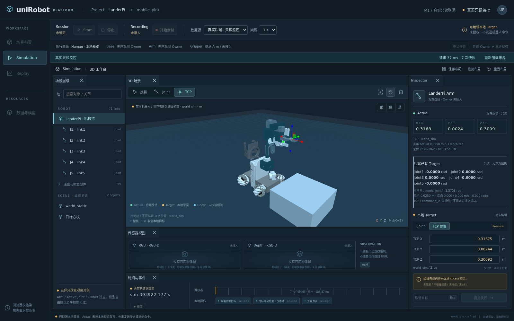
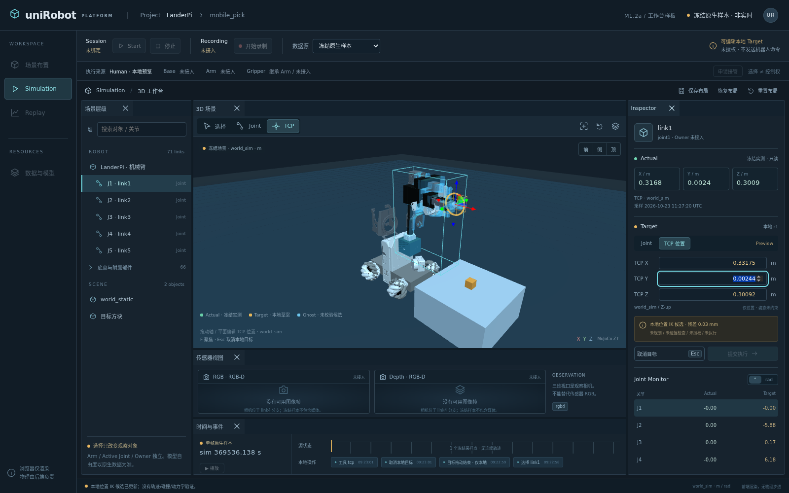

# M3.0 单 Episode 共用帧游标与连续只读播放工作台（2026-10-29）

在 M2.4 的“历史装配只剩一个来源”之上，把**当前查看位置**收敛成 FrameBrowser 内的一个游标：帧列表与定位控件、RGB、关联状态、时间面板、历史 3D 与新增的五轴历史 Actual 曲线全部跟随同一个选择；播放跨过页末时按 reader 自己的 `next_offset` 连续前进、到 `has_more=false` 自己停止；节奏措辞改为“每秒展示帧数”，并明确它**不是原速/真实倍速**（后端未证明记录时间播放资格）。只修改 `frontend/`；不发运动/RESET/录制/STOP/导航，不改后端、公共契约或 native，不新增路由、不放宽代理白名单。本切片不主张跨流采样同刻同步、整车位姿重建、已验证 3D 历史回放或正式 M1/M1.5 验收通过。

## 一、共用当前查看位置

- 游标身份写在面板头部：`data-frame-cursor-selection = offset|index|sample_id`、`data-cursor-selected-sample`；跟随它的五个消费者各自回显同一 `sample_id`——帧列表选中行、RGB（`data-frame-asset-sample`）、关联状态面板（`data-frame-displayed-sample`）、时间面板（`data-frame-displayed-sample`）、历史 3D（`data-model-requested-sample` / `data-model-displayed-sample`）与曲线竖线（`data-curve-selected-sample`）。
- 保留既有语义：`run_id`/`episode_id` 仍是身份；`sample_id` 精确条件与时间窗口条件仍显示在 `data-frame-context-sample` / `data-frame-context-window`，换 Episode 全部作废；锚点原始位置继续以 `line_index` + `persist_sequence` 呈现，`data-frame-line-index-clock="true"` 与 `data-frame-cursor-order` 一起说明**文件追加顺序不是时钟**——曲线横轴与定位控件都不把行号命名为时间。
- 没有引入跨应用全局 store：游标是组件内状态，历史面仍渲染在 `WorkbenchContext` 之外（该 context 只服务工作台面板）。

## 二、连续播放与定位

- 节奏选项是**每秒展示帧数**（每秒 2 / 1 / 0.5 帧 → 500 / 1000 / 2000 ms/帧），界面同时打印 `data-frame-playback-rate-ms` 与“每秒展示帧数只是界面推进节奏……不称原速/真实倍速，也不等于录制帧率”。
- 跨页连续：`readPage` 增加 `keepPlaying`，播放导致的翻页不再停播；页末 `has_more=false` 时播放自行关闭并写明“不推断录制结束，也不声称已遍历全部帧”；起点 `offset=0` 向后不循环、不伪造。
- 定位范围只到本页读取到的帧：本页下拉（逐行列出 `line_index` 与 `sample_id`）、本页首帧/末帧按钮、点表格行、点曲线；`data-frame-seek-scope` 与说明文字明确“不显示总时长或全局进度百分比”，`data-frame-total-forbidden` 的旧约束保留。
- 现有 `sample_id` 精确打开与时间窗口入口不变；改窗口/改条件/切 Episode/拖动定位都会停播并丢弃在旧代次上的响应。
- 时间窗口是**过滤条件而不是排序键**：界面逐行显示 reader 返回顺序里的 `sample_id`、`line_index` 与 `persist_sequence` 原值，断言这三列与直接读取同一窗口参数的响应逐行相等，且 `line_index` 随页面顺序严格递增，同时原样回显 `cursor.order=native_append_order_of_the_anchor_stream` 与 `line_index_is_not_a_clock=true`（真实档案跨前 5 帧的窗口实测行序 `line_index=[0,1,2,3,4]`、`persist_sequence=[1,2,3,4,5]`）。窄窗口只命中 1 行时不声称证明过顺序——那条断言只用于验证命中与排除计数。

## 三、播放中的一致显示（复用既有归属，不建第二套调度）

- 复用 `pageSerial`/`assetSerial`/`frameKeyRef` 与模型面板的 `poseSerial`：新帧的姿态、状态与媒体仍归属被请求的那一帧，迟到的读取或解码都不写进新选择。
- 缓冲：游标行新增 `data-frame-cursor-pending`（媒体仍在读取/解码时为 true 并写明“不拿上一帧的图像顶替”）；`clearMedia` 保证换帧即清旧图；缺失、歧义（多条候选不选第一条）、被拒（`refused`）、不支持格式（NumPy 只按字节读、不做数值解码）各自显示自己的说明，不补 0、不沿用上一帧。
- **播放中切 Episode 已被直接断言**：合成夹具让 `episode_play` 的每一条资产延迟 1.4 s，先播到 `rgbd_p1`（此刻 `data-frame-play=pause`、`assetStatus=loading`，即确实有在途读取），再切到 `episode_ok`。切换即 `readPage`：播放关闭、旧资产请求被 `AbortController` 取消、`assetSerial` 前进，之后 2.2 s 观察窗内游标仍是新 Episode 自己的 `rgbd_0`，`data-frame-play=play`、`assetStatus=bytes`，游标行 / RGB / 状态 / 时间 / 3D / 曲线竖线 / 表格选中行七个消费者全部指向同一个 `sample_id`，没有一个字段被旧代次回写。该命名空间的树在本页会话里此前已经取过，所以切换后新增取树 0 次（契约是"每命名空间至多一次、逐帧零次"，精确的 1 次/0 次由 M2.4 的普查断言负责），在线 `mobilecar/scene` 读取依旧为空。
- **卸载（离开历史视图）与切 Episode 走的是同一条丢弃链**：合成路径先播到 `rgbd_p1` 且此刻资产读取确实 `loading`，点 Simulation 卸载面板——`controllers` 全部 abort 并 revoke object URL；回到历史视图时面板显示的是**未选择**占位（`data-frame-episode=none`、`data-frame-bound=false`、连播放按钮都不存在），而不是自动恢复上一次的选择或播放——因为选择是组件状态，没有跨应用 store。在未选择的 2.4 s 观察窗（长于夹具的 1.4 s 延迟）内 `/episodes/**` 请求数为 0：既没有迟到 tick 恢复推进，也没有迟到的字节写回。重新选档后才绑定新一轮读取，游标/RGB/曲线/3D 一致指向 `rgbd_p0`，且该命名空间的树命中缓存、不再重取。
- **修掉的真实时序缺陷**：模型面板过去只在 `useEffect` 里把状态改回 idle，帧面板 DOM 已经更新而面板仍带着上一代的 status 一拍。现在渲染期即 `shownStage = sampleId ? stage : IDLE_STAGE`，空结果页/未绑定帧的同一渲染里状态就是 idle。这正是上一轮“空时间窗 `modelStatus=idle`”抖动的根因：等待条件写在帧面板上、断言却读模型面板的 effect 结果。合成路径现在断言“同一代次里即为 idle”，不靠加 sleep、不放宽阈值。

## 四、最小历史 Actual 曲线（有界、不插值、不猜 Target）

- 数据只用**本页已经取得**的 `frames[].state.recorded_state.arm_model_qpos_rad`（真实首页 5 帧、切到每页 20 帧时 20 帧全部带单一选中状态），不额外请求 robot-state、不下载整份归档、不新增依赖（手写 SVG）。
- 五条子图各自独立纵向缩放（避免把 joint4 与近零轴塞进同一比例后看不出差异），轴标签用记录数组下标 `arm_model_qpos_rad[0..4]`——本页不带每帧关节名，名称与下标的对应只在被读取那一帧的 `robot-state.arm_hinge_joints` 成立，界面不按顺序猜名字。
- 缺失即断点：`single_state_selected=false`（或该帧没有 `recorded_state`、没有 `arm_model_qpos_rad`）→ **五条轴在该帧一起断开**；`arm_model_qpos_rad` 长度不足 5 时，只画该数组确实带有的下标，缺的下标断开并写明“长度 2 < 5：不按顺序猜缺的轴”。`data-curve-interpolation="none"`，`data-curve-segments`/`data-curve-missing` 逐轴可断言；min/max 只在存在的点上计算，不补 0。
- 横轴二选一并写明来源：默认“帧顺序（本页第 N 帧，reader 的追加顺序）”，单位原样标“帧序号（不是时钟）”，并附 `line_index 不是时钟（响应原值）` 的说明；或记录自己的原始时间基（`anchor.clocks.capture_backend_monotonic_s` / `persist_backend_monotonic_s` / `capture_sim_time_s`），**只有本页每帧都带该钟的有限数值才可选**，否则下拉里标“本页不完整，不可选”。检测到相对前一帧回退时报告首处并在原位绘制，不重排、不丢弃。
- Target：`recorded_state` 的键集合里没有语义明确的位置目标，界面因此**不画记录 Target**，并点名 `wheel_velocity_rad_s`、`base_twist_body_m_s` 是速度/旋量、命令意图不等于 Actual（`data-curve-target-note`）。若某档档案真的带命名明确的 target 字段，界面只点出字段名，仍不当作 Actual。
- 点曲线任意一处或点表里的 `sample_id` 即移动同一个游标，五个面板一起跟随，且不为此多发一次帧页读取。

## 五、同一冻结 dist 的实际验证与复现入口

- 最终冻结 dist `m1-front-geometry-20261029T191842Z-9b0a12560912`（聚合摘要 `9b0a12560912`），上游 127.0.0.1:18977（M1.5f）。构建、单元测试与浏览器检查全部在授权服务器执行；真实与合成两条路径在同一 dist、同一上游上各自独立跑完，结果不拼接。更早的同产物冻结 `…T170417Z-b074b6c757e6`（真实 104 / 合成 78）、`…T180048Z-9f3f2ef1e566`（105 / 79）与 `…T181921Z-0fda80916cf4`（105 / 79）保留为迭代记录，差异只在本节 §六 列出的测试断言上。
- 真实归档（预览 19074）：unit 186/186（11 个文件）；`frames` **105** 项通过；同轮 `history` 78、`geometry` 23、`config` 51、`session` 38、`lifecycle` 48 全部通过。
- 合成夹具（预览 19075，`/api/v1/mobilecar/**` 与在线路由被夹具拒绝）：同一 dist、同一 unit 186/186；`frames` **80** 项通过；`history` 42 项通过。
- 本轮补上的三条直接断言的实测值：真实窗口过滤后 `cursor.order=native_append_order_of_the_anchor_stream`、`line_index_is_not_a_clock=true`、行序 `line_index=[0,1,2,3,4]`、`persist_sequence=[1,2,3,4,5]`、`sample_id` 逐行等于同参数直接读取的响应；合成播放中切 Episode `rgbd_p1`（在途 `loading`）→ `episode_ok` 的 `rgbd_0`，切换后 `data-frame-play=play`、2.2 s 观察窗内游标不变、新增取树 0 次、`live_scene_reads=[]`；合成播放中卸载再回来 `rgbd_p1`（在途 `loading`）→ 占位 `episode=none`/`bound=false`/无播放按钮且未选择期间 `/episodes/**` 请求 0 条 → 重新选档后 `rgbd_p0`、播放保持 `play`、游标在后续 1.4 s 内不变。
- 真实路径逐值：冷页面＋冷缓存重载后取树 1 次、面板自报读取 1 次、`live_scene_reads=[]`、资产 `bytes`。每页 20 帧时 `data-curve-frames=20`、`with-state=20`、缺 0；播放跨页继续推进，播放窗口内**取树 0 次**、被落帧的姿态读取 2 次；页内定位范围为 20 且不为定位多发一次帧页读取；横轴切到 `anchor.clocks.capture_backend_monotonic_s` 后界面写明“本页 20 帧全部带该钟的有限数值……不声称与别的流同源”，帧顺序轴写明“单位＝帧序号（不是时钟）· line_index 不是时钟（true）”；末页 `has_more=false` 时播放自己关闭。媒体慢响应只在浏览器侧注入 1.8 s 延迟（归档与后端未做任何改动）：`assetStatus=loading`、`cursorPending=true`、没有上一帧的图像冒充；台账记下 1 条被页面主动取消的资产路由（`Route is already handled`），这正是切帧丢弃旧读取的表现。
- 合成路径逐值：6 帧、每页 1 帧、每秒 0.5 帧的节奏从 offset 0 连续走到 5，共 5 次帧页读取，`has_more=false` 后自己停；游标、3D、曲线都落在 `rgbd_p5`，面板取树仍 1 次、播放窗口内 0 次重取、在线 scene 读取为空。曲线逐轴 `segments=[2,2,2,2,2]`、断点 `[1,1,2,2,2]`：`single_state_selected=false` 那一帧五轴一起断口，长度 2 的那一帧只画它确实带的两个下标、缺的不猜。空时间窗的同一渲染里 `modelStatus=idle`、`cursorSample=none`、`data-model-requested-sample=none`。
- 相机布局保持：播放、页内定位与切轴之后 `distance / azimuthDeg / polarDeg` 在 1e-6 内不变，`links` 仍是 71，`pendingLoads=0`、`assetFailures=[]`；环绕轴心会按当前帧的模型重新取景（记录里底盘与臂本来就在动，实测两次 target 分别为 `[0.0326, 0.0, 0.2540]` 与 `[0.0673, 0.1703, 0.0300]`），因此沿用 M2 已有约定比较视角三值与 link 数，不比较 target。
- 复现入口（服务器）：`bash /tmp/m24run.sh m1-front-geometry-20261029T191842Z-9b0a12560912 real 19074 "<本轮说明>"`、`bash /tmp/m24run.sh m1-front-geometry-20261029T191842Z-9b0a12560912 synthetic 19075 "<本轮说明>"`；报告在 `~/Desktop/uniRobotPlatform/var/reports/<REL>-{real,synthetic}/`，其中 `frames/browser.json` 的 `real.playback.window_append_order`、`synthetic.playback.episode_switch_while_playing` 与 `synthetic.playback.unmount_while_playing` 就是上面这些数值的原始记录。核活只用 `GET /api/v1/episodes?limit=1`（`/health` 未注册，404 不是故障）。
- 预览台账收尾（时刻 2026-10-29T19:32:39Z）：先用 `preview-registry.py … verify` 逐条核对，19072（pid 3760550）与 19073（pid 3980550）报 `owned=true, reasons=[]`，即 PID＋start_ticks＋uid＋cmdline＋端口归属全匹配且都属于被取代的 `…T181921Z-0fda80916cf4`，才按 `stop --pid` 各自停止（`verified_identity=["match"]`、`needed_sigkill=false`）；停止后这两个端口探测为 000（已无监听）。保留并核活：19074/19075（本切片最终 dist，200）、19060/19061（M2.4 最终 dist，200），上游 18977 本身 200。19056–19059 属上一 Goal 轮次登记的 M2.4 更早预览，本轮没有登记它们，因此不动。
- 冻结清单与交付工作树的逐文件比对（时刻 2026-10-29T19:35:18Z，HEAD `be6b44d`）：两侧都是 110 个文件，无缺失、无多出；`src/`、`tests/`、`index.html`、锁文件与工具脚本逐字节相同，唯一内容差异是 `docs/backend-gaps.md`——它在冻结之后又写入了本轮记录，故工作树聚合 `28da914c041d` 与冻结聚合 `9b0a12560912` 不同；`docs/development.md` 按 `release-source.py` 的设计本就不进快照。因此结论只到"被验证的 dist 与交付的源码/测试是同一份（两份记录文档相对冻结清单滞后，且滞后被这样记出）"，不写成"dist == 交付"的全等；复看本轮结果按上一条的登记命令重跑即可。

## 六、同一 dist 的首次失败、诊断与修正（不加固定 sleep、不降阈值）

- 需求点名的“空时间窗 `modelStatus=idle`”抖动有真实产品成因：模型面板过去只在 `useEffect` 里把状态改回 idle，帧面板 DOM 已经换帧而面板仍带着上一代 status 一拍。改为渲染期 `shownStage = sampleId ? stage : IDLE_STAGE` 后，最终 dist 的合成路径首次即通过该断言，没有新增任何固定等待，也没有放宽判定。
- 首个 dist `…T161135Z-21ddfe950f31`：真实 `frames` 停在第 70 项，`data-cursor-selected-sample` 读到 `None`——`.history-cursor` 同样存在于旧的 `history-view` 流游标上，选择器命中了第一个；把三处选择器限定为 `[data-frame-view] .history-cursor` 后通过。同轮合成停在第 53 项：断言用整页文本判断“不出现‘倍速’”，而新增说明合法地写着“不称原速/真实倍速”；改为只判断节奏选项文本。
- 第二个 dist `…T162036Z-42abe00d6a5a`（与本 dist 同一份前端产物，只改测试）：真实第 75 项把“不是时钟”断言在 `data-curve-x-label` 上，而界面把它写在单位与 `data-curve-x-note` 里（单元测试钉的就是 `unit` 字段），改为读面板自己的横轴说明；合成第 54 项期望“数组过短的五轴全断”，与单元测试有意保留的“只画该帧确实带的下标、缺的不猜”规则冲突，按产品实际规则改为逐轴 `[1,1,2,2,2]`。
- 同一产物的第三～五轮（逐步收紧测试作用域，非产品问题）：`wait_frames` 不支持 `arg`，改用 `page.wait_for_function`；分页选项没有“2”这一档，改用现有 1/5/20，并把跨页播放的等待条件换成面板自己报告的“界面停止推进”而不是猜偏移；曲线点选后“不多发帧页读取”原先从更早的标记数起，会被前一次改页大小的在途响应污染，改为紧贴点击取标记；注入延迟的路由处理器在页面主动取消旧读取时抛 `Route is already handled` 使整轮中断，改为记录这次取消，同时保留“缓冲／落定”两个 DOM 断言。修正后 `…T170417Z-b074b6c757e6` 真实 104 项、合成 78 项一次通过。
- 完成后的复核发现两条需求只是**被间接覆盖**，于是补成直接断言并按同一 dist 重跑：①“时间筛选后仍遵守追加顺序”——第一次补的断言用真实档案的窄窗口（±0.05 s，只命中 1 行），单调递增子句在单行上是空真，等于没证明；改为跨前 5 帧的窗口并要求 ≥3 行、逐行等于 reader 返回顺序（`…T180048Z-9f3f2ef1e566` 起）。②“切 Episode 后旧请求不能恢复播放或覆盖新选择”——原来只有非播放态的切换用例，现补成在途资产读取存在时的切换，并把节奏、分页与观察窗写成面板自己报告的状态（`data-frame-play`、`assetStatus`）而不是猜时间。
- 新增的切 Episode 断言首跑失败在**测试自己的期望**上：我写了“切换后新增取树 1 次”，而这一页会话此前已打开过 `episode_ok`，命名空间＋内容身份的缓存让真实答案是 0 次；宽诊断把七个消费者取值、`playMode`、取树次数与在线读取全部打出来后确认产品行为正确，于是断言改回契约本形（每命名空间至多一次、逐帧零次），并保留 M2.4 普查里“新命名空间恰好 1 次”的精确断言，不靠放宽阈值让测试通过。
- 补第三条（卸载再回来）时的两次失败都在测试自己：① 以为“回到历史视图会自动重绑上一次的帧”，实测是 `data-frame-episode=none`、`data-frame-bound=false`、连播放按钮都不存在——选择是组件状态、没有跨应用 store，所以正确断言是“占位 ＋ 未选择期间 `/episodes/**` 请求 0 条”；② 又把“重新进入即取树 1 次”当期望，而缓存命中的真实值是 0 次——同一个错误在两条断言上重犯，已按“至多每命名空间一次、逐帧零次”与 M2.4 普查里“新命名空间恰好一次”分工。定位手段是把裸的 40 s 超时换成带标签的 `wait_state`，它一次打印面板自身的十来个状态字段，直接指出卡在哪一步，而不是留下一个无信息的 timeout。
- 收尾审计（2026-10-29，同一 dist，不改产品代码）抓到两处“记录写得比事实靠前”：① §五 原先直接写“本轮被取代的 19062–19073 已按台账停止”，但 19072/19073 在那一刻仍在监听——先跑 `verify` 确认 `owned=true/reasons=[]` 再 `stop --pid`，端口现探测为 000，记录补上时刻与核对结果；② 逐文件比对不是全等：`docs/backend-gaps.md` 在冻结后被写过，聚合摘要因此与工作树不同（`9b0a12560912` vs `28da914c041d`），差异只在这份记录文档、`src/`/`tests/` 逐字节相同。两条都按“滞后要写明，不写成 dist == 交付”处理。同时确认第 4 项的“遇到回退不能静默重排”不是只落在实现里：单元测试 `reports a clock that steps backwards and keeps the record order untouched` 钉住 `points.x` 仍为 `[11, 9, 12]` 且 `outOfOrder=[{position:1, sampleId:'rgbd_1', from:11, to:9}]`，界面按原顺序绘制并显示首处回退。
- 本轮除上面的渲染期 idle 修复外**没有发现其它产品缺陷**：其余失败都在测试断言的作用域与夹具能力上，逐条留档以免被误记为“抖动”。

# M2.4 历史装配只剩一个来源：采用 18977 的 `include_model_tree`，在线场景读取被删除（2026-10-29）

后端 M1.5f 把前端等待的那一项交付在**既有路由**上：`GET /api/v1/episodes/{id}/robot-state` 新增可选布尔查询参数 `include_model_tree`（默认 `false`；非布尔 422 `bool_parsing`；`schema_version` 未升版；历史面仍是八条 GET）。本节把历史固定模型树的来源从 `GET /api/v1/mobilecar/scene` 切换到该 Episode 自己的 `robot-state.model_resource.model_tree`，并删除历史装配对在线路由的读取与回退。**这关闭了 M2.0 第三节里"清单仍取自在线路由"那一条未达成项**；整车完整重建、跨流同步、已验证 3D 历史回放与正式 M1/M1.5 验收仍不宣称。

## 一、按实际发布契约取树与装配

- `readRobotState` 增加可选 `includeModelTree`；取树时保留 `run_id` 与当前 `sample_id`，读回后先 `assertHistoryFrameIdentity` 核对帧身份，再决定装配。树只认 `model_resource.model_tree`，不猜 `model_resource.links`，不新增路由、不放宽代理白名单（实测既有 exact 路由原样转发新参数：默认响应没有 `model_tree` 键，带 `include_model_tree=true` 的响应有，且 `links` 条数等于外层 `link_count`）。
- 门控：只有 `model_resource.status=match`、`model_tree.requested=true`、`included=true`、`authority=frozen_compiled_geometry_bundle`、`live_native_scene_proxied=false`、`semantics.world_links=compiled_initial_layout_not_live_object_state`、`world_links_are_not_recorded_object_positions=true`、`is_recorded_state=false` 且 links/world_links 非空才装配；否则写出**拒绝条款**（`included=false · reason · links_are_substituted` 或"门控拒绝：authority/语义/空数组"）并阻塞，绝不退回在线树。装配用 `model_tree.links/world_links` 的完整 `local_transform`＋`geoms[]` 结合 `model_resource.assets` 构造内部 `SceneManifest`，网格字节仍只走本 Episode 的资产端点并按声明摘要寻址。
- 绑定：12 行身份/计数/引用行（四个摘要取"树自述 `content_identity` vs 记录外层同名字段"两个各自发布的值；`link_count`、`world_link_count`；`arm_hinge_joints` 用"记录声明名单在树文档顺序里的同名子集"，不引入命名猜测；`counts.{links,world_links,geoms,mesh_geoms}` 与实体数组自洽；`mesh_asset_id 可解析`）＋ 记录点名节点的逐节点行（#35 交付）。任一行不等即拒绝装配。真实两侧全等：71/2/100/22、四个摘要、`joint1..joint5`、22 引用 0 未解析、23 个声明资产中 22 个被引用（`imu_link` 无树内引用，界面如实列出，不要求全部被引用）。
- 缓存只管静态内容：以 `episode|run` 为命名空间、`content_identity_sha256` 为键，首次或内容身份变化时取一次完整树，其后逐帧请求省略该参数；默认响应没有 `model_tree` 属正常，不触发每帧重下；**条目不跨命名空间共享**（否则一份声称同一身份但内容不同的树会被别的 Episode 直接画出来——本轮就因此把共享键改成命名空间＋身份复合键）；不缓存整条 `robot-state`，不沿用旧帧 pose/mapping/part_readiness；动态响应无 `ETag` 是预期，不把 mesh 的内容 ETag 用到整条响应上。`data-model-tree-reads / -read-episode` 报的是"本页面会话内为该 Episode 发起的取树请求数"，回访已缓存的 Episode 报 0。

## 二、真实与合成两条路径的联合验收（同一冻结 dist、同一上游 18977）

真实路径（`http://127.0.0.1:18977`，release `m1z-20261029T075630Z-platform`，提交 `a64b522c93ceb0abbbb27c058801af29192334f0`；核活只用 `GET /api/v1/episodes?limit=1`，`/health` 未注册其 404 不是故障）：`frames` 92 项、`geometry` 23 项、`session` 38 项、`config` 51 项、`lifecycle` 48 项、`history` 78 项全部通过。其中该 Episode 取树 1 次、其后逐帧/翻页/时间窗/三视图/拾取之内 0 次，切 Episode 再恰好 1 次；历史面窗口内 `/api/v1/mobilecar/scene` 读取 0 次（应用自身的在线 `snapshot` 轮询单列记录，不与历史面板混计）；底盘＋五铰链＋TCP 点按本帧记录值驱动，同帧 FK `abs_error_m=1.645e-14` 与容差 `0.005` 并列显示；同 run 第二档真实档案照常装配、一个部件都不驱动。

合成路径（同一 dist，夹具把 `/api/v1/mobilecar/**` 一律拒成 503 `native_offline`，新页面冷缓存）：树缺失、`included=false` 拒绝、语义自称活物体、树内容身份与记录不符、相同 mesh 换关节顺序、内容身份换帧后重取一次、回访已核验命名空间不再取树、声明摘要被改的资产在字节读取处被 reader 拒发并点名——逐项断言；历史模型、姿态与媒体在在线路由被拒的前提下照常工作。**独立性由"在线路由被拒仍然装配成功"证明，不靠预热缓存。**

## 三、边界

- `world_links` 只是编译参考布局，`target_cube` 等对象在本 Episode 的历史位置仍未记录（`mapping.dynamic_scene_objects=missing`）；夹爪换算、相机外参、TCP 朝向、跨流同步与统一历史游标本轮未推进。
- 同一冻结 dist（`m1-front-geometry-20261029T111821Z-9e7dfa11c6b8`）上出现过一次与本轮改动无关的时序抖动：`frames` 在"空时间窗页面把排除行计数并保持窗口为当前条件"一项停住（面板状态尚未回到 idle），随后对同一预览、同一 dist 单独重跑 `frames` 得 92 项通过；上一轮同一 dist 变体在 `geometry` 的"Actual 刷新保持 TCP 拖拽/目标/相机"也抖过一次、重跑即过（该项历史上就有抖动，见 M1.x 记录）。两条路径的通过数字都取自同一冻结 dist 的最终一次执行，未拼接不同候选：真实＝18977，合成＝同一 18977 上游＋夹具拒绝在线路由。
- 迭代中被取代的报告目录按原因改名保留（`-real-suitefail-*`、`-synthetic-suitefail-*`），不删除；失败原因依次是：断言里用了不存在的属性名、真实窗口内应用自身的在线读取被误算进历史面、夹具树缺少记录声明的夹爪/轮关节、共享内容键被另一 Episode 的异树污染、摘要不符的资产按旧语义等待 blocked。

# M2.0 已验证部件的真实历史姿态联动、切帧归属修复与按内容身份绑定的固定模型树（2026-10-28）

本轮把上游从 18969 切到 **18970（M1.5e）**，并按该候选的**实测分部契约**开放有依据的历史姿态：底盘（`base_pose_placement`）、机械臂（`arm_local_pose`）与 TCP 位置点（`tcp_position_marker`）在真实记录上确实被驱动；夹爪保持 `conditional` 不默认开启，TCP 朝向/相机/动态物体保持 `blocked`。同时修掉切帧显示归属（请求帧与显示帧分开），把静态放置树与记录**按内容身份绑定**（不再只看网格摘要），并修正 `sim` 时间量与版本更正的措辞。只修改 `frontend/`；不发运动/RESET/录制/导航，不改后端、公共契约或 native。

**本轮成熟度分层（不合并宣称）**：① 切帧归属修复已完成并在真实与合成两条路径验证，且屏幕上每个被驱动的值都能逐行追溯到自己的显示帧（见第六节）；② 分部历史姿态在 18970 的真实记录上**已开放并渲染验证**（底盘＋五个模型弧度＋TCP 点），并在同一条 run 的另一档 `recorded_payload=null`、无 `verified` 映射的真实记录上验证了**反向半边**：装配照常成立、一个部件都不驱动、九项能力各有自己的原因（见第八节）；③ 固定模型树已与记录按内容身份绑定，但**清单仍取自 `GET /api/v1/mobilecar/scene`**——该路由自述 `data_source=live_native_http_with_verified_compiled_geometry`，即内容由编译 geometry bundle 核验过、但读取路径仍需在线会话；Episode 作用域的静态模型 manifest 后端尚未发布，前端不假造不存在的路由，因此“历史装配完全不依赖在线场景读取”这一条**未达成**，界面把这句话原样写在装配说明里；④ 整车完整重建、跨流同步、已验证 3D 历史回放与正式 M1 验收**均未宣称**。

## 冻结版本与上游

| 项 | 值 |
|---|---|
| 前端 release | 见下节“同一冻结版本的实际验证” |
| 历史上游 | `http://127.0.0.1:18970` = 后端 M1.5e 候选（服务器 PID 3256687）：同一进程提供 episode-read-1 五条 GET、`frame-link-2` 的 `/frames`、`history-pose-1` 的 `/robot-state` 与 `/model/assets/{asset_id}`、以及 `geometry-2` 的 `/mobilecar/scene` |
| 真实样本 | `run_0104613ff7364ae78cf2f3946bd45f7b` / `episode_27bfed5427684795b361cd2ec21e9aa7` / 首帧 `rgbd_e3213e6cb64b4cd693c17d485d064d09` |
| 保留服务 | 上一轮交付预览 **19013 → 18969** 与 **18986 → 18964** 全程未停；18969/18970/8792 只经 GET 探测，native 写入路径未触碰 |

## 一、切帧显示归属（真实产品缺陷修复）

`sampleId` 是“请求帧”，`displayedSample` 是“显示帧”，两者分开存：帧切换时先把面板置空并调用 `applyFramePose(null)` 让树**回到编译初始布局**（阶段文案写明“画面暂时回到编译初始布局，不使用上一帧的姿态”），读回后才把该帧允许的部件摆上；读取失败同样回到初始布局，不保留上一帧姿态、不补 0、不沿用上一帧。面板头部同时打印“请求帧 / 显示帧”，`data-model-attribution` 取 `matched / pending / no-frame`，`data-frame-pose-verified` 只在“显示帧就是当前请求帧且确有动态姿态”时为 true。模型资源、相机与布局在换帧时不重建：装配键是 `episode|run`，逐帧只重读 robot-state 并重新摆位。

## 二、按 18970 分部契约驱动姿态

- 门控按**能力**而不是按关节数量：`part_readiness` 的 `status ∈ {ready, ready_with_caveats}` + 对应 `mapping` 行 `verified` + 本帧真带值 + 逐项 `frontend_rule` 的附加条件，四者同时成立才驱动；`conditional` 不默认开启，`blocked` 绝不从记录绘制，未知状态一律拒绝。`fixed_model_reference_assembly` 有自己独立的规则（“整车姿态缺口不阻断装配”），因此整车未就绪不影响其他部件。
- 机械臂：五个值按 `arm_model_qpos_rad` 的**模型弧度**直接施加到 `arm_hinge_joints` 的五个铰链，要求 `requires_user_angle_conversion=false` 且 `draw_in_model_radians=true`，绝不做用户零位换算；数量不符即整条不驱动。0 是合法数值，照常驱动并写明“没有跨帧运动覆盖证据就不宣称某轴已验证”。
- 底盘：记录的世界位姿**替换** `base_link` 根 free joint 的编译初始位姿，不再叠加 `root_joint.local_position_m=[0,0,0.0556]`；该排除由 reader 自己的同帧运动学核对背书——`supported_hypotheses` 含 `recorded_pose_is_base_body_world_pose`、总 `verdict=consistent`（`abs_error_m=1.6454375138849238e-14`，`consistency_tolerance_m=0.005`，容差归属原文“not a calibration limit and not a contract threshold”），另一条“需要叠加 bundle 根偏移”的假设被算成 `inconsistent`，误差恰为 `0.0556` m。按该能力 `frontend_rule` 的原文，“核对不一致就不放置底盘”，因此 verdict 非 consistent 或缺失时底盘不放置，而机械臂与 TCP 照旧。
- TCP：只画位置点（自建 sphere，绝不复用 live `actualTcp`），`tcp_orientation_frame` 为 `blocked` 所以不合成朝向。
- 真实记录实测：`mapping` 10 行 = 4 `verified`（臂关节、底盘位置、底盘朝向、TCP site）＋ 1 `unverified`（夹爪）＋ 3 `missing`（TCP 朝向、相机外参、动态物体）＋ 2 `not_required_for_pose`；`part_readiness` 9 项 = ready 1 / ready_with_caveats 3 / conditional 1 / blocked 3 / not_required 1；界面驱动 4 项（装配＋臂＋底盘＋TCP），逐条列出 5 项未驱动原因；`pose_readiness.mapped_targets_partially_or_fully_verified=4/10`、`robot_state_can_be_rebuilt_without_assumptions=false`、`capability_summary.whole_robot_pose_rebuildable=false` 原样保留。

## 三、时间与姿态措辞

- 帧面板显示 `times.sim_time_quantity_keys`（负载量与信封量各一条，缺就是缺、不互相回填）与 `version_migration.corrections`（本版把“取信封值却标为负载来源”的标注错误记为更正）；遇到不返回这两个键的旧候选答复，界面写“reader 未声明 sim 时间量清单（本版无该键）”并零条更正行，不自造。
- 四类说法分开且不可互推：本帧输入完整（`single_state_selected`/`recorded_payload`）、同帧运动学一致（`tcp_kinematic_cross_check`）、跨帧运动覆盖（逐帧实际值是否变化）、硬件标定（`zero_pose_authority.zero_status=user_defined_photo_pose_not_hardware_500`、`calibration_session=uncalibrated`、能力限制里的 `no calibration claim`）。`version_binding.writer_identified=false` 与非同步声明继续显示在姿态旁边。

## 四、静态树与记录的内容身份绑定

装配前额外核对 7 个**可比**身份字段：`bundle_sha256`、`content_identity_sha256`、`model_inputs_sha256`、`compiled_scene_sha256`、`link_count`、`world_link_count`、臂铰链名与文档顺序；任一项不等就 `blocked` 并列出两侧值——这是“相同 mesh 字节、不同树内容”唯一能被拦下的地方（合成用例分别用 content_identity 与 joint 顺序调换验证）。真实数据两侧全等：`275389464eee…` / `cb7899642604…` / `9e1b60c04b8d…` / `a7b8b2c2d12d…` / 71 条 link / 2 条 world link / `joint1..joint5`，23 个网格摘要亦逐个相等。放置树仍按 `episode|run` 一次读取，换帧不重新下载；不要求逐 link 位姿表，屏幕位姿由固定树加本帧被允许的输入算出。

**读取普查（本轮新增验收）**：面板把“自己为当前 Episode 发起过几次静态树下载”写在 `data-model-tree-reads` 与 `data-model-tree-read-episode` 上，普查因此能归属到历史面板自身而不被同路由的其它读者污染——`/api/v1/mobilecar/scene` 同时是工作台自己的原生读取路径，合成模式下该路径被网关拒绝后会重试，路由级计数会把这类读取算进来（实测该 Episode 路由窗 2 条，面板自身 1 条）。真实路径的归属核对同时看路由窗：一个 Episode 的身份只有 1 次放置树读取，其后的 13 次 `robot-state`（6 个不同帧）、多次翻页、时间窗、视图切换与点击拾取之内**新增 0 次**；切到另一个 Episode 后路由窗仍恰好 1 次，面板计数重新为 1（换 Episode 时面板重新挂载，这与“换帧不重建视口”是两件事，后者由相机与 link 计数不变证明）。网格字节一律走 `GET /api/v1/episodes/{id}/model/assets/{asset_id}`，历史窗口内来自 `/mobilecar/scene/assets/` 的请求为 0 条。

**放置树本身读取失败也要说清（本轮新增用例）**：这条路由可以拒绝，也可以答非所问，两种都不能留下一个模型在屏幕上。夹具让它按 `geometry_bundle_unavailable` 返回 503 时，面板置 `failed`、原文带出这个 reader 码、画布数为 0、五个关节与底盘/TCP 全部不驱动、显示帧为 `none`（`data-model-tree-reads=1` 说明它确实尝试过一次，而不是没读）；夹具改答 `world_pose_semantics=live_native_object_state_not_compiled_layout`（“这是在线对象状态，不是编译初始布局”）时，面板同样 `failed` 并写明“不用它装配历史参考”，且 `data-model-tree-source=none`；随后路由恢复、重新打开同一 Episode 又装配成功（`ready`、画布 1、五个关节、归属 matched），说明失败不会粘住。这两条与身份不符、joint 顺序调换、资产摘要不符一起，构成“静态参考不可用时界面说什么”的完整证据。

**清单来源按路由原文显示（本轮新增）**：装配说明不再只说“冻结 bundle”，而是把该路由自己的 `data_source` 原样写出来并紧跟缺口说明——实测 18970 答复 `data_source=live_native_http_with_verified_compiled_geometry`、`world_pose_semantics=compiled_initial_layout_not_live_object_state`，且其 `runtime_identity.episode_id=episode_43c22f95536f4517be04e4b195d6d354` 并不是被打开的 `episode_27bfed542768…`。也就是说：**内容由编译 bundle 核验过并与记录按身份绑定，但取到这份内容的路径仍需在线会话**。同值通过 `data-model-tree-source` 交给断言（真实路径与一次直接 GET 的答复逐字相等；合成路径按夹具声明的同值显示），操作者在屏幕上能看清这条差别，而不是被一句“冻结”糊过去。这条依赖只有后端发布 Episode 作用域 manifest 才能解除。

## 五、真实多帧验收

同一 Episode 首页里选出三个底盘与关节值不完全相同的帧，逐帧断言：显示帧身份＝所选帧、渲染根高度＝该帧记录 z（`0.053540585735473954 / 0.05353981847658025 / 0.05353885338965963`，与编译初始 `0.0556` 不同）、五个关节值＝记录原值、图像＝该帧自己的 rgb 引用；三帧渲染高度互不相同、臂值不同的帧对之间 `gripper_link` 世界位置确实移动；整段步进相机距离/方位/俯仰与 link 计数不变。面板显式陈述 world_sim 轴向与 `mujocoRoot` 的 −90° 映射（`data-model-axis-convention`），并在真实模型上按网格点击完成一次**真实拾取**，Inspector 读取的相机/link/姿态归属在拾取后不变，且页面上不存在 Target/Ghost/工具元素。

前/侧/顶视本轮在**真实记录**上补齐（原来只有合成路径）：三次切换后 `camera.distance` 全等（`0.9243614011846233`，顶视 `0.9243614058064303`），`target` 三点全等，只有方位/俯仰改变（侧视 `azimuthDeg=0`、正视 `azimuthDeg=90`、顶视 `polarDeg=0.0057…`），且三视图下 `attribution.displayedSample`、link 计数与 `worldPositions` 完全一致——视图只动相机，不重新装配也不换帧。数值核对不止读 DOM：Inspect 把渲染结果逆变换回 world_sim 后与记录逐分量对齐（三帧最大分量误差 `0.0`）、与后端同帧 FK 距离 `1.6e-14` 量级且与 reader 自己报告的 `abs_error_m` 相同、TCP 到 `gripper_link` 的距离跨帧不变（极差 `2.8e-16`），详见下节。

## 六、已驱动值的逐值屏上溯源（本轮新增切片）

“画面被驱动了”与“画面上这一行的数就是记录里的那一个”是两件事：前者已由 `data-model-joints-applied` 与逆变换核对证明，本轮把后者也摆到屏幕上。历史面板在“未驱动清单”下面新增一张**逐值表**（`drivenValuesOf()`），行由**场景真正施加的值**反推，而不是由记录字段列表正推——输入是 `scene.attribution()` 的 `jointValues`／`baseApplied`／`tcpApplied`，因此门控没放行的部件天然没有行，缺席也不会被 0 补出来。三列语义严格分开：

- **绘制用的记录原值**（`data-value-model`）：就是移动关节/身体的那一份数，`String()` 原样输出。真实首帧实测五行为 `0.00004731963891071609 / 0.0016603668666036813 / 0.0014384481908740504 / -1.5696750090681135 / 0.0000011293487091102144`，底盘行是 `base_position_world_sim_m` 与 `base_quaternion_xyzw` 两段 JSON，TCP 行是 `tcp_position_world_m` 的三段 JSON。断言把这三列与同一帧 `robot-state` 的 `recorded_payload` 逐字比对（`[float(…)[:5]] == arm_model_qpos_rad`、`json.loads(底盘段) == base_position_world_sim_m`），不是与面板自己的另一句文案比对。
- **仅展示：按 reader 公式的用户角**（`data-value-display`）：用 `model_vs_user_angles.user_angle_formula` 的 `zero_model_rad`／`user_direction` 现场换算，并在同一格写明“本界面按 reader 公式换算，仅展示，未参与绘制”。真实 joint4 的模型弧度 `-1.5696750090681135` 与该格显示的 `0.0011213177…` 相差约 1.57 rad（joint4 声明的零位是精确 −π/2），两列同时出现即证明绘制走模型弧度而非换算后的用户角；该轴缺 `zero_model_rad`/`user_direction` 时这一格写“不换算、不猜测”，左列原值照常列出。
- **来源字段**（`data-value-source`）：逐行标明 `arm_model_qpos_rad[i]`＋`render_source` 原文、底盘的“同帧运动学核对背书”、TCP 的“只画位置点，不合成朝向（`tcp_orientation_frame=blocked`）”，底盘行另复述 `root_joint.local_position_m=[0,0,0.0556]` 未再叠加。

整张表挂在**显示帧**上：`data-model-values-table` 取显示帧的 `sample_id`，归属未成立时为 `no-frame` 并列出“本帧没有可归属的已驱动值”一行（`data-model-value-none`）。真实三帧逐帧断言行内容随记录变化且互不重复（`real.driven_value_readout_per_frame`：`rgbd_e3213e6…` → `rgbd_e553d6b…` → `rgbd_9d0502b…` 的臂值、底盘向量、TCP 各自不同，且“打印出的不同值数量”与“记录里的不同值数量”一一对应——臂 3 种、底盘 3 种、TCP 3 种）。合成路径覆盖四种空/缺表状态：读取中（`pending`＋表为 `no-frame`）、无 `part_readiness`（有显示帧但零行）、运动学核对缺失（只有底盘行消失，臂与 TCP 保留）、放置树被拒（`failed`＋零行）。0 照常成行：`episode_zero_angles` 五行原值为 `0`，joint4 的展示列算成 `1.5707963267948966`。

## 七、跨帧运动覆盖的本会话观测（本轮新增切片）

第三类与第四类说法要分开：**同帧运动学一致**不等于**跨帧运动被覆盖**，而后者此前只在测试里算过一次，屏幕上看不出来。现在面板把“本会话在这一个 Episode 真读过并归属过的帧”里每个被驱动项出现过的**不同记录值个数**如实列出来（`motionCoverageOf()`，输入是每次 `applyFramePose` 真正施加的那份值）：

- 只有 1 个值的轴写明“没有跨帧运动覆盖证据，不宣称该轴已被验证”，多个值才写“有跨帧运动证据，且只对已访问帧成立”，并把每个不同值的来源帧 id 列在旁边（`data-motion-distinct` / `data-motion-visits` / `data-motion-samples`）。
- 观测按 `episode|run` 起算并随其重置（`data-motion-visited-key`），换 Episode 不会把上一个 Episode 的帧混进来；被扣下的部件没有行，所以底盘被扣的夹具里运动覆盖行也只有臂与 TCP，放置树被拒时访问计数为 0。
- 真实记录实测（`real.motion_coverage`）：步进三帧时访问计数为 `[1, 2, 3]`，三帧之后七个被驱动项全部 `distinct=3`、`visits=3`，来源帧恰好是这三帧且都属于本 Episode——即“记录里三个帧各不同 → 屏幕上确实显示三个不同值”，而**不是**推断整条 Episode 的每个轴都活动过。
- 合成路径给出反向证据：`episode_ok` 两帧的 `arm_model_qpos_rad` 完全相同，界面在两帧都驱动成功的同时写明七项全为 `distinct=1` 且“没有跨帧运动覆盖证据”——驱动成立与运动被验证是两件事，这条现在在屏幕上直接可见。

## 八、同一条 run 的第二档真实档案：分部契约各自成立（本轮新增切片）

第七节与第二节此前只在**一档真实 COMPLETE 记录**＋合成夹具上验证过“不驱动时界面说什么”。本轮在 18970 的归档里找到同一条 `run_0104613ff7364ae78cf2f3946bd45f7b` 的另一个 Episode 作为**真实对照**：`episode_9285f8146bf44f99a3a4e796c7e20359`（首页 3 帧，首帧 `rgbd_b04252c36a504b8c8e6df49bbcf51628`，全部经 GET 读取）。它的自己的契约答复与主档案完全不同——`frame.linkage_status=partial`、`state.single_state_selected=false`、`state.recorded_payload=null`、`tcp_kinematic_cross_check.verdict=null`，`mapping` 10 行是 5 条 `unverified`（臂关节、底盘位置、底盘朝向、夹爪、TCP 位置）＋3 条 `missing`＋2 条 `not_required_for_pose`，**没有一条 `verified`**；而静态身份两侧仍逐字相等（`bundle_sha256=275389464eee…`、`content_identity_sha256=cb7899642604…`）。也就是说：**同一条 run、同一个冻结 bundle，分部契约按 Episode 各自成立**——不能拿主档案的 `verified` 给这一档放行，也不能因为这一档不可用就把装配一起否掉。

- 屏幕实测（`real.partial_archive`）：`stage=ready`、画布 1 个、7 个内容身份字段全为 `true`、放置树按**这个 Episode 自己的身份**恰好重读一次（`data-model-tree-reads=1`、`data-model-tree-read-episode=episode_9285f8146bf4…`、路由窗同样只有 `/api/v1/mobilecar/scene` 一条），`data-model-tree-source` 仍原样显示 `live_native_http_with_verified_compiled_geometry`；被驱动的部分是零——`data-model-joints` 为 `0`、底盘 `false`、TCP `false`、`data-frame-pose-verified=false`，逐值表只剩“本帧没有可归属的已驱动值”一行（`data-model-values-table=no-frame`），运动覆盖表同样是空行且访问计数不掺进上一个 Episode 的帧。
- 未驱动清单 8 行，且**每一行写的是该项自己的答复**：`arm_local_pose=blocked`、`base_pose_placement / gripper_visual_appearance / tcp_position_marker=conditional`（不默认开启）、`tcp_orientation_frame / camera_view_from_record / dynamic_scene_objects_from_record=blocked`（不从记录绘制）、`wheel_pose_from_record=not_required`；页面上不再出现任何“界面没有该能力的处理规则：不驱动。”这类兜底句。截图 `pose-second-archive-no-drive.png`。
- 合成路径同步收紧：状态歧义夹具的未驱动数从 3 改为 **8**，并额外断言能力行数与 reader 的 9 项 `part_readiness` 一一对应、`data-part-drivable` 只有装配一行是 `true`、兜底句不出现——这样“每项能力各自有原因”在两条路径上都是被断言的，而不是偶然成立的。

## 本轮测出并修掉的实际缺陷

1. **内容身份绑定表里的“清单来源”行会让装配永远失败（真实缺陷，代码审查＋浏览器检查发现）**：把“树来自哪里”写成一行身份比较，两侧字符串永不相等，`unbound` 恒不为空、装配恒为 `blocked`。改为只比较可比较的身份字段，来源另在绑定表旁的说明里陈述。
2. **底盘门控漏掉 reader 的一条 `frontend_rule`**：原实现只看 `supported_hypotheses`，未看总 verdict；规则原文是“运动学核对不一致就不放置底盘”，故补上“verdict 非 consistent 或缺失即不放置”，并加“相同状态歧义的帧仍装配但不驱动任何记录值”的用例。
3. **TCP 标记在无标记时抛错**：`this.tcpMarker!.visible = false` 在未创建过标记时崩，改为显式判空，标记不再借用 live `actualTcp`。
4. **测试自身的错误断言（不是产品缺陷，一并记录）**：① 用 `abs(底盘高度差) > 1e-6` 判“画面动了”，而真实帧间底盘位移只有微米级，改为“记录里不同→渲染里必不同，且臂值不同的帧对 `gripper_link` 必须移动”，把运动覆盖的判定权交给记录本身；② 断言 `0.0556` 出现在 `data-fk-check` 段落里，而该值只在被排除假设的表格行中，改断页面文本；③ “读取中不重贴旧姿态”用 `wait_for_function` 抓到 `pending` 后再读属性，快答复会让窗口滑走，改为夹具对该帧故意延迟 1.2 s，使“隐藏”成为可观测状态；④ 播放节拍用例把“显示帧＝当前帧”当成即时条件，而逐帧重读本身需要时间，改为暂停并等待归属重新 `matched` 后再断言；⑤ 时间更正行的采集读的是属性值（恒为 `true`），改读 `<li>` 文本；⑥ 夹具的 `part_readiness`/`mapping` 若干 `frontend_rule`/`gap` 用的是自拟短句，现按 18970 原文替换，避免前端规则被“测试自己写的话”满足；⑦ **普查第一版把路由计数当成了面板自身计数**：`/api/v1/mobilecar/scene` 也被工作台自己的原生读取使用，合成路径下该读者被拒绝后还会重试，于是“这个 Episode 读了几次树”被算成 2 次、切帧窗口里也混进 1 次，改为面板自计（`data-model-tree-reads`）承担断言、路由窗只作记录；⑧ **第一版把自计器当累计值**（以为换 Episode 后应为 2），实测面板在换 Episode 时重新挂载、计数重新为 1，真实路径的路由窗同时给出“每个 Episode 恰好 1 次读取”的外部证据，因此两条都按实测改为“当前 Episode 自身 1 次”。
5. **非归属帧的未驱动清单没有带上每一项自己的答复（真实第二档档案测出的产品缺陷）**：`recorded_payload=null` 时 `poseDriveOf` 走短路分支，只有臂/底盘/TCP 三项写有依据的原因，其余能力落到通用兜底句上——reader 这一帧明明逐项答复了 9 个能力（`arm_local_pose=blocked`、`base_pose_placement=conditional`、`gripper_visual_appearance=conditional`、`camera_view_from_record=blocked`…），屏幕上却分不清哪一项是 `conditional`（不默认开启）、哪一项是 `blocked`（绝不从记录绘制）。修法是短路分支在返回前把 `part_readiness` 里尚未答复过的能力逐条补上，原因里带上该项自己的 `status`、`frontend_rule` 与缺口（“本帧没有单一选中的状态记录，且该能力自身 status=…：按 frontend_rule 不驱动”），既不放行任何一项，也不把九条答复折叠成一句。第一版真实 pass（`…T131659Z-56fa033e724f-real-second-archive-gate-abort`，其 `frames/browser.json` 为 `status=failed`、已记录 67 项检查）正是在这一条上中止：新加的第二档断言要求页面上同时看得见 `conditional` 与 `blocked`，`exception` 字段原文保留被否定的检查名“真实第二档：conditional 不被默认开启、blocked 不从记录绘制，本帧缺状态被原样写成缺而不是 0”与当时的驱动摘要“本帧状态不可归属（single_state_selected=false）：画面保持固定参考姿态，未驱动 8 项。”（修复后这条断言在交付 pass 里改名为“…conditional/blocked 都留在未驱动一侧…”，与三条第二档断言一起通过）；目录已按上述名字保留，不计入最终结果。合成路径的夹具同步收紧（状态歧义用例的未驱动数 3 → 8、能力行数与 reader 的 9 项一一对应、兜底句不得出现），因此这条修复在两条路径上都被断言，而不是只在真实数据上碰巧成立。
6. **验证轮次自身的中断（不作成功记录）**：一次把 node 目录拼成 `…/bin/bin` 导致 `tsc` 用旧 node 崩溃、一次 `nohup bash -c` 的变量传递写法让 PATH 失效、一次沿用已存在的 reports 目录被 `mkdir(exist_ok=False)` 拒绝；对应目录改名为 `…iter1-broken-env / …iter2-wrong-node-dir` 保留证据，不计入最终结果。本轮普查第一版的 release `m1-front-geometry-20261028T093830Z-58282cdc4a89` 同样不作成功记录：真实 pass 跑到 53 项后因 ⑧ 的累计假设失败，合成 pass 跑到 13 项后因 ⑦ 的归属失败；其 19020/19021 预览在 PID／start tick／uid／cmdline／监听归属匹配后停止。另有一次 `m20run.sh` 的 `$REL` 在单引号里未展开（`set -u` 立刻报 unbound），未启动任何进程，改用新端口重跑。逐值表切片另有三次中断，均按证据保留、不计入结果：`…T111258Z-61f463342ac6` 在 `tsc` 阶段失败（`order.map(...).filter(row is DrivenValueRow)` 的类型谓词与元素被收窄出的 `kind: 'arm'` 字面量不兼容，报 TS2322/TS2677，改为显式 `rows.push` 累加）；`…T111433Z-8aef160dd3c3` 在单测阶段失败，原因是**测试写错了预期**——我以为“运动学核对缺失时只剩臂行”，实际底盘被扣下而 TCP 仍独立成立（门控按能力成立正是本轮要证明的行为），断言改成“5 臂＋TCP、无底盘行”；同一 release 的第一次真实 pass 在 geometry 套件第 18 项 `Actual refresh preserves ongoing TCP drag, target and camera` 失败，把该套单独对着同一 dist 重跑得到 23/23 通过，确认是此前已登记的相机保持 flake（见“排查两项相机保持断言 flake”一轮），于是把该次 reports 目录改名为 `…-real-geometry-flake` 保留，并以端口身份匹配停止该轮 19040 预览后重跑正式真实 pass。

## 同一冻结版本的实际验证

最终交付 release：`m1-front-geometry-20261028T133915Z-754c2f3325b8`（109 个文件逐项摘要核对，聚合 `754c2f3325b8…`）。两个 pass 用**同一 dist、同一上游 18970**，不拼接 18969/18970 结果；本页是验证后记录，刻意排除在自身哈希之外。交付后逐文件比对冻结清单与当前工作树：**109 个文件（含 `src/`、`tests/`、`index.html`、锁文件与当时那份 `docs/backend-gaps.md`）逐字节全部相同，无缺失、无多出**——被验证的 dist 与交付的代码/测试是同一份；此后写入的两份文档补记（本页与 backend-gaps 的第八节记录）按设计不回写进冻结清单，回看本轮结果可用同一登记命令重跑。同 Goal 更早的切片（`…T095056Z-76dfc8d77404`、`…T100907Z-9ef64bbd5685`、`…T102544Z-0dae559ab0e2`、`…T103714Z-1ced9aec48d9`、`…T105132Z-d61eb284e6f7`、`…T111708Z-6461c5cb1838`、`…T120719Z-43e7556d3445`）都跑绿过，本轮在其上加了第二档真实档案与门控修复，因此以最新一次为准；`…T131659Z-56fa033e724f` 是修复前的那次真实 pass，在第 67 项中止（缺陷 5），目录已改名留证、不计入结果。

| pass | 实际执行（全部在授权服务器） | 结果 |
|---|---|---|
| 共同 | `npm run build`（含 `tsc --noEmit`）＋ `vitest` | 构建通过；**170/170** 单测通过（含按能力门控的驱动、逐值行反推与扣行、运动覆盖计数、非归属帧的逐项原因、内容身份绑定、时间措辞与 M1.5e 载荷形状） |
| A · 真实 | `--frames --history --history-mode real --geometry --session --config --lifecycle --upstream http://127.0.0.1:18970` | frames **89**、history **78**、geometry **23**、session **38**、config **51**、lifecycle **48** 项检查全部通过，六个套件 `status` 全为 `passed`，0 浏览器错误 |
| B · 合成 | `--frames --history --history-mode synthetic`（同一 dist、同一上游） | frames **68**、history **42** 项检查全部通过，0 浏览器错误 |

真实多帧数值核对（pass A，`frames/browser.json → real.pose_linkage`）：三帧 `rgbd_e3213e6… / rgbd_e553d6b… / rgbd_9d0502b…` 的记录底盘 z 为 `0.053540585735473954 / 0.05353981847658025 / 0.05353885338965963`（编译初始 `0.0556`，未被再次叠加），三帧臂值互不相同（`arm_value_variants=3`、`chassis_variants=3`、`arm_moved_pairs=3`），`gripper_link` 渲染世界位置随帧移动；同帧运动学误差 `abs_error_m=1.6454375138849238e-14` 对容差 `0.005`（容差归属原文“not a calibration limit and not a contract threshold”），被排除的另一约定误差 `0.0556`。步进全程相机 `distance/azimuth/polar` 与 link/world link 计数不变。

静态树读取普查（同一 pass 的 `real.static_tree_census` 与 `synthetic.static_tree_census`）：真实路径该 Episode 的路由窗放置树读取 **1 次**、面板自计 **1 次**，其后的步进窗（13 次 `robot-state`、6 个不同 `sample_id`、翻页、时间窗、三视图、拾取、网格字节读取）新增 **0 次**；切到 FAILED 记录后路由窗仍为 **1 次**且 `data-model-tree-read-episode` 变成该 Episode。合成路径面板自计同为 1 次，路由窗另计 2 次——多出来的是工作台自身对同一路由的失败重试，已按归属分开陈述。历史窗内 `/mobilecar/scene/assets/*` 为 **0** 条，网格字节走 `model/assets/{asset_id}`。

坐标轴与拾取（同一 pass 的 `real.picking`、`real.standard_views`）：面板另有 `data-model-axis-convention` 一行写明 world_sim 轴向、`mujocoRoot` 的 −90° 映射、关节轴取自 bundle `joint_axis`、底盘读 `base_link` 世界位姿与“TCP 只画位置点，不画朝向帧”；在真实模型上按网格点击拾取，命中 `link3`（hinge）并列出 `link3_collision`、`link3_visual` 两个 geom 及其 mesh 引用 `link3`，页面上 Target/Ghost/工具元素仍为 0，拾取后显示帧身份与已驱动关节数不变；前/侧/顶三视在真实记录上 `distance` 与 `target` 全等、只有方位/俯仰变化，且姿态归属与 `worldPositions` 不随之改变；合成路径同样点击命中 `base_link`。

清单来源透传（`real.tree_source`）：面板显示的 `data-model-tree-source` 与一次直接 `GET /api/v1/mobilecar/scene` 的答复**逐字相等**，实测值 `data_source=live_native_http_with_verified_compiled_geometry`、`world_pose_semantics=compiled_initial_layout_not_live_object_state`，且该答复的 `runtime_identity` 是 `run_9c88e3e36e7648a3852c9f590e43ed5f` / `episode_43c22f95536f4517be04e4b195d6d354`，与被打开的 `episode_27bfed542768…` 不同——界面把这两件事一起写出来：内容与记录按身份绑定，但取内容的路由仍需在线会话。合成夹具声明同一 `data_source`，面板同样原样显示，断言它没有被改写成“Episode 作用域”。

渲染位姿与记录/后端 FK 的数值核对（本轮新增，`real.rendered_geometry_vs_record`）：Inspect 现在把场景图里的位置**经渲染根逆变换回 world_sim**（`worldPositionsSim` 与 `tcpPositionSim`，用 `mujocoRoot.worldToLocal`，不是把 DOM 属性再读一遍），三帧逐项核对结果为：渲染 `base_link` 对记录 `base_position_world_sim_m` 的最大分量误差 `0.0 / 0.0 / 0.0`（三分量都对得上，因此“没有再次叠加 `0.0556` 初始根偏移”在 X/Y/Z 上都成立，而不只是 Z）；渲染 TCP 标记对记录 `tcp_position_world_m` 的距离 `0.0`；对**同一帧后端自己算出的** `computed_tcp_position_m` 的距离为 `1.6454375138849238e-14 / 1.6875198861411483e-14 / 1.6561836752757798e-14`，与 reader 逐帧报告的 `abs_error_m` 完全相同（差值 < 1e-12），也远在其声明的 `consistency_tolerance_m=0.005` 之内——容差归属照原文引用：“stated by this slice to judge kinematic agreement; it is not a calibration limit and not a contract threshold”。另有一条刚体不变量：TCP 到渲染 `gripper_link` 原点的距离在三帧间为 `0.059525045255533…`，极差 `2.8e-16`，即机械臂关节被真实施加、且 ±90° 轴映射没有把 site 与本体拆散。这些是**运动学与几何一致性**，不是标定结论。

逐值溯源表（本轮新增，`real.driven_value_readout` 与 `real.driven_value_readout_per_frame`）：首帧表头 `data-model-values-table=rgbd_e3213e6cb64b4cd693c17d485d064d09`，七行依次为 `joint1…joint5 / base_link / grasp_tcp`（末行名字取记录自己的 `model_resource.tcp_site`），`data-value-model` 与同帧 `recorded_payload` 逐字相等——臂五行 `0.00004731963891071609 / 0.0016603668666036813 / 0.0014384481908740504 / -1.5696750090681135 / 0.0000011293487091102144`，底盘行 `[-0.00023473557897040777,-0.0000010145992864392481,0.053540585735473954] / […]`（四元数完整列出，且写明 `local_position_m` 未再叠加），TCP 行 `[0.17753849921383363,0.002461415763947755,0.30179180035418635]`；展示列 joint4 为 `0.0011213177…`，与绘制的 `-1.5696750090681135` 相差 1.57 rad，正是“绘制用模型弧度、用户角只展示”的可见证据。三帧的行分别对应各自记录、互不重复，且“打印出的不同值数量”与记录里的不同值数量一致（臂 3 / 底盘 3 / TCP 3）。

请求边界（pass A：帧套件全页 **210** 条、历史窗 **178** 条，历史套件全页 **176** 条；非 GET **0** 条）：路径只落在 8 条精确历史 GET（列表、详情、streams、records、assets、`/frames`、`/robot-state`、`/model/assets/{asset_id}`）、`/api/v1/mobilecar/scene` 与外壳自身的只读监控 `GET /api/v1/mobilecar/snapshot`（帧套件历史窗 14 次）。全页 `/mobilecar/scene` 共 **4** 条且都能对上原因：**三个** Episode 各 1 次装配读取（COMPLETE 主档、FAILED 档、本轮新增的第二档）＋“与直接 GET 逐字比对来源”的用例读取 1 次，没有一条来自换帧；`/robot-state` 全页 16 次、`/frames` 10 次、`model/assets/{asset_id}` 89 次（清单声明 23 个资产，页面上出现的不同 `asset_id` 为 22 个；按 Episode 分别为主档 45 次＝同一批网格字节在面板重新挂载后再取一遍、FAILED 档 22 次、第二档 22 次）——`/robot-state` 变多是因为三帧各有一次独立的同帧核对读取，加上第二档档案自己的读取。控制、Session、RESET、录制与 native 透传为 0 次——历史套件的 `gateway_boundary` 逐条记录了网关对这些写路径返回自己的 HTML 拒绝页（404/405）且不转发。

运动覆盖观测**不产生任何额外请求**：它只用已经读回并归属的帧值，访问计数与 `robot-state` 的归属次数一一对应。

第二档真实档案（本轮新增，`real.partial_archive`）：`episode_9285f8146bf44f99a3a4e796c7e20359`／`run_0104613ff7364ae78cf2f3946bd45f7b`，首帧 `rgbd_b04252c36a504b8c8e6df49bbcf51628`，直接 GET 读到 `linkage_status=partial`、`single_state_selected=false`、`recorded_payload=null`、`tcp_kinematic_cross_check.verdict=null`、`mapping` 无一条 `verified`；同一 Episode 打开后面板 `stage=ready`、`data-model-joints=0`、底盘/TCP 均 `false`、`data-frame-pose-verified=false`、逐值表与运动覆盖表都是空行、未驱动 **8** 项且 9 个能力行与 reader 的 `part_readiness` 一一对应（`data-part-drivable` 只有装配一行 `true`）、7 个内容身份字段全 `true`、`data-model-tree-reads=1` 且 `data-model-tree-read-episode` 是该 Episode、路由窗同样只有 1 条 `/api/v1/mobilecar/scene`、`data-model-tree-source=live_native_http_with_verified_compiled_geometry`。

证据：真实 pass 的 [unit.json](../reports/m1-front-geometry-20261028T133915Z-754c2f3325b8-real/unit.json)、[frames/browser.json](../reports/m1-front-geometry-20261028T133915Z-754c2f3325b8-real/frames/browser.json)、[history/browser.json](../reports/m1-front-geometry-20261028T133915Z-754c2f3325b8-real/history/browser.json)、[geometry/geometry.json](../reports/m1-front-geometry-20261028T133915Z-754c2f3325b8-real/geometry/geometry.json)、[preview.json](../reports/m1-front-geometry-20261028T133915Z-754c2f3325b8-real/preview.json)；合成 pass 的 [frames/browser.json](../reports/m1-front-geometry-20261028T133915Z-754c2f3325b8-synthetic/frames/browser.json)；中止那一次真实 pass 的 [frames/browser.json](../reports/m1-front-geometry-20261028T131659Z-56fa033e724f-real-second-archive-gate-abort/frames/browser.json)（`status=failed`，异常原文留在 `exception` 字段）。真实截图（同一 dist、同一后端候选）：

## 九、树与记录的逐节点绑定（2026-10-29 收尾切片，聚焦验证）

第四节此前的绑定只比较**七个摘要/计数字段**；本切片把记录**自己点名的节点**也逐条对上：`root_joint`、`tcp_parent_body_view`、`end_effector_link`、`camera_link_chain` 的每个 link 与 `world_links` 的每个物体，以及 `arm_hinge_joints`/`gripper_slide_joints`/`gripper_other_joints_in_bundle`/`wheel_hinge_joints` 的每个关节名。规则与既有门控一致——**只比较记录声明了的字段，未声明就不猜**；树里找不到同名 link 就单行写明“装配用的树里没有同名 link”，找不到同名关节就写“树里没有同名关节”。这些行与摘要行合进同一张绑定表（`data-tree-binding-row`），任一行为 `false` 即 `blocked`、不装配也不退回在线 Actual（[platform-history-pose.ts](../src/adapters/platform-history-pose.ts) 的 `linkBindingRowsOf`，[history-model-pane.tsx](../src/workbench/history-model-pane.tsx) 的 `bindingRowsOf`）。真实数据前置已实测成立：18970 主档案点名的 14 个 link 与 14 个关节名在装配用的树里全部同名存在且 `parent_name/joint_name/joint_type` 全等，因此新门控不会误拦真实记录。

**这一片的边界（不夸大）**：它证明的是“被检查的那些节点确实对上”，**不**等于历史装配已与在线树来源无关——完整 71 条 link 的 `local_transform` 与 `geoms[].mesh_asset_id` 仍只能从 `GET /api/v1/mobilecar/scene` 取到，第 4 条的在线依赖未解除（见“未覆盖与下一步”）。本轮按交接要求只做**聚焦验证**：授权服务器上 `npm run build`（含 `tsc --noEmit`）通过、`vitest run` **177/177**（11 个文件，新增 7 条逐节点用例）；运行目录是聚焦用的 `var/focused/m1-front-geometry-20261029T073934Z-5adb59da7f5d/frontend`（同一 node 20 环境与同一 `node_modules`，不是交付 release）；**不**为这个仍用旧树来源的过渡版本重复跑真实＋合成两套浏览器 pass，也不再去扫描端口找不存在的接口。浏览器层的完整回归与最终交付预览（19049/19048，冻结 `…T133915Z-754c2f3325b8`）保持不动，逐节点绑定会在后端补出完整 `links[]` 后随 #34 的联合验收一并进入浏览器断言。

过程中修掉的两条测试自身契约错误（不是产品缺陷）：① “rewired parent”用例原本只改 `joint_type`，名字却在说父节点——现按事实拆成两条：`joint_type` 变化一条，另一条让记录真的声明 `parent_name`（`guide_rod_link` 挂到 `link2`），再断树侧接成 `link3` 时只出现 `guide_rod_link/parent_name` 一行 `false` 且左右两侧原值如实显示；② 空节点表那条先前断言“应当没有行”，实测是 14 条——实现是对的（记录点名的每个节点都缺席就每个都拒绝），断言按事实改为**核对完整的行集合**（每个点名 link 一条 `link_exists=false`、每个声明关节一条 `joint_in:<清单>=false`），而不是把 0 改成 14。

## 未覆盖与下一步

- **资产摘要守卫已在真实候选上单独实测（本轮，只读 GET）**：对 18970 的同一条资产路由，带正确 `sha256` 得 `200 model/stl`（1,020,984 字节），带错误 `sha256` 得 `409 history_asset_revision_changed`（`message="asset digest differs from the frozen bundle"`，`read_only=true`，不返回字节），**不带** `sha256` 则同样返回 `200` 与字节——即校验只在参数存在时生效。前端把摘要无条件写进每条资产 URI，所以屏幕上每一次字节读取都走“服务端先比对再放行”的那一支；夹具与界面显示的 409 码与实测逐字一致（不是测试自拟的码名）。
- 历史装配仍依赖 `GET /api/v1/mobilecar/scene`：该路由自述 `data_source=live_native_http_with_verified_compiled_geometry`，其 `runtime_identity` 属于当前在线会话（实测 `run_9c88e3e36e7648a3852c9f590e43ed5f` / `episode_43c22f95536f4517be04e4b195d6d354`），不是本 Episode。后端需发布 Episode 作用域的静态模型 manifest（完整静态树、关节/geom/mesh 引用、资源身份与内容摘要），前端才能不再读这条在线路径；本轮把这条差别写进界面说明与 `data-model-tree-source`，不让“冻结”二字掩盖它。**这条依赖的性质已在 2026-10-28 逐行核对后端规格后确认**：`docs/specs/30-contracts/03-episode-events-annotations.md:117` 把历史读取面闭集声明为八条 GET（不含静态树），`:121` 把 3D 回放身份钉在归档磁盘 `manifest.json`，而 `docs/specs/90-governance/sources/S24-…:28` 明文规定“历史端点不得代理当前 `/mobilecar/scene` 或 snapshot……避免历史读取路径依赖在线 native”——也就是说后端规格**自己就把前端目前所处的状态列为不该发生的依赖**，缺的只是 HTTP 读取面（`backend/src/unirobot/api.py` 只注册 `robot-state` 与 `model/assets/{asset_id}`）。前端需要的最小字段清单与可缓存性建议已写在 [backend-gaps](backend-gaps.md) 的对应条目里（含后端已在资产路由用 `ETag: "<sha256>"` 携带内容键这一可复用做法）。**本轮把这条缺口收窄到“一个字段”**：直接测量 18970 的 `robot-state.model_resource` 全部 28 个键后发现，Episode 作用域路由已经给出四个摘要、`link_count=71`、23 条 `assets[]`（含 `sha256`/`media_type`/`coordinate_space`）、臂/夹爪/轮铰链名单与三条完整形状的选中 link（`root_joint`／`tcp_parent_body_view`／`end_effector_link`），并自述 `live_native_scene_proxied=false`；**唯一缺的就是那 71 条 link 的 `local_transform` 与 `geoms[].mesh_asset_id`**。因此最小整改是在既有 `model_resource` 里补一个 `links[]` 数组（字段名沿用该路由已在用的形状），不需要新增 GET、不需要动代理白名单、schema 门与身份比较都已就位——前端拿到这 71 条即可停止读取 `/mobilecar/scene`，在线依赖当场解除。在此之前本条仍记为未达成。2026-10-28 再次复核：服务器 18969/18970/18972/18973/18990-18998 全部对 `…/model/manifest`、`…/model/tree` 等候选路径回 **404**，后端 worktree HEAD 仍是 `ab9e35d`（M1.5e），其历史面仍只发布 8 条 GET——因此本轮不接这条路由，也不假装已经解除该依赖。第二档档案交付时又对同一候选复探一次：`…/model/manifest`、`…/model/tree`、`…/model/static-manifest`、`…/manifest` 仍是 **404**，而 `…/model/assets/link1?sha256=…` 同一次探测回 **200**，该候选 OpenAPI 里与模型有关的路径仍只有 `model/assets/{asset_id}` 与 `model/stl`。随后把范围扩到服务器上全部 20 个在听端口逐个只读探测：没有任何端口对 `…/model/manifest` 返回非 404；能答 `robot-state` 的只有 18967/18968/18969/18970，前三者是 M1.5d 形态（同一 schema 字符串、`mapping` 9 行、**`part_readiness` 为空**、`model_resource` 25 键），只有 18970 带分部契约（9 项／10 行／28 键）——上游若退回那三个，门控会落到“reader 未返回该能力”的兜底路径而一个部件都不驱动，这正是合成用例断言的行为，也是“不拼接 18969/18970 结果”的实际含义。
- 夹爪只在消费者接受并显示平台常量时才可用；TCP 朝向、相机外参、动态物体仍无记录依据。逐帧运动覆盖只对所选帧成立，不推断全档所有轴都被验证。不做点云/NumPy 解码、不做跨流或跨 Episode 统一游标、不接采集闭环、不执行回放。

## 可操作预览与本轮清理

- 交付预览（本轮，最新）：**19049 → 18970**（服务器回环），根目录 `releases/m1-front-geometry-20261028T133915Z-754c2f3325b8/frontend/dist`，随本轮进程与 SSH 隧道存活，登记 round `m38-real`；同一 dist 的合成对照预览在 **19048**（round `m38-synth`）。用法：左栏“历史 Episode”→ 打开 COMPLETE 记录 `episode_27bfed…` → 逐帧步进/播放即可看到底盘位置、五个模型弧度与 TCP 点随记录变化；把同一 run 的 `episode_9285f8146bf4…` 也打开一次，就能看到**装配照常成立、一个部件都不驱动**（未驱动清单逐项写自己的 `status` 与规则，逐值表与运动覆盖表都是空行）。面板“未驱动清单”下面第一张表是逐值溯源，第二张是跨帧运动覆盖；装配说明一行直接写出清单路由自述的 `data_source`，`data-model-tree-reads` / `data-model-tree-read-episode` 是读取普查属性，`data-motion-visited-frames` / `data-motion-visited-key` 是访问普查属性，Inspector 的 `worldPositionsSim` / `tcpPositionSim` 是数值核对读的逆变换结果。要确认“现在这一版”只看 19049/19048。
- 同一 Goal 更早切片的交付预览**保留未停**，可作为对照历史：**19044 / 19045 → 18970**（`…T120719Z-43e7556d3445`，round `m29-synth` / `m29-real`）、**19040 / 19043 → 18970**（`…T111708Z-6461c5cb1838`，round `m28d-real` / `m28c-synth`）与 **19030 / 19031 → 18970**（`…T105132Z-d61eb284e6f7`，round `m27-real` / `m27-synth`）；更早目标的 **19013 → 18969** 与 **18986 → 18964** 同样未动。
- 本 Goal 内被后续切片取代的预览已按台账停止：`m22b`（19018/19019）、`m23d`（19022/19023）、`m24`（19024/19025）、`m25`（19026/19027）共 8 个进程，逐个在 PID／start tick／uid／cmdline／监听归属匹配后收到 SIGTERM，`needed_sigkill` 全为 false；本轮另停掉自己刚起的 **19040（PID 2383648，round `m28c-real`）**——它属于那次 geometry flake 中断的 pass，同样按身份匹配停止后才用同一端口重跑。第二档档案这一切片另外按同一身份匹配停掉自己登记的 **6 个进程**：19048 上的 `m30-synth`（PID 2749034）、`m32-synth`（4064824）、`m35-synth`（1025829）、`m36-synth`（2093173）与 19049 上的 `m30-real`（3054358）、`m36-real`（2430968），台账 `stop_reason` 全为 `sigterm`，停完才用同一端口重跑正式 pass；对应 `var/reports/<release>-{real,synthetic}` 与 `releases/<release>` 全部保留（含两次构建/单测失败、一次 flake 与这次中止的目录，分别改名标注 `…-synthetic-buildfail-ts-narrowing`、`…-synthetic-unitfail-wrong-tcp-row`、`…-real-geometry-flake`、`…-real-second-archive-gate-abort`、`…-synthetic-port-in-use-abort`），回看任何一次切片可用同一登记命令重新起服务。服务器上的 18974/18990-18998 与 19041/19042/19046/19047/19081 经只读探测确认属**其它会话**（其网关对同一 `/api/v1/episodes/{id}/frames` 返回自己的拒绝页），本轮未停止、未复用。后端候选 18969/18970 与 native 8792 全程未重启、未替换，8792 只经 GET 探测。

# M1.9 frame-link-2 联调与历史固定模型参考装配（2026-10-26）

本轮做三件事：把前端从 `unirobot-mobilecar-frame-link-1` 迁到服务器 18969 的**实际 frame-link-2 载荷**（不是只改 schema 字符串）；新增 `history-pose-1` 两条只读客户端与代理白名单，把所选帧的状态/映射/模型资产读通；并在历史视图里装配**固定模型参考面**——放置树来自平台冻结 geometry bundle、网格字节只按摘要走历史资产端点、只有后端标 `verified` 的目标才允许驱动关节。只修改 `frontend/`。

**本轮成熟度分层（不合并宣称）**：① “v2 联调”已按 18969 实测接通并验证；② “固定模型装配”已接通（身份/摘要门控 + 参考渲染 + 资源释放）；③ “局部历史姿态”**未开放**——18969 的真实记录里 9 个映射目标无一为 `verified`（`arm_joint_positions` 仅 `partially_verified`），因此模型停在编译参考姿态，历史数值只作原值展示；驱动路径以明确标注 synthetic 的 `verified` 夹具验证；④ “正式同步回放验收”**未执行**，跨流同步、整车重建与 M1.5/M1 验收均未通过。

## 冻结版本与上游

| 项 | 值 |
|---|---|
| 前端 release | 见下节“同一冻结版本的实际验证”（本轮最终交付 release 与其逐项结果） |
| 历史上游 | `http://127.0.0.1:18969` = 后端 `m1v-20261025T161014Z-platform`（M1.5d 候选，PID 3923606）：同一进程提供 episode-read-1 五条 GET + `frame-link-2` 的 `/frames` + `history-pose-1` 的 `/robot-state` 与 `/model/assets/{asset_id}`，以及 `geometry-2` 的 `/mobilecar/scene` |
| 更新候选核对 | 后端已发布 M1.5e 候选 `m1x-20261026T065320Z-platform`（18970）。按“先核对契约再切换”要求做了只读比对：schema 仍是 `frame-link-2`/`history-pose-1`，但 `sim` 基差值已拆两条并新增 `sim_time_quantity_keys`、`version_migration.corrections`，`mapping` 增为 10 项且四项升为 `verified`，另出现 `part_readiness`/`capability_summary`/`arm_mapping_chain`/`version_binding`/`model_vs_user_angles`/`tcp_kinematic_cross_check`。**本轮不切换上游**：现有真实断言与驱动门控是按 18969 实测写死的，切换需要按 18970 事实重写并整套重跑；差异与需要补的三件事已记入 [backend-gaps](backend-gaps.md)。18969 仍是本 Goal 指定的主契约。 |
| 保留服务 | 交付预览 **18986 → 18964** 与后端 18969/18966/18964/18960/18959/18953/18949、native 8792 全程未停、未替换；8792 仍只经 GET 探测 |

## v2 契约迁移的实际内容

- 时间：`times.deltas`/`declared_latency_ms`/`age_of_state_relative_to_frame` 的显示依赖**全部删除**，改为逐条渲染 `times.quantities`（每条列出 `source_record/field/relative_to/unit/clock/meaning/direction` 与两端原值），并用三个独立显示口径区分“状态事件写入时刻”“状态负载自述采样时刻”“录制器声明的反馈时间”，另列 sim 基量与 `persist−capture`、`arrival−capture` 两类管线量；`times.recorder_declared` 原样复制录制器自述字段并并列显示重算的 `arrival−capture` 与 `agrees_with_recomputation`，不折算成状态年龄；`version_migration` 的 `changed/removed_fields/compatibility_note` 直接呈现，旧 `age` 字段以“本版已移除”的形式说明替代键。未知 `schema_version`（含 frame-link-1 载荷）在共享 schema 门处抛 `EpisodeContractError`，不静默兼容。
- 歧义与不补值：角色按 `requirement`（`required_kinds`+`kind_cardinality`、单记录角色 `exact_records`）判定，新增 `ambiguous_kind`/`ambiguous_candidates` 的状态含义、`status_precedence`、`kind_inventory`、`candidate_line_indexes`、`ambiguous_records` 全部列出；帧级 `primary_roles_matched` 改为角色名列表并显示 `primary_roles_ambiguous`；`media.items` 改用 `observation_row_line_indexes/observation_row_candidates/observation_rows_conflict`。`single_state_selected=false` 或 `recorded_state=null` 时状态表保持空，并显式说明“不挑第一条、不补 0、不沿用上一帧”，候选记录逐条列出行号与 payload 字段名。
- 分页：改用 v2 的 `anchor_records_examined`、`post_page_records_examined`、`anchor_lines.*`、`next_qualifying_anchor_line_index`、`offset_semantics`、`scan.whole_file_scanned/note` 与 `excluded_by_sample_id_filter`；`frameStopNote` 不再复述 v1 的“has_more 混合候选行计数”缺陷（浏览器测试断言该措辞不得再出现），改为按 reader 自己的读到底/未扫全文语义说明，且翻页保持 `sample_id` 与时间窗口条件。

## history-pose-1 客户端与固定模型参考

- `readRobotState` 必带 `sample_id`（省略时 reader 会返回它自己的第一条记录），并在返回后核对 `identity.run_id/episode_id` 与 `frame.sample_id`；`readHistoryModelAsset` 带 `sha256`，服务端逐请求重算，摘要不符即 409 `history_asset_revision_changed`，`ETag "sha256:…"` 作为重算结果解析。代理新增两条精确 GET 路由，历史面合计 8 条精确 GET，episode 子路径未放宽为通配。
- 参考视图复用 `SceneView`（Three.js 场景/相机/OrbitControls/资产摘要校验/fitView/dispose）+ 一个只做拾取的子类，不重写工作台、不挂 Target/Ghost/工具、不轮询 live snapshot。门控顺序：`model_resource.status==='match'` 且四项身份比较全等 → 冻结 bundle 的 23 个 `mesh_assets` 与历史清单资产逐个摘要相等 → 才装配；身份不符或摘要不符即 `blocked` 并说明条目、释放已建视图、不降级为占位几何。资源读取失败、409 内容变化、切换 Episode、迟到响应分别处理：manifest 只按 Episode 重建，逐帧步进仅重读 robot-state 并重新应用允许驱动的关节；旧字节读取不写入新表，卸载/换 Episode 释放几何/材质/上下文。
- 驱动规则明说：只有该目标 `status=verified` 才按**记录原值的模型弧度**驱动对应铰链/滑动关节，绝不套用用户零位换算；`partially_verified/unverified/missing/not_required_for_pose/未知状态` 一律不驱动并逐条给出原因与 reader 原文 `gap`；`verified` 但值数与关节名数不符也不驱动。真实记录 `robot_state_can_be_rebuilt_without_assumptions=false` 与 `no fabricated dynamic object pose` 原样显示，动态物体不摆位。

## 本轮测出并修掉的实际缺陷

1. **参考视图永不装配（真实产品缺陷，浏览器检查测出）**：固定模型面板原先共用一组 `AbortController`，而帧步进/换 Episode 时的清理会把**同批**在途请求全部 abort——React  effects 的执行顺序是“清理全部 → 几何 setup 发出 bundle 请求 → 姿态 setup 再清理”，结果刚发出的 geometry-2 请求立即被自己面板取消，`data-model-status` 永远停在 `reading`。修法是几何与姿态各用独立控制器集合（`geometryControllers` / `poseControllers`），卸载时才一起取消。测试断言的是“装配确实发生”（`wait_model('ready')`、canvas 只在参考面内、23 个资产摘要行），不是把等待放宽。
2. **帧步进后状态栏长期停在“正在读取”（真实产品缺陷，浏览器检查测出）**：`ready` 文案原先写在“装配/重建 bundle”分支内部，因此同一 Episode 内换帧时（`assemblyKey` 未变、视图复用）该分支被跳过，姿态已经读回、参考模型也已经重绑，`data-model-status` 却仍是 `reading`。修法是把状态写入移到装配判定之后：每次几何+姿态都到位就写 `ready`，link/world link 计数直接取冻结清单的 `data.links/data.world_links`，不引入新数值。测试等待的是这一状态确实到达（`wait_model('ready')`），并把超时改成带实际 `data-model-status` 与 `data-model-stage` 文本的断言，避免下一轮再靠猜。
3. **旧候选的分页期望被当成新契约事实（测试侧，实测纠正）**：v1 时代“按 sample_id 打开后再点下一帧会读到空页”的断言在 18969 上不成立——实测该筛选页 `has_more=false`、`next_offset=null`、`anchor_records_examined=303`、`excluded_by_sample_id_filter=302`、`whole_file_scanned=true`，界面因此**不发下一次读取**并写“不推断录制结束，也不声称已遍历全部帧”。现在真实检查断言的是“点击后 /frames 请求数不变 + 计数与直接读取一致 + 页面上找不到 v1 那条混合行号警告”，空页渲染改由合成夹具与真实“窗口无命中”两条路径覆盖，不再要求真实归档凭空给一个空页。
4. **测试自身的错误断言**（不是产品缺陷，一并记录以免被当成证据）：① 断言“age 字段已从载荷消失”时用 `json.dumps(times)` 做子串匹配，会把 `removed_in_this_version` 里对旧字段名的说明也算进去，改为按字典键判定并单独断言 DOM 里确有“本版移除字段”；② `recorder_declared` 的说明文字在 `<em>` 子节点里，断言却读了 `data-recorder-declared` 属性，改为读元素 innerText；③ JS 里 `String(3.0)='3'`，断言 `'3.0'` 永不成立，改为按实际数值形式比较；④ 合成夹具一度断言“整个页面从未请求 live snapshot”，与外壳后台监控本身的只读轮询冲突，改为只断言参考面自身声明不轮询且不含任何控制面元素；⑤ `single_state_selected=false` 的合成帧只改了 `candidate_records` 却没给两条 `candidates`，界面只能列出一行候选，改为按契约补 `line_index/record_position/event_seq` 两行；⑥ 收尾统计 episode 子路径时对 `/api/v1/episodes`（列表请求）也做了 `split('/episodes/')[1]`，改为先确认路径里确有该段；⑦ “模型字节绝不走 live 场景资产端点”的检查原先扫全量请求，外壳自己的 live 3D 视口在启动时合法地读过 `/mobilecar/scene/assets/…`，因此改为以“历史页打开的那一刻”为界（`report['history_from']`）只判定历史面板自身产生的请求——被隔离的是参考视图，不是整个应用。

## 未覆盖与下一步

- 不做点云/NumPy 数值解码、不做跨流或跨 Episode 统一游标、不接新采集闭环、不改 native/后端/公共契约；`robot-state` 未提供逐 link 位姿表，因此“完全由历史资源装配”的模型仍受限于平台 bundle 的放置树（已在 backend-gaps 记为需后端补的读取差距）。
- 切换到 18970（M1.5e）需要：消费 `part_readiness/capability_summary` 的逐项 `frontend_rule`、按 root free joint 处理底盘位姿、显示 `sim_time_quantity_keys` 与 `corrections`，并用同一冻结 dist 重跑全部真实/合成检查。

## 同一冻结版本的实际验证

全部结果来自服务器（`ssh -i ~/.ssh/remoteServer -p 37694 liaozhengyan@39.96.32.164`）上对**同一个冻结 release** 的两趟检查，不拼接旧迭代计数。

| 项 | 实测值 |
|---|---|
| 交付 release | `m1-front-geometry-20261026T092830Z-2d2c53330b76`（109 个源文件冻结 → 服务器 `npm run build` + vitest + Chromium） |
| 上游 | `http://127.0.0.1:18969`（唯一主要上游，两趟共用） |
| 常驻交付预览 | 服务器 `http://127.0.0.1:19013`，PID 481132，台账 round `m19d-deliver`（`var/frontend-previews/registry.json` 登记，状态 running）。实测：`GET /` 200 且返回 `uniRobot · 3D 工作台` 外壳、`GET /assets/index-nSk5gENy.js` 200 / 1,493,673 B、`GET /api/v1/mobilecar/scene` 透传 `unirobot-mobilecar-geometry-2`、`POST /api/v1/episodes/x/frames` 405（写方法不放行）。该地址属于授权服务器，本机隧道未核实，因此不写成本机可直接打开的链接 |
| 真实 PASS A（exit 0） | 单元 142/142（45 suites，0 失败）；frames 61 checks（9 次 `/frames`、12 次 `/robot-state`、67 次资产/媒体 GET，方法只有 GET）；history 78；geometry 23；config 51；lifecycle 48；session 38 |
| 合成 PASS B（exit 0） | 单元 142/142；frames 48 checks；history 42 checks——歧义、空时间基、404/409、错误 schema、迟到响应与 `verified` 驱动夹具全部在明确标注 synthetic 的本地路由拦截中执行 |
| 真实记录 | COMPLETE `run_0104613ff7364ae78cf2f3946bd45f7b` / `episode_27bfed5427684795b361cd2ec21e9aa7`（每页 5 帧、代表帧 11 条 `times.quantities`、23 个资产逐个摘要相等、映射 `1/9`、`next_offset=5`）；FAILED `run_1f6fb34853f94130aadedb8fa486705b` / `episode_879cf70489064a3b83bb15b5395a8341`（4 帧四主角色全 `matched` + 4 条 `unresolved_reference`） |
| native 只读证据 | `native-read-only.json`：before 与 after 同为 `run_9c88e3e36e7648a3852c9f590e43ed5f` / generation 1 / `episode_43c22f95536f4517be04e4b195d6d354` / `IDLE`，`native_mutations_sent=false`、`new_physics_process_started=false`；native 状态仅经 GetProbe 发 GET |
| 截图 | 真实 PASS A：`front.png`、`side.png`、`oblique.png`、`front-viewport.png`、`side-viewport.png`、`oblique-viewport.png`、`tcp-local-preview.png`（geometry 渲染）＋ session/config 面板图；合成 PASS B：`synthetic.png`。两趟均无 `failure.png` |

被取代的本轮迭代（报告目录留在 `var/reports/`，其结果不计入交付）：`…070146Z-7aca643d37aa`（单测文案断言）、`…070330Z-ac5e5ad4df5c`（frames 停在“三个替代时间戳各占一行”）、`…070824Z-5571793b6cae`（frames 停在 v1 分页措辞）、`…071258Z-4ba2a2ff7934` 与 `…071607Z-d9cc1f2e9b21`（推进到 11→23 checks）、`…071719Z-64e7fc432718`（真实 33 checks 后撞 v1 空页期望；合成 13 checks 处暴露候选行夹具缺字段）、`…090207Z-34ba06783001`（合成 14 checks 处暴露“状态栏停在 reading”的产品缺陷，真实 28 checks 处暴露 live 场景资产边界判定过宽）。

**交付预览上的一次性只读截图核对**（不属于冻结套件，只是对最终地址的实勘）：打开 `19013` → 历史 Episode → COMPLETE 记录 → 选第一帧，等到 `data-model-status=ready` 后取参考面画布。实测 `canvasInPane=1`、`canvasTotal=1`（整页只有参考面有画布），banner 原文为“固定模型参考；所选帧姿态尚未验证…”，驱动摘要为“已驱动 0 个关节值；未驱动 9 个目标；robot_state_can_be_rebuilt_without_assumptions=false”，45 条请求方法集合只有 `GET`。画面是底盘＋五关节臂＋静态世界方块（编译初始布局），网格字节来自历史资产端点。截图：`history-reference-canvas.png`、`history-model-pane.png`、`history-page-full.png`（服务器 `/tmp/m19shot/`，本机副本在 `Desktop/uniRobotPlatform/scratch/`）。

**提交**：本地与远端同为 `ba4efc5fae8a430492e410f98e54a111b7430a34`（`origin/codex/m12a-workbench`，非 force、无 tag）；该提交的代码内容即上表冻结 release 的源码（`docs/development.md` 不参与快照哈希，提交时未改动任何被构建的文件）。

预览台账清理：本轮 m19/m19b/m19c 与合成 m19d 的临时预览按 `registry.json` 条目逐条核对 pid + start_ticks + uid + 完整 cmdline + 监听归属后停止；`18986 → 18964` 交付预览与全部后端服务保持运行，最终交付预览 `19013` 保留。

# M1.8 接通真实历史帧关联浏览，并修正明确空时间基数组的回退（2026-10-25）

本轮做两件事：把后端 frame-link-1 的**一条真实 GET 接成可操作的“图像—关联机器人状态—来源与时间”帧联动浏览**（按服务端 `next_offset/has_more` 推进、按 `sample_id` 打开、按契约允许的时间窗口定位，全部由同一帧驱动）；并修掉 `numericBasesOf` 把服务端明确返回的 `numeric_time_bases=[]` 当成缺字段、回退四个声明基的真实缺陷。只修改 `frontend/`。**完成只表示“单 Episode 内的帧关联浏览切片”按实测载荷接通并通过，不表示跨流/跨 Episode 统一游标、历史 3D 回放或正式 M1.5/M1 验收通过。**

## 冻结版本与入口

| 项 | 值 |
|---|---|
| 前端 release | `m1-front-geometry-20261025T174619Z-61127e8fec84`（104 个输入，聚合 `61127e8fec84ea99…`；服务器逐文件重算与 `source-manifest.json` 一致，`check-release.py` 在构建前先校验，不匹配即终止。六个 pass 全绿于该 release；本记录与 Git 段在其后提交，文档不参与产品代码） |
| 提交 | 见本节末“Git”段（本地与远端 SHA 一致，未 force、未建 tag、未推凭据或原始归档） |
| 帧与历史上游 | `http://127.0.0.1:18966` = 后端 `m1s-20261025T084308Z-platform`（frame-link-1 候选，服务器 PID 3668527，源码聚合 `932582d19de263ab…`、启动清单 `6872adad98dbc75f…`），同一进程继续提供 episode-read-1 五条 GET + frame-link-1 一条 GET |
| 保留上游 | 18964（`m1p`，无 `/frames` 路由）、18960（`m1k`）、18959、18949、18953、8792 全部保留未动；离线地图 pass 按其定义仍指向 **18949**（该候选没有 map/route 端点），不改用 18966 冒充离线 |
| 本轮预览 | 六个 pass 各一个只读预览：18999（帧·真实）、19000（历史·真实）、19001（帧·合成）、19002（历史·合成）、19003（地图/Session/配置/几何/生命周期）、19004（离线地图）。**交付预览 18986 → 18964 全程保留未动**；本轮启动的六个预览在结束时按登记身份逐一停止 |
| 预览台账 | `~/Desktop/uniRobotPlatform/var/frontend-previews/registry.json`（`tools/preview-registry.py`；round `m18-rf/m18-rh/m18-sf/m18-sh/m18-live/m18-off`，每轮开始前先按 pid+round+cmdline+start tick+uid+监听归属复核再停止，绝不按端口或进程名批量匹配） |
| 真实 native | 8792 未被本轮任何批次重启或写入：每个 pass 的 `native-read-only.json` 记录 `native_mutations_sent=false`、`new_physics_process_started=false`，前后 `run_id/backend_generation/episode_id/recording_status` 一致 |

## 一、`numericBasesOf` 的空数组回退（真实缺陷）

`src/adapters/platform-episodes.ts` 原写法是 `page?.time?.numeric_time_bases?.length ? … : [...DECLARED_NUMERIC_BASES]`：服务端**明确回答“本流没有任何可数值定位的基”**（`[]`）时，`.length` 判成假，界面回退到四个声明基，`seekGate` 于是放行定位并把回退出来的列表当作 reader 的答案显示。现在改为“数组存在就是权威答案，包括空数组”，只有整字段缺失（尚未读过任何页）才使用 `DECLARED_NUMERIC_BASES`：

- 空白/纯空格仍直接拒绝且不发请求（“要定位到 0 请显式输入 0”）；显式 `0`、`0.0`、`-2.5` 仍合法；`abc/NaN/Infinity/1e999` 仍拒绝。
- `[]` 时 `seekGate` 拒绝，且拒绝文案打印 `numeric_time_bases=空`，不再列出四个基。
- 18966 实测各 records 页都返回 4 个数值基，所以 `[]` 分支由**合成夹具**（`browser-frames.py --mode synthetic`，界面面板与拒绝文案）+ 单元测试共同覆盖，不冒充归档事实。

## 二、frame-link-1 客户端与“只加一条精确 GET”的代理

- 新模块 `src/adapters/platform-frames.ts`：`readFramesPage()` 只发 `GET /api/v1/episodes/{id}/frames`，与 episode 客户端共用同一个 schema 门（`unirobot-mobilecar-frame-link-1` + `read_only=true`，不符即 `EpisodeContractError`）。参数只在契约允许的组合下发送：`time_base` 必须与至少一个边界同行，单独的边界整体丢弃（实测服务端会**静默忽略**无基的边界，若照发就会把“未过滤”误读成“已过滤”）。
- `tools/serve-readonly.py` 只新增一行 `^/api/v1/episodes/<ID>/frames$` 的 `{'GET'}`，不是 `/episodes/{id}` 通配；`/frames/extra`、`/frames/deeper/still`、`POST /frames`、`POST /episodes/{id}/validate` 都仍由网关自身 HTML 错误页拒绝、不转发（浏览器 pass 逐条断言）。
- 视图投影全部按响应原词：`paging` 12 个计数、`cursor`（`line_index_is_not_a_clock`、`persist_sequence_is_the_recorders_own_counter`）、`linkage.roles/status_meaning/primary_roles/selection_rules`、`summary` 六项、`time.{selectable_time_bases,units,synchronized_across_streams,clock_sameness,deltas_are_recorded_arithmetic}`、`three_d_replay` 三个布尔位、`not_proven`、`capability_limits`。

## 三、帧浏览的可操作行为（`src/workbench/frame-browser.tsx`）

- 打开 Episode 详情后，帧面板按**详情返回的身份**（source/run/episode）自动读取第一帧页；前后帧、每页 1/5/20、`next_offset` 翻页、回退上一页落到该页最后一帧、按 `sample_id` 精确打开并可清除、按 `selectable_time_bases` 之一 + 数值秒边界定位并可清除窗口。
- 翻页始终携带当前 `sample_id` 与窗口条件；**响应没有 total，界面就不显示也不推算“共 N 帧”**（`data-frame-no-total="true"`，并断言面板文本不含“共 N 帧”）。
- 实测到的分页语义缺口如实呈现：`offset=0&sample_id=<首帧>` 返回 1 帧且 `has_more=true`，按 `next_offset` 推进的那一页返回 0 帧、`has_more=false`；面板写明“`has_more=true` 混合了候选行计数与锚点原生行号（后端在 m1.5c 记录里列为待修正的分页语义），不等于还有匹配当前条件的帧”，停在该页并保留条件，不伪造帧、不声称遍历完。
- 播放只按界面节奏（500 ms/1 s/2 s）在已读取的帧上前进，到页末按 `next_offset` 继续；芯片固定为“节奏只控制界面推进，不是录制帧率”，本轮不宣称录制帧率或跨流同步。

## 四、状态、时间与媒体的措辞边界

- 状态来自该帧 `state.recorded_state` 的真实字段（实测 `base_position_world_sim_m / base_quaternion_xyzw / base_twist_body_m_s / wheel_velocity_rad_s / arm_model_qpos_rad / gripper_width_m / tcp_position_world_m / feedback_time_monotonic / sim_time_s`），单位只按响应 `state.units` 的通配后缀匹配（最长后缀优先），匹配不到就写“未在 units 表里声明（不自行推断单位）”。`arm_model_qpos_rad` 标为**机械臂模型关节角（qpos，录制值）**并明确“不是用户控制角、也不是标定结果”；未知字段保留原名并注明 reader 未声明含义。
- 同时显示 source/run/episode/sample、`join_key`+`key_value`、`event_seq`、`record_position`（如 `events.jsonl#27`）、各角色命中位置、锚点 `line_index/persist_sequence`、profile 与身份匹配位。四个主角色 `matched` 与 `declared_reference_status=unresolved_reference` **分两行显示**，引用未解析处写明“不等于完全没有机器人状态——本帧的关联状态来自 state_feedback_event”。
- `2.885 ms` 一类数字固定标为“关联状态事件时间差”，附“两条记录字段相减…不是物理状态采样延迟，不是同步证明，也不推导帧率”，并另列 `capture_value/other_value` 原始两端值与 `recorder_declared_feedback.feedback_time_s/feedback_clock`；`same_clock_verified=false`、`clock_sameness.verified_by_reader=false` 原样透出，不推导同钟或同时刻。
- 媒体只按该帧 `media.items[].uri` 读取（该结构**没有** `kind` 字段，类别由 `field` 名映射），默认只自动读取 `rgb_uri`；`absent / refused(refusal_code) / not_recorded_on_this_frame` 一律不请求、不显示图像，并在切换 Episode/翻页/换条件/换帧时清空旧图与释放 objectURL。摘要声明（`declared_sha256_by_row`）、本次服务端重算（`X-Episode-Asset-Sha256`）、完整性结论分三行；`.npy` 按字节显示并写明不做 NumPy 解码、不画点云、不启用历史 3D。

## 五、异步归属

帧面板自持一套 serial：`pageSerial` 绑定 episode/run，`assetSerial` 绑定 `episode|run|sample_id` 三元键；任何 Episode/run 切换、翻页、条件变更、换帧与卸载都会使旧响应与旧解码作废（`live()` / `frameKeyRef` 双条件），abort 控制器统一回收，读取错误保持可见。历史视图外壳、组件与布局未重写，帧面板作为 `.history-view` 内的一个面板挂在既有三栏之下，不向 live Actual/Target 回填任何历史数据（pass 断言帧面板内 `canvas=0`、无 Target/Ghost 控件）。

## 六、实测事实与合成夹具的分工

真实（18966，只读）：COMPLETE 记录 `run_0104613ff736…/episode_27bfed54…` 首页 5 帧四主角色全 `matched`、`declared_reference_status=unresolved_reference`、`age_ms=2.8854069532826543`、rgb 32804 B `image/png` 且服务端摘要与声明一致、depth 1228928 B `application/octet-stream`；FAILED/INCOMPLETE 记录 `run_1f6fb348…/episode_879cf704…` 4 帧同样 matched + 引用未解析。合成（`page.route` 夹具，标注 synthetic）：空 `selectable_time_bases`、`absent/refused/not_recorded_on_this_frame` 媒体、摘要不符、非图像字节、状态 `missing`、切换后的迟到帧页、错误 schema、`episode_stream_unavailable`、`sample_id_invalid`、records 页 `numeric_time_bases=[]`。

## 七、验证（服务器执行）

每个 pass 都是“构建 → 单元测试 → 浏览器套件”的同一冻结树，报告目录 `~/Desktop/uniRobotPlatform/var/reports/<release>-<pass>/`。

| pass | 上游 | 预览 | 结果 | 关键度量 |
|---|---|---|---|---|
| 帧·真实（`browser-frames.py --mode real`） | 18966 | 18999（round `m18-rf`） | **39 checks passed** | 10 次 `/frames` GET、77 个请求全为 GET；COMPLETE 首页 5 帧四主角色 `matched` + 引用 `unresolved_reference`、`age_ms=2.8854069532826543`、`next_offset=5`；FAILED 记录 4 帧同样 matched/未解析 |
| 历史·真实（`browser-history.py --mode real`） | 18966 | 19000（`m18-rh`） | **77 checks passed** | 与上一轮同计数（未照抄：本次实测 47 次历史 GET、`event_seq_filter={excluded:3038,anomalies:200}`、COMPLETE→`known_stale_self_check`、FAILED→`incomplete_terminal_recorded`/`unexplained`）；帧面板加入后旧断言仍全部成立 |
| 帧·合成（`--mode synthetic`，`page.route` 夹具） | 夹具（不触网） | 19001（`m18-sf`） | **33 checks passed** | 空 `selectable_time_bases`、`absent/refused/not_recorded_on_this_frame`、摘要不符、`.npy` 字节、状态 `missing`、切换后迟到帧页、错误 schema、`episode_stream_unavailable`、`sample_id_invalid`、records 页 `numeric_time_bases=[]` 各自单独断言；全部标注 synthetic |
| 历史·合成 | 夹具 | 19002（`m18-sh`） | **41 checks passed** | 旧套件在新面板存在下不回归 |
| 回归（地图 live / Session / 配置 / 几何 / 生命周期） | 18966 | 19003（`m18-live`） | **68 / 38 / 51 / 48 checks passed** | 同一冻结前端、同一上游；`native_mutations_sent=false`、`new_physics_process_started=false` |
| 离线地图（按定义指向无 map 端点的候选） | **18949** | 19004（`m18-off`） | **15 checks passed** | `write_requests=[]`；离线口径未被 18966 冒充 |
| 单元测试 | — | — | **113 passed / 0 failed**（9 个文件） | 新增 `platform-frames.test.ts`（客户端参数面、分页/空页解释、状态与时间措辞、角色分离、媒体可用性、来源与边界）与空数组回退用例 |

native 8792 未被本轮任何批次重启或写入：六个 pass 的 `native-read-only.json` 前后 `run_id/backend_generation/episode_id/recording_status` 一致。本轮启动的六个预览在取证后按登记身份逐个 `stop`（`verified_identity=["match"]`、无需 SIGKILL），`listeners-after` 显示 18999–19004 已无监听，**18986（交付预览 → 18964）与 18966（帧候选）仍在监听、未动**。

被取代的迭代（同轮，未回填、不拼成最终通过）：`…T160447Z-28bab0d54d55`（tsc：`stateAgeOf` 误用 `frame.time`，应为 `page.time`）；`…T160616Z-ceaa4b549797`（3 项单元测试失败，其中一项暴露真实缺陷：客户端会在没有任何边界时仍发送 `time_base`，现改为边界与基同行才发送）；`…T160801Z-6bb75ea61821`（我的执行脚本相对路径错误，未跑成）；`…T160947Z-a550e5561053` 与 `…T161148Z-43df2fcfa29e`（帧面板复用 `.history-3d-notice`、`.history-record-table` 类名与旧套件的选择器相撞，改为独立 `history-frame-boundary` / `frame-record-table`，未削弱任何断言）；`…T161434Z-f428baca07a6`、`…T163724Z-b1656ad1ccdc`、`…T164912Z-b1656ad1ccdc`（测试自身的等待与取值缺陷：读属性当文本、合成夹具的身份段取错、切换后未等帧页绑定）；`…T170032Z-a1da39869482`、`…T170942Z-08cd6b50b66f`、`…T172447Z-f4052c63f5a8`、`…T173442Z-6ce88689d3fb`（离线 pass 被我以 live 模式调用；合成媒体断言与播放芯片断言读取的是属性值而非可见文本；缺“媒体已落定”等待造成的真实 flake——现以 `wait_asset_settled / wait_asset_uri` 消除，不放宽比较）。

## 八、边界与未覆盖

未证明：跨流/跨 Episode 的统一历史游标；两个写入者是否共享时钟；`rgbd_capture_timing` 自述反馈时间与状态记录时间的等价性；历史 3D 渲染正确性；逐 body 位姿可否由现有流重建；广泛连续播放（须以后端修正后的分页契约为准）。未覆盖：`observations/persist` 之外作为锚点的帧关联、NumPy 数值解码与点云、除真实两帧记录外的归档全量、训练资格。未做：native 任何写请求、8792 变更、物理运动/录制/RESET/训练、`backend/` 与公共契约改动、生产 pin 变更、`frontend/` 之外的文件改动。

# M1.7 历史浏览正式适配 18964、定位上下文修复与预览所有权收敛（2026-10-25）

本轮做四件事：把历史浏览从旧读者候选**正式迁到后端只读整改后的 18964 并按实测载荷适配**；修掉 `history-view` 定位（seek）的上下文缺陷；把 `observations-persist` 的真实媒体引用接全；并处理两项长期记录在案的相机保持断言与预览清理方式。只修改 `frontend/`。远端已推送（见下表）。**完成只表示历史浏览/单流播放切片适配整改候选并通过，不表示跨流同步、历史 3D 回放或正式 M1.5/M1 验收通过。**

## 冻结版本与入口

| 项 | 值 |
|---|---|
| 前端 release | `m1-front-geometry-20261025T091617Z-455731a67ef6`，100 个输入，聚合 SHA-256 `455731a67ef6d239158dc984888f33ea90058188cfc840933ebbe264500d387f`（服务器逐文件重算与 `source-manifest.json` 一致） |
| 提交 | `c9349c0`（实现）+ `654755f`（测试取值修正）+ 本记录提交，三者均已推送；远端 `refs/heads/codex/m12a-workbench` SHA 与本地一致（用仓库既有 `core.sshCommand`（`~/.ssh/liaoGithub`），未改 Git 配置、未 force、未建 tag、未推凭据或原始历史数据） |
| 历史上游 | `http://127.0.0.1:18964` = 后端 `m1p-20261025T053030Z-platform`（M1.5b 只读整改候选，服务器 PID 2102683，清单 `832bf518274600a9…`、源码聚合 `4090935b4c45c900…`），只读 schema `unirobot-mobilecar-episode-read-1`；同进程继续提供 geometry-2 + 23 资产、Map/Route、Draft/validate、Session/`current`、STOP/end 契约 |
| 保留上游 | 18960（`m1k`，上一轮历史验收处）与 18959（`m1j` 统一候选）、18949、18953、8792 全部保留，未启动/停止/替换；两代候选不互换、不推断，本轮只用实测的 18964 |
| 本轮预览 | **交付预览 18986 → 18964**（PID 1174103，服务最终冻结 dist，历史真实/地图/Session/配置 pass 的同一个预览）。18987/18988/18989 是同批次的其它验证 pass 预览、18981 是迭代用 scratch 预览（非冻结树），四者本轮结束时按登记身份逐一停止（round `m17-life/m17-3d/m17-offline/m17-scratch`）。既有交付服务 18974 → 18960、18972/18973 → 18959 保留未动 |
| 预览台账 | `~/Desktop/uniRobotPlatform/var/frontend-previews/registry.json`（`tools/preview-registry.py` 读写；每条含 pid、端口、release、上游、服务目录、完整 cmdline、内核 start tick、uid、round、状态与停止时刻） |
| 真实 native | 8792 仍 PID 941842（`drvfix`/G4A2）。native 状态只经后端 `tools/native_get_probe.py` 的 `GetProbe` 读取，摘要 `{"methods":["GET"],"non_get":[]}`，`run_9c88e3e…` / `episode_43c22f…` / `recording_status=IDLE` 全程未变；日志 `/tmp/frontend-native-get-probe.jsonl`、`/tmp/frontend-native-get-probe-final.jsonl`。对 18964 的契约核对脚本 47 次请求也全是 GET |

## 一、seek 定位的上下文修复（真实缺陷）

上一轮的历史切片里，定位框的值、拒绝文案与结果提示都是**跨上下文存活**的，具体缺陷与现在的行为：

- 切换 Episode / 流 / 时间基时，`seekText`、`seekError` 与定位结果提示一并清除（`clearSeek()` 在 `openEpisode`、`openStream` 与时间基 `onChange` 三处调用）。此前在一个流里输入的秒数会在换流后被当成另一种单位/时钟解释，旧的拒绝文案也会随新的记录页重新出现，看起来像新发现。
- 空白或纯空格的输入**不再被 `Number('')` 变成 0**：`parseSeekValue()` 先 trim，空值直接拒绝且不发请求，并明确“要定位到 0 请显式输入 0”。显式 `0`、`0.0`、`-2.5` 仍是合法数值；`abc` / `NaN` / `Infinity` / `1e999` 继续被拒绝且不发请求。真实 pass 用请求计数断言“没有新的 `time_from` 请求发出”。
- 数值定位的资格判定改为读服务端答案：`seekGate()` 用每页的 `time.numeric_time_bases`（无页时退回契约声明的 4 个 `*_s` 基），不再用“基名是否等于 `wall_utc`”。`wall_utc` 因此按“不是数值基”被拒绝，界面原样列出 `numeric_bases`，不猜日历区间格式；服务端侧对应 400 `time_base_not_numeric`。
- 迟到归属保护保留并补强：`selectionRef` 仍在意图时绑定，`liveRecords/liveDetail` 仍按序号 + 选择判定；新增“**空记录页释放媒体槽**”——`readPage`/`step`/`seek` 在解析不到记录时调用 `clearAsset()`（递增 `assetSerial` 并 revoke `objectURL`），否则上一条记录在途的字节/解码会因为 episode+run+stream 未变而通过旧的 token 检查，写进一个已经没有记录的光标。合成 pass 用“已显示 rgb → 应用空区间 → 媒体槽清空”断言这一点。
- 事件序号区间（`event_seq_from/to`）现在是界面上的一等输入：`applyRange` 归零 offset 重读，`clearRange` 恢复；非整数输入本地拒绝并发出 0 个请求。

## 二、按 18964 实测载荷适配契约（不是照搬旧候选）

先用 GET-only 探测脚本（`/tmp/probe_history_contract.py`，47 次请求、方法只有 GET）核对 18964 的真实响应，再改代码：

- 新增声明与显示：`time.numeric_time_bases`、整块 `filtering.event_seq_range{from,to,active,excluded_without_valid_event_seq,anomalies[]}` 与 `filtering.note`、`source.recording_root_resolved` / `source.path_boundary`、`media_summary.symlink_or_escape_excluded` / `excluded_count`、`platform_association.source` / `sidecar_error`、`StreamDto.reason` / `parse_error` / `scan_truncated`、`corrupt_lines[].column`、`backend_generation.values` 分支。
- 形状纠正：`integrity.lines_over_read_size_limit` 服务端给的是**行号数组**，旧 DTO 声明成对象数组并按 `.line_index` 取值，界面对真实数据永远显示 `null`；现在按 `number[]` 显示行号。详情 DTO 上 phantom 的顶层 `run_id`、记录页上不存在的 `capability_limits` 移除。
- 错误码补全：`episode_stream_unavailable`、`episode_id_invalid`、`run_id_invalid`、`episode_path_escape`、`episode_record_corrupt`、`history_source_invalid/unavailable/not_configured`；422 的实际 code 是客户端 `parseError` 给的 `validation_error`（`detail` 为数组），旧的 `http_422` 提示永远不会命中，已替换；`describeHistoryError` 额外回显 `numeric_bases`、`expected` 与 `relative_path`。
- 空页语义三分：`pageKind()`/`pageExplanation()` 用 `filtering` 把“该流合法地没有 event_seq（排除 N 行并计数）”“区间内无匹配”“offset 越过末尾”与“有记录”分开表达，读取失败仍是独立状态。真实验到 observations-index 3038 行、persist/transforms 各 303 行全部 `event_seq_missing_or_not_integer`（`value_type=NoneType`），HTTP 200、`next_offset=null`、`has_more=false`。
- 可用流不再以 `records>0` 为开关：`available=true 且 records=0` 也能打开并按上面的规则解释；不可用流显示 `reason=stream_not_recorded_or_missing`，被扫描上限截断显示 `scan_truncated`，JSON 解析失败显示 `parse_error`。`GET …/streams` 目录接口现在真正被调用（`openEpisode` 里取一次），提供 `declared_status` 与每流字段。
- `transforms` 语义按后端更正写入 3D 限制文案：它是带 frame/时钟标记的变换观测，不是逐 body 位姿序列，因此身份摘要匹配也复原不出历史姿态；本切片仍不挂 3D、不做同步回放。

## 三、observations-persist 的真实媒体浏览

- 记录引用按字段读取：`asset_uri`（index 流）、`rgb_uri`、`depth_uri`、`valid_mask_uri`（persist 流），每个引用显示它来自哪个字段、role 与 kind；声明摘要优先取记录自带的 `asset_sha256`/`rgb_sha256`/`depth_sha256`/`valid_mask_sha256`，其次才是 `media_summary` 的 20 条样本，两者都没有就写“本条无声明摘要”。`sample_id` 只作标签，绝不参与拼路径；index 流里 lidar/imu/encoders 的 `asset_uri` 为 `null` 时如实显示“没有引用”。
- 默认只自动读取记录的主图（index 的 `asset_uri` 或 persist 的 `rgb_uri`），其余引用各有一个“按此引用读取”的动作，`.npy` 深度资产继续显示为字节 + 明确“不能内联显示”。
- 三行分开：`摘要声明` / `本次读取`（字节数、content-type、服务端 `X-Episode-Asset-Sha256`、与声明是否一致）/ `完整性结论`（媒体一致不推出整条 Episode 完整，Episode 层仍由详情五层表达）。
- 真实测得（18964，COMPLETE 记录）：`rgb_uri` → 200 `image/png` 32804 B、`depth_uri` → 200 `application/octet-stream`、`valid_mask_uri` → png；带错误 `?sha256=` 时 409 `episode_asset_digest_mismatch` 回显 `expected`/`actual`，不存在的路径 404 `episode_asset_missing`。persist 流没有任何一个已声明数值时间基，因此该流的定位保持“拒绝”，界面不编造 clock。

## 四、两项相机保持断言的排查记录

development.md 记录过：`browser-readonly.py` 的 “runtime-only change keeps verified content, renderer, camera and layout” 与 `browser-session.py` 的 “invalidation cancels the local target but keeps renderer, camera and layout” 各在一次 pass 失败过一次，根因未定位。本轮按“先记录触发顺序与测量时点，再判断”的方式处理：

- 产品侧机制（读代码确认）：每个网格资产加载完成都会 `_scheduleFit()`，它是一个 **120 ms 去抖**后再执行的 `fitView()`，会重写 `camera.position`/`controls.target`/`near`/`far`（并按当前 aspect 计算）；`controls.enableDamping=true` 使每次 `controls.update()` 继续推进残余角度；`handleLayoutChange()` 在 resize/fullscreenchange 时无条件 `controls.update()`。也就是说，条件刚刚翻转的那一刻，相机是**可被合法移动**的。
- 旧测试的测量时点：readonly 侧 “before” 只等固定 700 ms、“after” 在 `pendingLoads===0 && renderCount>0` 之后立刻取一次；session 侧两侧都是裸 `evaluate`，只有 `target===null` 这一个刚翻转的条件。两处对相机数组做**精确相等**比较。同仓库不抖的同类断言（`browser-readonly.py` 的“polling preserves … camera”、`browser-geometry.py` 拖拽期间那一条）等待的是“已完成 4 次轮询”或“拖拽把手势钉住 `userHasNavigated`”，即结构性避开了去抖 fit。
- 本轮改动（不降阈值、不放宽身份比较）：`SceneView` 在 fit 回调里把 `fitTimer` 置回 `null`，`inspect()` 新增 `fitPending` / `autoFitSuppressed`，测试端加入共享 `tests/view_settle.py::settle_view()`：等 `pendingLoads===0 && fitPending===false && renderCount>0`，再要求连续两次采样 camera/cameraTarget/viewport 完全相同，两侧都用同一个门槛测量；`camera_trace()` 把“刚翻转的采样”和“静置后的采样”都写进报告。两条断言的比较对象不变，并**额外**要求 `scene.viewport` 相等，让标签里的“layout”不再只是名义。
- 本轮实测（同一冻结 dist，上游 18964）：runtime 与 invalidation 两条在静置后 before/after 完全一致（camera 三量逐位相等、viewport 不变、`fitPending=false`），`browser-readonly` 32 项、`browser-session` 38 项通过；同一次 run 里作为对照的 resource（内容变化）分支在“刚翻转”时采样与静置后**不同**（`camera_at_flip` 与 `camera_after_settle` 的位置数组明显偏离，而静置后又回到与 before 几乎相同的值），说明这条路径确实存在“条件翻转后相机仍在运动”的窗口。
- 结论与保留：**证据支持“旧失败是测量时点落在去抖 fit/阻尼残余之内”，不支持“产品在不该动相机时动了相机”**；但本轮没有复现出旧的失败实例（该次运行的 `camera_at_flip` 与 before 已相同），因此根因是**推断级**，不宣称 3D 一致性回归永久稳定，也不把 `scene.camera` 的精确比较降级成容差。若后续再出现失败，报告里的 `camera_measurements` 会同时给出两个采样点，可直接区分“仍在运动”与“真的变了”。

## 五、预览进程所有权（把清理变成有证据的动作）

- 上一轮的越界（用过宽端口正则误停 18972/18973）之后，本轮把规则落到代码：`tools/preview-registry.py` 提供 `register` / `verify` / `stop` / `free-port` 四个动作。`register` 记录 pid、端口、release、上游、服务目录、**完整 cmdline**、`/proc/<pid>/stat` 第 22 字段（内核 start tick）、uid 与本轮 round 标签，缺任一身份字段就拒绝登记。
- `stop` 只接受台账里恰好一条匹配的 pid，并重新核对：进程存活、`/proc/<pid>/cmdline` 与登记完全一致、start tick 一致（防止 pid 复用）、uid 一致、且该 pid 仍持有登记的监听端口（读 `/proc/<pid>/net/tcp`，不是靠端口号）。任何一项不符就拒绝；round 标签不符也拒绝。停止只对该 pid 发一次 SIGTERM，超时才 SIGKILL，并把结果写回台账。
- 没有任何端口正则、进程名批量匹配或“按端口号即视为己有”的路径；`free-port` 只报告哪些端口既可绑定又未被台账占用，不做任何 kill。`check-release.py` 现在把完整 `command` 写进 `preview.json`，并可用 `--preview-registry` / `--preview-round` 在启动预览后立即登记；相对 `--reports` / `--environment` 路径改为先 `resolve()`（此前把相对路径交给以 `frontend/` 为 cwd 的子进程会解析到错误目录）。
- 本轮实际执行：一个候选 release 的验证批次因上述相对路径缺陷在登记前中止，留下 3 个未登记预览。处置方式是先按各自 `preview.json` 把它们补登记（`round=m17-aborted`）、`verify` 到 `owned=true`，再逐个 `stop --round m17-aborted` 停止（全部 SIGTERM 生效、无需 SIGKILL，端口随之释放）；同时验证了两条拒绝路径：对**未登记的 18964 后端 PID** 请求停止 → “exactly one registry entry must match pid … found 0”，对登记过但 round 标签不符的 PID → “refusing: entry round=… is not the requested round=…”。整个过程未触碰任何后端候选或 8792。

## 六、服务器验证（同一冻结 release，全部在服务器执行）

冻结候选 `m1-front-geometry-20261025T091617Z-455731a67ef6`（100 输入，聚合 `455731a67ef6d239158dc984888f33ea90058188cfc840933ebbe264500d387f`；服务器逐文件重算通过，四个批次都先校验摘要再运行）。四个批次各自独立 `--reports` 目录、独立预览，批次退出码全部为 0。

| pass | 上游 | 套件与结果 |
|---|---|---|
| m17-main | 18964 | `tsc --noEmit && vite build` 通过；vitest **97 passed / 0 failed**（含新增 6 项 seek/契约用例）；**历史真实 77 项全过（110 次浏览器请求，methods 只含 GET、non_get=0）**；地图 live 68；Session 38；配置 51 |
| m17-life | 18964 | 历史合成夹具 41 项（58 次历史请求，全为 GET，`non_get=0`）；生命周期合成 48；生命周期 live 读取 7 |
| m17-3d | 18964 | 只读集成 32（含 runtime 相机保持断言）；冻结工作台 29；geometry 23；usability 100 |
| m17-offline | 18949 | 地图离线模式 15 |

真实记录侧的关键取值（写在 m17-main 的 `history/browser.json.real`）：COMPLETE `run_0104613f… / episode_27bfed54…` → `integrity=complete`、`complete_checksum_pattern=known_stale_self_check`；FAILED `run_1f6fb348… / episode_879cf704…` → `integrity=incomplete_terminal_recorded`、`failed_checksum_pattern=unexplained`；`event_seq_filter={excluded: 3038, anomalies: 200}`（observations-index 全量被排除、异常示例按服务端上限截断到 200 条）；`persist_refs` 为 `assets/rgb/rgbd_e3213e6c…_rgb.png` / `…_depth_m.npy` / `…_valid.png`（引用直接取自记录字段）。

相机证据（同一次冻结运行）：`runtime` 与 `invalidation` 两条 `moved_between_flip_and_settle=false`、`moved_after_settle=false`、`fit_pending_at_flip=false`、`viewport` 前后一致；作为对照的 `resource` 分支 `pending_loads_at_flip=44`、`moved_between_flip_and_settle=true`、`moved_after_settle=true`——内容变化本来就要换场景，该断言只断言“不复用旧网格”，因此不受影响，但它同时记录了“条件刚翻转时相机仍在运动”的实测窗口。

native 证据：四个批次的 `native-read-only.json` 全部 `before == after`（`run_9c88e3e36e…` / `episode_43c22f95…` / `recording_status=IDLE`），`native_mutations_sent=false`、`new_physics_process_started=false`；本轮另外两次通过 `GetProbe` 读取 8792（`methods=["GET"]`、`non_get=[]`，日志 `/tmp/frontend-native-get-probe.jsonl`、`/tmp/frontend-native-get-probe-final.jsonl`）。

## 七、预览登记与本轮处置

`var/frontend-previews/registry.json` 记录本轮全部 12 个条目（含三个中止批次的补登记与停止）。处置全部通过 `preview-registry.py stop --pid … --round …`，每次先核对 cmdline、start tick、uid 与监听端口归属：

- 保留：**18986 → 18964**（本轮交付预览，服务最终冻结 dist，PID 1174103）；既有交付服务 18974 → 18960、18972/18973 → 18959 未触碰。
- 已按身份停止：18982/18983/18984（中止批次补登记，round `m17-aborted`）；18981（迭代 scratch 预览，round `m17-scratch`）；中间两版候选的 18986/18987/18988/18989 验证预览（round `m17-main/m17-life/m17-3d/m17-offline`，共 8 个 PID）；以及最终批次里除交付预览外的 18987/18988/18989 三个 pass 预览。合计 15 个登记 PID 全部 SIGTERM 生效、无 SIGKILL，台账里每条都留有 `stopped_at_utc`。
- 两次拒绝路径实测：对未登记的 18964 后端 PID → `exactly one registry entry must match pid … found 0`；对 round 标签不符的登记 PID → `refusing: entry round=… is not the requested round=…`。未启动、未重启、未停止任何后端候选或 native。

## 八、中途返工（不倒填）

本轮先后冻结并上传过三个候选：`…T085230Z-51f8bb44e864` 因 `check-release.py` 把相对 `--reports`/`--preview-registry` 交给以 `frontend/` 为 cwd 的子进程，登记步骤失败（四个批次未跑任何浏览器套件；已补登记并停止其 3 个预览）；`…T085438Z-fab8d858e141` 四个批次全部通过，但 `browser-history.py` 把 `report.real.complete_pattern` 记在 FAILED Episode 打开的时刻，标签与取值不符；修正取值点后重冻为最终交付的 `…T090454Z-0f79150a35a9` 并重跑四个批次。三代的 release 目录与报告都保留在服务器 `releases/`、`reports/` 下，不互相拼接结论。

- 追加：README、`docs/backend-gaps.md` 的文档修订也在冻结清单输入之内，因此先提交文档、再冻结 `m1-front-geometry-20261025T091617Z-455731a67ef6`，四个批次全部在这最后一个候选上重跑（数字与上一候选逐项一致，不引用旧批次数值）。上一候选 `…T090454Z-0f79150a35a9` 的四批次记录同样全部通过，保留在服务器 `reports/` 下；本节引用的请求数（真实 pass 共 110 次 GET）取自最终候选。

## 九、边界与未覆盖

- 未做也不宣称：跨流同步与统一回放游标、历史 3D 同步回放、真实控制/运动/录制/RESET/训练、生产 pin 或 recipe 改动；`frontend/` 之外未改一个字节。
- 历史媒体仍不覆盖：`transforms` 记录把媒体路径放在 `metadata.rgb_path/depth_path/valid_mask_path` 内，本切片只读记录顶层引用，未接 metadata；`depth` 仍是“字节可读、不能内联”，没有做 `.npy` 数值解码。
- 相机保持断言：根因是**推断级**（测量时点落在去抖 fit/阻尼残余内），本轮未复现旧失败实例；不宣称 3D 一致性回归永久稳定，比较仍为精确相等，未放宽阈值。
- 空页/无 `event_seq` 的三分类已在 observations-index 真实验证；observations-persist 的区间排除与 transforms 的区间排除由同一次直接读取覆盖（各 303 行），界面路径只在 index 上跑过一次区间应用（同一分支逻辑）。
- 生命周期正向 STOP/结束录制仍只在合成夹具成立：8792 未部署候选补丁，生产 recipe 未声明 `session_stop_protocol/recording_end_protocol`；本轮对这些端点只做读取。
- 后端 reader 的边界案例（软链/越界/损坏）仍只在后端隔离夹具里成立；通过只读代理无法构造（网关按结构先拒），因此前端侧只断言这些码值在有响应时按原文显示。

# M1.6 保存期间编辑覆盖修复与历史 Episode 只读浏览/单流播放（2026-10-25）

本轮做两件事：修掉**同一路线保存期间的新编辑被服务器响应覆盖**的缺陷，并把后端历史读取候选的 `episode-read-1` 接成工作台里的**历史 Episode 浏览 + 单流分页/播放**视图。只修改 `frontend/`，本地提交不推送。完成只表示“历史浏览/单流播放切片”可用，**不**表示跨流同步、历史 3D 回放或正式 M1.5/M1 验收通过。

## 冻结版本与入口

| 项 | 值 |
|---|---|
| 前端 release | `m1-front-geometry-20261025T070938Z-7fc0e8e5f2a6`，98 个输入，聚合 SHA-256 `7fc0e8e5f2a67035f33149244c0157e1fb9471035bc13809546bf18766b9d03a`（`source-manifest.json` 逐文件摘要） |
| 交付提交 | `2599bd5`（本地，未推送），基线 HEAD `f25855f`、上一轮主实现 `b05178b` |
| 历史上游 | `http://127.0.0.1:18960`，PID 1757266，后端 release `m1k-20261025T040435Z-platform`，`--history-source config/mobilecar-history-source.json`（source `mobilecar-server-history-20261017`，root `~/Desktop/mobileCar/var/runs`，native release `drvfix-20261019T044549Z-0a80415b2577`），独立 SQLite `report/history-041241.sqlite3`；同一进程继续提供 geometry-2 + 23 资产、Map/Route、Session/`current`、STOP/end 契约 |
| 统一上游 | `http://127.0.0.1:18959`（PID 3608367）保持不变，作为回归与合成夹具 pass 的上游；该上游**没有** episode 读取路径，历史视图在它上面如实显示网关拒绝 |
| 交付预览 | 18972 → 18959（全套回归）、18973 → 18959（地图/路线）为上一轮交付预览；本轮新增 **18974 → 18960**（历史 + 统一能力，PID 见 `var/preview-logs/preview-18974.log`），实测 `GET /api/v1/episodes?limit=1` 返回 `episode-read-1`，`POST /episodes/{id}/validate`、`POST /runs/{id}/stop`、`POST /commands` 均为网关本地 404 拒绝、不转发 |
| 真实 native | 8792 仍 PID 941842（`drvfix`/G4A2）；每个 pass 前后 `run_9c88e3e…`/generation 1/`episode_43c22f…`/`recording_status=IDLE` 一致，全部报告 `native_mutations_sent=false`、`new_physics_process_started=false`；本轮对 8792 与 18960 只发 GET |

## 一、保存期间的新编辑不再被覆盖

- 缺陷位置是 `writeSave`/`createRoute` 的成功分支：它把 `working` 整体换成响应回显，PUT 在途期间的编辑因此静默丢失。现在改为**服务端记录与本地编辑器分别落地**（`src/map/use-route-workspace.ts` 的 `applyWriteEcho`）：`serverDraft`（`draft_revision`/`content_digest`/`validation`）总是采纳；本地编辑器只在“提交后未再改动”时被回显替换，否则保留较新的本地内容并只同步已保存修订号。
- 判定依据是提交瞬间的快照与解析时的 `workingRef` 比较（label + map 绑定 + `routeContentEqual` 点位内容），沿用 `session-panel.saveDraft` 的既有先例，不引入通用合并框架。
- 分别表达：`data-draft-revision` 只表示服务器已保存修订；`data-route-dirty` 仍是“本地内容 ≠ 服务器草案”；新增 `data-edits-after-save` 与 `[data-after-save-edits]` 说明块，明确“服务器已存 rN、提交之后的编辑仍未保存、下一次会以 `base_revision=rN` 提交”。保存进行中另有 `[data-saving]` 提示。`reloadServerDraft`（显式“放弃本地编辑”）、`openRoute`、`closeRoute` 仍整体替换并清零该状态。
- 保留的行为：`WriteContext`（epoch + routeId + mapId/mapVersion + attached）、地图事务序号、真实 409 与 `current_revision`、不可变旧版本、解除绑定后的迟到响应忽略与 `data-stale-write` 提示、`busy` 门控与发布口径（`data-publish-dirty` 仍按 `dirty` 判定）。
- 确定性覆盖：`tests/browser-map.py` 新增“延迟 PUT 期间继续编辑”用例（PUT 延迟 3 s → 期间把第二点改为 45° → 断言服务器存的是提交瞬间的 30°、界面仍是 45°、`data-route-dirty=true`、`data-edits-after-save=true`，再保存后服务器为 45° 且两个标记归位）。该用例在 18960 与 18959 两个上游都通过（各 68 项断言）。

## 二、历史 Episode 浏览与单流只读播放

- 新模块 `src/adapters/platform-episodes.ts`：五条精确 GET 的客户端 + 纯函数投影（`integrityFacets`、`checksumFinding`、`streamViews`、`timeFieldOf`、`presentTimeBases`、`mediaRefsOf`、`declaredDigestOf`、`rowViews`、`emptyListKind`、`threeDNotice`、`describeHistoryError`）。字段名逐条来自服务器实测载荷；`schema_version` 不是 `episode-read-1` 或 `read_only!==true` 的响应直接判为契约错误，不做乐观渲染。
- 新视图 `src/workbench/history-view.tsx`，入口是左侧导航“历史 Episode”（`workspaceView==='history'`），**只在被选中时挂载**，因此其他 pass 不会产生任何 `/api/v1/episodes` 请求。列表分页 + `recording_status`/`run_id` 筛选 + 详情（segment、9 条可用流、录制内模型身份、时间声明、动作类别、媒体摘要、来源身份与归档基线、能力限制）。
- 身份：每行与详情都同时显示 `source_id · run_id · episode_id`，请求一律带 `run_id`；另有“按身份打开”入口用于验证规则——不给 `run_id` 时按服务端 409 `episode_id_ambiguous` 显示候选 run（`detail.runs`）并要求显式选择，界面不合并、不串读。`task_language` 只作显示名。legacy 关联按 `platform_association.known=false` + `reason=legacy_native_record_without_platform_sidecar` 原样显示为未知。
- 完整性分五层（`declared`/`lifecycle`/`tail`/`checksum`/`uncovered`），每层只说明自己；`checksum_verification.verdict=mismatch_present` 显示为不成立并写明“不得读作全部完整”，界面文案不出现“已验证完整”。“过期自校验”解释只在**不符项仅限 `episode.json`/`episode_complete.json` 且声明为 COMPLETE** 时给出，其余一律写“原因未证明，不归因于同一历史问题”。真实数据两侧都验到：COMPLETE 记录 `pattern=known_stale_self_check`（924 条声明、本次重算 2 个文件、1 条不符），FAILED 记录 `status=incomplete_terminal_recorded` + tail 存在 + `pattern=unexplained`。全程不调用 validate 或任何写接口。
- 单流分页与播放：`limit/offset` 有界读取；播放/暂停、上一条/下一条、跨页按 `next_offset` 续读、`has_more=false` 时停止并说明“不代表录制结束”；节奏是界面参数并显式标注 `data-playback-cadence-ui-only=true`（不是录制帧率）。时间基只在该流声明的基（`detail.time.available_time_bases`）或本页记录实际携带的字段中选择，显示数值 + 单位 + `clock_id`（记录没有 `clock_id` 时显示 `null`，不编造）；缺该字段的记录显示“无该时间字段”，绝不补 0；`line_index_is_not_a_clock=true` 与 `synchronized_across_streams=false` 持续显示为“跨流未同步”。定位只用 `time_base + time_from`（分页读取不带 `time_base`，因为服务端要求伴随区间，否则 400 `time_range_required`），`wall_utc` 不做数值定位（区间格式未在契约中声明）。
- 媒体：只按记录自身的 `asset_uri`/`valid_mask_uri` 读取，声明摘要仅当 `media_summary` 样本确实携带时以 `?sha256=` 交给服务端核验，实际摘要取 `X-Episode-Asset-Sha256`；`.png` 内联显示并以浏览器解码结果为准，`.npy`（`application/octet-stream`）按字节显示并明确“不能内联显示”；缺媒体、`episode_asset_missing`、`episode_asset_digest_mismatch`、`episode_asset_type_unsupported` 各自原文显示。切换 Episode/流/游标会推进序号并作废在途请求与 `objectURL`，迟到的字节与迟到的解码都不会写入新上下文。
- 只读隔离：视图只接收 `PlatformEpisodeApi`，渲染在 `WorkbenchContext` 之外，因此没有 live 快照、Target/Ghost、命令或物理步进能力；实测历史视图内 `canvas` 数为 0，live 轮询继续（`.monitor-chip` 计数增长）而历史 DOM 指纹逐字节不变；“返回实时视图”显式声明数据源仍是当前 live 来源且历史内容未回填 Target。
- 历史 3D 限制先行：`three_d_replay` 块在任何 3D 能力之前显示，写明模型/场景摘要匹配等级与“身份摘要匹配不等于渲染正确性已验证”，并原样引用 `live_geometry_or_actual_may_be_applied=false`；本切片不挂载历史 3D、不做同步回放。
- 代理：`tools/serve-readonly.py` 只新增 5 条精确 GET 正则（列表、详情、streams、records、`assets/<最多 8 段>`），并透传 `X-Episode-Asset-Sha256`/`X-Episode-Run-Id`；`POST /episodes/{id}/validate`、`GET /episodes/{id}/assessment`、`POST /episodes/{id}`、`PUT/DELETE` records、`/runs/{id}/stop`、`/commands`、`/reset` 与 native 透传继续被网关自身 HTML 错误页拒绝、不转发（两套 pass 逐条断言）。

## 三、服务器验证（全部在服务器执行）

| pass | 上游 | 结果 |
|---|---|---|
| `tsc --noEmit && vite build` + vitest | — | 构建通过；**91 passed / 0 failed**（9 文件，含新增 `tests/platform-episodes.test.ts` 13 项） |
| `browser-history.py --mode real` | 18960 | **56/56** 断言：分页与 `next_offset` 不重叠、FAILED 筛选与 `total_matches`、身份三元组与 `run_id` 携带、segment/9 流/媒体覆盖口径、五层完整性与两种 pattern、行号非时钟、时间基与单位/`clock`、seek 与 `records_without_the_selected_base` 计数、真实 RGB PNG 摘要核验与解码、`.npy` 非内联、缺媒体文案、流可用性、`episode_stream_unsupported` 原文、无 3D canvas、live 轮询不改写历史 DOM |
| `browser-history.py --mode synthetic` | 18959 | **35/35** 断言：`readable=false` 行、筛选空页 vs 无记录、未知 `backend_generation`、`restricted` 3D、`training_qualified=false` 不阻断读取、不可用流与 `episode_stream_unsupported`、缺时间字段不补 0、`has_more=false` 停止、损坏/超限行、四种媒体错误（摘要不符/缺失/类型不支持/非图像）、`wall_utc` 不猜测格式、409 歧义与按候选 run 重读、契约版本不符被拒、迟到 records 页与迟到媒体都不覆盖新上下文 |
| `browser-map.py --mode live` | 18960 / 18959 | **68/68**（含本轮新增“延迟 PUT 期间继续编辑”） |
| `browser-map.py --mode offline` | 18949 | **15/15** |
| `browser-session.py` | 18959 | **38/38**（本轮另两次复跑亦 38/38） |
| `browser-config.py` | 18960 | **51/51** |
| `browser-lifecycle.py --mode synthetic` / `--mode live` | 18960 | **48/48** / **7/7**（含网关逐条本地拒绝断言） |
| `browser-readonly.py` + `browser-workbench.py` | 18960 | **32/32** + **29/29** |
| `browser-geometry.py` / `browser-usability.py` | 18960 | **23/23** / **100/100** |
| 8792 与端口 | 每次 check-release | 前后 health 一致、`native_mutations_sent=false`、`new_physics_process_started=false`、监听集合仅新增/移除本轮预览 |

**本轮边界违规与后果（不隐瞒）**：清理迭代预览时使用了过宽的端口正则（`1(89|90|91)..` + `serve-readonly.py`），误停了上一轮交付预览 **18972 与 18973**。已按原端口、原 dist（`m1-front-geometry-20261025T044805Z-66976ad5df73/frontend/dist`）与原上游（18959）重新启动，实测两者 `GET /` 200、`GET /api/v1/mobilecar/scene` 返回 geometry-2；后端候选 8792/18949/18953/18959/18960 全程未被停止、重启或替换。今后清理预览只按精确端口匹配。

**观察到的不稳定项（如实记录，不称全绿）**：`browser-session.py` 的“invalidation cancels the local target but keeps renderer, camera and layout”与 `browser-readonly.py` 的“runtime-only change keeps verified content, renderer, camera and layout”各在一次 pass 失败过一次（同一类相机一致性断言）；同一 release 复跑后两项均通过（session 38/38 两次、readonly 32/32 + geometry 23 + usability 100）。这两处不在本轮改动路径上（本轮未改 viewport/相机逻辑），但根因未定位，留作后续核对；不据此宣称 3D 一致性回归永久稳定。

**测试口径的一处调整**：新增 episode GET 白名单后，`POST /api/v1/episodes/stop` 由原来的 404（路径未放行）变为 405（方法不允许），`browser-lifecycle.py` 原本只匹配 “allowlisted” 字样，因此放宽为同时接受本网关自己的 “method not allowed” 措辞；拒绝仍是本地 HTML 错误页、不转发（逐条断言状态码与 `text/html`）。

## 四、仍未验证与不做

- 未验证：跨流同步游标对齐、历史 3D/同步回放、真实 STOP/录制收尾、新采集闭环、导航执行、G1/G4A2 与 a5/drvfix 选择、正式 M1.5/M1 验收。
- 后端仍在修复历史读取边界与冻结证据（见后端 `docs/backend-m1.5a-history-reader.md` 中披露的一次人工 `POST …/validate` 事件）；因此本轮验收以 `18960` 这一明确候选为准，后端换候选后需重跑 `--history --history-mode real`。
- 前端不搬移、不改写、不重算归档数据；不新增存储、不建索引库；不代理 native 透传。

# M1.5+ 异步上下文归属修复与 18959 单一上游联合验收（2026-10-25）

本轮做两件事：把上一轮剩下的**异步上下文污染**修掉（路线写入的迟到响应可恢复已被解除的绑定；Session 恢复读回可把选择拉回旧 Session 并抢占新选择的 current 读取），并把前端预览指向**后端统一候选 18959 作为唯一上游**完成适用回归的联合验收。只修改 `frontend/`，本地提交不推送。联合验收不拼接 18949/18953 两个旧上游的结果。

## 冻结版本与入口

| 项 | 值 |
|---|---|
| 前端 release | `m1-front-geometry-20261025T044805Z-66976ad5df73`，89 个输入，聚合 SHA-256 `66976ad5df73f50ac8eed6bae29b7b128adb18695dd964a899333d63e732d5bc`（`source-manifest.json` 逐文件摘要） |
| 交付提交 | `b05178b`（本地，未推送）；此前 `…035859Z`、`…041033Z`、`…042130Z`、`…043239Z` 是修测试夹具/等待条件过程中的中间产物，未交付 |
| 统一上游 | `http://127.0.0.1:18959`，服务器 PID 3608367，`tools/launch_unified_gateway.py`，后端 release `m1j-20261025T020857Z-platform`（平台源码 30 文件聚合 `26c60b76acbac68a…`），geometry bundle `m1-geometry-20261023T192202Z-cdfc7472e5de`（23 资产，`bundle.json` `a5f4a90c…`），recipe `mobilecar.g1.teleop` rev 3，native 仅 GET 8792，独立 SQLite `releases/m1j-…/report/unified-live-021657.sqlite3`（`existed_before=false`） |
| 上游实测契约 | OpenAPI 37 路径：geometry-2 场景（`data_source=live_native_http_with_verified_compiled_geometry`、`geometry_binding.content_matches=true`、`runtime_identity_matches=true`）+ maps/route-drafts/routes versions + Draft/validate/snapshot + Session envelope/`current` + `/sessions/{id}/stop`、`/recording/begin`、`/recording/end`；`capabilities`/`snapshot` 仍为 `unirobot-mobilecar-read-1`（与后端文档一致，前端只按 scene 的 `schema_version` 判定挂载 3D） |
| 本轮预览 | 交付预览 18972 → 18959（PID 3830766，全套回归）与 18973 → 18959（PID 4174883，地图/路线）；对照 pass 预览 18975 → 18953（PID 24086）、18976 → 18949（PID 61336）；旧候选预览 18969 → 18949、18970 → 18953 保留未停止；本轮为迭代夹具等待条件而启动的中间预览（18963–18968、18971、18974 等）已逐个按 `/proc/<pid>/cmdline` 身份核对后停止；未启动、重启或停止任何后端/native 实例 |
| 真实 native | 8792 仍 `drvfix`/G4A2/PID 941842；各 pass 前后 `run_9c88e3e…` / generation 1 / `episode_43c22f…` / recording=IDLE 一致，`native_mutations_sent=false`、`new_physics_process_started=false`；`preflight.read_contract_compatible=false`、`session_ready=false` |
| 环境 | cec-sim，Node 20.20.2 / npm 10.8.2，锁摘要 `1bb055b6e003c960…`，Chromium ANGLE SwiftShader |
| 证据 | 服务器 `reports/m1-front-geometry-20261025T044805Z-66976ad5df73-J-18959/`（全套回归）、`…-J2-18959/`（统一上游地图/路线）、`…-K-18953/`、`…-L-18949/` 四个报告目录，各含 build.log、unit.log、unit.json、environment.json、preview.json、native-read-only.json、listeners-before/after 与套件目录（browser.json/geometry.json/usability.json + 截图） |

## 实现一：路线写入绑定到发起时的上下文

- 新增 `WriteContext`（`epoch` + 当时的 `routeId` + 当时的 `mapId/mapVersion` + `attached`）：地图被成功采纳、切离线、`openRoute` 采纳新路线、创建成功绑定新 `route_id`、`closeRoute` 解除绑定、组件卸载都会推进 `epoch`；`createRoute` / `writeSave`（保存与 409 重试）/ `reloadServerDraft` / `publishRoute` 在 `.then`/`.catch` 里全部先判 `liveWrite(started)`，不合格就一个状态都不写——包括 `setBusy('')`（避免清掉新请求的进行中状态）与 `rememberRoute`（避免把 `?route=` 写回已解除的地址）。
- 明确不把 AbortController 当撤销：这些写入控制器的请求**故意不被 abort**（abort 也不能撤销服务端已受理的写入），因此测试里迟到的 PUT 真的让服务器修订前进了一位，而前端只是忽略旧结果并显式提示“服务端可能已经受理，请重新读取”，见 `data-stale-write`。
- 顺带修正上一轮遗留：地图读取失败时的错误块原来只在“当前显示地图有后端 authority”时渲染，失败后仍显示离线夹具就看不到错误；现在错误、进行中提示与栅格不可用块按真实状态渲染，且写入原因的优先级为“读取/校验失败 → 正在读取 → 离线 → 未通过校验 → 点位绑定不一致”，因此校验失败不会被“离线测试地图”这条较弱的理由掩盖。
- 服务端一致性检查加严：保存与发布的响应若 `route_id` 与发起时不同（`dto.route_id !== routeId`）同样按迟到结果处理，不再信任“回来的就是我发出去的那条”。

## 实现二：生命周期与读回归属于原选择代次

- 新增 `selectionEpoch`：切换 Session 的副作用里与 `lifecycleSerial` 一起递增，表示“当前选择代次变了”。
- `recoverOne` 与 `refreshCurrent` 不再顺带改变选择：新增 `mergeSession`（只按 `session_id` upsert 存档缓存），`applySession`（会改选择）只留给确实是用户目标的位置（创建成功、409 `session_conflict` 读取既有 Session、创建超时后凭快照回读并选中）。`refreshCurrent` 进入前就要求 `sessionId` 仍等于当前选择，且带 `epoch` 时在应用前再判一次代次。
- 恢复读回改用独立信号 `recoverySignal()`：取消一次生命周期意图不应连带取消用于对账的存档读回；该读回完成后只有在 `mine()`（动作序号 + `selectionEpoch` + 当前 `session_id` 三者一致）仍然成立时才写 notice / 清回执 / 发起 current 刷新，否则只留下按 id 更新过的缓存。同意图 `request_id` 重试、结果未知只回读不自动重发、切换后旧响应不覆盖新选择这三条保持不变。
- 修掉一处真实缺陷：`refreshSessions` 里“刷新存档后再读 current”用的是草案的 `selectedRef`，与 Session ID 永不相等（死代码）；被我误改成真的调用 `refreshCurrent` 后与按钮契约“刷新存档（不调用 native）”冲突，现按契约删除该调用——列表刷新只读 envelope。

## 服务器结果（构建、类型检查、测试、浏览器全部在 cec-sim，同一冻结 dist）

| 套件 | 统一上游 18959 | 对照 |
|---|---|---|
| `npm run build`（含 `tsc --noEmit`）/ `npm test` | 通过 / 78 passed | 同一冻结 release 在 K/L pass 复跑 |
| browser-readonly / frozen workbench | 32 / 29 | — |
| browser-geometry（23 资产、Ghost/Actual、Joint/TCP） | 23 | — |
| browser-usability（布局、全屏、持续拖动、键盘） | 100 | — |
| browser-config（真实 Draft/validate/快照/409/envelope/current） | 51 | — |
| browser-session（标注 synthetic 的协议夹具） | 38 | — |
| browser-lifecycle `--mode synthetic` | 48（新增恢复读回与切换交错、迟到恢复不启动覆盖新选择的 current 刷新） | — |
| browser-lifecycle `--mode live` | 7（真实 `GET /sessions` 为 `source=stored, live=false, sessions=[]`、`read_contract_compatible=false`、`session_ready=false`，因此不渲染任何生命周期控件且整个 pass 零非 GET 请求；网关以自身 HTML 404 页面拒绝 `POST /runs/{id}/stop`、`POST /commands`、`POST /reset`、`POST /episodes/stop`、native `POST /session/stop`、native `POST /recording/end` 与 `GET /runs`，全部不转发） | — |
| browser-map `--mode live` | 62（真实地图与路线端到端 + 迟到保存解除绑定 + 统一候选独立库里旧 `route_id` 的真实 404 `route_version_not_found`/`route_draft_not_found` 且不覆盖当前绑定/版本/地址 + 同一上游 geometry-2 场景挂载并加载全部 23 资产） | 18953 同一冻结前端 60 通过（样本路线存在分支）；18949 `--mode offline` 15 通过 |

统一上游实况（18959）：Room A `map_room_a_g3b_release_v1/v1` 的 P5 栅格实际摘要 `01dcdb387aed81b521cba6d31bb5d403d9db1de84b35546c4e34988191069d71` 与声明一致、解码 59×47 一致；本轮在该上游创建的专用测试路线 `route-a71b8d509ac74a959cadd2e87b0733d4` 走完 r1→r2→发布 v1 `529d2b88…6219`→重排 r3→发布 v2 `754ab746…bff1`、真实 409 `route_draft_revision_conflict · current_revision=4` 与显式重载，8 个非 GET 请求全部是该路线的 route-drafts POST/PUT/publish。把 PUT 人为延迟 3 秒后点“解除绑定”：服务器仍把草案修订推进一位（GET 回读证实），而界面保持未绑定、`data-route-id` 为空、`?route=` 未被写回、新请求的 busy 未被清除，并显示 `data-stale-write`“服务端可能已受理”。同一上游的 geometry-2 场景在地图 pass 内挂载成功（`mesh_assets=23`、`renderCount=16`、`pendingLoads=0`），因此 3D/23 资产、持续 Actual、Joint/TCP/Ghost、布局与全屏可用性与地图/路线、Draft/validate/current 是在**同一个冻结前端、同一个上游**上分别通过的。旧候选交付的样本路线 `route-9e55257f…` 在 18959 上返回 `route_version_not_found`/`route_draft_not_found`，测试按“数据库独立、不迁移、不自动重建”如实断言；未对 18949/18953 的库、交付路线或正在运行的后端做任何写入。

排查记录（避免把测试时序当成产品缺陷）：统一上游首轮 `browser-usability` 曾在“1920×1080 视口高度 ≥500px”一项失败（实测 319px）。用同一冻结 dist 对 18959 与 18949 两个预览做布局探针，面板几何逐位一致（1366×768 画布 678×319；1920×1080 画布 991×518，`.dv-view` 各面板高度相同，无 `.layout-warning`），说明不是上游差异也不是布局缺陷，而是该断言在窗口刚 resize、23 个网格资产仍有 44 项在途时测量到旧尺寸。测试改为轮询到连续两次画布矩形一致后再断言（阈值不变），地图 pass 的 3D 断言同样改为等待 `pendingLoads===0`；产品代码未因此放宽。

## 仍未执行

1. **真实 STOP / 结束录制 / begin 仍未验证**：18959 暴露了 `/sessions/{id}/stop`、`/recording/begin`、`/recording/end` 的 schema 与 `current` 字段，但 `preflight.read_contract_compatible=false`、真实 validate 仍 `execution_eligible=false`、`GET /sessions` 为空、生产 recipe 仍只声明 `session_binding`+`recording_begin`，8792 未部署候选补丁 → 三个动作在真实环境全部被拒或禁用。分层成功回执、`coverage_complete=false` 的“不宣称整机停稳”、四种结束结论与幂等重放只在明确标注 `?fixture=synthetic-lifecycle` 的合成夹具中验证。端点存在或控件禁用都不算真实 STOP/end 成功。
2. 本轮没有创建、重启或停止任何后端/native 实例，没有发送真实运动、RESET、begin/STOP/end，也没有触碰 18949/18953/18943/18944 的库与服务。
3. **M1 工作包 M1.5「只读回放」仍未开始**（见 [docs/handoff.md](../../docs/handoff.md) 的 M1.1～1.6 拆分）：Episode/segment/时间戳/动作单位的连续读取、时间轴同步、不推进在线物理的回放全部未实现；本轮标题里的 M1.5 只是前端交付轮次编号，不代表该工作包完成。
4. 导航采用与执行、目标下发、热重规划、速度发布、训练与预测后续仍在 M1 之外；地图为 G3B 历史离线包，`assets_verified` 只表示声明资产逐字节核验，不等于 live SLAM 或整机导航资格。

# M1.5 地图异步事务、统一写入门控与 Session 录制生命周期界面（2026-10-25）

本轮先修地图切片的两个真实缺陷（迟到响应覆盖新选择、写入只检查 `imageEvidence` 非空而忽略其地图身份），再把后端 M1.4 交付的 Session 录制生命周期（`recording/begin`、机器人 STOP、`recording/end`）接成可用界面。只修改 `frontend/`，本地提交不推送。生命周期成功路径只在明确标注 synthetic 的协议夹具中验证；真实候选仍未加载 STOP/end，动作恒为禁用。

## 冻结版本与入口

| 项 | 值 |
|---|---|
| 前端 release | `m1-front-geometry-20261025T025902Z-1301c33d7e3e` |
| 输入 / 聚合 SHA-256 | 89 个输入；聚合 `1301c33d7e3edc5ccf1475e63921da697ea996f82d770fba0b84210625d89fd4`（本轮 3 次冻结：`…023139Z-020a19d95213`、`…024509Z-2d7f09001eb7`、最终 `…025902Z-1301c33d7e3e`，前两次是被测试夹具缺陷取代的中间产物，未被交付） |
| 3D/Session 上游 | 18949 = `m1e-20261024T090448Z-platform`（geometry-2，OpenAPI 不含 stop/end） |
| 地图/路线上游 | 18953 = `m1g-20261024T113913Z-platform`（真实 map/route，同样不含 stop/end） |
| 本轮预览 | 18969 → 18949（PID 1890720，3D/Session/生命周期）与 18970 → 18953（PID 2168685，真实地图/路线），同一冻结 dist；本轮为迭代测试缺陷而启动的中间预览 18963/18964/18965/18966/18967/18968 已逐个按 `/proc/<pid>/cmdline` 身份核对后停止，未触碰他人进程 |
| 保留服务 | 18958 → 18953、18957 → 18949、18951 → 18949、18950 → 18944、18946 → 18943 与 18943/18944/18949/18953 后端全部未停止、未重启；本轮没有启动或停止任何 native/物理实例 |
| 真实 native | 8792 仍 `drvfix`/G4A2/PID 941842；两轮 pass 前后 `run_9c88e3e…` / generation 1 / `episode_43c22f…` / recording=IDLE 一致，`native_mutations_sent=false`、`new_physics_process_started=false` |
| 环境 | cec-sim，Node 20.20.2 / npm 10.8.2，锁摘要 `1bb055b6e003c960…`，Chromium ANGLE SwiftShader |
| 证据 | `reports/m1-front-geometry-20261025T025902Z-1301c33d7e3e/`（Pass A）与 `…-1301c33d7e3e-18953/`（Pass B），含 build/unit/unit.json/environment/preview/native-read-only/listeners-before|after 与各套件目录（browser.json + 截图） |

## 实现一：一次地图选择 = 一个事务

- `useRouteWorkspace` 用 `mapSerial` + 一组被跟踪的 `AbortController` 把“版本详情 → PGM 字节 → SHA-256 摘要 → 栅格尺寸 → 状态写入”串成同一序号下的单次事务；每一步之后都重新判定 `live()`，序号已被取代时既不写成功也不写失败。
- 切换地图、`改用离线测试地图`、按 `route_id` 打开另一条路线、卸载抽屉都会递增地图/路线/版本/目录序号并 abort 在途控制器：旧的失败响应不会清除新状态，旧的成功响应也不会把已放弃的地图重新画出来或把离线模式翻回后端地图。
- `openRoute` 里路线绑定地图的读取同样在该事务内完成；读取或校验失败就显式报错且不回退到其他地图。

## 实现二：统一写入资格与发布语义

- `ImageEvidence` 现在带 `mapId/mapVersion` 与声明/实际的摘要、字节数、声明/解码尺寸；`verifiedMap` 只在“证据属于当前所选真实地图 + 摘要与声明一致 + 解码尺寸与声明一致 + `mapState=ready` 且无错误”时成立。
- 创建、条件保存、发布、409 以服务器修订重试全部读同一个 `gates` 对象（离线 / 正在读取 / 读取或校验失败 / 未通过校验 / 位置或朝向无效 / PointGoal 仍绑定旧地图 / 已有 in-flight 写入 分别给出原因），界面按钮 `disabled` 并显示 `data-*-reason`；每个动作内部再判一次资格，不合格就写“…；写入未发出”而不是发出请求。不再存在“只检查 `imageEvidence` 非空”的旁路。
- 发布结果与服务器修订绑定：`data-publish-revision`（发布所用的 `draft_revision`）、`data-publish-version`、`data-publish-digest`、`data-publish-dirty`；本地仍有未保存编辑时明确提示“它们没有被包含在本次发布里”。真实 409（`route_draft_revision_conflict` + `current_revision`）、稳定 waypoint ID、yaw 必填与不可变旧版本全部保留。

## 实现三：begin / 机器人 STOP / 结束录制接线

- 平台客户端按后端 OpenAPI 新增 `beginRecording`（body 仅 `operator_id`、`view_source`）、`stopSession`、`endRecording`（body 仅 `request_id` + `reason`），三者都返回 `{session, replayed}`；代理白名单只加这三条精确 POST 路径，`/runs/{id}/stop`、`/api/v1/commands`、`/api/v1/episodes`、`/api/v1/reset` 与 native 透传继续不代理。
- 三个动作各自独立、都只由点击发出；`src/workbench/lifecycle.ts` 只从 `current` 的 `session_stop_protocol`/`recording_end_protocol` + `stop_available`/`recording_end_available`/`recording_begin_available` 判定可用性，绝不从 `motion_ready`/`recording_ready`、health 或本地状态推断；机器人 STOP 也不受其他动作的 pending 影响（浏览器测试用一次 in-flight 的 `current` 读取验证 STOP 仍可用）。
- 每个操作意图生成一次 `request_id`（`front-{action}-{uuid}`），超时/断流只追加“结果未知”并回读存档与 `current`，不自动重发；显式“用同一 request_id 重试”复用同一 id，服务器以 200 + `replayed` 返回。切换 Session 递增该动作序号并 abort 在途请求，旧响应不会写进当前选择（界面回执只来自该 Session 自己的存档文档）。
- 回执分层显示：受理 / STOP 下发 / 停车反馈与覆盖 / 停车结论 / Recorder 排空 / finalize 落盘 / 录制完整性 / 动作结论 / 副作用边界（`recording_touched`、`reset_issued`、`safety_cleared`、`owner_acquired`、`motion_restored`）。`accepted=true`、`base_stopped`、`complete_tail` 都不单独显示为成功；`coverage_complete=false` 明确“不宣称整机停稳”；`ended_parking_unconfirmed`、`end_finalize_failed`、`ended_incomplete_terminal`、`end_already_finalized`、`stop_unsupported`、`session_not_stoppable`、`result_unknown` 各有不同文案与色调；`fanout_drained` 只报广播滞后、不参与门控。任务结果绝不由本界面宣称。

## 服务器结果（构建、类型检查、测试、浏览器全部在 cec-sim）

| 套件 | Pass A（18949） | Pass B（18953） |
|---|---|---|
| `npm run build`（含 `tsc --noEmit`） | 通过 | 通过 |
| `npm test` | 78 passed / 0 failed（含新增 `tests/lifecycle.test.ts` 12 项） | 78 passed / 0 failed |
| browser-readonly / frozen | 32 / 29 | 跳过 |
| browser-geometry / usability | 23 / 100 | 跳过 |
| browser-config | 51 | 跳过 |
| browser-session | 38 | 跳过 |
| browser-map `--mode offline` | 15 | — |
| browser-map `--mode live` | — | 56（真实地图端到端 + 新增迟到地图详情、切离线抢占、校验失败后写入未发出、发布对应服务端修订与未保存编辑提示） |
| browser-lifecycle `--mode synthetic` | 44（标注 synthetic 的有状态协议夹具：分层回执、request_id 复用与重放、结果未知回读、四种结束结论、关闭 Session 拒绝、旧响应不可覆盖、in-flight current 不屏蔽 STOP） | 跳过 |
| browser-lifecycle `--mode live` | 5（真实环境按钮禁用且零写请求） | 未运行：该候选拒绝 3D 读取契约，Session 抽屉不渲染生命周期控件 |

Pass B 实况（18953 真实地图/路线）：`map_room_a_g3b_release_v1/v1` 的 P5 栅格仍为 2786 字节、实际 SHA-256 `01dcdb387aed81b521cba6d31bb5d403d9db1de84b35546c4e34988191069d71` 与声明一致。专用测试路线 `route-959df16e0e49467a8cfd2d20f136193f`：创建 r1 → 保存 r2 → 发布 v1 `7677c869…50b3` → 重排后 r3 → 发布 v2 `3fd8a4c0…4f53`，v1 摘要不变；外部 PUT 后旧修订保存得到真实 409 `route_draft_revision_conflict · current_revision=4`；本轮新增的确定性检查把版本详情+栅格读取人为延迟 3 秒后切到离线测试地图，晚到的成功响应既没有把后端地图画回来也没有清除离线状态；把栅格替换为摘要不符的字节后 `digest_mismatch` 显式显示，创建/保存/发布全部 blocked 且写请求数为 0（7 个非 GET 请求全部属于该测试路线的 route-drafts POST/PUT/publish，交付样本路线 v1/v2 摘要未被改写）；在存在未保存本地编辑时发布，`data-publish-revision=4`、`data-publish-dirty=true` 并提示“没有被包含在本次发布里”，发布摘要等于服务端草案摘要而非本地内容。

Pass A 实况（18949）：`browser-lifecycle --mode live` 断言真实 `GET /sessions` 仍为 `source=stored`、Session 数为 0，因此生命周期控件根本不渲染，全部非 GET 请求为 0；合成夹具（44 项）覆盖：begin/STOP/end 各自独立、`request_id` 只在同一意图重试时复用（服务器 200 + `replayed`）、STOP 超时后“结果未知”且只回读不重发、切换 Session 后旧响应不覆盖当前选择、`coverage_complete=false` 显示“不宣称整机停稳”、`ended / ended_parking_unconfirmed / end_finalize_failed / ended_incomplete_terminal / end_already_finalized` 四种结论互不相同、`stop_unsupported` 与关闭 Session 的 409/禁用理由如实显示、in-flight 的 `current` 读取不屏蔽机器人 STOP。`browser-session`（38）、`browser-config`（51）、`browser-readonly`（32）、`frozen browser-workbench`（29）、`browser-geometry`（23）、`browser-usability`（100）、`browser-map --mode offline`（15）在同一冻结 dist 上全部通过，TCP/Joint、Ghost、Actual、布局、全屏与持续拖动行为未回归。8792 只在 pass 前后各读一次 health：`run_9c88e3e3…` / generation 1 / `episode_43c22f95…` / `recording_status=IDLE` 一致，`native_mutations_sent=false`、`new_physics_process_started=false`。

## 仍未执行

1. 统一候选未运行：服务器上有新的后端冻结 release（`m1j-20261025T0*Z-platform`）在源码中同时注册 `/sessions/{id}/stop`、`/recording/end`、maps/routes 与 `mobilecar_geometry`，但没有任何在监听实例提供它；18949 与 18953 的 OpenAPI 都不含 STOP/end。因此“同一冻结前端 + 同一上游”的 3D/几何、地图路线、配置/current、可用性联合回归本轮仍未执行，等后端把统一候选起起来后补跑；本轮不拼接两个上游的结果当作联合验收。
2. 真实机器人 STOP 的物理停车、`parking.confirmed=true` 的真机语义、gripper 覆盖（后端首版恒 `not_observed`）、真实录制 finalize 与数据集/回放侧的完整性核对全部未验证。
3. 8792 未部署 native `m1h` 补丁；生产 recipe 只声明 `session_binding`+`recording_begin`，所以真实环境 STOP/end 恒为 unsupported。
4. 导航采用与执行、运动遥操作、RESET、训练与回放界面不在本轮范围；夹具成功不代表任何真实动作发生。

# M1.3 真实地图与带朝向 Route Draft/Version 端到端接线（2026-10-24）

本轮把 Scene Setup 从“会话内本地存储”接到后端候选 18953（`m1g-20261024T113913Z-platform`）真实交付的 Map/Route 资源：地图目录、固定版本、按摘要读取的 PGM 栅格，以及 Route Draft 创建/读取/条件保存/发布与不可变版本读取。DTO 全部按 18953 实际 OpenAPI 与 `CT-NAVIGATION-ROUTE` V0.6 映射，未自造 wire；导航采用与执行仍按后端 `navigation_eligible/adoption_supported/execution_supported=false` 禁用。只修改 `frontend/`，未推送。

## 冻结版本与入口

| 项 | 值 |
|---|---|
| 前端 release | `m1-front-geometry-20261024T160252Z-298deb4a4650` |
| 输入 / 聚合 SHA-256 | 86 个输入；`298deb4a4650322f097d66bcb1232815744f1b5c903cbfeac3b8bc1d08d655ab` |
| 地图/路线上游 | 18953 = `m1g-20261024T113913Z-platform`（真实 map/route，`read_contract_compatible=false`） |
| 3D/Session 上游 | 18949 = `m1e-20261024T090448Z-platform`（geometry-2 只读 envelope） |
| 本轮预览 | 18958 → 18953（PID 3122409，地图/路线实况）与 18957 → 18949（PID 2812567，3D/Session 回归），同一冻结 dist |
| 保留服务 | 18951 → 18949、18950 → 18944、18946 → 18943 与 18943/18944/18949/18953 后端全部未停止、未重启；端口按 `ss -ltnp` 实测选取，18954 是 mobileCar native 实例、18956 是 gateway uvicorn 夹具，均未触碰；上一轮中断候选的 18955 预览（本会话启动）已按 PID 身份核对后停止 |
| 真实 native | 8792 仍 `drvfix`/G4A2/PID 941842；两轮 pass 前后 `run_9c88e3e…` / generation 1 / `episode_43c22f…` / recording=IDLE 一致，`native_mutations_sent=false` |
| 环境 | cec-sim，Node 20.20.2 / npm 10.8.2，锁摘要 `1bb055b6e003c960…`，Chromium ANGLE SwiftShader |
| 证据 | `reports/m1-front-geometry-20261024T160252Z-298deb4a4650/`（18949 回归）与 `…-298deb4a4650-18953/`（真实地图/路线），含 build/unit/environment/preview/native-read-only/listeners 与各套件目录、截图 |

## 实现一：真实 wire 与 DTO 映射

- 新增 `src/adapters/platform-navigation.ts`：`MapListDto`、`MapVersionDto`、`MapAssetRefDto`、`RouteDraftDto`、`RouteVersionDto`、`RouteVersionSummaryDto`、`RouteVersionListDto`、`PublishResultDto` 与 `PlatformNavigationApi`（`listMaps`、`getMapVersion`、`mapImage`、`createDraft`、`getDraft`、`saveDraft`、`publishDraft`、`listVersions`、`getVersion`），路径、查询参数与请求体逐一对应 18953 OpenAPI。
- snake_case DTO 与 camelCase ViewModel 的转换集中在此：`map_ref.map_id/version/frame → mapRef`、`x_m/y_m/yaw_rad → xM/yM/yawRad`（`[-π, π)` 归一化）、`resolution_m/width_px/height_px/origin{x_m,y_m,yaw_rad}`、`coordinate_convention`、`compatibility`。`frame!=map` 或 `image_row!='-Y'` 直接抛 `MapContractError`，不猜坐标系。
- 版本标识与摘要以后端为权威：界面显示 `v1/v2` 字符串与后端 `content_digest`；本地 `route-store`（`local_session_only`、数字版本、`local-` 前缀摘要）整体删除，不再有任何本地摘要冒充服务端确认。
- 实测 wire 细节：`GET /routes/{id}/versions` 返回 `{route_id, versions[]}` 信封；无已发布版本时返回 404 `route_version_not_found`，前端按“空列表”处理而不是错误；`POST .../publish` 返回 `{route_version, reused}`，`reused=true` 明确显示为“内容与已发布版本相同，未新建版本”。

## 实现二：真实 PGM 与坐标约定

- `src/map/pgm.ts` 只接受 P2/P5；解析头、注释与像素后校验：声明摘要与实际字节 SHA-256 必须一致（`digest_mismatch`）、解码尺寸与声明 `width_px/height_px` 必须一致（`dims_mismatch`）、其它 magic/位深/截断/越界值显式失败。浏览器端把校验后的栅格画进 canvas 再作为 PNG 图层，CSS 使用 `image-rendering:pixelated`。
- 任何校验失败都保留该地图为“不可用”并禁用写入，不静默回退离线测试地图；离线 `offline-test-map` 仍在，但标记为 `offline_test_fixture` 且禁止创建后端路线。
- 保留既有几何：origin 为图像左下角在 map frame 的位姿、列随 +X、行随 −Y、格中心 `col+0.5,row+0.5`、yaw 逆时针从 +X 起；视图旋转/缩放/平移仍经 `getScreenCTM()` 逆变换，map 坐标不变。标记几何改为按栅格尺寸比例缩放，59×47 的真实栅格与 800×600 的离线夹具视觉一致。

## 实现三：Draft、版本与运行隔离

- 创建（POST）、读取（GET）、条件保存（PUT `base_revision`）、发布（POST `publish` `base_revision`）与固定版本读取全部走真实后端；`data-route-dirty` 区分本地未保存编辑，服务端 Draft 与不可变 Version 分区显示，`data-content-digest` 只显示后端值。
- 真实 409：`code=route_draft_revision_conflict` 与 `current_revision` 原样显示，本地编辑保留、服务器内容未被覆盖；提供“重载服务器草案（放弃本地编辑）”和“以服务器修订重试（用本地内容写入）”两条显式路径。旧的“服务端为 rN”本地推断文案随 `route-store` 一并删除。
- 后端没有路线目录 GET：新增“按 route_id 打开”入口，创建/打开后把 `?route=` 写入地址栏，刷新即重新读取服务端草案与版本列表；未虚构任何列表路由。
- 切换地图或路线使用串行序号 + AbortController：晚到结果不能覆盖当前对象；打开路线时若 `map_ref` 与当前地图不同则读取该路线绑定的地图，失败即显式报错，不回退。旧地图的 PointGoal 在新地图上以 `地图绑定不一致` 显式标记并禁用写入，需用户点“清空 PointGoal 以改用此地图”。
- 采用与执行保持禁用并给出后端理由（`adoption_supported=false`、`execution_supported=false`、`arrival_acceptance=not_checked`）；Simulation 导航小窗可切到“明确选中的固定版本”，标注“查看不等于采用”，并保留只读、非规划安全路径与“执行反馈：无”。
- 兼容性发现与解耦：18953 的 mobilecar 读取仍是 `unirobot-mobilecar-read-1`（无 `geometry_binding/geometry_provenance`，`data_source=live_native_http`），前端 3D 工作台按既有严格判定拒绝该来源并显示“3D 数据源不可用 + 使用冻结原生样本”。地图/路线资源不依赖机器人场景，因此 Scene Setup 改为不要求 3D 样本挂载即可使用；Simulation 视图与 Session 抽屉的原有门控、错误恢复按钮保持不变（`browser-workbench` 29 项回归通过）。

## 服务器结果（构建、类型检查、测试、浏览器全部在 cec-sim）

| 套件 | Pass A（18949） | Pass B（18953） |
|---|---|---|
| `npm run build`（含 `tsc --noEmit`） | 通过 | 通过 |
| `npm test` | 66 passed / 0 failed | 66 passed / 0 failed |
| browser-readonly / frozen | 32 / 29 | 跳过（该候选无 geometry-2，见上） |
| browser-geometry / usability | 23 / 100 | 跳过 |
| browser-config | 51（真实 Draft/validate/快照/409/envelope） | 跳过 |
| browser-session | 38（标注 synthetic 协议夹具） | 跳过 |
| browser-map `--mode offline` | 15（无 map 端点显式失败 + 朝向规则 + 小窗回归） | — |
| browser-map `--mode live` | — | 46（真实地图与路线端到端） |

Pass B 实况：目录 `local_map_packages · live=false · supported=true`，Room A/B 两个固定版本；选择 `map_room_a_g3b_release_v1/v1` 后按声明摘要读取 2786 字节 P5 栅格，实际 SHA-256 `01dcdb387aed81b521cba6d31bb5d403d9db1de84b35546c4e34988191069d71` 与声明一致、解码 59×47 与声明一致；`g1_recipe_status=failed`、`navigation_eligible=false`、`current_runtime_status=not_checked` 原样显示。专用测试路线 `route-db64648d23f84396a4c957d38643b5e5`：创建 r1 → 仅改 yaw 保存 r2（后端摘要变化）→ 发布 v1 `9b51b34d…` → 重排（ID 不变）保存 r3 → 发布 v2 `31b39ea1…`，v1 摘要不变、列表 `[v2, v1]`；外部 PUT 后 UI 用旧修订保存得到真实 409 `route_draft_revision_conflict · current_revision=4`，本地编辑保留并显式重载 r4；刷新页面凭 `?route=` 重新打开草案与两个版本；40 个请求中写请求仅为该路线的 route-drafts POST/PUT/publish。交付样本路线 `route-9e55257f…` 的 v1/v2 摘要在测试前后与交付记录完全一致，未被改写。

Pass A 实况：`GET /sessions` 仍为 `{source:"stored", live:false, sessions:[]}`，preflight `read_contract_compatible=false`；真实校验仍 `failed`、`execution_eligible=false`、快照 `cs-cf2a57a1482a90a86dc6ebac0e55de2409e5b724`（sha256 `2e1e9fc5…1e5490`，recipe `4c3e5f42…5e9e`）。

## 仍未执行

18953 未部署 geometry-2 读取与 native binding 补丁，因此该候选上没有可用 3D 场景、真实 prepared/Start、运动、录制或回放；地图为 G3B 历史离线包，不是 live SLAM，`assets_verified` 只表示 manifest 声明资产的逐字节摘要核验（历史包 `manifest.sha256` 自校验遗留不一致仍由后端如实标注）；配置采用、导航执行、目标下发、热重规划与速度发布全部未实现；本轮新增的测试路线只是资源写入证据，不代表任何到点或朝向验收。

文档时点说明：`docs/development.md` 不进入冻结清单，`docs/backend-gaps.md` 进入；两者都在官方 pass 之后定稿，因此服务器 release 目录里的 `backend-gaps.md` 是运行时的较早版本。它们不参与 `vite build`，`dist` 与所有被测代码仍与冻结摘要逐字节一致。

# M1.2e 18949 current 迁移与带朝向 Waypoint 路线切片（2026-10-24）

本轮把 Session 抽屉迁到后端 M1.2d 候选 18949（`SessionList` envelope + 单 Session `current` 只读观测），并在同一 React/TS 工作台内交付 Scene Setup 的“位置＋朝向”地图/Waypoint 路线编辑与本地保存隔离切片。3D 工作台、相机、布局与只读监控保持不变；未开放运动、RESET、录制、导航执行或速度发布。仅写 `frontend/`，未修改 backend、公共契约、native 或根配置，未推送。

## 冻结版本与入口

| 项 | 值 |
|---|---|
| 前端 release | `m1-front-geometry-20261024T132145Z-05cd4ef709d4` |
| 输入 / 聚合 SHA-256 | 81 个输入；`05cd4ef709d43ca89e9a6419ff4e292242aa478c655601bdf3995385d8772ce0` |
| 后端候选 / 上游 | `m1e-20261024T090448Z-platform`（18949，production recipe，`read_contract_compatible=false`） |
| 本轮预览 | 服务器回环 18951 → 18949，PID 2066909（同一冻结 release，`--read-only` 白名单代理） |
| 保留服务 | 18950 → 18944（M1.2c 预览，未停止）；18946 → 18943（M1.2b 预览，未停止）；18943/18944/18949 后端未重启 |
| 真实 native | 8792 仍为 `drvfix` / G4A2 / PID 941842；本轮前后 `run_9c88e3e…` / generation 1 / `episode_43c22f…` / recording=IDLE 完全一致，`native_mutations_sent=false` |
| 环境 | cec-sim，Node 20.20.2 / npm 10.8.2，锁摘要 `1bb055b6e003c960…`，Chromium ANGLE SwiftShader |
| 证据 | 服务器 `reports/m1-front-geometry-20261024T132145Z-05cd4ef709d4/`（build/unit/environment/preview/native-read-only/listeners 与各套件目录） |

## 实现一：18949 Session envelope 与 current

- **类型与客户端**：新增 `SessionList`（`source/live/retrieved_at/sessions`）、`SessionCurrent`、`CurrentBinding`、`CurrentOwner`、`CurrentRecording`；`listSessions` 返回 envelope，`getSession` 返回带 `current` 的单文档。
- **存档与当前分离**：列表解包后显示 `source=stored · live=false · retrieved_at=…`，并明确“它是存档列表，不是 current”。选中 Session 由独立串行 `refreshCurrent()` 走 `GET /sessions/{id}` 读取 `current`，显示 `source / observed_at / valid / status / error / blockers`、runtime、binding、snapshot 资格、授权范围、recording、owner/lease、safety 与四个 ready/available 字段；历史 receipt、attempt 与存档 binding 留在“历史 / 存档字段”折叠区。
- **资格判定**：`可Start`、Owner、Recording、Motion 全部取 `current`，preflight 只作为全局 native 诊断（界面写明“Session 是否可 Start 只以下方单 Session current 为准”）。`current` 尚未读取或读取失败时提示“不能使用存档 execution / start_available / binding status 代替 current ready”，Start 保持禁用。
- **不作存档兜底**：夹具用 HTTP 200 + `current.status=offline, valid=false, error=native_offline` 验证界面仍禁用 Start、仍显示 blockers；`current` 请求被中断（断连）时同样禁用并可显式重试恢复。
- **切换与迟到响应**：切换 Session 触发新的 `current` 读取并作废在途结果；夹具把 `ps-fixture-b` 的 `current` 延迟 3 秒，切到 `ps-fixture-a` 后晚到响应没有覆盖当前选择。
- **TTL 与生命周期**：`prepared` 与 `started` 分开显示，界面写明“prepared TTL 与 started 生命周期由后端 current.status 判定，前端不按本地时钟计算”，存档 `expires_at_backend_monotonic_s` 仅作历史字段展示。夹具分别验证 `prepared`、`started`、`expired`、`identity_changed`。
- **失效处理**：`current` 身份/binding 不一致时 `data-session-invalidated=true`，取消旧手势与待提交目标（`__workbenchInspect().target===null`），保留同一 renderer 实例、相机与布局，Start 禁用且不自动重绑/重发。未取得 Owner、未开录与 binding 失效各自独立显示。

## 实现二：位置＋朝向的 Waypoint 编辑

- 新增共享 `MapWaypointEditor`（`src/map/MapWaypointEditor.tsx`）与坐标层 `src/map/route.ts`：`mapFromPixel / pixelFromMap` 处理原点位移与旋转、分辨率、图像 Y 轴向下；视图旋转/缩放/平移由 SVG 组变换与 `getScreenCTM().inverse()` 反算，因此 map 坐标不随视图变化。
- 每个 PointGoal 携带稳定 ID、顺序、`mapId/mapVersion/frame` 与 `xM/yM/yawRad`；顺序重排不换 ID，删除后新增使用新 ID。朝向为必填：`routeErrors` 拒绝 `yawRad===null`，界面在朝向未设时显示虚线与 `?`，不把缺省值当 0°。
- 手势互斥：空白拖动平移（>3px 不生成点）、点本体拖动移动位置、方向手柄拖拽设朝向；拖动距离小于 `MIN_YAW_DRAG_M`（0.12 m）不提交，因此零长度拖拽不会静默写入 0°。UI 输入角度用度，内部与 wire 用 rad 并归一化到 `[-π, π)`。
- Scene Setup（侧栏“场景布置”）负责创建/编辑/保存并显示地图身份、版本、frame、分辨率、原点、来源与场景兼容状态；地图为独立离线测试来源（`offline-test-map`，图内与元数据都写明“非 SLAM、非导航地图”），未拿 3D 地面或 world_sim 真值冒充地图；Simulation 视口工具栏“导航”小窗以只读方式复用同一编辑器，标注“本地草案 · 未保存 · 保存版本不可用”“执行反馈：无（本轮不导航）”“编辑连线，非规划安全路径”。

## 实现三：保存与运行隔离（后端契约缺口下的边界）

- 18949 `/openapi.json` 实际路径清单没有 map/route/waypoint 端点，代理白名单因此未增加任何路线相关转发，也没有猜测 wire。`data-backend-route-api=unavailable` 与说明写明这一事实。
- 新增 `src/map/route-store.ts` 作为明确标注 `local_session_only` 的会话内存储：保存是带 `draftRevision` 条件写（陈旧修订抛 `RouteConflict`，本地编辑保留并可显式重载存储草案），发布产生不可变 Route Version（内容摘要、来源草案修订、地图绑定、点集），发布不覆盖旧版本、不修改采用引用，采用仍禁用（需后端配置契约）。刷新后草案与版本全部丢失并如实显示“未保存到后端”。
- 单元测试用该存储验证 409 语义、旧版本保留与“仅改朝向也是内容变更”；浏览器测试验证本地保存/发布/重载、采用禁用、`data-route-adopted=none` 以及地图切片零写请求。后端路线 API 就绪后，把该存储替换为真实客户端即可，不需要新增协议假设。

## 服务器结果（全部构建/测试/浏览器在 cec-sim 执行）

| 套件 | 结果 | 归类 |
|---|---|---|
| `npm run build`（含 `tsc --noEmit`） | 通过 | 真实 |
| `npm test` | 54 passed / 0 failed（新增 `tests/route.test.ts` 17 项） | 真实 |
| browser-readonly | 32 checks | 真实 18949 只读 |
| frozen-browser（workbench） | 29 checks | 真实 |
| browser-geometry | 23 checks | 真实 |
| browser-usability | 100 checks | 真实（含最大化/全屏/紧凑布局回归） |
| browser-config | 51 checks | 真实 18949 |
| browser-session | 38 checks | 隔离 synthetic 协议夹具 |
| browser-map | 35 checks | 本地编辑与 `local_session_only` 存储（另加真实 18949 只读页面回归） |

真实 18949 关键事实：`GET /sessions` 返回 `{source:"stored", live:false, retrieved_at:"2026-10-24T13:26:14+00:00", sessions:[]}`；preflight `read_contract_compatible=false` 且 `interface_profile` failed；Draft 创建/保存 201/200（`draft-dbe119d3d3c84dca85101ec0ead74a0c`，draft_revision 2、execution_revision 1）；validate 200 但 `status=failed`、`execution_eligible=false`、`validated_snapshot_id=null`、19 项检查、6 条 blocking reasons；快照 `cs-aa52608a27c0f6d579d2ea29d163cf9effa6709d`，sha256 `46bb89ba5960ba268998a35d139849548a8fa332da777e8c362d468cd7e6f57`，recipe fingerprint `4c3e5f42…5e9e`；真实创建/Start 仍禁用，未发送真实 `POST /sessions`。地图套件共 95 个请求，全部为 GET，无 `/commands`、`/episodes`、`/reset`、`/recording`、`/start` 与任何自造 route 路径。

同一冻结 release 的首轮官方运行在 `browser-usability` 的“退出全屏恢复停靠视口”检查处因等待窗口偏短而中断（未产生 native 影响，证据目录 `reports/m1-front-geometry-20261024T130141Z-5ab2bfba83bc`、`…-r2` 保留为中断记录）；本轮未改动任何产品代码，仅把 `browser-session` 中断后的错误显示改为等待 `data-current-error` 非空，随后对最终冻结输入 `05cd4ef709d4` 重跑全部套件通过。开发记录中此前指向 `091342Z` 的 20 个报告链接已改为服务器实际存在的 `m1-front-geometry-20261024T092102Z-eecb7395d87a`。

## 仍未执行（不得当作已完成）

真实 native binding/录制补丁未部署到 8792，因此没有真实 prepared/active Session、真实 Start、物理运动、录制与回放；SLAM/导航地图来源、后端 Route Draft/Version API 与配置采用契约仍缺；运行中改目标、热重规划、导航执行与速度发布本轮未实现也未开放。地图与路线结果只证明本地交互与保存隔离语义，不证明导航资格。

# M1.2c Session 准备与显式 Start 交付（2026-10-24）

本轮把 Session 抽屉接到 18944（M1.2c, recipe revision 3）：真实 Draft/validate/快照/409 成果保留，新增 `preflight` 当前观测、prepared Session 创建、独立显式 Start、binding/owner/recording/motion 分区展示和状态新鲜度。真实 native 仍未部署 binding 补丁，所以真实环境准确显示阻塞；成功交互只在隔离的有状态协议夹具中验证。仅写 `frontend/`，未修改 backend、公共契约、native 或根配置，未推送。

## 冻结版本与入口

| 项 | 值 |
|---|---|
| 前端 release | `m1-front-geometry-20261024T092102Z-eecb7395d87a` |
| 输入 / 聚合 SHA-256 | 70 个输入；`eecb7395d87a8020da602f85cdc9460dccf23c27a4f4b66d3d22a2700b8444c1` |
| 后端候选 / 上游 | `m1c-20261024T065943Z-platform`（recipe revision 3，fingerprint `4c3e5f42…5e9e`），服务器 18944 |
| 预览 | 服务器回环 18950，代理 18944；PID 1253949（同一冻结 release）。18946→18943 旧预览保留；临时 18947/18948 已停止 |
| 真实 native | 8792 仍为 `drvfix` / G4A2 / PID 941842；未部署 binding 补丁，未重启、未发送运动/RESET/录制/命令 |
| 环境 | cec-sim，Node 20.20.2 / npm 10.8.2，Chromium ANGLE SwiftShader，原锁文件 |

## 本轮行为

- **Session 类型与接口**：新增 `SessionExecution`、`OwnerLease`、`StartReceipt`、`StartBlock`、`StartAttempt`、`RecordingAttempt`、`RecordingBeginReceipt`、`SessionEnvelope`、`CreateSessionRequest` 和 `PreflightRecord`；客户端新增 `createSession`、`startSession`、`preflight`。
- **创建与 Start 分离**：只有当前快照 `execution_eligible=true` 且 `validated_snapshot_id` 非空时创建按钮可用；创建使用快照的 `execution_revision`、`fingerprint`、validated id 与幂等键。创建成功只进入 prepared，不自动 Start。Start 仅在 `state=prepared`、`start_available=true`、binding verified、运行身份新鲜时启用。
- **幂等与超时**：同一快照/修订/指纹的重试复用同一个 `idempotency_key`；不同快照生成新键。创建/Start 使用 8s 动作超时；超时显示“结果未知”并立即回读 `GET /sessions`/`GET /sessions/{id}`，恢复则采用存档，不伪造失败或成功。
- **错误语义**：409 `session_conflict` 回读后端返回的 `session_id`；`idempotency_conflict`、`snapshot_not_found`、`stale_execution_reference`、`recipe_changed`、`validation_incomplete`、`native_offline`、`start_preconditions_unmet`、`native_start_failed` 均保留 code/message/blocking reasons。失效快照提示重新校验或新建草案，不跨数据库复用旧 Draft/快照 ID。
- **生命周期与独立状态**：抽屉分别显示配置/执行合格、prepared、可 Start、active、Owner/lease、recording required/begin_required/ready、motion_ready/motion_blockers、授权范围、Start/recording 回执和 attempt。active 明确不表示取得 Owner、正在录制或允许运动。
- **新鲜度**：`GET /sessions` 只读“最近平台动作存档”，按钮明确写“刷新存档（不调用 native）”，显示 `execution.source/observed_at` 和最近读取时间；`GET /mobilecar/preflight` 显示 `checked_at`、当前 runtime、recording 和真实 checks，按钮写“刷新 native 观测（只读）”。preflight 不改变 Session 存档或资格。
- **失效处理**：选中 Session 的 `native_identity` 与当前 Actual 或 preflight 不一致、或 `native_binding.status!=verified` 时，取消旧手势/待提交目标并禁用 Start；不改变 sample，同内容网格、相机和布局保留，不自动重绑或重发。错误显示 `data-session-invalidated`。
- **代理**：新增 `GET /mobilecar/preflight`、`POST /sessions`、`POST /sessions/{id}/start`；保留 Draft 写入与既有读取。未代理 `recording/begin`、运动、STOP、RESET、回放、媒体或 native 命令。代理放行不等于授权。
- **测试夹具**：`tests/browser-session.py` 以 `page.route` 建立进程内状态机，所有 Session/配置响应标注 synthetic；mobilecar 场景/Actual 仍来自真实 18944 GET，用于保留 3D 回归。夹具验证创建、幂等键复用、超时回读、409、Start 拒绝/成功、freshness、binding 失效与目标取消。未加入生产模拟 Passed 或门禁开关。

## 真实 18944 结果（非夹具）

| 操作 | 真实结果 |
|---|---|
| GET preflight | 200；`checked_at=2026-10-24T09:25:25+00:00`，`read_contract_compatible=false`，`session_ready=false`，`interface_profile` failed |
| GET sessions | `[]`；没有 prepared/active/failed Session |
| Draft create/save/reload | 201/200/200；Draft `draft-525edd1875b241f291d552017a93f263`，draft_revision 2，execution_revision 1，名称/描述持久化 |
| validate | 200；`status=failed`，`execution_eligible=false`，`validated_snapshot_id=null`，19 项检查，6 条 blocking reasons |
| 快照 | `cs-78f4238e15010a2a9b8f929f7f5f047389530027`；sha256 `394085075397e3f08147d4d3e027af14ebcc3a456e08f318d9fc65582b64e594` |
| 创建 / Start | 真实环境不满足条件；创建按钮禁用，未发送真实 `POST /sessions` 或 `/start` |
| 409 冲突 | 外部宿主 PUT 推进 revision 后，UI 用旧 base_revision 保存得到真实 409 `conflict`；服务端保留外部值，UI 保留本地文本，显式读取后采用服务器版本 |
| 请求 | 同一 release 经代理 542 GET / 3 POST / 3 PUT；平台写请求来自 Draft create/save/validate，无 Session/start、commands、episodes、RESET、recording 或 native 命令 |
| native 影响 | run/generation/episode、recording=IDLE 前后一致；无 native mutation、无新物理实例 |

真实运行身份：`run_9c88e3e...` / generation 1 / `episode_43c22f...`；几何内容身份 `cb789964...18a7cc`。

## 合成夹具结果（与真实分开）

`browser-session.py` 24 checks passed，全部标注 synthetic：

- 首次创建 503 `native_offline` 后重试，两个请求使用同一幂等键；创建成功不自动 Start。
- Start 先被 409 `start_preconditions_unmet` 拒绝，Session 保持 prepared 并记录 refused attempt；显式重试后 active，owner=`not_acquired`、recording_ready=false、motion_ready=false。
- 同 runtime 已有 Session 时 409 `session_conflict` 被回读；延迟创建超时后通过 GET 存档恢复为 prepared，未自动 Start。
- 刷新存档不改变 `execution.observed_at`；刷新 preflight 更新 `checked_at` 而不改变 Session 存档。
- binding/native identity 变化后取消本地 Target，Start 禁用，renderer/camera/instance 不变，且不自动重发。
- 所有 live mobilecar 请求为 GET；没有 native `/session/*`、commands、recording、RESET 路径；夹具写请求仅 Session create/start。

## 同一冻结版本的验证

| 套件 | 结果 |
|---|---|
| 类型检查 + 生产构建 | `tsc --noEmit && vite build` 通过；保留既有大 chunk 提示 |
| 单元 | 37 passed：新增 create/start/preflight wire、身份/运动学/配置回归 |
| 真实只读 | 32 passed：三接口、23 资产、Actual 持续、断连/身份/坏字节夹具 |
| 冻结工作台回归 | 29 passed：Joint/TCP、Actual/Target/Ghost、取消、Orbit、布局 |
| 几何/装配 | 23 passed：23 网格、TCP 对齐、三视图、跨 Actual 持续拖动 |
| 可用性 | 100 passed：缩放/取景/分隔条/最大化/全屏/预设/持续拖动/1366/1920/125% |
| 真实 18944 配置 | 46 passed：preflight、Draft 保存/重载/校验、动态 checks/reasons、快照、真实 409、迟到 validate、断连、创建按钮禁用、无 Session 写 |
| 合成 Session 协议 | 24 passed（synthetic）：创建幂等、超时恢复、409、Start 拒绝/成功、freshness、binding 失效、3D 目标取消 |

报告：[集成摘要](../reports/m1-front-geometry-20261024T092102Z-eecb7395d87a/integration-summary.json)、[源码清单](../reports/m1-front-geometry-20261024T092102Z-eecb7395d87a/source-manifest.json)、[构建](../reports/m1-front-geometry-20261024T092102Z-eecb7395d87a/build.log)、[37 单元](../reports/m1-front-geometry-20261024T092102Z-eecb7395d87a/unit.json)、[32 只读](../reports/m1-front-geometry-20261024T092102Z-eecb7395d87a/browser/browser.json)、[29 冻结](../reports/m1-front-geometry-20261024T092102Z-eecb7395d87a/frozen-browser/browser.json)、[23 几何](../reports/m1-front-geometry-20261024T092102Z-eecb7395d87a/geometry/geometry.json)、[100 可用性](../reports/m1-front-geometry-20261024T092102Z-eecb7395d87a/usability/usability.json)、[46 真实配置](../reports/m1-front-geometry-20261024T092102Z-eecb7395d87a/config/browser.json)、[24 合成 Session](../reports/m1-front-geometry-20261024T092102Z-eecb7395d87a/session/browser.json)、[native 前后](../reports/m1-front-geometry-20261024T092102Z-eecb7395d87a/native-read-only.json)。

截图：[prepared](../reports/m1-front-geometry-20261024T092102Z-eecb7395d87a/session/session-prepared.png)、[active 且 owner/recording/motion 分离](../reports/m1-front-geometry-20261024T092102Z-eecb7395d87a/session/session-active.png)、[超时回读恢复](../reports/m1-front-geometry-20261024T092102Z-eecb7395d87a/session/session-recovered.png)、[binding 失效并取消目标](../reports/m1-front-geometry-20261024T092102Z-eecb7395d87a/session/session-invalidated.png)、[真实 18944 配置校验](../reports/m1-front-geometry-20261024T092102Z-eecb7395d87a/config/config-validated.png)、[真实 409 错误态](../reports/m1-front-geometry-20261024T092102Z-eecb7395d87a/config/config-conflict-actual-final.png)、[Session 抽屉真实空状态](../reports/m1-front-geometry-20261024T092102Z-eecb7395d87a/usability/usability-session.png)、[真实只读](../reports/m1-front-geometry-20261024T092102Z-eecb7395d87a/browser/real-readonly.png)。

## 验证中修掉的问题

1. 首轮测试在闭合 `
` 内等待 attempt“可见”；改为等待 DOM 挂载，产品本身正常。
2. 超时创建实际在毫秒级完成“unknown → 存档回读恢复”，测试无法稳定捕获瞬时横幅；改为验证恢复后的提示、最终 prepared 状态和同一幂等键，不把瞬时提示当作唯一证据。
3. 测试夹具在第二次延迟创建时被“已有 active Session”规则误拦；仅对显式 conflict 模式保留单 Session 冲突，成功/超时路径使用独立合成 runtime 会话。
4. 真实配置测试早期断言默认快照已存在，改为在自身 Draft validate 后检查 `execution_eligible=false`、创建按钮 blocked、无 Session Start 动作。
5. 新增 preflight 后，只读/可用性网络白名单同步扩展；仍断言无 native 写路径。
6. 收紧跨数据库/删除边界：如果选中的草案已不在当前后端列表，抽屉清空旧草案与快照并提示新建；`draft_not_found` 显示具体重建提示，不保留可误用的旧 ID。

## 边界与未覆盖

**真实通过**：18944 preflight 当前观测、真实 Draft 保存/重载/validate、动态 checks/blocking reasons、不可变快照读取、真实 409 冲突、空 Session 读取、创建按钮在真实不合格快照上禁用、无 Session/运动/录制写请求。

**仅合成夹具通过**：prepared 创建、幂等重试/重放、超时回读恢复、Start 拒绝/成功、owner/recording/motion 分离、binding 失效与目标取消、preflight/存档 freshness 分离。夹具不提交到真实 18944，也不证明 native binding。

**等待 native 部署**：真实 G1 prepared/Start、`m1-binding-1` 原生端点、无 RESET 开录 `m1-recording-1`、owner/lease 获取、STOP/停车确认/finalize、真实录制与回放、运动学标定/TCP 姿态/部署 attestation。本轮没有把这些写成 M1 通过，也没有进入运动、录制或回放开发。

## Git

本轮只写 `frontend/`；源码、测试与证据保存在 `codex/m12a-workbench`，未推送。历史保存点 `71c52e5`、`af8ab60a`、`eed1537` 等保留。冻结 release 的 70 个输入在交付前逐一核对与工作树一致；本页按既有约定不参与源码聚合。

---

# M1.2b 配置接线交付（2026-10-24）

本轮把已完成的 3D 工作台接到 M1.2b 候选 18943：真实 Draft 创建/列表/读取/保存、`validate`、不可变配置快照、configuration/readiness 逐项检查、`blocking_reasons`、recipe fingerprint 和空/失败 Session 读取。仅写 `frontend/`；未修改 backend、公共契约、native 或根配置，未推送。

## 冻结版本与入口

| 项 | 值 |
|---|---|
| 前端 release | `m1-front-geometry-20261024T073114Z-af8ab60a4c56` |
| 输入 / 聚合 SHA-256 | 69 个输入；`af8ab60a4c5672556b0c20a4f76a82480915b0a4b23f618e3d4940596a82d67a` |
| 后端候选 / 上游 | `m12b-20261024T034103Z-4be0d6c86d7b`（提交 `4be0d6c`），服务器 18943；实测进程 cwd 与该 release 一致 |
| 后端 wire | `unirobot-mobilecar-geometry-2`、`read-1`、`unirobot-mobilecar-kinematics-1`、`unirobot-execution-recipe-1` |
| 预览 | 服务器回环 18946，代理 18943；PID 3659380（同一冻结 release） |
| 保留服务 | 18935、18933、18932、18931、18941、18942、18943、native 8792 均保留；只停止本方失败/上一轮临时预览 |
| 环境 | cec-sim，Node 20.20.2 / npm 10.8.2，Chromium ANGLE SwiftShader，原锁文件 |

## 本轮行为

- **Draft**：列出、读取、创建（默认 preset）、保存。可编辑字段仅为后端声明的 `name` / `description`；保存使用 `base_revision`，`execution_revision` 由后端维护。没有任意初态、场景编辑或机器人配置写入。
- **校验 / 快照**：`POST /experiment-drafts/{id}/validate` 使用当前 `execution_revision` + `fingerprint`；响应更新 Draft，并自动 `GET /config-snapshots/{id}`。抽屉逐项显示 configuration/readiness 的 `key/status/phase/scope/detail`、`blocking_reasons`、`execution_eligible`、`validated_snapshot_id`、`reused`、`snapshot_id/sha256`、`validation_scope`、recipe fingerprint 与来源摘要。
- **摘要不等于资格**：界面只把“通过 X/Y”作摘要，单独显示 `execution_eligible`；只有后端 Session 状态才表示 Session 资格。
- **Session 准备**：读取 `GET /sessions`，空数组、failed、unsupported 均作为正常可解释结果；Start/运动/RESET/录制/回放继续禁用。本轮不代理 `POST /sessions` 或 start。
- **geometry-2**：运行身份变化只取消旧手势与本地目标，保留已验证网格、相机、布局；内容身份变化或 binding 不一致明确失效并重载。`contentKey` / `runtimeKey` 分开，snapshot 轮询不会因正常 RESET 重建 renderer。
- **运动学**：live 模式消费 `GET /mobilecar/kinematics` 的 `landerpi.kinematics.v1`，并用 `execution-recipe` 的模型/场景 pin 与 profile digest 交叉核对；检查关节顺序、单位声明、TCP 父节点/site、相机父节点、5 项实时一致性。`orientation_xyzw=null` 显示“未声明”，不生成姿态。元数据缺失/不匹配禁用本地 Joint/TCP 并显示原因，不自动回退冻结 profile。
- **冻结来源**：保留独立 `sample/arm-spec.json` 参考 profile，明确标为非 live；不参与平台资格。
- **代理**：按方法+路径白名单放行既有读取、kinematics、execution-recipe、Draft POST/PUT/validate、配置快照与 Session 读取；保留真实 HTTP 状态、错误体、查询参数和 Content-Type。Session 创建/start、运动、RESET、录制、媒体、native 命令未放行。

## 真实环境结果（非夹具）

最终 release 的真实配置测试创建并使用 Draft `draft-68597f12a82545c8aeadc8cb8d7c4b56`：

| 操作 | 真实结果 |
|---|---|
| POST create | 201，`draft_revision=1`，`execution_revision=1`，`validation.status=unvalidated` |
| PUT save | 200，`draft_revision=2`，`execution_revision=1`；名称/描述持久化 |
| 浏览器重载 + GET draft | 读取到同一 revision 2 与保存后的名称 |
| POST validate | 200，`validation.status=failed`，`execution_eligible=false`，`validated_snapshot_id=null` |
| 快照 | `cs-00c41826ad4a3e2155bc32081ff46ba01001b6c7`；sha256 `6df8af76cfeb7c9728a71396d771233d09e61fa76d9074b48f8edc7dff327752`；17 项检查（12 passed / 1 failed / 4 unsupported） |
| 快照独立读取 | GET `/config-snapshots/{id}` 的 sha256、checks、eligibility、blocking_reasons 与 validate 一致 |
| 阻塞原因 | 5 条：`interface_profile`（configuration）；`deployed_config_attestation`、`scene_manifest_attestation`、`session_binding_protocol`、`recording_begin_protocol`（readiness） |
| GET sessions | 空数组；Start 仍禁用 |
| 409 冲突 | 外部宿主 PUT 推进 revision 后，UI 用旧 `base_revision` 保存得到真实 409 `conflict`；服务端保留外部值，UI 保留本地文本，显式“读取服务器版本”后才采用 |
| 请求 | 同 release 代理记录 500 GET / 3 POST / 3 PUT；3 个写请求为 Draft create、validate、save/冲突重试链，没有 Session/start、commands、episodes、RESET、recording 或 native 命令 |
| native 影响 | run/generation/episode、recording=IDLE 前后一致；无 native mutation、无新物理实例 |

真实运行身份：`run_9c88e3e...` / generation 1 / `episode_43c22f...`；内容身份 `cb789964...18a7cc`；当前 `runtime_identity_matches=true`。

## 夹具验证（与真实结果分开）

以下由自动浏览器合成响应验证，**不是真实 RESET 或真实故障**：

- geometry-2 仅运行身份变化：renderer 实例、`contentKey`、相机与布局保持；旧 Target 清空；Actual/Target/身份更新。截图与 trace 见 `browser/browser.json` 的 `identity_transitions`。
- 内容身份变化：明确失效并重建场景，未沿用旧网格。
- 延迟 validate 后切换 Draft：迟到结果未覆盖当前 Draft。
- Draft 列表断连：显示错误，解除后显式刷新恢复。
- 慢 snapshot / 断连 / 坏资产 / 身份跳变沿用既有只读测试。

## 同一冻结版本的验证

全部在服务器 cec-sim、同一解包产物执行。

| 套件 | 结果 |
|---|---|
| 类型检查 + 生产构建 | `tsc --noEmit && vite build` 通过；保留既有大 chunk 提示 |
| 单元 | 35 passed：身份拆分、geometry-2 binding、kinematics 模型 pin/一致性/orientation=null、配置 wire/409/422、冻结回归 |
| 真实只读 | 32 passed：三接口 + 23 资产、Actual 持续、慢响应不重叠、断连/身份/坏字节夹具、运行身份保持内容、资源变化重建 |
| 冻结工作台回归 | 29 passed：Joint/TCP、Actual/Target/Ghost、取消、焦点、Orbit、布局重建/恢复、切源 |
| 几何/装配 | 23 passed：23 网格、TCP 对齐、前/侧/顶视图、跨 Actual 持续拖动 |
| 可用性 | 100 passed：滚轮/按钮缩放、适配/全景/聚焦、分隔条、最大化、全屏、布局预设/保存恢复、持续拖动、1366×768 / 1920×1080 / 125% |
| 真实配置流程 | 38 passed：创建/保存/重载/validate/快照/session 空、真实 409、迟到 validate、断连、写方法边界 |
| 只读边界 | 所有浏览器 API 读取为允许的 GET；写请求仅为 Draft create/save/validate |

报告：[集成摘要](../reports/m1-front-geometry-20261024T073114Z-af8ab60a4c56/integration-summary.json)、[源码清单](../reports/m1-front-geometry-20261024T073114Z-af8ab60a4c56/source-manifest.json)、[构建](../reports/m1-front-geometry-20261024T073114Z-af8ab60a4c56/build.log)、[35 单元](../reports/m1-front-geometry-20261024T073114Z-af8ab60a4c56/unit.json)、[32 只读](../reports/m1-front-geometry-20261024T073114Z-af8ab60a4c56/browser/browser.json)、[29 冻结](../reports/m1-front-geometry-20261024T073114Z-af8ab60a4c56/frozen-browser/browser.json)、[23 几何](../reports/m1-front-geometry-20261024T073114Z-af8ab60a4c56/geometry/geometry.json)、[100 可用性](../reports/m1-front-geometry-20261024T073114Z-af8ab60a4c56/usability/usability.json)、[38 配置](../reports/m1-front-geometry-20261024T073114Z-af8ab60a4c56/config/browser.json)、[native 前后](../reports/m1-front-geometry-20261024T073114Z-af8ab60a4c56/native-read-only.json)、[环境](../reports/m1-front-geometry-20261024T073114Z-af8ab60a4c56/environment.json)。

截图：[真实配置校验](../reports/m1-front-geometry-20261024T073114Z-af8ab60a4c56/config/config-validated.png)、[409 冲突错误态](../reports/m1-front-geometry-20261024T073114Z-af8ab60a4c56/config/config-conflict-actual.png)、[Session 抽屉](../reports/m1-front-geometry-20261024T073114Z-af8ab60a4c56/usability/usability-session.png)、[1366×768](../reports/m1-front-geometry-20261024T073114Z-af8ab60a4c56/usability/usability-1366.png)、[3D 专注](../reports/m1-front-geometry-20261024T073114Z-af8ab60a4c56/usability/usability-focus3d.png)、[125%](../reports/m1-front-geometry-20261024T073114Z-af8ab60a4c56/usability/usability-125.png)、[真实只读](../reports/m1-front-geometry-20261024T073114Z-af8ab60a4c56/browser/real-readonly.png)、[几何斜视](../reports/m1-front-geometry-20261024T073114Z-af8ab60a4c56/geometry/oblique-viewport.png)。冲突错误态截图在冻结套件后用同一预览补拍，源码/测试未改；见 [conflict-capture.json](../reports/m1-front-geometry-20261024T073114Z-af8ab60a4c56/config/conflict-capture.json)。

## 验证中修掉的真实问题

1. 首轮类型检查发现 recipe 可能为 null 的收窄错误与 Vitest Mock 调用签名错误；修正后通过。
2. 只读夹具把 `scene_id` 改为 `fixture-scene-0`，与 execution-recipe 的真实 pin 不符，模型 pin 检查正确禁用了本地预览；夹具改为仅在资源变化时改内容，运行身份变化保留真实 scene_id。
3. 配置测试误把 async Playwright `expect_response().value` 当同步属性；修正为 `await`。
4. 可用性测试缺少 `urlsplit` 导入；修正。
5. 运行身份变化检查与 reload 后的自动取景 timer 竞争；测试在捕获前等待取景稳定，并在报告中记录前后 instanceId/contentKey/camera。
6. 实际发现控制条会在慢首帧（如 1132 ms）时因监控文字变长而换行，1366×768 固定条带从 150px 涨到 180px；收紧控制条间距并把 monitor chip 限制到 200px，重跑同一冻结流程通过。

## 边界与限制

**真实可用**：3D 只读监控、geometry-2、版本化运动学元数据与 recipe pin 核对、Draft 创建/列表/读取/保存、validate、快照读取、逐项检查/阻塞原因/Session 空列表读取、真实 409 处理。

**仅夹具通过**：运行身份漂移时保留网格/相机/布局、内容身份变化失效、延迟 validate、Draft 列表断连恢复。真实 native 未 RESET，也没有制造真实断连。

**仍被 native 阻塞**：prepared Session 创建/Start（无 `m1-binding-1` 无运动绑定）、真实 Passed/ValidatedSnapshot（interface_profile 与 readiness 证明缺失）、运动学标定与 TCP 姿态、Owner/lease/命令回执、录制 begin/finalize、RESET 实际应用、媒体、只读 Episode 回放。本轮不显示 Ready，不开放这些端点。

## Git

本轮只写 `frontend/`；源码、测试与证据保存在 `codex/m12a-workbench`，未推送。历史保存点 `eed1537`、`596c0d7` 等保留。冻结 release 的 69 个输入在交付前逐一核对与工作树一致；本页按既有约定不参与源码聚合。

---

# M1.3 3D 视口与布局可用性交付

2026-10-23。保存点 `596c0d7`（真实只读联调 + 车体修正，含 63 个未提交证据文件）之后开始本轮；只写 `frontend/`，未改 backend、公共契约、native 或公共锁文件，未推送。本轮目标是把 3D 工作台做成真正可操作，并在同一外壳准备 Session 界面。下方原车体渲染记录按历史保留。

## 本轮行为

| 能力 | 实现 | 边界 |
|---|---|---|
| 聚焦选中对象 | `focusSelection`：选中 `arm` 时框住整臂，选中 link 时框住该 link；保持视角方向。视口内 `F` 同义 | 只改相机 pivot/距离，不改选中、Target 或控制权 |
| 适配模型 | `fitModel`：只框机器人可见几何（排除 pending、隐藏 geom、地面 plane），保持方向 | 不含场景物件 |
| 恢复全景 | `fitScene`：机器人 + 可见场景对象，并恢复默认 3/4 俯视方向 | 不旋转模型根节点 |
| 应用内最大化 | 锁定版 Dockview 公开 API：`maximizeGroup` / `exitMaximizedGroup` / `hasMaximizedGroup` / `onDidMaximizedGroupChange` | 未升级 Dockview、未重写布局框架 |
| 浏览器全屏 | `main` 元素全屏，覆盖数据源、状态、布局条、视口（含 HUD 与取消目标）、Inspector、传感器、时间轴、状态栏与弹层 | 被环境拒绝时显示 `NotAllowedError` 等真实原因，应用内最大化仍可用，不显示假成功 |
| 相机缩放 | 滚轮/触控板沿用 OrbitControls；工具栏 ＋/− 用相机 dolly，受 `minDistance/maxDistance` 限制 | 不缩放 mesh、不拉伸 Canvas |
| 面板缩放 | 分隔条加可见描边 + `::after` 命中扩展；左右栏、传感器、时间轴可拖动、折叠、恢复 | 折叠/恢复时重新分配垂直空间，不重建视口 |
| 布局预设 | 标准工作台 / 3D 专注（收起传感器与时间轴、收起导航、最大化视口） | 预设切换不改变 Target、Actual 或控制权 |
| 顶部压缩 | 原 runtime 63 + authority 39 + monitor 30 合并为 42px 控制条 + 可展开详情 | 只读、陈旧、Owner、重新加载仍可达 |
| Session 准备 | Draft / 校验 / prepared Session 三段抽屉，读取真实 envelope 标志 | 不出现 Ready；Start/运动/RESET/录制仍禁用 |

## 修掉的实际缺陷

1. `cancelGesture()` 只清 `gizmo.dragging`，不释放 `interacting`，一次失焦即可让工具、布局、数据源全部卡死；现在统一释放并清 `gizmo.axis`。
2. Dockview 布局事件与 `disableDnd` 属性抖动会在拖动中触发取消；`resize()` 现在只在宿主尺寸真变时返回 true，取消只在真实重排时发生，DnD 改为常量关闭。用新增的 gesture trace 定位（`cancel:layout`）。
3. 继承相机位于 pivot 下方，被 `maxPolarAngle` 夹成近乎水平视角；改为显式 3/4 俯视，默认取景框机器人。
4. `fitView` 把 4 m 地面当主体，相机被推到 5.5 m 上限；取景排除 plane。
5. 折叠传感器时 Dockview 把空间给时间轴、视口反而缩小；新增结构化 rebalance，折叠后视口变大、恢复后对称。
6. 布局“重置”用 `key` 重建整个 Dockview，会销毁 renderer 与相机；改为结构化重置，同一 renderer/相机/目标保持不变。
7. 1366×768 下固定条带 270px、视口仅约 140px 高；现在固定条带 150px，视口画布 319px（1920×1080 为 518px）。
8. 125% 页面缩放下 `.application{min-height:640px}` 造成页面溢出、状态栏被裁；已移除，并让短视口默认进入 3D 专注。
9. 分隔条颜色与背景几乎同色；改为可见描边与 hover 高亮。
10. Inspector 单一滚动会把“取消目标/提交执行”滚出屏幕；改为局部滚动 + 固定动作栏 + `
` 诊断。
11. 相机“前/侧”与车体方向相反（旧“前”为 world_sim −Y）；按车轴重命名为车头(+X)/车侧(−Y)/顶视(+Z)，只改相机。

## 同一冻结版本的实际验证

release `m1-front-geometry-20261024T041729Z-254ee2318a57`（65 个输入，aggregate `254ee2318a574695643a02fc72e64bf94090da737789de116a6d8e03d588ad64`），全部在服务器 cec-sim 的同一份解包产物上执行：Node 20.20.2 / npm 10.8.2，Chromium ANGLE SwiftShader，代理上游为几何候选 18942。

| 验证 | 结果 |
|---|---|
| 类型检查与生产构建 | `tsc --noEmit && vite build` 通过；保留既有大 chunk 提示 |
| 单元 | 23 passed：含 envelope 能力标志不升级为就绪、声称 ready 的 envelope 被拒绝、编译网格不二次 scale、Joint4 零位 |
| 真实只读 | 30 passed：三接口、23 资产摘要、Actual 持续更新、慢响应不重叠、断连/身份跳变/坏字节夹具 |
| 冻结交互回归 | 29 passed：Joint 环、TCP 轴、数值、取消、焦点、Orbit、布局、切源 |
| 装配/几何 | 23 passed：23 网格装配、TCP 对齐误差、前/侧/顶视图、跨 Actual 刷新的持续拖动 |
| 可用性（新增） | 99 passed：滚轮/按钮缩放、适配/全景/聚焦、分隔条双向拖动、最大化、全屏进入退出、布局预设、面板折叠、布局保存恢复、Esc 全屏、TCP 持续拖动、1366×768 / 1920×1080 / 125% |
| 只读边界 | 全部浏览器请求仅 GET；无运动/RESET/录制端点；native run/generation/episode 前后一致 |

关键数值（同一 release）：1366×768 画布 678×319、固定条带 150px、页面不滚动；1920×1080 画布 1048×518；125%（CSS 1093×614、DPR 1.25）画布 472×170，状态栏仍在视口内；滚轮 0.969→0.782→0.969 m；最大化 618×319→1202×541，同一 renderer、相机与目标；TCP 持续拖动跨 12 次快照、Actual 位移 5.5e-16 m、相机不动、面板尺寸不变。

证据：[源码清单](../reports/m1-front-geometry-20261024T041729Z-254ee2318a57/source-manifest.json)、[构建](../reports/m1-front-geometry-20261024T041729Z-254ee2318a57/build.log)、[23 项单元](../reports/m1-front-geometry-20261024T041729Z-254ee2318a57/unit.json)、[30 项只读](../reports/m1-front-geometry-20261024T041729Z-254ee2318a57/browser/browser.json)、[29 项冻结交互](../reports/m1-front-geometry-20261024T041729Z-254ee2318a57/frozen-browser/browser.json)、[23 项装配/几何](../reports/m1-front-geometry-20261024T041729Z-254ee2318a57/geometry/geometry.json)、[99 项可用性](../reports/m1-front-geometry-20261024T041729Z-254ee2318a57/usability/usability.json)、[原生只读前后](../reports/m1-front-geometry-20261024T041729Z-254ee2318a57/native-read-only.json)、[preview](../reports/m1-front-geometry-20261024T041729Z-254ee2318a57/preview.json)、[release 摘要](../reports/m1-front-geometry-20261024T041729Z-254ee2318a57/release.json)。

可用性截图为同一 release：[1366×768](../reports/m1-front-geometry-20261024T041729Z-254ee2318a57/usability/usability-1366.png)、[1920×1080](../reports/m1-front-geometry-20261024T041729Z-254ee2318a57/usability/usability-1920.png)、[3D 专注](../reports/m1-front-geometry-20261024T041729Z-254ee2318a57/usability/usability-focus3d.png)、[125% 缩放](../reports/m1-front-geometry-20261024T041729Z-254ee2318a57/usability/usability-125.png)、[Session 准备](../reports/m1-front-geometry-20261024T041729Z-254ee2318a57/usability/usability-session.png)。

## 预览与版本

- 候选预览：服务器回环 18935，代理 18942；SSH 隧道提供 http://127.0.0.1:18935/ 。已验证的 18933（`m1-front-geometry-20261023T192903Z-58a156740be8`）与 18931/18932 保持原状，未重启或停止。
- 本轮不进入 prepared Session 的真实 Start/接管/录制；Session 抽屉只呈现后端已返回的 false 标志与阻塞原因。
- 遗留：运动学仍是本地固定参考 profile（按模型摘要匹配），等待后端版本化元数据；媒体与连续 Episode 仍未接入；浏览器全屏在嵌入环境可能被拒绝，此时只有应用内最大化可用；软件渲染下会触发像素比降至 1.0 的自适应提示。

---

# LanderPi 车体渲染修正交付

2026-10-23。本轮按用户要求只修车体几何与材质；现有 TCP 手柄、拖动、数值编辑、取消、Joint、Actual/Target/Ghost 与实时只读监控保留。没有改为Viser、加入点云/可达性层、逐件位移/旋转补偿、移动模型根节点、改关节零位或伪造Actual。下方原只读联调记录按历史保留。

## 前端已修复

- `native-scene-view.js` 的 `_buildGeom` 在构造/拾取前跳过 authored alpha<=0；可见primitive和mesh都保留，不使用collision/group或零件名字删外观。半透明Actual实际启用混合并关闭opaque深度写入；Ghost保持既有蓝色候选样式并乘源alpha。
- 服务适配层消费 `unirobot-mobilecar-geometry-1` / verified compiled geometry scene。compiled STL的scale、居中与主轴预处理已烘焙，前端仅应用既有geom→body→joint→world_sim显示链，不二次scale。新增资产坐标、单位、source身份和geometry_provenance穿过内部类型/适配层；新增contype/conaffinity保留原义。无编译坐标约定的live scene拒绝，不能把旧raw STL组合标为已修正。
- 真实源继续按关节名使用model_joint_positions_rad；joint4用户0→模型−π/2未改。TCP实际标记不依赖本地目标，编译网格不会改变关节链或真实TCP。`geometry_source_changed`作身份失效处理，清旧预览并重载/明确不可用。
- 旧冻结资产与交互夹具保留，显式标为“冻结旧样板 · 网格坐标未修正”；不作为本轮装配证据。23个新compiled STL留在后端服务器，经API加载，未拉回平台模型目录。
- 检查模式只增加只读的geom局部AABB、变换局部AABB得到的world_sim范围、矩阵及TCP误差；这些是可视几何诊断，不是在线接触真值。页面header显示本次release摘要。

## 后端已补齐及仍有边界

用户明确授权与后端对齐后，向“Continue M1.1(后端)”发出坐标契约与原生导出字段修复请求。后端选择编译网格方案，独立提供18942；主智能体只写frontend，未修改backend、公共契约或原生工程。

后端交付记录：[backend-m1-geometry.md](/home/liaozhengyan/.codex/worktrees/backend-m1-read/uniRobotPlatform/docs/backend-m1-geometry.md)。geometry-1的scene、每资产coordinate_space/units/preprocessing/source_sha256/source_mesh_name、新字节SHA/URI、真实group/contype/conaffinity与来源摘要均已补齐；capabilities/snapshot仍为read-1。`chassis_collision`实际group3/contype2/conaffinity1/alpha0，`base_link_visual`仍是可见外观；collision只表示过滤参与。

当前必要几何信息已足够完成本切片。候选绑定本次native运行和静态编译来源，换run/模型/场景后需后端重新生成验证包，不承诺通用热切换；18941保持旧版兼容服务。验证范围为static compilation匹配live manifest，不是读取在线C内存/接触，也不授予执行资格。用户角/TCP本地运动学仍采用已有固定参考profile，版本化元数据和Session/控制/录制/媒体/回放仍按既有缺口保留，未在本轮扩展。

## 当前预览与版本

- 请查看 [http://127.0.0.1:18933/](http://127.0.0.1:18933/)，它代理服务器18942；18931/18932仍是旧预览。新预览PID800217，SSH仅作本地回环转发；页面header摘要为 `58a156740be8`。
- 前端release `m1-front-geometry-20261023T192903Z-58a156740be8`，63个输入；aggregate SHA256 `58a156740be83a2879e5a1d2145f77d552d51f6682b1e3d318d6a2b048044276`。
- 后端候选 `m1-geometry-20261023T192202Z-cdfc7472e5de`（后端提交42cdd6a），geometry bundle `275389464eee2f3de0c2ddf96ae85acbedfd382c496a589ec41a3662ee31d171`。接口 `geometry-1 + read-1`，native profile `g4a1-1.0`。
- 既有native8792/PID941842、read网关18941/PID1155600、几何候选18942/PID397182、旧18931/PID2614787和18932/PID293264均保留。只停止了本方核对PID/argv后的失败18933候选，未触及其他服务。

## 实际验证与截图

全部在服务器 cec-sim 的同一冻结前端release执行，Node20.20.2/npm10.8.2/原锁文件；Chromium ANGLE SwiftShader。没有以GPU性能或真人体验验收作扩张声明。

| 验证 | 实际结果 |
|---|---|
| 输入、类型检查、生产构建 | 63文件上传逐项SHA一致，`tsc --noEmit && vite build`通过；仍保留既有大chunk提示 |
| 单元 | 21 passed：旧FK/IK/零位、只读投影隔离，加alpha0/半透明/基础几何保留、编译网格不二次scale与缺失坐标约定拒绝 |
| 只读浏览器 | 30 checks passed；三接口、23网格新摘要、身份/断连/迟到/坏资产夹具及相机/目标稳定 |
| 旧交互回归 | 29 checks passed；TCP/Joint手柄、数值、取消、焦点/失焦、选择、Orbit、布局与源切换 |
| 新装配与TCP | 23 checks passed；Ghost关闭、无本地目标、所有可见geom保留、不可见碰撞不构造；四轮前后/左右分离、薄轴沿Y、支撑高度一致、底盘水平、两壳体/臂基座/两夹爪完整；TCP拖拽跨两次Actual刷新不丢目标或相机 |
| 几何数值 | 四轮中心与AABB、底盘范围/可见网格矩阵存于geometry.json；最终渲染关节链到真实TCP标记误差 `1.694362330178007e-14 m`；未改Actual或机器人模型来满足断言 |
| 三视图人工复核 | 主智能体查看了本版前/侧/斜视截图，车体水平、轮组及壳体装配完整，机械臂/夹爪与既有TCP链一致。截图Ghost关闭、无Target，并关闭场景物体层防止方块遮挡；grid仍为观察辅助 |
| 原生与网络 | 所有浏览器与代理API记录仅GET；native运行/Episode/recording与PID前后相同，无运动/RESET/录制，无新物理实例 |
| 回传 | 约1.40MB，25个证据文件按索引核对SHA，原始大网格留服务器；63个运行输入在交付前再次核对一致。本页/报告排除自引用hash |

沿用既有观察相机按钮的命名：UI“前”为Three +Z，即world_sim −Y（车侧）；UI“侧”为Three +X，即world_sim +X（车头）；斜视为原全景相机方向。没有为截图改根节点或旋转机器人。前、侧使用相同相机距离/观察中心，具体相机与tick记录在geometry.json。以机器人方向命名的截图：

- [车头视图（world_sim +X）](../reports/m1-front-geometry-20261023T192903Z-58a156740be8/geometry/side-viewport.png)
- [侧视图（world_sim −Y）](../reports/m1-front-geometry-20261023T192903Z-58a156740be8/geometry/front-viewport.png)
- [斜视图](../reports/m1-front-geometry-20261023T192903Z-58a156740be8/geometry/oblique-viewport.png)
- [TCP本地预览](../reports/m1-front-geometry-20261023T192903Z-58a156740be8/geometry/tcp-local-preview.png)

证据：[源码清单](../reports/m1-front-geometry-20261023T192903Z-58a156740be8/source-manifest.json)、[21项单元](../reports/m1-front-geometry-20261023T192903Z-58a156740be8/unit.json)、[30项只读](../reports/m1-front-geometry-20261023T192903Z-58a156740be8/browser/browser.json)、[29项交互](../reports/m1-front-geometry-20261023T192903Z-58a156740be8/frozen-browser/browser.json)、[23项装配/几何/交互](../reports/m1-front-geometry-20261023T192903Z-58a156740be8/geometry/geometry.json)、[真实geometry scene](../reports/m1-front-geometry-20261023T192903Z-58a156740be8/geometry/scene.json)、[进程/身份/网络摘要](../reports/m1-front-geometry-20261023T192903Z-58a156740be8/integration-summary.json)、[完整产物索引](../reports/m1-front-geometry-20261023T192903Z-58a156740be8/server-artifact-index.json)。

首轮同代码候选已通过装配15项与两组既有浏览器回归，后续测试将已显示的0再次fill为0而未触发React change，导致错误地等待一个未创建Target；修正为先编辑1再回0，完整冻结新版本重跑，未拼接旧候选结果。只读子代理关于Ghost transparent的担心经主智能体核对：Ghost材质构造时已保证transparent=true；实际补齐的是后续蓝色样式opacity继续乘源alpha。所有子代理只读，未运行验证或修改。

本轮切片可检查；未声明真实M1控制、录制或回放闭环通过。前端新改动/报告留在本方worktree，未提交或推送，原M1.2a保存提交e73624e及上一轮成果均保留。

---

# 第一轮真实只读联调交付记录

2026-10-23。最新记录优先；下方原 M1.2a 样板记录作为历史证据保留。前端恢复、只读接入及服务器验证均由用户明确授权，本轮已完成可检查切片，**不代表真实 M1 控制/录制/回放闭环通过**。

## 保存与修改边界

- 先将原 M1.2a 与验证证据保存为本地提交 `e73624e`；共同基线仍为 `2f7ff9b091c060034e55d2f387dbb6e130aaada3`，当前分支 `codex/m12a-workbench`。
- 本方 worktree `/home/liaozhengyan/.codex/worktrees/frontend-m12a/uniRobotPlatform`；本轮仅修改 `frontend/`，未改 backend、公共契约、native、根配置或公共锁文件，未推送。新实现与报告保留在本方工作树中，未自动提交第二次。
- 三路子任务只读核查最新 Schema、Actual 刷新/renderer 边界、故障验证要求，主智能体整合、修改与实际执行验证。子任务指出的 gripper Actual/Target 模型角映射遗漏已由主智能体补齐。

## 当前可操作内容与数据来源

默认进入 **真实只读监控**：从平台 scene/capabilities 初始化，持续读取 snapshot；23个真实 STL 使用本次 scene URI，经同源代理携带 sha256 查询参数获取，在解析前核对字节摘要。普通快照复用同一场景/renderer，不重置相机、选择、Dockview 布局或本地目标。

Actual 是后端实时反馈，按 `model_joint_positions_rad` 原生关节名渲染。用户角和模型角分别保留；joint4 用户零位约0、模型零位约 −π/2。后端已有 Target 独立只读显示（关节、底盘、夹爪）；`command_id=null/tcp=null` 没有被转成成功回执。本地 Joint 环/数值/滑条、TCP 手柄/数值、Ghost 和取消继续可用，不写 Actual，也不发控制请求。

本地候选使用已固定参考运动学 profile；元数据来源与匹配限制见 [provenance](provenance.md)。根 XML 摘要匹配不证明远端全部配置一致。未知模型不猜测用户角映射，禁用本地候选但保留只读 Actual；后端尚缺版本化映射/TCP安装元数据，最小建议见 [backend-gaps](backend-gaps.md)。本地 IK 只约束位置，未作姿态/碰撞/动力学/后端计划认证。

world_links 只标为编译初态，不是物体实时位姿。真实源的 Actual 使用显式字段投影，diagnostics/GT/Oracle 不从冻结来源合并。RGB/Depth 只显示缺少媒体，native SensorState 引用不用于下载图像。时间区域显示源 sim/feedback/tick 与本地接收年龄；没有伪造连续 Episode 或录制轨迹。

Session/Start、停止、接管、执行、录制、播放仍禁用；观察到的 Owner 不授权本方。`?source=frozen` 或数据源菜单可显式打开冻结样本；不自动回退，不把它称为历史 Episode 回放。没有新增模拟成功路径。

## 轮询、失效与代理

先在服务器测得 snapshot 约48–88ms，默认请求完成后再等1秒；可选择2/5秒。没有 setInterval 并发请求，10秒超时；切源/卸载取消请求，异步迟到结果被拒绝。连续3次失败后暂停自动重试并保留明确错误，用户可重新加载。

跨 scene/capabilities/snapshot 比较 adapter、robot、run/generation/episode、contract/model/hash/scene、interface profile。运行或资源身份变化立即作废旧 Target/Preview 并重载；初始化身份不一致不挂载混合场景。断连保留最后 Actual 并明确标陈旧；资产错误标不可用，可重新加载来源，不以冻结数据或旧网格补成功。

同源静态预览代理只允许四组 GET 路径；其他 API 不代理，写方法不转发。响应状态、ETag、no-store 与完整查询参数保留。没有访问 native 控制路径。

## 本次冻结版本与实际验证

- 前端 release：`m1-front-read-20261023T180841Z-25c387722858`；61个输入；聚合 SHA256 `25c387722858c7414ec4f539a26e88b457042d8ae798691565b4cef7548392af`。
- 对接网关：`m1-read-20261023T155543Z-cef9ddedf781`，wire `unirobot-mobilecar-read-1`；当前 native interface `g4a1-1.0`。
- native release：`drvfix-20261019T044549Z-0a80415b2577`。运行 `run_9c88e3e36e7648a3852c9f590e43ed5f` / generation 1 / `episode_43c22f95536f4517be04e4b195d6d354`；模型/场景身份见 [只读浏览器报告](../reports/m1-front-read-20261023T180841Z-25c387722858/browser/browser.json)。这不是更新 native pin 或完整部署内容核验。

| 实际执行，全部在服务器 cec-sim | 结果与证据 |
|---|---|
| 上传逐文件哈希、TypeScript 与生产构建 | 通过；[输入清单](../reports/m1-front-read-20261023T180841Z-25c387722858/source-manifest.json)、[构建日志](../reports/m1-front-read-20261023T180841Z-25c387722858/build.log)。保留 bundle 大于500KB的 Vite 提示，本轮未为此扩大拆包 |
| 单元检查 | 13 passed / 0 failed；含 Actual/Target 分离、关节零位、身份隔离、URI摘要边界与原FK/IK；[结果](../reports/m1-front-read-20261023T180841Z-25c387722858/unit.json) |
| 真实代理与只读浏览器 | 30 checks passed；三接口200，23/23资产字节摘要匹配，错误sha查询保留409；持续更新不重建renderer、不覆盖相机/选择/布局/目标；[结果](../reports/m1-front-read-20261023T180841Z-25c387722858/browser/browser.json) |
| 原 M1.2a 交互回归 | 29 checks passed；Joint/TCP拖拽、Actual隔离、输入焦点、失焦、单位、拾取、布局重建/恢复、取消与切源；[结果](../reports/m1-front-read-20261023T180841Z-25c387722858/frozen-browser/browser.json) |
| 故障夹具 | 1.5秒慢响应无重叠；503断连、运行/资源跳变、组间身份不一致、切源迟到、坏字节与502摘要错误均通过；全部合成响应，未 RESET/修改 native 制造故障 |
| 取景与持续拖拽补查 | 同一生产构建上6项通过；自动取景稳定后所有robot link中心在视口内；TCP手柄持续拖拽跨越两次Actual刷新，目标/相机/拖拽状态稳定；[补充输入脚本与结果](../reports/m1-front-read-20261023T180841Z-25c387722858/final-preview-check.json)。脚本作为独立验证输入以自身SHA记录，未修改61个构建输入 |
| 网络与原生影响 | 代理记录254次API读取均GET且在白名单；26个真实snapshot代理耗时中位31.905ms，22.25–233.21ms；[摘要](../reports/m1-front-read-20261023T180841Z-25c387722858/integration-summary.json)、[网络记录](../reports/m1-front-read-20261023T180841Z-25c387722858/proxy-network.json)。无运动/RESET/录制请求，无新增物理实例；[前后状态](../reports/m1-front-read-20261023T180841Z-25c387722858/native-read-only.json)、[补查后PID/状态](../reports/m1-front-read-20261023T180841Z-25c387722858/final-preview-check.json) |
| 环境与回传 | Node20.20.2/npm10.8.2、原锁文件、Chromium ANGLE SwiftShader；不外推真人操作手感或GPU性能。[环境](../reports/m1-front-read-20261023T180841Z-25c387722858/environment.json)、[产物索引](../reports/m1-front-read-20261023T180841Z-25c387722858/server-artifact-index.json)。约1.23MB精简包回传并核对22个文件，原始大数据/资产未回拉 |

较早候选不拼接为本次通过：首轮仅遇到测试JSON的TS tuple断言错误；第二轮浏览器24项后暴露测试在React切源完成前读取旧inspect hook，已修正等待。最终上述主检查均在同一冻结版本完整通过。末张快速截图曾早于自动fit timer结束，另以独立补查确认稳定取景与持续拖拽，并保存稳定后的预览；没有为截图改 Actual/场景或冒充真实控制。

## 预览与保留服务

- 联调预览：服务器 loopback18932，PID293264；当前SSH隧道提供 [http://127.0.0.1:18932/](http://127.0.0.1:18932/)。源目录与启动时间见 [preview.json](../reports/m1-front-read-20261023T180841Z-25c387722858/preview.json)。仅任务预览，随服务器进程/隧道存活。
- 旧样板18931/PID2614787、网关18941/PID1155600、native8792/PID941842 均保留，前后PID一致；只替换过本方明确验证身份的18932失败候选。未重启/停止其他任务服务。
- 后续最小差距仍为运行绑定/Start、控制权与命令回执、录制/可靠收尾、媒体与只读Episode reader，以及版本化运动学元数据。本轮不继续进入这些功能。

---

# M1.2a 前端开发记录

日期：2026-10-23（America/Los_Angeles）。当前用户明确授权恢复前端，从 V0.7 M1.2a 开始；不修改 backend、native 或公共契约。此页是验证后的开发记录，刻意不纳入自身 release 哈希，避免报告自引用；运行源码与测试仍全部纳入 allowlist。

## 基线与文件所有权

- 原工作目录：`/home/liaozhengyan/Desktop/uniRobotPlatform`，main HEAD `1b17d6c1f7cccb171d5db8720a0e6f8ffd960623` 的现有未提交/未跟踪成果原地保留，未 reset/clean，也未改变原 index。
- 使用临时 Git index 固定包含最新 V0.7 文档、既有 M1.1/M1.2 代码/证据的共同基线 `2f7ff9b091c060034e55d2f387dbb6e130aaada3`（本地 `codex/m12a-common-baseline-20261023`），不是从旧 HEAD 直接开始。
- 独立 managed worktree：`/home/liaozhengyan/.codex/worktrees/frontend-m12a/uniRobotPlatform`；分支 `codex/m12a-workbench`。后端和公共契约在此相对共同基线没有修改，原主目录的并行修改不被覆盖。
- 本切片仅写 `frontend/`，包括独立 package.json/package-lock、工具、源资产与开发报告。没有改根配置或部署配置，没有推送。

## 实现与数据来源

详见 README 与 provenance。冻结真实几何/运行采样用于观察，Target/Ghost/FK/位置 IK 是前端本地预览。没有真实 Session、执行授权、指令提交、录制或连续 Episode 回放。

三路只读任务已回收：SceneView/资产/坐标与生命周期、交互条款、前后端数据缺口。原交互代理一次执行失败，由新只读代理接管完成；没有把失败任务算作完成。追加静态复核发现的场景替换 marker/失败记录清理与数据源 targetRef 清理已由主智能体处理。子代理没有修改文件或运行验证。

## 同一冻结版本的最终验证

最终 release：`m12a-20261023T162150Z-bf82d5697880`；56个输入文件逐项核对，aggregate SHA-256：`bf82d5697880125086002666d74046a2a103a96f868b9abee54bf2bf8b534102`。当前运行源码/测试/锁文件与该清单一致。本页与 reports 是验证后记录，排除在自引用哈希之外。

| 实际执行（全部在服务器） | 结果与边界 |
|---|---|
| 类型检查与生产构建 | `npm run build`（含 `tsc --noEmit`）通过；Node20.20.2，依赖锁摘要见 environment.json |
| 目标/FK/位置 IK 聚焦测试 | 6 passed：真实关节链 FK 与冻结 TCP 相符、单关节目标保留、joint4 零位、限位/非有限输入、本地位置候选、不可达反馈 |
| 生产构建的 Chromium 检查 | 29 checks passed；对象树/mesh/Inspector、Joint 环真实指针拖动、TCP 轴真实指针拖动与相机隔离、Actual 不变、文本焦点/取消、失焦事件、resize、布局重建/恢复、显式切源、零 native 命令请求 |
| 来源/执行隔离 | 冻结样本不授予 Session；Start/执行/接管/录制禁用；浏览器101项请求均 GET，没有 native 命令/runtime 请求 |
| 原生影响 | 验证前后 run/generation/Episode/recording 身份相同。没有新建物理实例或停止既有服务；只结束了本任务旧版静态预览进程 |
| 源码/证据回传 | 当前源码清单、12个精简证据文件哈希核对通过；回传包约0.7MB，原始数据与环境留在服务器 |

证据：[索引](../reports/m12a-20261023T162150Z-bf82d5697880/server-artifact-index.json)、[源码清单](../reports/m12a-20261023T162150Z-bf82d5697880/source-manifest.json)、[构建](../reports/m12a-20261023T162150Z-bf82d5697880/build.log)、[6项测试](../reports/m12a-20261023T162150Z-bf82d5697880/unit.json)、[29项浏览器检查](../reports/m12a-20261023T162150Z-bf82d5697880/browser/browser.json)、[原生前后](../reports/m12a-20261023T162150Z-bf82d5697880/native-read-only.json)、[环境](../reports/m12a-20261023T162150Z-bf82d5697880/environment.json)。

这些是 M1.2a 离线工作台交互与工程验证，对应既有交互 TEST 的适用子集；不将 TEST-MOBILE-001/002、真实权限/命令/采集/回放或完整交互条款标为已通过。

## 可操作预览与限制

- 最终静态预览：服务器回环端口18931，当前 SSH tunnel 转发为 `http://127.0.0.1:18931`。进程 PID/目录见 [preview.json](../reports/m12a-20261023T162150Z-bf82d5697880/preview.json)。预览随本任务服务器进程与隧道存活；没有对外发布。Codex 面板已请求打开该地址。
- 真实网格与运行单帧为冻结来源，位置 Target / Ghost 为本地计算；本样本含原生 GT_DEBUG 工程观察数据，不作为受限采集的 OperatorView/Policy 输入。后续真实接入的载荷权限应由服务端按 Profile 裁决。
- RGB/Depth 无媒体，时间轴没有连续 Episode；实时状态、真实授权/执行、录制和历史同步流尚待接通。本地 IK 只满足位置约束，没有姿态/碰撞/动力学/规划认证。
- 浏览器实际 GL renderer 为 ANGLE/SwiftShader 软件渲染，验证了1600×1000及1280×900桌面布局；没有宣称客户端GPU帧率或远程实时链路延迟达标。默认关闭实时阴影避免软件渲染负载和阴影伪影；真实几何/状态未更改。
- 生产 JS 约1.2MB（gzip约312KB），构建有大 chunk 提示；本切片没有为消除提示额外拆架构。手机布局未验收。
- 中间迭代保留在服务器，不拼接结果：首轮 TCP 测试坐标未命中手柄；新增 Joint 检查时修正了对 Three.js 旋转手柄几何类型的测试投影；新增失焦拖动后修正测试误用旧 revision 的断言。最终29项均在上述同一冻结版本重跑通过。

## 后端接续

[最小数据/服务缺口与具体样例](backend-gaps.md)。平台只读 scene/Actual 可先接入，不等待控制/录制全部齐备；端点映射仍集中在 adapters，wire 契约由后端对话维护。M1.2b～M1.6 不因本前端样板而完成。
